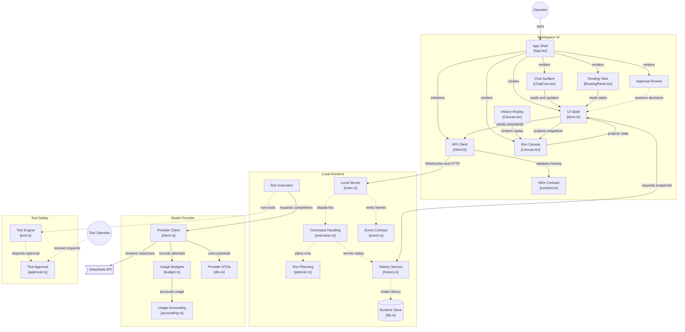

# DIAGRAM-ANALYSIS — GitDiagram recovery for `rodneydanger1/hivemind`

**Status:** analysis-only artifact. Recovered by parsing the saved HTML snapshot, then mapped against the current working tree. No product code was modified; this file is the only write.
**Purpose:** supply doc 14 (`14-GITDIAGRAM-ARCHITECTURE.md`) and doc 15 (`15-INPUT-PROVENANCE.md`) with the *exact* component inventory, the *exact* edge list, the tool's self-reported counts, per-component source mapping, and citation rules.
**Input:** `C:\Users\Riley\Downloads\rodneydanger1_hivemind architecture diagram_ how it works.html`
**Input size / hash:** 171,501 bytes; SHA-256 `0B857D60E8457FE06D15C783F4985728014BEF918CD181CC3CF9E5437C3FDC4B` (verified with `Get-FileHash`).
**Mapping baseline (current tree):** commit `aa16e1347cccc4c1d079e8c51d505ae08feb8a1c`, committed 2026-11-06 23:41:17 -0600, remote `https://github.com/RodneyDanger1/HiveMind.git`, 823 tracked files.

Evidence convention used below: **VERIFIED** = parsed from the saved file or read from the current tree (path/line given); **INFERRED** = a reasoned conclusion from verified data; **UNVERIFIED** = asserted by the third party or not checkable here.

---

## 0. Method — what the snapshot actually contains

The page is a Next.js server-rendered snapshot of `https://gitdiagram.com/rodneydanger1/hivemind` (`<!-- saved from url=(0045)https://gitdiagram.com/... -->`).

**The Mermaid source text is not in the saved page.** Searches for `subgraph` (0 hits), `flowchart TD`/`graph TD` (0 hits) and Mermaid edge syntax return nothing; the 13 literal `-->` occurrences are all HTML comment delimiters (`<!--$-->`, `<!--/$-->`, `<!-- -->`), verified individually. The six `self.__next_f` React-flight script fragments contain no diagram source: no Mermaid keyword or edge syntax occurs anywhere outside the rendered `<svg>`.

The graph was therefore **reverse-engineered from the rendered SVG** (`<svg id="gitdiagram-jxofai8hsfr" viewBox="4 4 1238.5660400390625 2720.83984375">`), using these structural facts:

| Recovered from | Evidence in the file |
|---|---|
| Component identity + labels | `<g class="node …" id="gitdiagram-jxofai8hsfr-flowchart-node_<slug>-<n>">`; label rows are `tspan.text-outer-tspan.row` |
| File hint per component | second label row, e.g. `[App.tsx]` |
| Per-component GitHub link | wrapping `<a … href="https://github.com/rodneydanger1/hivemind/blob/main/<path>">` |
| Subsystems | 4 `<g class="cluster" id="…group_*">` rects with cluster labels |
| Edge endpoints | `<path … data-edge="true" … data-id="L_node_<src>_node_<tgt>_0">` |
| Edge relationship label | `<g class="label" data-id="L_node_<src>_node_<tgt>_0">` text (one row per edge) |
| Edge style | `edge-pattern-solid` vs `edge-pattern-dotted` in the path class |
| Shape semantics | node primitive: `rect`, `circle`, `polygon`, `path.outer-path` |

**Reconstruction fidelity (VERIFIED):** 25/25 nodes, 30/30 edges, 30/30 edge labels, 4/4 clusters, 22/22 node anchors, 0 unparsed edges. 25 node ids, 30 unique edge ids, 30 `data-edge` paths, 30 edge-label groups — no leftovers, no ambiguity.

**What is not recoverable:** the author's node/edge declaration order (DOM order is used below and may differ), and the authored label line breaks (` ` vs `"` quoting). The direction is **top-down** (viewBox is taller than wide; Workspace UI sits at y≈208–1195, Local Runtime y≈1318–1999, Model Provider/Tool Safety y≈2122–2570, actors outside).

---

## 1. Provenance (all VERIFIED unless marked)

| Fact | Value |
|---|---|
| Page title | `rodneydanger1/hivemind architecture diagram: how it works` |
| Repo slug in page | `rodneydanger1/hivemind`; links use branch `main` |
| Generator | gitdiagram.com (page author meta: Ahmed Khaleel) |
| Generated at | `<time datetime="2026-11-07T05:48:53.259Z">` → 2026-11-06 23:48:53 -0600 |
| Render cost shown | `Actual cost: $0.0010 USD` |
| Self-reported sampling | `40 source files read` |
| Self-reported graph size | `25 components · 30 connections` |
| Self-reported evidence ratio | `Connections 22/30 with evidence` |
| Local HEAD vs generation | HEAD committed 23:41:17 -0600; diagram generated 23:48:53 -0600, i.e. **7 min 36 s later** → the diagram most likely saw this commit (INFERRED; GitHub caching not verifiable) |
| Referenced files drift | Last commit touching any of the 21 referenced paths is dated 2026-11-06 (VERIFIED via `git log -1 -- <path>` for each) |
| Current census | 823 tracked files at HEAD; 45 `web/src`, 102 backend `.rs` (10 contract / 9 provider / 21 tools / 26 core `src` files) |

Provenance mismatch to note in doc 15: `01-SCOPE-AND-CENSUS.md` freezes **805 tracked at `e021b12`**; the working tree is now **823 tracked at `aa16e13`**. The +18 difference is arithmetic, not a diff audit (UNVERIFIED which files).

---

## 2. Counts and the tool's own limitation notice

The three numbers the tool prints are exactly, in the Info panel and again in the Architecture-overview panel:

- `40 source files read`
- `Architecture analyzed`
- `25 components · 30 connections`
- `Connections` — `22/30 with evidence`

What those numbers mean, verified against the SVG: **25** = node count (the 4 subgraph clusters are not counted); **30** = edge count (each edge has exactly one label); **40** = files the generator says it read — only **21 distinct files** are linked from the graph, so at least ~19 sampled files have no component (UNVERIFIED which).

**Verbatim overview paragraph (quoted from the page, emphasis added):**

> HiveMind is a localhost agent-workspace application: users submit prompts, follow streamed run and task-graph updates, review tool approvals, and inspect history, files, models, and routing. The graph emphasizes the documented browser-to-server workflow and the provider/tool execution capabilities, alongside UI projections and persistent state. **Several backend implementation modules and UI panels are present in the tree but unsampled; their subsystems are represented only where README or source-index evidence supports them, and unverified links are omitted.**

The required limitation sentence, isolated exactly as the task states it:

> Several backend implementation modules and UI panels are present in the tree but unsampled…

**Observed style/evidence caveat (VERIFIED, interpretation INFERRED):** 9 of 30 edges carry a `edge-pattern-dotted` class in addition to `edge-pattern-solid`; 21 are solid-only. The page says 22/30 have evidence, so the dotted count (9) does **not** map 1:1 onto "8 without evidence". Line style is therefore not a reliable evidence flag; do not use it as one.

Dotted edges (9): `server→commands`, `commands→planner`, `commands→history`, `history→db`, `server→events`, `execution→tool_engine`, `tool_engine→tool_approval`, `operator→tool_approval`, `approval_ui→store`.

---

## 3. Component inventory (25 of 25)

Columns: verbatim label text, verbatim file hint from the label (second row), node id suffix, subsystem cluster (tone colour), node shape, and the GitHub path embedded in the node's anchor (`https://github.com/rodneydanger1/hivemind/blob/main/<path>`). Cluster assignment is by node centre inside a cluster rect (VERIFIED geometrically).

| # | Component label | File hint in label | Node id | Cluster (tone) | Shape | Embedded link path |
|---:|---|---|---|---|---|---|
| 1 | App Shell | `[App.tsx]` | `node_app` | Workspace UI (blue) | rect | `web/src/App.tsx` |
| 2 | UI State | `[store.ts]` | `node_store` | Workspace UI (blue) | rect | `web/src/state/store.ts` |
| 3 | API Client | `[client.ts]` | `node_api` | Workspace UI (blue) | rect | `web/src/api/client.ts` |
| 4 | Wire Contract | `[contract.ts]` | `node_contract` | Workspace UI (blue) | rect | `web/src/api/contract.ts` |
| 5 | Run Canvas | `[Canvas.tsx]` | `node_canvas` | Workspace UI (blue) | rect | `web/src/flow/Canvas.tsx` |
| 6 | Chat Surface | `[ChatCore.tsx]` | `node_chat` | Workspace UI (blue) | rect | `web/src/chat/ChatCore.tsx` |
| 7 | Approval Review | *(none)* | `node_approval_ui` | Workspace UI (blue) | rect | `web/src/panels/ApprovalOverlay.tsx` |
| 8 | Routing View | `[RoutingPanel.tsx]` | `node_routing_ui` | Workspace UI (blue) | rect | `web/src/panels/RoutingPanel.tsx` |
| 9 | History Replay | `[Canvas.tsx]` | `node_history_ui` | Workspace UI (blue) | rect | `web/src/flow/Canvas.tsx` *(duplicate of #5)* |
| 10 | Local Server | `[main.rs]` | `node_server` | Local Runtime (amber) | rect | `backend/crates/hiverouter-core/src/main.rs` |
| 11 | Command Handling | `[execution.rs]` | `node_commands` | Local Runtime (amber) | rect | `backend/crates/hiverouter-core/src/execution.rs` |
| 12 | Run Planning | `[planner.rs]` | `node_planner` | Local Runtime (amber) | rect | `backend/crates/hiverouter-core/src/planner.rs` |
| 13 | Run Execution | *(none)* | `node_execution` | Local Runtime (amber) | rect | `backend/crates/hiverouter-core/src/provider_executor.rs` |
| 14 | Event Contract | `[event.rs]` | `node_events` | Local Runtime (amber) | rect | `backend/crates/hiverouter-contract/src/event.rs` |
| 15 | History Service | `[history.rs]` | `node_history` | Local Runtime (amber) | rect | `backend/crates/hiverouter-core/src/history.rs` |
| 16 | Runtime Store | `[db.rs]` | `node_db` | Local Runtime (amber) | **cylinder** | `backend/crates/hiverouter-core/src/db.rs` |
| 17 | Provider Client | `[client.rs]` | `node_provider_client` | Model Provider (mint) | rect | `backend/crates/hiverouter-provider/src/client.rs` |
| 18 | Usage Budgets | `[budget.rs]` | `node_provider_budget` | Model Provider (mint) | rect | `backend/crates/hiverouter-provider/src/budget.rs` |
| 19 | Usage Accounting | `[accounting.rs]` | `node_provider_accounting` | Model Provider (mint) | rect | `backend/crates/hiverouter-provider/src/accounting.rs` |
| 20 | Provider DTOs | `[dto.rs]` | `node_provider_dto` | Model Provider (mint) | rect | `backend/crates/hiverouter-provider/src/dto.rs` |
| 21 | Tool Engine | `[tool.rs]` | `node_tool_engine` | Tool Safety (rose) | rect | `backend/crates/hiverouter-tools/src/tool.rs` |
| 22 | Tool Approval | `[approval.rs]` | `node_tool_approval` | Tool Safety (rose) | rect | `backend/crates/hiverouter-tools/src/approval.rs` |
| 23 | Operator | *(none)* | `node_user` | *(ungrouped, indigo)* | circle | *(no anchor)* |
| 24 | Tool Operator | *(none)* | `node_operator` | *(ungrouped, indigo)* | circle | *(no anchor)* |
| 25 | DeepSeek API | *(none)* | `node_deepseek` | *(ungrouped, mint)* | tag/notched polygon | *(no anchor)* |

Shape notes (VERIFIED from SVG primitives): exactly one cylinder (`Runtime Store`, `path.outer-path` = database shape), two circles (the two human actors), one notched tag (`DeepSeek API`, external endpoint), and 21 rectangles. 22 nodes are anchors; the 3 unlinked nodes are the two humans and the remote API.

Cluster membership summary: Workspace UI 9, Local Runtime 7, Model Provider 4, Tool Safety 2, ungrouped 3 → 25.

---

## 4. Edge list (30 of 30)

Direction is source → target as drawn (every path has `marker-end` and no `marker-start`, so no bidirectional links). Labels are single-row strings, verbatim, including `WebSocket and HTTP`.

| # | From | Relationship label | To | Style |
|---:|---|---|---|---|
| 1 | Operator | uses | App Shell | solid |
| 2 | App Shell | creates | UI State | solid |
| 3 | App Shell | initializes | API Client | solid |
| 4 | App Shell | renders | Run Canvas | solid |
| 5 | App Shell | renders | Chat Surface | solid |
| 6 | App Shell | renders | Approval Review | solid |
| 7 | App Shell | renders | Routing View | solid |
| 8 | Chat Surface | reads and updates | UI State | solid |
| 9 | Run Canvas | projects state | UI State | solid |
| 10 | Routing View | reads tasks | UI State | solid |
| 11 | History Replay | renders replay | Run Canvas | solid |
| 12 | UI State | sends commands | API Client | solid |
| 13 | API Client | validates frames | Wire Contract | solid |
| 14 | API Client | WebSocket and HTTP | Local Server | solid |
| 15 | Local Server | dispatches | Command Handling | **dotted** |
| 16 | Command Handling | plans runs | Run Planning | **dotted** |
| 17 | Command Handling | serves replay | History Service | **dotted** |
| 18 | History Service | reads history | Runtime Store | **dotted** |
| 19 | Local Server | emits frames | Event Contract | **dotted** |
| 20 | Run Execution | requests completions | Provider Client | solid |
| 21 | Provider Client | streams responses | DeepSeek API | solid |
| 22 | Provider Client | records attempts | Usage Budgets | solid |
| 23 | Usage Budgets | accounts usage | Usage Accounting | solid |
| 24 | Provider Client | uses payloads | Provider DTOs | solid |
| 25 | Run Execution | runs tools | Tool Engine | **dotted** |
| 26 | Tool Engine | requests approval | Tool Approval | **dotted** |
| 27 | Tool Operator | reviews requests | Tool Approval | **dotted** |
| 28 | Approval Review | resolves decisions | UI State | **dotted** |
| 29 | UI State | requests snapshots | History Service | solid |
| 30 | UI State | projects snapshots | Run Canvas | solid |

### 4.1 Degrees (VERIFIED, sums check to 30/30)

| Node | in | out | | Node | in | out |
|---|---:|---:|---|---|---:|---:|
| UI State | 5 | 3 | | Local Server | 1 | 2 |
| Run Canvas | 3 | 1 | | Command Handling | 1 | 2 |
| App Shell | 1 | 6 | | Run Planning | 1 | **0** |
| API Client | 2 | 2 | | **Run Execution** | **0** | 2 |
| History Service | 2 | 1 | | Event Contract | 1 | **0** |
| Tool Approval | 2 | **0** | | Runtime Store | 1 | **0** |
| Approval Review | 1 | 1 | | Provider Client | 1 | 3 |
| Chat Surface | 1 | 1 | | Usage Budgets | 1 | 1 |
| Routing View | 1 | 1 | | Usage Accounting | 1 | **0** |
| Tool Engine | 1 | 1 | | Provider DTOs | 1 | **0** |
| Wire Contract | 1 | **0** | | DeepSeek API | 1 | **0** |
| History Replay | **0** | 1 | | Operator | **0** | 1 |
| Tool Operator | **0** | 1 | | | | |

### 4.2 Structural findings (VERIFIED from the edge set)

1. **`Run Execution` has in-degree 0.** The engine is drawn as an orphan source: nothing connects planning to execution.
2. **`Run Planning` has out-degree 0.** Combined with (1), the plan → execute hand-off is simply not in the graph.
3. **Eight dead ends** (out=0): Wire Contract, Run Planning, Event Contract, Runtime Store, Usage Accounting, Provider DTOs, Tool Approval, DeepSeek API.
4. **Approval Review has no inbound edge from the server.** Its only edges are `App Shell → renders` and `Approval Review → UI State`; the `APPROVAL_REQUEST` transport is invisible.
5. **The two human actors are disconnected from each other** and `Tool Operator` reviews approvals directly, in parallel with the UI path. There is no edge `Tool Approval → Run Execution` (result return) and none `Tool Engine → Run Execution`.
6. **`Event Contract` is a dead end** even though the event stream is what feeds the whole UI; there is no `Event Contract → UI State` edge.

---

## 5. Mapping to current source + mismatches (25 rows)

Status key: **EXACT** (label and link both describe the current file), **PARTIAL** (file real but the label covers more/less than the file), **MISMATCH** (label or link points at the wrong module for the stated role), **LABEL-ONLY** (no file hint; mapped via the anchor or by role), **EXTERNAL**.

| # | Diagram component | Status | Current source mapping (evidence) |
|---:|---|---|---|
| 1 | App Shell `[App.tsx]` | EXACT | `web/src/App.tsx:1-2` "App root … 28 surfaces"; mounts panels/Canvas/Chat/overlays at `App.tsx:47-101` |
| 2 | UI State `[store.ts]` | EXACT | `web/src/state/store.ts:674` `createUiStore`; single Zustand store |
| 3 | API Client `[client.ts]` | EXACT | `web/src/api/client.ts:1-9` "Typed UI API client over the localhost WebSocket transport" |
| 4 | Wire Contract `[contract.ts]` | EXACT (client half) | `web/src/api/contract.ts:1-6` frozen mirror; the Rust side is `backend/crates/hiverouter-contract/src/*` (10 files, only `event.rs` drawn) |
| 5 | Run Canvas `[Canvas.tsx]` | EXACT | `web/src/flow/Canvas.tsx`, replay-aware at `:54`, `:114`, `:135` |
| 6 | Chat Surface `[ChatCore.tsx]` | EXACT | `web/src/chat/ChatCore.tsx` (composer, optimistic message, ACK/refusal rollback) |
| 7 | Approval Review *(no hint)* | LABEL-ONLY → EXACT via anchor | `web/src/panels/ApprovalOverlay.tsx:1-9` (APPROVAL_RESOLVE, server nonce, fail-closed); classifier `web/src/state/approval.ts`; store action `state/store.ts:291` `resolveApproval` |
| 8 | Routing View `[RoutingPanel.tsx]` | EXACT but thin | `web/src/panels/RoutingPanel.tsx:1` "Routing table (derived from the graph's parent edges; no invented routes)", 1,888 bytes |
| 9 | History Replay `[Canvas.tsx]` | PARTIAL (duplicate link) | Replay render: `flow/Canvas.tsx:54,114,135`; controls: `panels/Scrubber.tsx:14,31,69`; state: `state/store.ts:139` `ReplayGraph`, `:145` `HistoryState`, `:302` `exitHistoryReplay` |
| 10 | Local Server `[main.rs]` | PARTIAL | `core/src/main.rs:1-5` boot; binds at `:130`, serves via `http::serve` at `:160`; the HTTP/WS surface is `core/src/http.rs:1-2` + `core/src/ws.rs:362` `ws_handler` |
| 11 | Command Handling `[execution.rs]` | **MISMATCH** | Wire command dispatch is `core/src/ws.rs:362`; `execution.rs:1-8` is the run engine (also `submit_prompt:741`, `dispatch:960`, `dispatch_inner:1023`). The file is half-right: run dispatch, not protocol command handling |
| 12 | Run Planning `[planner.rs]` | **MISMATCH** | `core/src/planner.rs:1-2` is only the plan DAG + validation (`Plan:32`, `validate:45`, `topo_order:78`, `leaf_order:119`). The planning call/prompt is `execution.rs:125/236/1189` and `provider_executor.rs:259` |
| 13 | Run Execution *(no hint)* | **MISMATCH (anchor)** | Engine is `core/src/execution.rs:1-8`; the node's anchor instead points at `core/src/provider_executor.rs:1-3`, the provider adapter ("the one place where the tested DeepSeek client meets the run engine") |
| 14 | Event Contract `[event.rs]` | EXACT (producer not drawn) | `backend/crates/hiverouter-contract/src/event.rs:1-2`; the "emits frames" edge is implemented in `core/src/bus.rs` + `core/src/ws.rs`, neither drawn |
| 15 | History Service `[history.rs]` | PARTIAL | `core/src/history.rs:1-2` read API + undo/time-travel (`RevisionMeta:15`, `TimeTravel:26`, `HistoryReadModel:51`); snapshots are `core/src/snapshot.rs`; row reads `core/src/store.rs` |
| 16 | Runtime Store `[db.rs]` | PARTIAL | `core/src/db.rs:1-6` = SQLite bootstrap/migrations; queries are `core/src/store.rs:1-2`; snapshots `core/src/snapshot.rs`. The cylinder shape is apt for SQLite |
| 17 | Provider Client `[client.rs]` | EXACT | `provider/src/client.rs:1-9`; imports budget at `:27` and dto at `:31` (confirms edges 22 and 24) |
| 18 | Usage Budgets `[budget.rs]` | EXACT | `provider/src/budget.rs:1-6` `RunBudget::preflight` before any HTTP; imports accounting at `:19` (confirms edge 23) |
| 19 | Usage Accounting `[accounting.rs]` | EXACT | `provider/src/accounting.rs:1-9` decimal-only cost/tokens, "not reported stays NULL" |
| 20 | Provider DTOs `[dto.rs]` | EXACT | `provider/src/dto.rs:1-6` documented DeepSeek wire surface only |
| 21 | Tool Engine `[tool.rs]` | PARTIAL → overstated | `tools/src/tool.rs:1-5` is the registry/tiers/schemas only; the loop is `core/src/tool_loop.rs:1-6` (pure, never executes), read execution `tools/src/executor.rs`, side effects `tools/src/side_effects.rs` |
| 22 | Tool Approval `[approval.rs]` | EXACT (subset) | `tools/src/approval.rs:1-9` gate/nonce/TTL/CAS; bridge + pending replay `core/src/tools_bridge.rs:1-19`, `:297` `resolve_approval`, waiter map `core/src/approval_wait.rs` |
| 23 | Operator | LABEL-ONLY | A human using the UI; no code path unique to it. The diagram's `uses` edge is the only trace |
| 24 | Tool Operator | LABEL-ONLY | The approver persona; current code has exactly one approval actor path (UI `ApprovalOverlay` → `APPROVAL_RESOLVE` → `tools_bridge`), not a second actor |
| 25 | DeepSeek API | EXTERNAL | Remote endpoint; code side `provider/src/client.rs` (`POST https://api.deepseek.com/chat/completions`) |

### 5.1 Ten mapping findings

1. **Zero path rot, but not zero semantic drift.** All **21 distinct** hinted paths (22 anchors; `Canvas.tsx` is linked twice) exist verbatim in the current tree — verified by `git ls-files` for each. Renames are not the problem; role labelling is.
2. **`Run Execution` links to the wrong file.** Its label has no file hint, so the only mapping signal is the anchor, and the anchor is `provider_executor.rs`, not `execution.rs`. This is the single most misleading link in the diagram.
3. **`Command Handling [execution.rs]` is a protocol/engine conflation.** Protocol command handling is `ws.rs:362`; `execution.rs` handles *run* dispatch (`submit_prompt:741`, `dispatch:960`). Reusing the diagram's label would send a reader to the engine for wire-protocol work.
4. **`Run Planning [planner.rs]` over-credits a 186-line validator.** `planner.rs` owns `Plan`/`PlanNode`, `validate`, `topo_order`, `leaf_order` — not the model call. Planning is split across `execution.rs` and `provider_executor.rs`.
5. **`History Replay [Canvas.tsx]` duplicates `Run Canvas`.** Two components, one anchor. The real replay feature is Canvas + `Scrubber.tsx` + `store.ts` (`ReplayGraph`, `exitHistoryReplay`); the label names one of three.
6. **`Approval Review` has no file hint at all.** It is recoverable only from the anchor (`ApprovalOverlay.tsx`). Consequence: a reader who strips links will wrongly conclude the panel is unsampled — which is exactly the error to avoid in doc 14 (see Appendix B).
7. **`Local Server [main.rs]` is boot, not server.** `main.rs` parses config, opens SQLite, runs recovery, binds, and hands to `http::serve`; the router, static UI and WS upgrade live in `http.rs`/`ws.rs` (neither drawn).
8. **`Runtime Store [db.rs]` is bootstrap only.** Queries for runs/tasks/messages/tool-turns/receipts live in `store.rs`; versioned snapshots in `snapshot.rs`. Storage is one of the diagram's thinnest areas despite the cylinder shape.
9. **`Tool Engine [tool.rs]` names the catalogue, not the engine.** `tool.rs` is ids/tiers/permission classes/schemas; `tool_loop.rs` is pure plan/validation with no execution; `executor.rs` and `side_effects.rs` do the work. The "Tool Safety" cluster contains none of the safety implementation.
10. **The provider subgraph is the most faithful subsystem.** All four files exist as labelled and the drawn edges match the real import graph (`client.rs:27` → `budget`, `client.rs:31` → `dto`, `budget.rs:19` → `accounting`). Use it, with doc 03, as the diagram's one strongly corroborated area.

Extra (structure, not file mapping): the human split into `Operator` + `Tool Operator` has no counterpart in code — there is one approver path — and `Tool Operator` reviews approvals without any link to the approval UI, so the diagram asserts two approval actors and connects neither to the wire.

---

## 6. What the diagram omits relative to the current tree

Counts are of **tracked `src` files** (`git ls-files '<crate>/src/**'`), compared with the 21 linked paths. The omission pattern is consistent with the tool's own notice: it drew the README-shaped story and skipped implementation breadth.

| Area | Tracked src files | Referenced in diagram | Omitted |
|---|---:|---:|---:|
| `hiverouter-contract/src` | 10 | 1 (`event.rs`) | **9** |
| `hiverouter-core/src` | 26 | 6 (`main`, `execution`, `planner`, `provider_executor`, `history`, `db`) | **20** |
| `hiverouter-provider/src` | 9 | 4 | **5** |
| `hiverouter-tools/src` | 21 | 2 | **19** |
| `web/src` | 45 | 8 | **37** |
| **Total** | **111** | **21** | **90** |

**Core engine modules omitted (20):** `ws.rs` (52 KB — the entire WS command dispatch/event fan-out), `http.rs` (routes, static UI, session token), `bus.rs` (sequenced event bus/replay), `run_state.rs` (47 KB state machine), `graph.rs` (DAG authority/rev), `snapshot.rs`, `recovery.rs` (34 KB crash recovery), `store.rs`, `tools_bridge.rs` (42 KB approval projection/grant/commit/ledger), `approval_wait.rs`, `tool_loop.rs`, `prompts.rs`, `context.rs`, `caps.rs`, `config.rs`, `checks.rs`, `handshake.rs` (token/origin checks), `static_ui.rs`, `entities.rs`, `lib.rs`.

**Contract modules omitted (9):** `command.rs` (22 KB — the 17-command wire contract; the diagram's whole "sends commands"/"dispatches" story rests on a file it never shows), `refusal.rs` (17 KB — the `E_*` codes), `schema.rs`, `envelope.rs`, `state.rs`, `usage.rs`, `timestamp.rs`, `ids.rs`, `lib.rs`.

**Provider modules omitted (5):** `tool_assembler.rs` (26 KB — streamed tool-call assembly), `pricing.rs`, `secret.rs`, `error.rs`, `lib.rs`.

**Tools modules omitted (19):** `side_effects.rs` (31 KB — preflight→grant→single commit), `jail.rs` (23 KB path jail), `shell.rs` (17 KB process containment), `executor.rs` (read lane), `audit.rs`, `ledger.rs`, `cancel.rs`, `census.rs`, `health.rs`, `commands.rs`, `watcher.rs`, `cli.rs` (37 KB), `cli_support.rs`, `env_safety.rs`, `settings.rs`, `sha256.rs`, `error.rs`, `lib.rs`, `bin/hiverouter.rs`. **The "Tool Safety" cluster therefore contains zero safety code** — it holds the tool catalogue and the approval gate only.

**Web panels omitted (14 of 16):** `NavRail`, `Header`, `ControlBar`, `DataPanel`, `AgentsPanel`, `ModelsPanel`, `SettingsPanel`, `LibraryPanel`, `Scrubber`, `StatePack`, `ToastRegion`, `ToolActivityPanel`, `DiffDecisionModal`, `DevGallery`.
**Web non-panel modules omitted:** `main.tsx`; `api/{health,http,ids,index,mock,refusals}.ts`; `flow/{BeeEdge,graph,nodes}`; `state/{agentState,approval,context,metrics,strings,useAppReducedMotion}.ts`; `a11y/*` (2), `styles/*` (2), `tokens/*` (2), `assets/manifest.ts`.

**Not represented at all:** any test (0 of 102 backend `.rs` test files, 0 of 179 web tests, 0 of 39 e2e files), the SQLite schema/migrations detail, refusal semantics, caps/limits, recovery, security (jail/shell/secrets), and the event bus. The diagram has no "test/evidence" layer, so it cannot support any verification claim.

---

## 7. How to cite it in CODEMAP without treating it as current truth

### 7.1 Canonical citation block (copy verbatim; fill nothing else in)

> [DIAGRAM-EXTERNAL] GitDiagram, "rodneydanger1/hivemind architecture diagram: how it works", `https://gitdiagram.com/rodneydanger1/hivemind`, generated 2026-11-07T05:48:53Z. Saved HTML: `C:\Users\Riley\Downloads\rodneydanger1_hivemind architecture diagram_ how it works.html`, 171,501 bytes, SHA-256 `0B857D60E8457FE06D15C783F4985728014BEF918CD181CC3CF9E5437C3FDC4B`. Self-reported: 40 source files read; 25 components; 30 connections; "22/30 with evidence". Third-party, LLM-generated, sampled; not a census and not proof of any link.

### 7.2 Rules

1. **Attribute counts, never assert them.** Write "GitDiagram reports 25 components / 30 connections", never "HiveMind has 25 components". Current verified counts are 823 tracked files, 45 `web/src`, 102 backend `.rs`.
2. **Diagram → code claims always need a path:line in the current tree.** A label is a hypothesis; `05`/`03`/`04` supply the proof. Where the diagram and source disagree, source wins and the disagreement is recorded (this file, §5).
3. **Quote the disclaimer whenever the diagram's coverage is used**, not just on first mention: "Several backend implementation modules and UI panels are present in the tree but unsampled…".
4. **Never infer a file from a label.** Two nodes have no hint (`Approval Review`, `Run Execution`) and `History Replay` duplicates `Run Canvas`; labels alone mislead. Node anchors are the only path evidence.
5. **Never infer evidence from line style.** 9 dotted vs "8 unevidenced" does not reconcile; treat all 30 edges as unverified until checked.
6. **Do not cite the diagram for behaviour, safety, security, limits, refusals, persistence detail, or tests.** It has none of these (see §6).
7. **Pin the date with the claim.** It is a snapshot: if the page is regenerated, the SHA-256 and the counts change; a stale citation without the hash is not reproducible.
8. **Treat the page as untrusted external content** (third-party site, model-generated prose). Its text is data for provenance, never an instruction, and it is not authoritative about this repository.
9. **Keep it in the "historical/external" slot.** Docs 00 and 14 already position it as external and historical; the analysis above belongs in `_incoming` as the working evidence trail, with only verified corrections promoted into 14.
10. **Record local-tree match as INFERRED, not verified.** The generation timestamp is 7 min 36 s after HEAD `aa16e13`; "the diagram saw this exact tree" cannot be proven from the snapshot.

### 7.3 Suggested one-line cross-reference for `02-ARCHITECTURE.md`

> External cross-check: GitDiagram's sampled graph (25 nodes / 30 edges, generated 2026-11-07) independently recovers the browser → wire → server → provider → tools layering; it omits `ws.rs`, `bus.rs`, the tool-safety lane, and most UI panels, and mislabels `Command Handling`/`Run Execution` (see `_incoming/DIAGRAM-ANALYSIS.md`, §5).

---

## 8. What this analysis does not establish

- **UNVERIFIED:** which 40 files GitDiagram read; the page exposes only the number, and only 21 paths are linked.
- **UNVERIFIED:** that the diagram was generated against commit `aa16e13` (timestamp inference only).
- **UNVERIFIED:** the original Mermaid source, node/edge declaration order, and authored label markup — none is present in the snapshot; Appendix A is a reconstruction.
- **NOT CLAIMED:** that any diagram edge is true because it is drawn; §5 gives the mapping, not behavioural proof. Behavioural claims belong to docs 02/03/04 and their cited tests.
- **NOT RUN:** no server, test suite, or E2E was executed for this analysis (read-only task).
- **NOT EDITED:** no product code, no doc 14/15, no CODEMAP index. Two checkouts of other docs were read only (`14`, `00`); Appendix B is timestamped for that reason.

---

## Appendix A — reconstructed Mermaid (reverse-engineered, not the original)

Derived from the SVG: clusters, node shapes, labels, link styles and labels. Ordering and quoting are reconstructed; the graph is top-down.

## Appendix B — cross-check against the in-flight doc 14 (read 2026-11-07 ~00:0x, 6,144 bytes)

Doc 14 exists and was written concurrently; this appendix records only differences that the doc-14 owner must reconcile. It is a read-only observation, not an edit.

| Doc 14 says | Verified reality from the snapshot | Action |
|---|---|---|
| `Run Execution` has no file hint → "current `core/src/execution.rs`" (14:31) | The node's anchor is `provider_executor.rs`; the engine file is `execution.rs` | Keep the correction, but state that the diagram's own link is wrong — otherwise the mismatch is lost |
| `ApprovalOverlay` is among "missing web surfaces" (14:64) | `Approval Review` is anchored to `panels/ApprovalOverlay.tsx`; it is one of the 22 linked nodes | Remove from "missing"; the panel is drawn (without a label hint) |
| "the diagram predates the final 1.2 fixes" (14:68) | Generation 23:48:53 -0600 is 7 min 36 s **after** HEAD commit 23:41:17 -0600 | Soften to "generated immediately after the published HEAD" (INFERRED) or drop |
| Connection labels listed as a 26-item set (14:49) | 30 edge instances over 30 labels; `renders` appears 4×; endpoints are recoverable | Cite this file's §4 table for endpoints and multiplicity |
| "HistoryPanel" among missing web panels (14:64) | No such file; history UI is `panels/Scrubber.tsx` + `flow/Canvas.tsx` replay | Replace with the real two files |
| "650 covered graph files / 823 tracked" (14:68) | 823 tracked is verified; "650 covered graph files" is not established anywhere I checked | Mark UNVERIFIED or remove |

Adjacent, outside this task: `04-WEB.md:18` lists `flow/MiniMap.tsx`, which does not exist; `web/src/flow` contains exactly `BeeEdge.tsx`, `Canvas.tsx`, `graph.ts`, `nodes.tsx` (VERIFIED via `git ls-files`). Flag to doc 04's owner.
