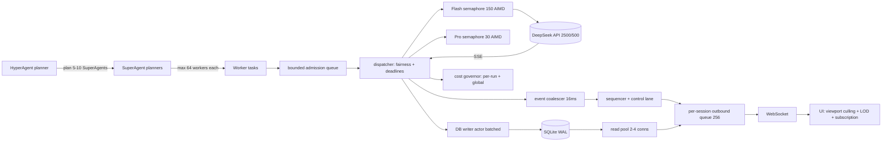

# 03 — Scale and concurrency: 50–150 concurrently active agents, 300–600 tasks under a HyperAgent

**Status:** RESEARCH COMPLETE — read-only pass. No product source was edited, no paid API was called.
**Research date:** 2026-11-07 (America/Chicago).
**Repository read:** `hiverouter-v1`, HEAD `bd575ba` (1.2 pre-release source line; `README.md` version-truth note).
**Documentation pin:** `version_pinned: false`; `version_source: https://api-docs.deepseek.com/updates/`; newest documented change **2026-10-17**. The DeepSeek docs are live/unversioned, so every provider fact below is dated 2026-11-07 and can rot.
**Evidence basis:** official docs fetched in this session (HTTP 200, quoted below); local source read at `path:line`; one local SQLite throughput measurement run on this host (command and output quoted in §5.3). No load test against the live provider was run — no credential was used and no paid call was made.

---

## 0. One-screen answer

| # | Question | Answer | Basis |
|---|---|---|---|
| 1 | Is the DeepSeek provider the thing that stops 50–150 concurrent agents? | **No.** The account may hold **2,500** in-flight `deepseek-flash` requests and **500** `deepseek-v4-pro`. 150 agents with one call each use **6.0%** of the Flash allowance (150/2500) or **30%** of the Pro allowance (150/500). | VERIFIED (docs), arithmetic |
| 2 | Does Rust alone make 300–600 tasks possible? | **No.** Rust removes thread/GC cost, not serialization points. Today a process-wide semaphore of **8**, one `Mutex<Connection>`, one 1,024-slot broadcast ring, a single active run, and a 64-agent cap each bind *before* the provider does. | READ + arithmetic |
| 3 | What binds first at 150 agents? | The **8-permit** in-flight limiter: 150/8 = **18.75x** below the requirement. Then per-fragment event fan-out (6,000 events/s vs a 171 ms ring), then the single SQLite connection, then browser frame budget. | READ + arithmetic |
| 4 | Is cost the blocker? | **No, but the caps are.** A 600-task sweep at 1 call/task is **$1.66** (Flash peak) to **$6.65** (Pro peak), half off-peak. The current per-run caps (**$0.50**, **400k tokens**, **40 calls**, **64 agents**) refuse that workload before the money matters. | VERIFIED prices + arithmetic |
| 5 | Can a single 16K-token planner call even emit 600 task nodes? | **No.** At an estimated 100–250 output tokens per plan node, 16,384 output tokens buy roughly **65–160 nodes**. 300–600 tasks require hierarchical planning (HyperAgent -> SuperAgents -> Workers), not one bigger JSON blob. | ESTIMATED + READ |
| 6 | What is the minimum architecture? | Seven bounded components: admission scheduler, adaptive provider limiter, single-writer DB actor + read pool, two-lane event pipeline with delta coalescing, per-session bounded outbound queue, two-level cost governor, viewport-culled/LOD graph UI — plus an offline load harness that proves each bound. | §11, §13 |
| 7 | What must *not* change? | Single local binary, SQLite, one API key, typed refusals, at-most-once effects. None of the required fixes needs Postgres, Redis, NATS, or a second process. | §11.4 |

**The honest headline:** 300–600 tasks under a HyperAgent is achievable on this stack, but not by "using Rust" and not by raising one constant. It needs bounded admission, a serialized-writer DB, coalesced fan-out, a coalescing outbound transport, a two-level budget, and a culled graph UI. Each of those is a small, testable change; together they are the difference between 8 and 150 concurrent calls (18.75x) and between 64 and 600 agents (9.4x).

---

## 1. How to read this document

| Label | Meaning | Test a reader can apply |
|---|---|---|
| **VERIFIED** | Quoted from an official/primary source fetched in this session, or produced by a command whose exact output is shown here. | The URL or command is in the row; the sentence is traceable to it. |
| **READ** | Read in this repository at the given `path:line`. Behaviour of *this* tree, not a claim about the world. | Open the path and line. |
| **ESTIMATED** | Arithmetic over stated assumptions; the assumptions are named adjacent to the number. | Change an assumption, recompute; the method is visible. |
| **UNKNOWN** | Not documented, not measured, or not reachable in this pass. Never to be used as a design constant. | The row says what evidence would resolve it. |

Arithmetic conventions used throughout:

- Token prices are **USD per 1,000,000 tokens**, as documented.
- "384K max output" is expanded as 384 x 1024 = **393,216 tokens** when a single number is needed; the docs state the limit as 384K, so 384K is used for arithmetic and 393,216 only as its binary expansion.
- Concurrency means **in-flight provider requests**, not tasks and not agents.
- "Active agent" means an agent that currently holds an in-flight model call, a running tool, or runnable CPU work. An agent waiting on approval, a timer, or a dependency is *not* active and costs no permit.
- Percentages are rounded to one decimal; ratios are kept exact where they carry the argument.

---

## 2. The provider envelope (DeepSeek official docs)

### 2.1 Documented facts

| # | Fact | Value / wording | Source |
|---|---|---|---|
| D1 | Per-account concurrency limit | `deepseek-flash` **2500**, `deepseek-v4-pro` **500** | https://api-docs.deepseek.com/quick_start/rate_limit |
| D2 | What counts as concurrent | "A request counts as one concurrent connection from the time it is sent until the model response is complete" | same |
| D3 | Scope | "Concurrency limits are calculated at the account level, regardless of which API Key is used" | same |
| D4 | Over-limit behaviour | "when the concurrency limit is exceeded, you will receive an HTTP 429 error code" | same |
| D5 | Expansion path | Capacity-expansion request form; "We will match the appropriate concurrency based on your actual business needs. There is no additional cost" | same |
| D6 | `user_id` isolation | For accounts with increased quotas, per-`user_id` limits are also 2500 / 500; empty id is a special `user_id`; recommended charset ASCII letters/digits/`_`/`-`, <= 512 UTF-8 bytes | same |
| D7 | Keep-alive while queued | Non-streaming: empty lines; streaming: SSE `: keep-alive` comments. "If the request has not started inference after 10 minutes, the server will close the connection." | same |
| D8 | Error taxonomy | 400 invalid format, 401 auth, 402 balance, 422 invalid parameters, 429 rate limit ("sending requests too quickly, or have exceeded a concurrency or QPS limit"), 500 server error (retry), 503 overloaded (retry) | https://api-docs.deepseek.com/quick_start/error_codes |
| D9 | Context / max output | Context length **1M**; max output "**MAXIMUM: 384K**" for both models | https://api-docs.deepseek.com/quick_start/pricing |
| D10 | Prices (USD / 1M tokens) | Flash: cache-hit 0.003 off-peak / 0.006 peak; cache-miss 0.15 / 0.30; output 0.6 / 1.2. Pro: cache-hit 0.022 / 0.044; cache-miss 0.66 / 1.32; output 1.98 / 3.96 | same |
| D11 | Peak windows | 01:00–04:00 and 06:00–10:00 **UTC**, Monday–Friday, excluding Chinese public holidays; "Off-peak rates are half of the peak rates" | same |
| D12 | Token/char ratio | "1 English character ~ 0.3 token", "1 Chinese character ~ 0.6 token" | https://api-docs.deepseek.com/quick_start/token_usage |
| D13 | Newest change | 2026-10-17: V4.1-Flash-1017, search API opened; "API calling method and pricing remain unchanged" | https://api-docs.deepseek.com/updates |

### 2.2 What these numbers do and do not mean

**D1 is not a task budget.** 600 tasks executed three calls each is 1,800 *sequential* requests. Concurrency limits how many can be in flight at once, never how many total may run. A 600-task sweep at 150 in-flight and a 20 s mean call is 1,800/7.5 = **240 s** of pure model time (Little's Law, §10.2), i.e. far inside any account's patience; the account limit is irrelevant at that concurrency.

**D4 + D8 are the only backpressure signals.** The docs do not document a token-per-minute limit, a per-request QPS number, a queue-depth header, or a `Retry-After` header. The repository already reads `Retry-After` (`backend/crates/hiverouter-provider/src/budget.rs:retry_after_from_header_value`), which is a reasonable engineering choice but **not** a documented contract — see UNKNOWN U2.

**D7 has a hard consequence for long calls.** A request that has not started inference within 10 minutes is closed by the server. With a 150-permit limiter that queues deeply, a queued request can burn 10 minutes of wall-clock before it is even admitted by the provider — the local limiter must therefore also enforce an *admission deadline*, not only a permit count. A local queue that waits 10+ minutes produces an inevitable failure that looks like a provider bug.

**D5 changes the calculus of the design.** Because the limit is 2,500 (not 250), the correct local posture is *politeness and observability*, not extreme rationing: run well under the account ceiling, treat 429 as the only authoritative signal, and use a feedback loop (AIMD) rather than a hard-coded constant.

### 2.3 UNKNOWNs in the provider envelope

| ID | Unknown | Why it matters | What would resolve it |
|---|---|---|---|
| U1 | Token-per-minute (TPM) ceilings per model/account | A 600-task sweep can be inside the 2,500 concurrency limit and still be throttled by aggregate token rate | Provider docs; a measured 429 rate under a controlled ramp |
| U2 | Whether 429 carries `Retry-After`, and its units | Current code parses integer seconds and caps at 60 s; if the header is absent or HTTP-date, backoff falls back to jittered exponential | A captured 429 header set from a controlled paid ramp, or provider confirmation |
| U3 | Account-specific tier | Docs say 2500/500, D5 says expansion exists; the actual account's tier is not knowable from the repo | `GET /models` does not report concurrency; the platform console does |
| U4 | Behaviour when the provider queue is full but concurrency is not exceeded (503 vs 429 vs silent queue) | Determines retry policy and whether 503 should be retried | Docs say 503 "retry after a brief wait"; frequency is undocumented |
| U5 | Real token throughput per stream (tokens/s) for this account/model/effort | Event rate arithmetic in §6 depends on it | A measured live run (explicitly out of scope here) |

---

## 3. The local ceilings that actually bind today (READ)

These are the numbers this tree enforces *before* any provider limit is reached. Every row is a read fact, not a hypothesis.

| # | Ceiling | Current value | Exact location | Effect at the 150-agent / 600-task target |
|---|---|---|---|---|
| L1 | In-flight provider requests, process-wide | **8** | `backend/crates/hiverouter-provider/src/budget.rs:43` (`IN_FLIGHT_LIMIT`); limiter created once per client at `client.rs:53-65`; acquired at `client.rs:380` and `client.rs:569` | 150 concurrent calls need 150 permits; the app can hold 8. **18.75x short.** All other calls queue behind `acquire().await`. |
| L2 | Agents per run | **64** | `budget.rs:40` (`AGENT_LIMIT`), defaulted into `RunCaps` at `budget.rs:450-452`; enforced at `execution.rs:1091` and `execution.rs:1358` | 300–600 tasks per HyperAgent is refused with `E_AGENT_LIMIT` at task 65. **4.7x–9.4x short.** |
| L3 | Calls per run | **40** | `budget.rs:31` (`CALL_CAP`) | 600 tasks x 1 call = 600 calls minimum. **15x short** even before retries. |
| L4 | Token budget per run | **400,000** combined | `budget.rs:28` (`TOKEN_BUDGET_COMBINED`) | 600 tasks x ~6,000 prompt tokens = 3,600,000. **9x short** (§8.2). |
| L5 | Cost cap per run | **$0.50** | `budget.rs:25` (`RUN_COST_CAP_USD_CENTS = 50`) | 600-task sweep costs $1.66–$6.65 (§8.2). **3.3x–13.3x short.** |
| L6 | Concurrent runs | **1** | `execution.rs:1032` returns `Refusal::RunActive` when a run is active; `active_run()` at `execution.rs:637` | A second HyperAgent cannot start while one is active. Fine for the stated single-HyperAgent goal; a limit for multi-project use. |
| L7 | Database connections | **1**, behind `std::sync::Mutex<Connection>` | `backend/crates/hiverouter-core/src/db.rs:297`, `:317-321`, `:348-350` | Every read and every write in the process serializes on one mutex; WAL's reader concurrency is configured (`:339-343`) but cannot be used. |
| L8 | Event fan-out | **1,024** broadcast slots, **256** replay events | `backend/crates/hiverouter-core/src/bus.rs:20-22` | At 6,000 events/s: 171 ms of live slack, **43 ms** of replay (§6.2). Any pause longer than that forces a resync. |
| L9 | Delta publishing granularity | **one event per streamed fragment** | `execution.rs:1769-1795` (`reply_delta_sink` publishes every non-empty delta) | 150 streaming agents x 40 tokens/s = 6,000 events/s, each with its own sequence number, replay push, and per-session JSON encode (§6.2). |
| L10 | UI graph rendering | **all nodes and edges** | `web/src/flow/Canvas.tsx:351-435` passes `nodes`/`edges` and does **not** pass `onlyRenderVisibleElements` (prop exists in `@xyflow/react` 12.12.1; verified in the installed type declarations) | 600 cards x ~30 DOM elements each = ~18,000 elements, re-laid-out on store changes; see §9. |
| L11 | Planner output per plan | **16,384** tokens (default) | `backend/crates/hiverouter-core/src/config.rs:18` (`DEFAULT_PLANNER_MAX_TOKENS`), used at `config.rs:64` | Single-shot planning cannot enumerate 300–600 nodes (§10.4). |

**Read this table as a budget, not a bug list.** Each row is one bound that a 300–600-task run must be re-tuned or replaced; none of them is repaired by language choice.

---

## 4. Rust/Tokio: what is cheap, what is bounded, and what Rust does not fix

### 4.1 Verified runtime facts

| # | Fact | Consequence for this design | Source |
|---|---|---|---|
| T1 | `Semaphore` is **fair**: "permits are given out in the order they were requested"; cancelling an `acquire` "makes you lose your place in the queue" | A single global permit queue gives FIFO fairness across runs, but a cancelled 10-minute-deadline request must not be allowed to hold a place it no longer needs. Queue depth is a first-class metric. | https://docs.rs/tokio/latest/tokio/sync/struct.Semaphore.html |
| T2 | `Semaphore::MAX_PERMITS` is `usize::MAX >> 3`; `new(permits)` panics above it | Not a practical limit at 150–2,500 permits; the constant is a non-issue. | same |
| T3 | `broadcast` is a bounded ring; capacity is rounded **up to the next power of two**; a slow receiver gets `RecvError::Lagged(n)` and its cursor advances to the oldest retained value; lagging does **not** disconnect | The bus's `FANOUT_CAPACITY = 1_024` is exactly 1,024 slots (already a power of two). A slow session loses events by design, so the system must make loss recoverable cheaply. | https://docs.rs/tokio/latest/tokio/sync/broadcast/index.html |
| T4 | `spawn_blocking` grows threads to a configured cap, then **queues**; the cap is "very large by default"; `abort()` has **no effect** on a running blocking task; runtime shutdown "will wait indefinitely" for started blocking tasks | A blocking SQLite call parked behind `busy_timeout = 5_000` can occupy a blocking thread for 5 s and cannot be cancelled; the semaphore that protects the DB must be sized and the timeout must be short. | https://docs.rs/tokio/latest/tokio/task/fn.spawn_blocking.html |

### 4.2 The cost of 150–600 tasks in Tokio is not the problem

An async task in Tokio is a heap-allocated future plus its buffers, not an OS thread. A reasonable estimate for a task that holds a 6 KB prompt, a streaming buffer, and a handful of small structs is **20–100 KB**; 600 tasks is therefore **12–60 MB** of live futures (600 x 20 KB = 12 MB; 600 x 100 KB = 60 MB). That is a rounding error on any machine that can run this product. **ESTIMATED**, and the estimate is deliberately generous.

The correct conclusion is *not* "Rust makes it easy". It is: **task count is not the constraint; the constraint is every place where tasks serialize**. Rust gives you cheap concurrency and no GC pauses; it does not give you a second SQLite writer, a wider broadcast ring, or a 60 fps browser.

### 4.3 What must be bounded, explicitly

| Bound | Today | Required property | Failure if unbounded |
|---|---|---|---|
| Provider permits | 8 global | Per-model semaphore, sized below the account limit (e.g. 150 Flash / 30 Pro), plus an **admission deadline** (< 10 min, per D7) | Queue grows without limit; requests expire provider-side; memory holds 600 pending futures |
| Queue | none (semaphore wait) | Bounded queue with refusal-at-capacity (`E_QUEUE_FULL`), depth metric, and age metric | Unbounded memory, invisible latency, no honest refusal |
| Task spawns per run | 64 agents, depth 3, fanout 8 | Raise caps deliberately with a plan-size budget, not by editing one constant | Fan-out explosion; 8 children x depth 3 = up to 584 structural nodes before any leaf work |
| Blocking DB work | direct calls on the calling task | Writer actor for writes; read pool for reads; no `rusqlite` call on an async worker | Worker threads parked on `busy_timeout` for 5 s; whole server stalls (§5.4) |
| Cancellation | one token per run, per-task tokens | Tree-shaped cancellation, per-call timeouts, idempotent settle | A cancelled 600-task run keeps 150 in-flight HTTP bodies alive |
| Retries | 3 attempts | Retry budget per run and globally; 429-aware AIMD; no retry after first byte | Retry storms multiply both concurrency and cost |

### 4.4 The scheduler the numbers imply

A workable shape, all in-process:

```
admission queue (bounded, mpsc)
   -> dispatcher task (single writer of "who runs next")
      -> provider permit (Semaphore, per model class, AIMD-adjusted)
         -> one provider call (cancellable, deadline, budget-checked)
            -> result -> DB writer actor (batched)
            -> events -> coalescer -> per-session outbound queue
```

Two properties matter more than the diagram:

1. **Fairness across runs.** Tokio's semaphore is globally FIFO, so a run that enqueues 600 tasks first will starve a second run. A per-run permit allocation (deficit round-robin, e.g. each run gets `max(1, permits / active_runs)` and unspent permits are redistributed every 100 ms) is needed as soon as two runs can coexist (today L6 forbids that, so this is deferred but should be designed now).
2. **Admission control, not just rate limiting.** A permit says "you may call"; it says nothing about whether the call is still worth making after a 9-minute wait. Each queued item carries a deadline; the dispatcher drops expired work with a named refusal rather than sending a call whose provider-side queue will close at 10 minutes.

### 4.5 What Rust *does* buy, stated honestly

| Benefit | Magnitude at this scale |
|---|---|
| No GC pauses while 150 streams are parsed | Removes a class of tail-latency spikes; not measurable without a live run |
| Task per agent instead of thread per agent | 150 OS threads at 1 MB stack reserve each = 150 MB+ of address space avoided; real but not binding |
| Memory safety across a 600-task shared graph | Prevents a class of corruption bugs that would otherwise appear only under load |
| Single static binary | Keeps the local-first contract; no runtime dependency to install |

None of these changes any number in §3. That is the point of §10.

---

## 5. SQLite: WAL, one writer, and the measured ceiling

### 5.1 Verified engine facts

| # | Fact | Consequence | Source |
|---|---|---|---|
| S1 | WAL "provides more concurrency as readers do not block writers and a writer does not block readers"; but "since there is only one WAL file, there can only be one writer at a time" | Multiple connections *read* concurrently; writes serialize no matter how many connections exist. A connection pool does not make writes parallel. | https://www.sqlite.org/wal.html |
| S2 | "SQLite supports multiple simultaneous read transactions ... but only one simultaneous write transaction" | The only real choice is *who* serializes: the engine or your mutex. | https://www.sqlite.org/lang_transaction.html |
| S3 | `BEGIN IMMEDIATE` "starts a new write immediately" and "might fail with `SQLITE_BUSY` if another write transaction is already active" | Use `IMMEDIATE` for write transactions: it converts a mid-transaction upgrade failure into a clean retryable failure at the start. | same |
| S4 | With `PRAGMA synchronous = NORMAL` in WAL, writers "omit this sync" per commit; the checkpoint is the only fsync. The docs state transactions "are no longer durable and might rollback following a power failure or hard reset" | Fast commits; the database stays consistent, but the most recent commits can be lost on power loss. Acceptable for a local ledger only if that loss window is stated. | https://www.sqlite.org/wal.html |
| S5 | Automatic checkpoint at ~1,000 pages (~4 MB); a checkpoint cannot pass an active reader's end mark; many overlapping readers can starve checkpoints and grow the WAL without bound | Long-lived read transactions (e.g. a UI snapshot) can pin the WAL; reads must be short. | same |
| S6 | Some queries can still return `SQLITE_BUSY` in WAL mode (exclusive locking, last-connection close, recovery) | Retry must exist even in WAL mode; `busy_timeout` alone is not a proof. | same |

### 5.2 What the tree does today (READ)

`Database` holds exactly one `rusqlite::Connection` behind a `std::sync::Mutex` (`db.rs:297`, opened at `:317-321`, locked at `:348-350`). Pragmas are set once per connection: `busy_timeout = 5_000 ms`, `journal_mode = WAL`, `synchronous = NORMAL`, `foreign_keys = ON` (`db.rs:339-343`). The WAL mode is persistent, so the file on disk stays WAL after the first open.

Two consequences:

1. **Every read serializes with every write.** WAL would let a reader proceed during a write; the mutex does not. With one connection there is no reader concurrency at all.
2. **Every DB call is a blocking call on whatever task makes it.** At 8 tasks this is invisible. At 150, a single writer holding the mutex through a batched write (up to 200 rows in the proposed design) delays every reader, and a `busy_timeout` wait of up to 5 s parks a Tokio worker thread (T4: it cannot be aborted).

### 5.3 Measured throughput on this host

Command (bundled Python 3, `sqlite3` 3.53.1, WAL, `synchronous=NORMAL`, temp directory on `C:`; 5,000 rows of ~200-byte JSON payload; two writer *threads* with `busy_timeout=5_000` for the contention case):

```
python hmars_sqlite_bench.py
{
 "sqlite_version": "3.53.1",
 "dir": "C:\\Users\\Riley\\AppData\\Local\\Temp\\hmars_sqlite__jpko44l",
 "wal_autocheckpoint_default": 1000,
 "journal_mode": "wal",
 "batch_5000_rows_sec": 0.015,
 "batch_rows_per_sec": 333709.3,
 "per_row_commit_5000_sec": 0.3177,
 "per_row_commits_per_sec": 15737.9,
 "two_writers_2000_commits_sec": 3.0736,
 "two_writers_commits_per_sec": 650.7,
 "two_writers_ok": 2000,
 "two_writers_busy_errors": 0,
 "db_bytes": 3022848
}
```

The script is reproduced in Appendix B; it was written to `%TEMP%\hmars_sqlite_bench.py` and is not part of the repository.

| Case | Result | Reading |
|---|---|---|
| 5,000 rows in **one** transaction | 0.015 s -> **333,709 rows/s** | Batching is ~21x faster than per-row commits |
| 5,000 rows, **one commit per row**, single thread | 0.318 s -> **15,738 commits/s** | The realistic single-writer ceiling on this machine, NORMAL sync |
| 2 writer threads, 1,000 commits each, 5 s busy timeout | 3.074 s -> **651 commits/s** aggregate, **0** `SQLITE_BUSY` | Contention costs **24.2x** versus one thread even with zero errors: the losers block and retry, they do not fail |

**Caveats, stated so the numbers are not over-read:** (a) Python's `sqlite3` binding, not `rusqlite`; the engine is the same but the bundled `rusqlite` version in this tree was not verified in this pass (U6); (b) a temp file on this machine's `C:` volume, single SSD-class device — not the deployment target's disk; (c) 200-byte payloads, so this measures commit overhead more than page-cache pressure. The *ratio* between batched, unbatched and contended is the durable finding; the absolute numbers are host-specific.

### 5.4 Arithmetic for a 600-task run

| Quantity | Value | Derivation |
|---|---|---|
| State transitions per task (spawn, running, tool turns, terminal) | ~10 (**ESTIMATED**) | 1 spawn + 1 running + ~6 tool/state events + 2 terminal/settle |
| Writes for 600 tasks | 6,000 | 600 x 10 |
| Time at the measured single-writer rate | **0.38 s** | 6,000 / 15,738 |
| Time at the measured 2-writer contended rate | **9.2 s** | 6,000 / 651 |
| Time if batched 20 transitions per commit | ~0.02 s of commit time | 300 commits / 15,738; row-writing cost is additional but small at this volume |
| Per-delta persistence (if ever added) | 6,000 rows/s at 150 agents | §6.2; that is **38%** of the *uncontended* ceiling and **9.2x** over the contended one |

The conclusion is precise: **state transitions are cheap and fit comfortably; high-frequency deltas are not persistable one row at a time.** The current tree already avoids persisting deltas (chat text is written per message, `store.rs:415`), which is correct. Any future "persist every event for replay" change would need batched inserts and would need to accept that the WAL grows at payload-rate.

### 5.5 Minimum DB architecture

| Change | Why it is required | Acceptance threshold |
|---|---|---|
| Single-writer **actor** (dedicated thread + bounded `mpsc<WriteBatch>`) | Serializes writes *once*, off the async workers, with batching; removes the mutex from the hot path | p99 write latency < 10 ms at 200 writes/s sustained |
| Batched transactions (flush every 20–50 ms or 200 rows) | 333k rows/s batched vs 15.7k/s per-row; contention is 24x worse still | >= 20 rows per commit at steady state |
| Read pool (2–4 read-only connections, `PRAGMA query_only`) | WAL readers do not block the writer, but only if they are **different connections** | Snapshot build of 600 nodes < 50 ms while writes continue |
| `BEGIN IMMEDIATE` for all write transactions | Avoids mid-transaction upgrade `SQLITE_BUSY` (S3) | 0 upgrade-related busy errors under soak |
| Short busy timeout for reads (50–200 ms) + bounded retry | 5 s parked on a worker thread is the stall mode (T4) | No blocking call > 250 ms on an async worker |
| Checkpoint policy + short read transactions | Checkpoint starvation is real with long readers (S5) | WAL file < 64 MB after a 600-task run |
| `SQLITE_BUSY` is a named, retried condition | S6: WAL still returns BUSY in edge cases | Counted metric, not a panic |

---

## 6. Event fan-out: the 1,024-slot ring and the 43 ms replay window

### 6.1 How the bus works today (READ)

`EventBus` (`bus.rs`) assigns a process-global monotonic `seq` with an `AtomicU64`, pushes every event into a `Mutex<VecDeque>` replay buffer of 256, clones the sequenced envelope, and sends it on a `broadcast::Sender<SequencedEvent>` created with `FANOUT_CAPACITY = 1_024` (`bus.rs:20-22`, `:74`, `:84`, publish path `:92-124`). Each session subscribes (`ws.rs:401` `session_loop`), receives, and on `RecvError::Lagged(skipped)` logs a warning and emits `ResyncRequired` (`ws.rs:444-455`). Each outbound frame is JSON-serialized per session in `send_envelope` (`ws.rs:1016-1023`: `envelope.to_json()` then `socket.send(...).await`).

### 6.2 Arithmetic: 150 streaming agents

| Quantity | Value | Derivation |
|---|---|---|
| Stream rate per agent | 40 tokens/s (**ESTIMATED**) | Flash-class streaming throughput; U5 says measure it |
| Active streaming agents | 150 | Target |
| Events/s if one event per fragment | **6,000** | 150 x 40 |
| Broadcast ring slack | **171 ms** | 1,024 / 6,000 = 0.1707 s |
| Replay window | **43 ms** | 256 / 6,000 = 0.0427 s |
| Bytes/s at ~300 B/event | ~1.8 MB/s | 6,000 x 300 |
| Outbound WS messages/s, uncoalesced | 6,000 | One per event |
| Outbound WS messages/s at 60 Hz coalescing | **60** | 6,000 / 100 events per batch |

The 171 ms / 43 ms pair is the most important number in this section: **a single 200 ms UI hiccup — a React commit, a GC pause in the browser, a debugger breakpoint — exceeds the ring and forces a resync.** A resync is not free: the client asks for `HISTORY_SNAPSHOT`, the server rebuilds and serializes the whole graph (600 nodes x ~400 B = **240 KB**, §9.3), and the client re-lays-out. If the UI hiccups again during the rebuild, the loop repeats. That is a resync storm, and it is a design-level failure, not a bug in the session loop.

### 6.3 Two lanes, not one

| Lane | Contents | Delivery | Loss policy |
|---|---|---|---|
| Control (lossless) | run state, node spawn/state, approvals, errors, usage settlement | guaranteed to the session; sequence-checked | must never be dropped; if the ring overflows, session must resync — but control events are rare (< 50/s at 600 tasks) |
| Delta (conflatable) | `REPLY_DELTA` text fragments | coalesced per `(run, task)` on a 16–33 ms tick; at most 60 flushes/s per node | drop-oldest is acceptable **only** between flushes; the client shows a "streaming (condensed)" state rather than pretending to be exact |

With that split, 6,000 events/s becomes 6,000 buffer appends/s (cheap, no seq assignment per fragment) plus 60 messages/s per active node only if a UI is actually watching that node. Sequence numbers stay on control events; deltas carry a monotone fragment index, not a global seq.

### 6.4 Acceptance thresholds for fan-out

| Property | Threshold | Test |
|---|---|---|
| No lag events | 0 `Lagged` over a 10-minute soak at 150 synthetic streaming agents | offline harness, synthetic deltas at 40/s/agent |
| Bounded resync | <= 1 resync after an injected 200 ms client stall; <= 1 per 5 s under repeated stalls | harness stalls the consumer socket |
| Coalescing ratio | >= 50:1 at steady state (6,000 in, <= 120 out) | counters on the coalescer |
| Replay correctness | A reconnect at `last_seq = N-50` replays 50 control events and never a delta | unit test on the bus + session |
| Memory | Fan-out structures < 32 MB at 150 agents | heap snapshot |

---

## 7. SSE and WebSocket backpressure

### 7.1 Two different transports, two different problems

| Direction | Transport | Where | What backpressure means there |
|---|---|---|---|
| Provider -> server | HTTP SSE (`stream: true`) | `backend/crates/hiverouter-provider/src/client.rs` (`parse_sse_line`, pump) | Stop reading the socket; TCP window closes; the provider buffers. A slow local consumer eventually causes a provider-side stall or timeout. |
| Server -> UI | WebSocket | `backend/crates/hiverouter-core/src/ws.rs` (`session_loop`, `send_envelope`) | The session loop awaits `socket.send(...)`; a slow client fills the kernel buffer, the send pends, the broadcast receiver lags, and `Lagged` fires. |

### 7.2 Verified transport facts

| # | Fact | Consequence | Source |
|---|---|---|---|
| P1 | axum's `Sse::new(stream)` + `.keep_alive(KeepAlive)`; keep-alive **defaults to no messages** | If SSE were used for the UI, idle connections would die silently behind proxies; the provider's own `: keep-alive` comments (D7) are the inbound analogue | https://docs.rs/axum/latest/axum/response/sse/struct.Sse.html |
| P2 | `EventSource` is unidirectional and reconnects automatically; over **HTTP/1.1** browsers cap SSE at **6 connections per browser + domain** (Chrome/Firefox "Won't fix"); over HTTP/2 the negotiated stream limit defaults to **100** | Never multiplex the UI over several SSE connections; one WebSocket per tab is the right call. Any future "per-panel SSE" design is capped at 6 tabs/panels total. | https://developer.mozilla.org/en-US/docs/Web/API/EventSource |
| P3 | WebSocket framing has no application-level flow-control window; backpressure is the TCP send buffer of that one connection (**ESTIMATED** — protocol reasoning, RFC not re-read this pass) | A per-session outbound queue with a drop/coalesce policy is mandatory; there is no transport-level "pause" the server can send. | — |
| P4 | The provider may send `: keep-alive` comments and empty lines while a request is queued; a request that has not started inference in 10 minutes is closed (D7) | The SSE parser must ignore comments (the repo does: `parse_sse_line(": keep-alive") -> Ignored`) and the request deadline must be < 10 minutes | https://api-docs.deepseek.com/quick_start/rate_limit |

### 7.3 Arithmetic: what one socket can carry

| Quantity | Uncoalesced | Coalesced per frame |
|---|---|---|
| Messages/s to one browser | 6,000 | 60 |
| JSON encodes/s | 6,000 | 60 (batched) |
| Payload per message | ~300 B | ~18 KB (60 updates) |
| Bandwidth | 1.8 MB/s | 1.08 MB/s |
| Browser event-loop wakeups/s | 6,000 | 60 |
| React commits/s | up to 6,000 | 60 (one per frame) |

Bandwidth is not the problem at either rate; **wakeups and commits are**. A browser can commit roughly 60 times per second; 6,000 commits/s is a 100x overrun, so the UI would either drop frames continuously or (worse) fall behind and force the resync loop of §6.2.

The second half of the fix is **subscription**: the client tells the server which nodes it can actually see (viewport + pinned selection). The server then sends:

- 60 Hz batches for visible nodes (typically **20–60** at 600-node zoom levels),
- 1 Hz status summaries for everything else,
- lossless control events always.

That turns 600 potentially-streaming nodes into ~60 *observed* nodes, and turns "6,000 events/s" into "~60 messages/s carrying <= 60 updates". Without the subscription, coalescing alone still forces the server to encode 600 nodes' state 60 times per second.

### 7.4 Session-loop requirements

| Requirement | Reason |
|---|---|
| Bounded outbound queue per session (`mpsc`, e.g. 256 batches) with `try_send` | An awaiting `send` inside the loop is what converts a slow client into bus lag |
| Frame batching on a 16 ms tick, not per event | P2/§7.3 |
| Send timeout (e.g. 2 s) then drop the session with a named close code | A dead TCP connection can otherwise pin a task forever |
| Ping/pong heartbeat (e.g. 20 s) | Detect half-open connections without waiting for TCP keepalive |
| Max frame size and max JSON depth on the client->server path | The server already rejects malformed frames by name (`handle_client_text` + `schema::parse_envelope`, `ws.rs:611-640`); keep the size bound explicit |
| Resync budget (<= 1 per 5 s) and a "condensed" degraded mode | Prevents the storm of §6.2; degradation must be visible, not silent |

### 7.5 Acceptance thresholds

| Property | Threshold |
|---|---|
| Slow-client isolation | With a client that stalls 500 ms every 2 s for 10 min, other sessions receive 0 `Lagged` and the stalled session resyncs <= 10 times |
| Outbound queue depth | p99 < 32 batches; 0 unbounded growth over 10 min |
| Drop policy visible | Every dropped delta batch increments a counter surfaced in the HUD; never silent |
| Disconnect | A killed client is detected <= 45 s (heartbeat), not at TCP timeout |

---

## 8. Token and cost ceilings

### 8.1 Verified price rows (USD per 1M tokens)

| Model | Class | Cache hit | Cache miss | Output |
|---|---|---|---|---|
| `deepseek-flash` | off-peak | 0.003 | 0.15 | 0.6 |
| `deepseek-flash` | peak | 0.006 | 0.30 | 1.2 |
| `deepseek-v4-pro` | off-peak | 0.022 | 0.66 | 1.98 |
| `deepseek-v4-pro` | peak | 0.044 | 1.32 | 3.96 |

Source: https://api-docs.deepseek.com/quick_start/pricing (fetched 2026-11-07). Peak = 01:00–04:00 and 06:00–10:00 UTC Mon–Fri, excluding Chinese public holidays; off-peak is exactly half.

### 8.2 Scenario arithmetic (600 tasks)

Assumptions (**ESTIMATED**, stated so they can be challenged): 6,000 prompt tokens and 800 completion tokens per task-call; one call per task for the baseline.

| Scenario | Input tokens | Input $ | Output tokens | Output $ | Total |
|---|---|---|---|---|---|
| A. Flash peak, 1 call/task | 3.6M | 3.6 x 0.30 = **1.080** | 0.48M | 0.48 x 1.20 = **0.576** | **$1.656** |
| A'. Flash off-peak, same | 3.6M | 0.540 | 0.48M | 0.288 | **$0.828** |
| B. Flash peak, 3 calls/task | 10.8M | 3.240 | 1.44M | 1.728 | **$4.968** |
| B'. B plus 1.3x retry overhead | 14.04M | 4.212 | 1.872M | 2.246 | **$6.458** |
| C. Pro peak, 1 call/task | 3.6M | 3.6 x 1.32 = 4.752 | 0.48M | 0.48 x 3.96 = 1.901 | **$6.653** |
| D. Flash peak, 80% cache hit | 3.6M | 3.6 x (0.2x0.30 + 0.8x0.006) = 3.6 x 0.0648 = **0.233** | 0.48M | 0.576 | **$0.809** |

Per task: $1.656 / 600 = **$0.00276** (0.28 cents) at baseline A.

Sustained rate at 150 agents, one 20 s call each: 150/20 = 7.5 calls/s -> **27,000 calls/hour**; at 6k/800 tokens that is 162M input + 21.6M output tokens -> **$74.52/hour** peak Flash, **$37.26/hour** off-peak, **$36.42/hour** with an 80% cache-hit rate. **ESTIMATED**, and the point is not the exact dollar: at full tilt the hourly burn is two orders of magnitude above the current per-run cap, so a *global* budget is required, not only a per-run one.

### 8.3 The caps versus the workload

| Cap | Current | Needed for 600 tasks | Ratio |
|---|---|---|---|
| Agents/run | 64 | 600 | 9.4x short |
| Calls/run | 40 | 600 (1 call/task) | 15x short |
| Tokens/run | 400,000 | 3,600,000 | 9x short |
| Cost/run | $0.50 | $1.66 (A) | 3.3x short |

This is the cleanest statement of why the current build cannot run the target: **the workload is refused by local policy before the provider or the machine is stressed at all.**

### 8.4 Minimum cost architecture

| Element | Requirement |
|---|---|
| Pre-flight estimate | Before each call: `est = (prompt_tokens_estimate x input_price + max_tokens x output_price)`. Refuse with a named code if `spent + est > run_cap` or `> global_cap`. |
| Reserve-then-settle | Reserve the estimate, settle with actual usage; on missing usage, keep the reservation and mark the run `INCOMPLETE` (never zero-fill — current behaviour is already honest here). |
| Two levels | Per-run cap (e.g. $5 configurable) **and** a global hourly/daily cap; the global cap is what stops a 150-agent runaway. |
| Peak awareness | Prices double in peak windows; the estimate must use the window that applies at send time, and the ledger must record which window was billed (the price table already carries provenance). |
| Stop conditions | Token budget, call cap, wall-clock, and cost are four independent stops; whichever trips first wins, and the refusal names which one. |
| Cache accounting | With cache-hit prices 50x cheaper than miss, the planner/leaf system prompt should be stable and shared so hit rate is high; the ledger already separates hit/miss. |

### 8.5 Acceptance thresholds

| Property | Threshold |
|---|---|
| No overspend | 100% of refused calls happen **before** the HTTP request; 0 calls sent after the cap is reached |
| Reconciliation | Ledger total within +/-5% of provider-reported usage over a 50-call sample |
| Named stop | Every stop emits a typed refusal naming the ceiling (`E_BUDGET_COST`, `E_BUDGET_TOKENS`, `E_BUDGET_CALLS`, `E_DEADLINE`) |
| Global cap | A 150-agent soak stops at the configured global cap and settles cleanly |

---

## 9. UI graph virtualization

### 9.1 What the tree does today (READ)

`web/package.json` pins `@xyflow/react` **12.12.1** (React 19.3.1). `Canvas.tsx:351-435` renders `<ReactFlow nodes={...} edges={...} nodeTypes={...}>`. It does **not** pass `onlyRenderVisibleElements`, and the prop is present in the installed type declarations (`GraphViewProps` in `@xyflow/react@12.12.1`, referenced by `EdgeRendererProps` and the node layer). Default is therefore "render everything".

The graph is built per store change: the `nodes` memo calls `buildNodes(visibleTasks, selectedTaskId, handleSelect)` starting at `Canvas.tsx:154`, `buildEdges(visibleTasks)` runs at `:213`, and replay variants are built at `:266-275`. With 600 tasks that is 600 cards plus edges rebuilt and reconciled on every event that changes any node.

### 9.2 Arithmetic

| Quantity | Value | Derivation |
|---|---|---|
| DOM elements at 600 nodes | **~18,000** | 600 x ~30 elements per card (**ESTIMATED**; the agent cards have icon, title, state chip, score, ctx, progress, handles) |
| Frame budget at 60 fps | 16.7 ms | 1000/60 |
| Per-node style/layout cost at 18k elements | ~0.02–0.05 ms each (**ESTIMATED**) | 600 nodes -> 12–30 ms, already over budget before edges/paint |
| Snapshot size | **240 KB** | 600 x ~400 B JSON |
| Snapshot at 1 revision/s | 240 KB/s, ~0.5–1.2 ms `JSON.parse` | parse is not the cost; layout is |
| Animated edges (bee motion) | one rAF/motion value per edge today | 600 animated edges is the single worst offender; cap to visible ones |

### 9.3 What "virtualization" must mean here

React Flow's documented lever is `onlyRenderVisibleElements` (render nodes/edges only inside the viewport). That is necessary but not sufficient at 600 nodes, because:

1. **Layout still costs.** React Flow must know every node's position to compute the viewport; the layout pass is O(n) even when only k are mounted. Keep positions in the store and avoid `dagre` re-layout on every event (`@dagrejs/dagre` is installed; layout must be incremental or run only on structural change).
2. **Edges dominate.** The installed types route the same `onlyRenderVisibleElements` flag into `EdgeRenderer`, so edges are culled too — but the custom `BeeEdge` component animates, and animation must be limited to visible edges regardless of mounting.
3. **Level of detail (LOD).** Below ~0.4 zoom a 600-node graph is a texture, not cards: collapse SuperAgent subtrees into a single cluster node showing `n workers · state`. This is also the honest representation: at that zoom the individual cards are unreadable.
4. **Subscription, not firehose.** The client must tell the server which nodes are visible (see §7.3); otherwise the server keeps encoding 600 nodes' deltas at 60 Hz.
5. **Snapshots must be deltas.** `HISTORY_SNAPSHOT` at 240 KB per revision is affordable at 1/s and not at 10/s; revision coalescing (>= 250 ms between revisions, or structural-change-only) is required.

### 9.4 Acceptance thresholds

| Property | Threshold | How to measure |
|---|---|---|
| Pan/zoom | >= 50 fps at 600 nodes on the reference machine, 1440x900 | Chrome DevTools performance trace, 10 s interaction |
| Initial paint | < 1 s from snapshot receipt to interactive | trace timestamps |
| Mounted nodes | <= 120 at any zoom (viewport culling) | count `[data-id]` elements in DOM |
| Animated edges | <= 50 | count active motion values |
| Snapshot | <= 300 KB; <= 4 revisions/s | server metric + client parse timing |
| Memory | < 300 MB heap after 10 min at 150 agents | Chrome memory timeline |

---

## 10. Does Rust alone make 300–600 possible? No.

### 10.1 The layer table

| Layer | Capacity today | Required at 150 agents / 600 tasks | Gap | Does Rust change it? |
|---|---|---|---|---|
| Provider account | 2,500 in-flight (Flash) | 150 in-flight | **16.7x headroom** | No |
| Local in-flight limiter | **8** | 150 | **18.75x short** | No — it is a constant |
| Agents per run | **64** | 600 | **9.4x short** | No — policy |
| Calls per run | **40** | 600 | **15x short** | No — policy |
| Tokens per run | **400k** | 3.6M | **9x short** | No — policy |
| Cost per run | **$0.50** | $1.66 | **3.3x short** | No — policy |
| Broadcast ring | 171 ms of slack | A 200 ms UI stall | **fails at 1.2x** | No |
| Replay window | 43 ms | 200 ms reconnect | **4.7x short** | No |
| SQLite | 1 writer, 1 mutex | ~6,000 writes/run batched | Fits if batched; fails if per-delta | No |
| Browser | 60 commits/s, 18k elements | 600 nodes | **~100x over the commit budget** if uncoalesced | No |

Language does not appear in a single row. Every row is a **bound**, a **serialization point**, or a **frame budget**. Rust makes the 600 futures cheap; it does not widen one bound.

### 10.2 Little's Law, applied twice

`L = lambda x W` (concurrency = arrival rate x time in system).

- At 150 in-flight and W = 20 s: `lambda = 150/20 = 7.5 calls/s`. 1,800 calls (600 tasks x 3) take `1800/7.5 = 240 s = 4.0 min`.
- At 8 in-flight and the same W: `lambda = 8/20 = 0.4 calls/s`. The same 1,800 calls take `1800/0.4 = 4,500 s = 75 min`.

**18.75x** — exactly the limiter ratio. The wall-clock difference between "an afternoon" and "a coffee" is a constant in `budget.rs:43`, not the language, the runtime, or the machine.

### 10.3 Amdahl-style decomposition of a sweep

`T = T_plan + (calls x latency)/L + T_tools/parallelism + T_settle`

With 600 tasks, 3 calls each, 20 s latency, and 150 permits, the model term is 240 s. Planning (one 16K-token call, ~30–60 s) and settlement/aggregation (a few seconds) are now comparable to the model term — which is why hierarchical planning (§10.4) and batched settlement (§5) matter as much as concurrency once L is fixed.

### 10.4 The planning ceiling nobody mentions

The planner's default max output is 16,384 tokens (`config.rs:18`). A plan node in the existing JSON shape (id, parent, role, prompt) plausibly costs 100–250 output tokens (**ESTIMATED**; U9 would measure it on a real plan), so a single plan can enumerate roughly:

- 16,384 / 250 = **65 nodes** (verbose nodes)
- 16,384 / 100 = **163 nodes** (terse nodes)

Both are below 300. Therefore **300–600 tasks cannot be produced by one planner call at the current cap**, regardless of how many permits exist. This is not a concurrency bug; it is a structural requirement for the HyperAgent design:

| Approach | Feasibility |
|---|---|
| Raise planner `max_tokens` to 384K and emit 600 nodes in one JSON | Technically possible, but one malformed character invalidates the entire plan; 16K->384K also multiplies cost/latency, and the JSON-mode contract does not guarantee schema validity (the repo already refuses malformed plans rather than retrying) |
| **Hierarchical planning (recommended)** | HyperAgent plans 5–10 SuperAgents (~20 nodes); each SuperAgent plans <= 64 Workers in its own 16K budget; Workers execute. 10 SuperAgents x 60 Workers = 600 tasks with no single plan above the cap. This is exactly the HMARS hierarchy the product already models (`PersonaTier::{Hyper,Super,Worker,Tool}`). |
| Template expansion | A deterministic template inserts N task rows (the engine already supports template-inserted tasks and `enqueue_spawned_tasks`) — good for fan-out-shaped work, not for open-ended planning |

**Conclusion:** the honest answer to "does Rust alone make 300–600 possible" is no, and the second-order answer is that *even an unlimited concurrency budget* does not make it possible without hierarchical planning.

---

## 11. Minimum architecture

### 11.1 Reference design



### 11.2 Components and their bounds

| # | Component | Responsibility | Hard bound | Metric | Failure mode if missing |
|---|---|---|---|---|---|
| 1 | Admission queue | Hold pending work with deadlines; refuse at capacity | queue <= 2x permits; age <= 9 min | `queue_depth`, `queue_age_p99`, `E_QUEUE_FULL` | Unbounded memory; silent 10-minute expiries |
| 2 | Dispatcher | Choose next task; fairness across runs; deadline enforcement | 1 task per permit; fair share per run | `dispatch_latency`, `per_run_share` | Starvation; one run monopolizes |
| 3 | Provider limiter | Semaphore per model; AIMD from 429s | Flash <= 150 default, Pro <= 30, ceiling < account | `in_flight`, `429_rate`, `permit_wait_p99` | 429 storms or 18.75x underuse |
| 4 | DB writer actor | Batch transactions; checkpoint policy | batch 20–50 ms or 200 rows | `write_p99`, `batch_size`, `busy_count` | Mutex convoy; 5 s stalls |
| 5 | Read pool | Snapshot reads off the writer | 2–4 connections, `query_only` | `read_p99`, `wal_size` | Checkpoint starvation, snapshot stalls |
| 6 | Event pipeline | Control lane lossless; delta coalescing; viewport subscription | 60 flushes/s; batch <= 64 KB | `events_in/out`, `coalesce_ratio`, `lagged_count` | 171 ms ring -> resync storm |
| 7 | Session outbound | Bounded queue, frame batching, heartbeat | 256 batches; 2 s send timeout | `outbound_depth`, `drops`, `resyncs` | Slow client pins the bus |
| 8 | Cost governor | Two-level budget, reserve/settle, peak-aware | run cap + global cap | `spend`, `reserved`, `refusals` | Runaway spend |
| 9 | Graph UI | Culling, LOD, memoized nodes, subscription | <= 120 mounted nodes, <= 50 animated edges | `mounted`, `fps`, `heap` | 18k-element layout thrash |
| 10 | Load harness | Offline proof of every bound | reproducible scenario per stage | pass/fail per scenario | No evidence, only belief |

### 11.3 Sizing table

| Load | Permits in use | Delta events/s (server) | WS msgs/s (batched) | DB writes/s | Run cost (1 call/task) |
|---|---|---|---|---|---|
| 50 agents / 200 tasks | 50 | 2,000 | 60 | <= 50 batched | $0.55 |
| 150 agents / 600 tasks | 150 | 6,000 | 60 | <= 200 batched | $1.66 |
| 150 agents, 3 calls/task | 150 | 6,000 | 60 | <= 200 batched | $4.97 |
| 600 simultaneous streams (not required) | 600 | 24,000 | 60 (visible nodes only) | <= 200 batched | — |

(*Run cost is the §8.2 scenario A/B figure for one sweep, not a rate per second. "DB writes/s" is the steady-state batched write rate; the run total is ~10 transitions per task.*)

Note the 600-simultaneous-stream row: it is included to show that even a pathological "every task streams at once" load stays inside 24,000 events/s, which coalescing handles, while the *ring* would not (24,000/s vs 1,024 slots = **43 ms**). That is why coalescing must happen **before** the ring, not merely before the socket.

### 11.4 What does not need to change

- **SQLite stays.** It fits the write volume once writes are batched and reads use separate connections.
- **One process stays.** All seven components are in-process; no broker, no Postgres, no second binary.
- **One API key stays.** The account-level limit (D3) is what matters; `user_id` isolation (D6) is optional and not needed for a single-user local product.
- **Typed refusals stay.** Every new bound must refuse by name (`E_QUEUE_FULL`, `E_BUDGET_*`, `E_DEADLINE`, `E_SESSION_SLOW`) rather than degrade silently.

---

## 12. Twenty questions

**Q1. How many concurrent requests can one DeepSeek account hold?**
2,500 for `deepseek-flash` and 500 for `deepseek-v4-pro`, counted account-wide across all keys, from send until the response completes; over the limit returns HTTP 429. **VERIFIED** (D1–D4).

**Q2. Does a 600-task run mean 600 concurrent requests?**
No. Only in-flight calls count (D2). 600 tasks at 3 calls each is 1,800 *sequential* requests; concurrency is how many of them overlap. **VERIFIED** + arithmetic.

**Q3. So how much concurrency do 150 active agents need?**
If each active agent holds one call, 150 permits. If an agent spends half its time in tools, ~75. The design number is the observed peak of `in_flight`, not the agent count. **ESTIMATED** by definition of active (§1).

**Q4. Why doesn't Rust alone make 300–600 possible?**
Because the limits are bounds the language cannot widen: an 8-permit constant, a 64-agent policy cap, a single-writer DB, a 1,024-slot ring, a 60 fps UI. §10.1 shows language absent from every row.

**Q5. Where exactly is today's concurrency limit?**
`IN_FLIGHT_LIMIT = 8` at `backend/crates/hiverouter-provider/src/budget.rs:43`, instantiated once per client (`client.rs:53-65`) and acquired before every call (`client.rs:380`, `:569`). It is not configurable; changing it is a code change. **READ**.

**Q6. WAL is enabled — why is SQLite still a bottleneck?**
Because the process uses **one connection behind one `Mutex`** (`db.rs:297`, `:348-350`). WAL's "readers don't block writers" requires separate connections; with one connection, every read and write takes the same lock. **READ** + S1.

**Q7. What does the 24x contention penalty mean for design?**
Measured: 15,738 commits/s single-threaded vs 651 commits/s with two writer threads and zero BUSY errors (§5.3). Contention does not fail, it *slows*; therefore writes must be funneled through **one** writer actor with batching, not spread across connections.

**Q8. How much time does the event ring actually buffer?**
At 6,000 events/s, the 1,024-slot live ring holds **171 ms** and the 256-event replay buffer holds **43 ms** (§6.2). A 200 ms stall exceeds both.

**Q9. What happens today when a session falls behind?**
`RecvError::Lagged` -> warning + `RESYNC_REQUIRED` (`ws.rs:444-455`) -> client requests a full `HISTORY_SNAPSHOT` (~240 KB at 600 nodes). Repeated stalls can loop. That is the storm risk.

**Q10. Why coalesce deltas at 60 Hz?**
The browser commits at most ~60 times per second; 6,000 events/s is a 100x overrun of that budget. 60 Hz batching turns 6,000 into 60 messages, each carrying up to 60 node updates (§7.3).

**Q11. SSE or WebSocket for the UI?**
WebSocket, as the tree already does. SSE over HTTP/1.1 is capped at **6 connections per browser + domain** (MDN P2), and the UI needs client->server commands anyway. SSE remains correct for the provider direction.

**Q12. What does a 600-task sweep cost?**
$1.66 at Flash peak (1 call/task, 6k in / 800 out), $0.83 off-peak, $4.97 at 3 calls/task, $6.65 on Pro; 0.28 cents per task at baseline (§8.2). **ESTIMATED** over verified prices.

**Q13. What stops a 150-agent runaway?**
Only a **global** budget does. Per-run caps (today $0.50, 400k tokens, 40 calls) refuse the workload entirely rather than controlling it. The governor must reserve-before-send at run and global level and name the ceiling that tripped (§8.4).

**Q14. Can one planner call enumerate 600 tasks?**
No. 16,384 output tokens at 100–250 tokens/node is roughly **65–163 nodes** (§10.4). 300–600 tasks require hierarchical planning (HyperAgent -> SuperAgents -> Workers), which the persona tiers already model.

**Q15. What is the minimum permit count to claim "150 agents"?**
150 for Flash, with AIMD headroom (start 120, climb to 150 while 429 rate stays < 1%). Pro should be capped separately (e.g. 30) because its account limit is 5x lower (500). **ESTIMATED** policy, verified ceilings.

**Q16. How many DB writes per second at 150 agents?**
Task-state traffic is small: 600 tasks x ~10 transitions = 6,000 writes **per run**, not per second; batched at 20–50 rows that is ~150–300 commits, i.e. well under the 15.7k/s single-writer ceiling. The danger is per-delta persistence (6,000/s), which must not exist (§5.4).

**Q17. What must the UI do at 600 nodes?**
Four things: render only viewport nodes (`onlyRenderVisibleElements`), collapse subtrees below ~0.4 zoom (LOD), subscribe the server to visible node IDs only, and accept snapshot deltas instead of full graphs (§9.3).

**Q18. What is the first change to make?**
Not the UI, and not the provider limit. First: make the permit count configurable and add a bounded admission queue with a deadline (< 10 min, D7). Without that, every other improvement is hidden behind an 8-permit gate.

**Q19. What is still unknowable from here?**
Token-per-minute ceilings, whether 429 carries `Retry-After`, the account's actual tier, real tokens/s, 503-vs-429 behaviour under queueing, and the bundled SQLite version (U1–U10). None of these changes the architecture; all change the constants.

**Q20. What is the acceptance test for "supports 150 agents"?**
A 60-minute offline soak: 150 synthetic agents streaming at 40 deltas/s, 600 tasks total; pass requires 0 `Lagged`, dispatch p99 < 250 ms, write p99 < 10 ms, 60 WS msgs/s, flat memory, and 600-node UI >= 50 fps. Exact scenarios per stage in §13.

---

## 13. Staged capacity plan with acceptance tests

All stages are offline-testable: the repository already runs provider tests against a local wiremock (`backend/crates/hiverouter-core/tests/provider_streaming.rs`), so no paid API call is needed to prove any bound below. "Synthetic provider" means that wiremock, driven at a configured latency and token rate.

### 13.1 Stages

| Stage | Target capacity | Changes | Acceptance test (pass criteria) | Rollback |
|---|---|---|---|---|
| **S0 — Baseline harness** | 8 in-flight (today) | No product change. Build the load harness and dashboards: `in_flight`, `permit_wait`, `events/s`, `ws_msgs/s`, `write_p99`, `lagged`, `resyncs`, `spend` | Harness reproduces the 8-permit ceiling (measured throughput ~0.4 calls/s at 20 s synthetic latency) and records p50/p95/p99; the numbers are committed as a baseline artifact | n/a |
| **S1 — Admission** | 25 agents | Configurable per-model permits (25 Flash / 10 Pro); bounded admission queue; per-item deadline < 9 min; `E_QUEUE_FULL`, `E_DEADLINE`; queue metrics | Drive 60 pending tasks against 25 permits for 10 min: `in_flight` p99 = 25, `permit_wait` p99 < 250 ms, 0 deadline expiries at steady state, refusal named at queue cap, memory flat | Permit config back to 8 |
| **S2 — Storage** | 50 agents | DB writer actor (dedicated thread, batched 20–50 ms), read pool of 2–4 `query_only` connections, `BEGIN IMMEDIATE`, short busy timeout + retry; delta coalescer *before* the bus | 10 min at 2,000 events/s: write p99 < 10 ms at 200 writes/s, 0 `SQLITE_BUSY` surfaced as errors, coalesce ratio >= 50:1, `lagged` = 0, snapshot build < 50 ms during writes, WAL < 64 MB | Writer actor feature-flagged off; single connection restored |
| **S3 — Sessions** | 100 agents | Per-session outbound queue (256 batches), 16 ms frame batching, 2 s send timeout, 20 s heartbeat, resync budget, viewport subscription protocol | Stalled-client test (500 ms stall every 2 s, 10 min): other sessions see 0 `Lagged`, stalled session resyncs <= 10, disconnect detected <= 45 s, outbound depth p99 < 32 | Queue disabled (old direct send) |
| **S4 — Budget and feedback** | 150 agents | Two-level governor (run + global, reserve/settle, peak-aware), AIMD on 429, retry budget, `E_BUDGET_*` refusals, deadline wired to D7 | 429 injection at 5%: permits reduce within 5 s and recover without oscillation; 0 calls sent after cap; ledger within +/-5% of synthetic usage; 150-agent 60-min soak passes all S1–S3 criteria simultaneously | Governor in observe-only mode |
| **S5 — 600 tasks and UI** | 600 tasks under one HyperAgent | Hierarchical planning path, agent/call caps raised with plan-size budgeting (not by editing one constant), UI culling + LOD + snapshot deltas + animated-edge cap | 600-task synthetic run: completes with 0 `E_AGENT_LIMIT`/`E_CALL_CAP`; 600-node UI >= 50 fps pan/zoom; <= 120 mounted nodes; snapshots <= 4/s and <= 300 KB; full run within run budget | Caps restored; UI feature flag off |

### 13.2 The scenario suite every stage must keep green

| Scenario | Injection | Pass criteria |
|---|---|---|
| Soak | Steady target concurrency for 60 min | No leak (RSS slope < 1 MB/min), 0 unhandled errors, all p99s hold |
| Burst | 3x target arrivals for 30 s | Queue refuses by name at cap; no crash; recovery < 30 s |
| Provider throttle | 429 on 5–20% of calls | AIMD reduces permits; 0 retry storms (retry rate < 2x baseline); recovery within 30 s of last 429 |
| Slow client | 500 ms stall every 2 s | Cross-session isolation; resync budget holds |
| DB contention | Second writer process for 10 s | Writer actor retries with BUSY counted; p99 < 50 ms during the window; no data loss |
| Snapshot storm | Client requests resync every 200 ms for 10 s | Server rate-limits to 1 per 5 s; memory flat |
| Cancellation | Cancel a run with 150 in flight | All permits released <= 2 s; no late writes; terminal state exactly once |
| Restart | Kill -9 with a full WAL | Reboot recovers; no duplicate task execution (at-most-once receipts hold) |

### 13.3 Kill criteria (stop and re-plan, do not "tune around")

- Any stage where p99 write latency exceeds 50 ms at the stated rate.
- Any `Lagged` event at the target concurrency after S2.
- Any call sent after a budget cap is reached.
- Any resync loop (more than 6 resyncs in 60 s for one client).
- Any run that loses at-most-once semantics under cancellation or restart.

---

## 14. Unknowns and the experiments that would close them

| ID | Unknown | Experiment | Cost |
|---|---|---|---|
| U1 | Token-per-minute ceilings | Ramp synthetic *live* calls at fixed concurrency until 429; requires paid calls (out of scope here) | Paid, needs approval |
| U2 | 429 headers (`Retry-After`?) | Capture a 429 from a controlled live ramp; inspect headers | Paid |
| U3 | Account tier (2500/500 or expanded) | Platform console, or a live ramp to the documented limit | Read-only console |
| U4 | 503 vs 429 under queueing | Live ramp at 80% of limit for 10 min | Paid |
| U5 | Real tokens/s and delta size | One measured live run; record deltas/s and bytes/delta | Paid |
| U6 | Bundled SQLite version (WAL-reset bug fixed in **3.51.3**; bug affects 2+ connections writing/checkpointing at once) | `SELECT sqlite_version()` from the built binary, or `rusqlite` metadata | Free, one command |
| U7 | Reference machine for fps claims | Record CPU/GPU/RAM of the QA machine in the harness output | Free |
| U8 | Browser version and zoom defaults | Pin in the trace harness | Free |
| U9 | Plan-node token estimate | Tokenize one real 10-node plan and extrapolate | Free (offline) |
| U10 | Viewport subscription feasible with React Flow 12 API | Prototype `useOnViewportChange` + `getIntersectingNodes` to compute visible IDs | Free, one spike |

**U6 is a gate, not a footnote.** The SQLite WAL-reset bug (present 3.7.0–3.51.2, fixed 3.51.3) is triggered by multiple connections writing/checkpointing at the same instant — exactly the shape of the writer-actor + read-pool recommendation. The measured Python engine here is 3.53.1 (fixed), but the product's bundled `rusqlite` version is **UNKNOWN** in this pass. If the bundled engine is older than 3.51.3, either upgrade it or keep the pool to one writer + one reader and gate checkpoints, before claiming the S2 architecture.

---

## 15. Sources

| # | URL | Establishes | Status |
|---|---|---|---|
| 1 | https://api-docs.deepseek.com/quick_start/rate_limit | 2500/500 concurrency, account scope, 429, expansion, `user_id`, keep-alive, 10-minute close | VERIFIED (fetched 2026-11-07) |
| 2 | https://api-docs.deepseek.com/quick_start/pricing | context 1M, max output 384K, all price rows, peak windows, off-peak halves, concurrency footnote | VERIFIED |
| 3 | https://api-docs.deepseek.com/quick_start/error_codes | 400/401/402/422/429/500/503 semantics | VERIFIED |
| 4 | https://api-docs.deepseek.com/quick_start/token_usage | token/character ratios | VERIFIED |
| 5 | https://api-docs.deepseek.com/updates | newest change 2026-10-17; pricing unchanged | VERIFIED |
| 6 | https://docs.rs/tokio/latest/tokio/sync/struct.Semaphore.html | fairness/FIFO, cancel loses place, MAX_PERMITS | VERIFIED (tokio 1.54.1) |
| 7 | https://docs.rs/tokio/latest/tokio/sync/broadcast/index.html | bounded ring, power-of-two capacity, `Lagged`, cursor advance, not disconnected | VERIFIED |
| 8 | https://docs.rs/tokio/latest/tokio/task/fn.spawn_blocking.html | blocking pool grows then queues, "very large by default", abort ineffective, shutdown waits | VERIFIED |
| 9 | https://www.sqlite.org/wal.html | one writer at a time, reader concurrency, checkpoint starvation, NORMAL sync, BUSY cases, WAL-reset bug 3.51.3 | VERIFIED |
| 10 | https://www.sqlite.org/lang_transaction.html | one write transaction, `BEGIN IMMEDIATE`, COMMIT BUSY | VERIFIED |
| 11 | https://docs.rs/axum/latest/axum/response/sse/struct.Sse.html | `Sse::new`, `keep_alive`, keep-alive default none | VERIFIED (axum 0.8.9) |
| 12 | https://developer.mozilla.org/en-US/docs/Web/API/EventSource | SSE unidirectional; 6 connections/origin over HTTP/1.1; HTTP/2 default 100 streams | VERIFIED |
| 13 | https://reactflow.dev/learn/advanced-use/performance | React Flow performance guidance page (content truncated in this fetch; the prop's existence was verified in the installed 12.12.1 types instead) | PARTIAL |
| 14 | Local: `backend/crates/hiverouter-provider/src/budget.rs`, `client.rs` | in-flight 8, agent 64, calls 40, tokens 400k, cost $0.50 | READ |
| 15 | Local: `backend/crates/hiverouter-core/src/db.rs` | single `Mutex<Connection>`, WAL/NORMAL/5 s, pragmas | READ |
| 16 | Local: `backend/crates/hiverouter-core/src/bus.rs` | 1,024 ring, 256 replay, per-publish mutex + clone | READ |
| 17 | Local: `backend/crates/hiverouter-core/src/execution.rs` | per-fragment delta publish, `RunActive`, caps enforcement | READ |
| 18 | Local: `backend/crates/hiverouter-core/src/ws.rs` | session loop, `Lagged` -> resync, per-session JSON encode | READ |
| 19 | Local: `web/src/flow/Canvas.tsx`, `web/package.json` | React Flow 12.12.1, no `onlyRenderVisibleElements`, all nodes rendered | READ |
| 20 | Local measurement (`hmars_sqlite_bench.py`, Python 3 / SQLite 3.53.1) | 333,709 rows/s batched; 15,738 commits/s per-row; 651 commits/s with 2 writers | MEASURED |

---

## Appendix A. Arithmetic index

| # | Formula | Result | Where |
|---|---|---|---|
| A1 | 150 / 2500 | 6.0% of Flash concurrency | §0, §2.1 |
| A2 | 150 / 500 | 30.0% of Pro concurrency | §0 |
| A3 | 150 / 8 | **18.75x** short of the target concurrency | §3, §10.2 |
| A4 | 600 / 64 | **9.375x** short on agents/run | §3 |
| A5 | 600 / 40 | **15x** short on calls/run | §3 |
| A6 | 3,600,000 / 400,000 | **9x** short on tokens/run | §3, §8.3 |
| A7 | 1.656 / 0.50 | **3.31x** short on cost/run | §8.3 |
| A8 | 1,024 / 6,000 | **0.1707 s** (171 ms) ring slack | §6.2 |
| A9 | 256 / 6,000 | **0.0427 s** (43 ms) replay window | §6.2 |
| A10 | 150 x 40 | **6,000** delta events/s | §6.2 |
| A11 | 6,000 / 60 | **100** deltas per 60 Hz batch | §7.3 |
| A12 | 1,800 / 7.5 | **240 s** at 150 in-flight | §10.2 |
| A13 | 1,800 / 0.4 | **4,500 s (75 min)** at 8 in-flight | §10.2 |
| A14 | 16,384 / 100 … 16,384 / 250 | **65 … 163** nodes per planner call | §10.4 |
| A15 | 3.6M x 0.30 + 0.48M x 1.20 | **$1.656** (Flash peak, 1 call/task) | §8.2 |
| A16 | 3.6M x 1.32 + 0.48M x 3.96 | **$6.653** (Pro peak, 1 call/task) | §8.2 |
| A17 | 3.6M x (0.2x0.30 + 0.8x0.006) + 0.48M x 1.20 | **$0.809** (80% cache hit) | §8.2 |
| A18 | 150/20 x 3,600 x (6,000x0.30 + 800x1.20)/1e6 | **$74.52/hour** at full tilt | §8.2 |
| A19 | 600 x 30 | **18,000** DOM elements (ESTIMATED) | §9.2 |
| A20 | 600 x 400 B | **240 KB** snapshot | §9.2 |

---

## Appendix B. The SQLite benchmark, verbatim

Run with the bundled Python (`C:\Users\Riley\.dsh\dsh-runtimes\dsh-primary-runtime\dependencies\python\python.exe`), script in `%TEMP%`, no repository files touched.

```python
import os, sqlite3, tempfile, time, threading, json
d = tempfile.mkdtemp(prefix="hmars_sqlite_")
db = os.path.join(d, "bench.db")
con = sqlite3.connect(db, timeout=5.0)
con.execute("PRAGMA journal_mode=WAL")
con.execute("PRAGMA synchronous=NORMAL")
con.execute("CREATE TABLE events(id INTEGER PRIMARY KEY, run_id TEXT, kind TEXT, payload TEXT)")
con.commit()
payload = json.dumps({"t":"delta","run":"r-0001","node":"n-0042","text":"x"*160})
N = 5000
# A: one transaction
t0 = time.perf_counter()
con.execute("BEGIN IMMEDIATE")
con.executemany("INSERT INTO events(run_id,kind,payload) VALUES(?,?,?)",
                [("r-0001","delta",payload)]*N)
con.commit(); a = time.perf_counter()-t0
# B: commit per row
t0 = time.perf_counter()
for _ in range(N):
    con.execute("INSERT INTO events(run_id,kind,payload) VALUES(?,?,?)",
                ("r-0001","delta",payload))
    con.commit()
b = time.perf_counter()-t0
# C: two writer threads, busy_timeout, 1000 commits each
counts = {"ok":0,"busy":0}; lock = threading.Lock(); t0 = time.perf_counter()
def writer(tag):
    c = sqlite3.connect(db, timeout=5.0)
    c.execute("PRAGMA busy_timeout=5000")
    ok=0; busy=0
    for i in range(1000):
        try:
            c.execute("INSERT INTO events(run_id,kind,payload) VALUES(?,?,?)",
                      (tag,"delta",payload))
            c.commit(); ok+=1
        except sqlite3.OperationalError:
            busy+=1
    c.close()
    with lock:
        counts["ok"]+=ok; counts["busy"]+=busy
ths=[threading.Thread(target=writer,args=(f"w{i}",)) for i in range(2)]
[t.start() for t in ths]; [t.join() for t in ths]
c_elapsed = time.perf_counter()-t0
print(json.dumps({
 "sqlite_version": sqlite3.sqlite_version,
 "dir": d,
 "wal_autocheckpoint_default": con.execute("PRAGMA wal_autocheckpoint").fetchone()[0],
 "journal_mode": con.execute("PRAGMA journal_mode").fetchone()[0],
 "batch_5000_rows_sec": round(a,4),
 "batch_rows_per_sec": round(N/a,1),
 "per_row_commit_5000_sec": round(b,4),
 "per_row_commits_per_sec": round(N/b,1),
 "two_writers_2000_commits_sec": round(c_elapsed,4),
 "two_writers_commits_per_sec": round(2000/c_elapsed,1),
 "two_writers_ok": counts["ok"], "two_writers_busy_errors": counts["busy"],
 "db_bytes": os.path.getsize(db),
}, indent=1))
con.close()
```

---

## 16. Deliverable status

| Done | Evidence |
|---|---|
| Provider envelope researched from official docs (concurrency, 429, `user_id`, keep-alive/10 min, prices, context/output, token ratios) | §2.1 table, sources 1–5 |
| Local ceilings enumerated from this tree with `path:line` | §3 table, READ rows 14–19 |
| Tokio semantics verified (fair semaphore, lagging broadcast, blocking pool) | §4.1, sources 6–8 |
| SQLite semantics verified and throughput measured on this host | §5.1–§5.3, sources 9–10, 20 |
| Event fan-out arithmetic and failure mode (171 ms / 43 ms) | §6.2 |
| SSE/WebSocket backpressure researched (6-connection SSE limit verified; no application-level WS flow control estimated) | §7.2 |
| Cost scenarios computed from verified prices; cap gaps stated | §8.2–§8.3 |
| UI scaling requirements grounded in the installed React Flow version | §9, source 19 |
| Direct answer to "does Rust alone suffice" with a layer-by-layer argument | §10 |
| Minimum architecture, sizing table, staged plan, acceptance tests, kill criteria | §11, §13 |
| 20-question Q&A, source list, arithmetic index | §12, §15, App. A |

| Not done | Reason |
|---|---|
| Live load test against the provider | Task forbids paid API calls; also unnecessary — every bound is testable offline |
| Raising the caps / implementing any of this | Task forbids editing code; this is research |
| Measured tokens/s and 429 header behaviour | Requires paid calls (U1, U2, U5) |
| Verified bundled SQLite version and React Flow perf page text | U6 open; source 13 fetch truncated before the guidance section |

| Unverified | What would prove it |
|---|---|
| That 150 permits is the right AIMD starting point | A live ramp (U1/U4) or the offline harness with a synthetic 429 model |
| 20 s mean call latency, 40 tokens/s, 6k/800 token per call, 30 DOM nodes/card | One live measured run (U5) and one UI trace (U7, U8) |
| The 24x contention penalty on the deployment disk | Re-run the benchmark on the target volume with the bundled `rusqlite` |
| Viewport subscription feasibility with React Flow 12.12.1 | The U10 spike |
| WebSocket has no application-level flow control (P3) | Read RFC 6455 §5 and the axum/tungstenite WS documentation directly |
| That hierarchical planning fits 600 tasks within 10 SuperAgents x 64 | A plan-size simulation with the real planner output cap |

---

*End of `03-scale-concurrency.md`.*

