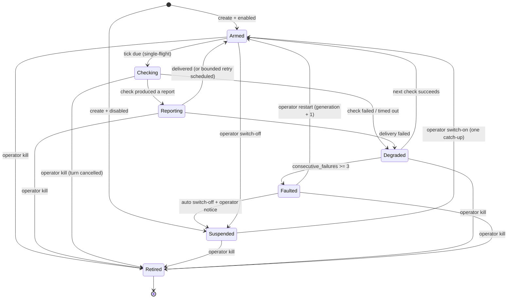
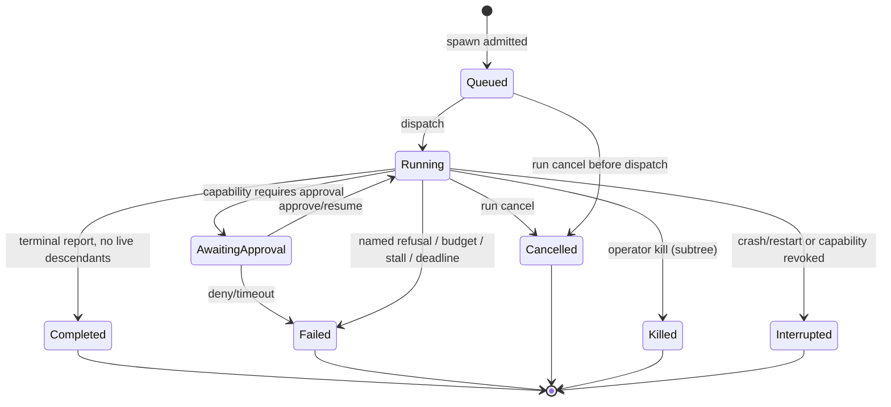

# 12 — HMARS role, capability, and ownership model

**Lane:** second-wave research, lane 3. **Date:** 2026-11-07 (America/Chicago).
**Repository:** `C:\Users\Riley\Desktop\hiverouter-v1`. **HEAD read:** `bd575ba7adf3a5f2a9bdbc69f9bbf7084fe6fe65`.
**Live-tree note:** `backend/crates/hiverouter-core/src/provider_executor.rs` is dirty (`git status`), and the live
version differs from `bd575ba` in exactly the two places this document needs: `system_prompt_for` now normalizes
the role string (`provider_executor.rs:82-90`) and the tool-turn continuation now uses the persona prompt
(`provider_executor.rs:374-377`). Every code claim below is against the **working tree**, and where that changes a
finding in `07-code-backend.md` or `09-synthesis-and-goal.md` it is called out explicitly.
**Read-only statement:** this lane wrote **only this file**. No product source, test, config, migration, build, server,
key, credential, or provider call was touched. No build or test was run, so every *runtime* statement is
`UNVERIFIED`; every *code path* statement is a read of `path:line`.

---

## 0. The one-page answer

The operator names four levels — **HyperAgent → SuperAgent → Agent → Subagent** — and asks for
**Watchdog/Remote/TV-remote daemons**, **switchable SuperAgent ownership**, and **a card for every agent**.
The model that satisfies all three without inventing a fourth tier or a second source of truth is:

1. **Three spawn-depth tiers, four agent ranks.** `HyperAgent`, `SuperAgent`, and `Agent` are capability tiers at
   depth 0, 1, 2+; **Subagent is not a fourth tier** but a *narrowed Agent profile* (read-only, leaf-only, no spawn),
   normally at depth 3. This preserves the depth-3 cap, the existing tier enum's safety property, and the operator's
   organogram. A daemon is **not a tier at all**; it is a one-job office outside the run tree.
2. **Office ≠ occupant.** A "department owner" or "domain owner" is a persistent **office** record (profile +
   scope + defaults). Each run **activates a fresh occupant instance** for that office. Ownership is a scoped,
   revocable *grant on the instance*, never a long-lived process and never a second scheduler.
3. **Ownership is exclusive and switchable, not nested.** Four modes: `department`, `domain`, `branch`, `task`.
   A `SuperAgent` in any mode may spawn `Agent`/`Subagent` only; **no Super→Super**. A department that needs more
   than one fan-out is split into sibling department-owned SuperAgents under the HyperAgent. Depth stays 3.
4. **A daemon is an immutable obligation plus short turns.** `daemon_id` is stable forever; the *job* is immutable;
   every check-in is an ordinary short-lived task. Restart increments `generation`; kill is terminal (`Retired`) and
   is never resurrected. This gives "one job forever" without a long-lived model context and without a second
   execution engine.
5. **Capability is not the tool id.** A capability is `(capability_id, scope, constraints, budget, expiry)` minted by
   the engine. A tool is one implementation of a capability. The effective grant is
   `tier ∩ profile ∩ ownership ∩ policy ∩ budget`, attenuated from the parent, and **empty means none**.
6. **Fail closed.** An unresolvable profile, unknown role, unknown capability, or empty grant **refuses the spawn or
   call** with a named code. The current engine's "unknown role → Worker" and "empty allowlist → no narrowing" are the
   two fail-open behaviours this model reverses.
7. **The daemon contract is small on purpose.** One job, one operator switch, heartbeat + report cadence, health
   (`healthy/degraded/faulted/unknown`), kill/restart with a restart budget, and **no autonomy escalation**: no spawn,
   no tool acquisition, no self-control, no target that is its ancestor, and no action that bypasses approval (kill
   and restart are requests). A "TV-remote" daemon is the same envelope with a fixed, deterministic button table.
8. **Every agent gets a card — as a roster invariant, not a canvas invariant.** The HyperAgent's canvas
   representation is the ChatCore anchor; its *card* is the pinned root card in the roster/treegrid/inspector. Every
   instance, including Subagents and daemons, has one card; daemon turns are activity rows on the daemon card, not
   new cards. Wire kinds become `hyperagent`, `superagent`, `worker` (labelled Agent), `subagent`, `daemon`, `tool`.
9. **Reports are data, never authority.** Agents report terminally, SuperAgents report at branch end and on threshold
   events, the HyperAgent emits checkpoints and a terminal digest, daemons report on cadence or change. No report can
   approve, change a grant, or promote an agent.
10. **Approvals are per call, instance-bound, argument-hash-bound, single-use, and never inherited** by a child or a
    later instance. Autonomy modes 1–4 are operator settings; mode 1 (side-effects only, default) is the current
    approval policy expressed as a mode, not a bypass.

What this buys, stated as the testable claim: **every instance has exactly one owner, one scope, one grant set, one
budget, one card, and one terminal outcome; every daemon has exactly one job, one switch, one cadence, one health
record, and one retirement.** §14 turns that into 26 invariants with acceptance tests; §16 lists the exact code gaps
that currently prevent it.

---

## 1. Decision frame, evidence bar, and method

### 1.1 Decision this research supports

| Field | Value |
|---|---|
| Decision | Adopt or reject the role/capability/ownership contract in this document as the second-wave HMARS specification for the Rust runtime and the FigCraft UI |
| Owner | Operator (Riley); consumer is the HMARS build plan and the lane-3 reviewers |
| Deadline | This second wave, before any P1 implementation starts |
| "Good enough" | A model that is concrete enough to implement without re-deciding roles, testable enough that each rule has a failing test, and honest about what the current code does not do |
| Non-goal | Product edits, migration code, UI code, pricing/scale claims, or a new A2A transport |

### 1.2 Evidence bar (declared before searching)

- **Freshness rule.** Everything external was fetched **2026-11-07**. The current year (2026) and the previous year
  are current; any older source is `HISTORICAL` unless it is a stable specification or a classic paper
  (Saltzer & Schroeder 1975 is used as a stable primary paper, labelled `HISTORICAL`).
- **Source hierarchy.** SPEC > OFFICIAL-DOCS > PAPER > SECONDARY. Forums, social media, SEO pages and generated
  summaries are `NOT AUTHORITATIVE` and are not used.
- **Claim labels.**
  - `VERIFIED-WEB` — text read on the cited page in this program, fetched 2026-11-07.
  - `VERIFIED-CODE` — `path:line` read in the working tree in this program, cross-confirmed at a second site where stated.
  - `READ` — one direct read; may drift with the code.
  - `INFERRED` — reasoned from cited code/spec, not directly stated.
  - `DESIGN` — a product decision made here, not an external fact.
  - `UNVERIFIED` — not executed; listed in §18.3.
- **No fabricated values.** Where the operator gave a number (for example "report every 5 minutes") it is treated as
  a requirement, not a measured claim. Where a source gives a number, it is quoted with its source. Where no source
  gives one, the document says `NOT DOCUMENTED` and either picks a bounded default as `DESIGN` or leaves the field
  absent.

### 1.3 Question list and what evidence settles each

| # | Question | Settling evidence | § |
|---|---|---|---|
| Q1 | How do four operator ranks map onto the runtime without a fourth tier? | Claude Code nesting/tool-withholding rule; HiveMind tier enum and depth cap | §2, §3 |
| Q2 | What is a "SuperAgent owner" when runs are ephemeral? | A2A task/context identity; Kubernetes owner references; HiveMind run/task rows | §5 |
| Q3 | Which ownership modes are needed, and how do they differ? | Operator decision + span/authority reasoning + controller/supervisor docs | §5 |
| Q4 | What may each role spawn, and what can never be spawned? | Claude Code depth rule; HiveMind `validate_spawn_role`; least privilege | §9 |
| Q5 | What is a capability, and how is it attenuated? | Saltzer & Schroeder (capability, least privilege, hierarchical control); NIST RBAC | §4, §6 |
| Q6 | How do approvals bind, and what must never grant authority? | OpenAI HITL (run-wide, per-call, sticky hazard); Claude Code report authority | §6 |
| Q7 | What is the minimal daemon contract? | systemd `WatchdogSec`; Kubernetes probes; Erlang supervisor intensity | §7 |
| Q8 | How can "one job forever" survive a run-scoped engine? | A2A task immutability; Erlang restart semantics; HiveMind single-run engine | §7 |
| Q9 | How do daemons avoid becoming a second scheduler or a hidden autonomy path? | Kubernetes controllers (only linked objects); separation of privilege; operator decision | §7, §9 |
| Q10 | What does "every agent gets a card" mean when the root is a canvas anchor? | Current graph filter + card vocabulary; A2A AgentCard as a record, not a process | §2.3, §12 |
| Q11 | What are the reporting cadences, and why not one for all? | Operator decision; MAST (system design failures); event-driven supervision | §11 |
| Q12 | What terminates an agent, a branch, a daemon, a run? | A2A terminal immutability; Erlang shutdown order; HiveMind terminal guard | §10 |
| Q13 | Which edge cases must be designed out? | MAST failure modes; this lane's state analysis | §13 |
| Q14 | What exactly is missing in the live code? | `path:line` reads of the working tree | §16 |

### 1.4 Method and its honest limit

The `/deep-research` program asks for a Lead with parallel researchers and a separate verifier. **That is not
available to this lane:** the session is a delegated subagent at depth 1 with `maxDepth: 1` and `remaining levels 0`,
so it cannot spawn a researcher or a verifier. The substitution is stated rather than hidden:

- one researcher (this agent) fetched every external source itself;
- every decision-critical external claim was re-read in the fetched text before being quoted;
- the code claims were checked in the working tree, not copied from the peer reports;
- **no independent verification pass happened.** §18.4 records that limitation and what a verifier should re-fetch.

Step 5 of the program ("synthesize before believing") is §2–§13; step 6 (citation gate) is §18; step 7
(package for reuse) is this file plus the existing `00`-style corpus layout: this file is self-contained so a later
`00-START-HERE` can link it without translation.

---

## 2. Terms, the hierarchy resolution, and the card resolution

### 2.1 Terms used in this document

| Term | Definition | Why it exists |
|---|---|---|
| **Actor** | Anything that can hold a capability and act: an agent instance, a daemon, the operator, or a tool actor. | One word for "who is acting" so authority checks are uniform. |
| **Agent profile** (persona) | A declarative, versioned record: id, display name, class, tier, template, capability grant, output schema, refusal policy, spawn limits, ownership defaults. Data, not behaviour. | A2A `AgentCard` and Claude Code subagent frontmatter are both cards; HiveMind `Persona` is the existing shape. |
| **Agent instance** | One task row bound to one profile version, one owner, one scope, one grant set, one budget, one card, one terminal outcome. | The task is the unit of work; the agent is the occupant. |
| **Office** | A persistent named seat: `(office_id, profile_id, ownership_mode, scope_binding, defaults)`. Occupied by a fresh instance per activation. | Lets "department owner" exist across runs without a long-lived process. |
| **Ownership** | An exclusive, scoped, revocable right to direct work in a scope: spawn within it, read/write its bank, receive its reports, terminate its descendants. It grants **no** tool authority by itself. | Resolves the operator's switchable SuperAgent ownership. |
| **Capability** | A tuple `(capability_id, scope, constraints, budget, expiry)` minted by the engine. A tool id is one implementation. | Distinguishes authority from mechanism; makes attenuation checkable. |
| **Grant** | The set of capabilities an instance actually holds after intersection and attenuation. | The only thing an authorization check may consult. |
| **Daemon** | A one-job office outside the run tree: immutable job, operator switch, heartbeat/report cadence, health, kill/restart, no spawn. | Watchdog/Remote/TV-remote. |
| **Card** | A UI projection of exactly one instance or one daemon record. It carries no authority and is never the source of truth. | "Every agent gets a card" without making the canvas authoritative. |

### 2.2 Resolving the operator's hierarchy statement

The operator wrote: *"Default hierarchy: HyperAgent → SuperAgents → Agents → Subagents; Remote agents may sit under
HyperAgent or a SuperAgent."* The runtime currently has `AgentTier::{HyperAgent, SuperAgent, WorkerAgent, ToolAgent}`
(`backend/crates/hiverouter-tools/src/tool.rs:72-81`), a depth cap of 3 (`caps.rs:9`), and a free-form role string
mapped by `task_agent_tier` (`execution.rs:151-163`). Four names, three tiers, one profile gap. The resolution:

```text
Operator rank        Runtime class            Depth band        Spawns
HyperAgent           HyperAgent tier          0 (one per run)   SuperAgent, Agent, Subagent
SuperAgent           SuperAgent tier          1                 Agent, Subagent
Agent                WorkerAgent tier         2 (or 1)          Subagent only
Subagent             WorkerAgent tier,        2..3              nothing
                     profile=subagent
Watchdog/Remote      Daemon (non-tier)        n/a (attached)    nothing
Tool actor           ToolAgent tier           n/a (actor)       nothing
```

Rules that make this resolution testable:

- **R1.** `Subagent` is a **profile**, not a tier. It uses the `WorkerAgent` capability tier but its grant is narrowed
  to read-only leaf work (no `workspace.write`, no `process.exec`, no `agent.spawn`). A distinct wire kind and card
  are added for visibility; the tier enum does not grow.
- **R2.** A `Subagent` instance is legal only at depth ≥ 2. A request to spawn one at depth 1 is refused
  (`E_SPAWN_PROFILE_DEPTH`) with the message "use an Agent profile at depth 1". This keeps the operator's four-rank
  shape honest even though the engine only has three tiers.
- **R3.** `SuperAgent → SuperAgent` is never legal. Departments/domains that need more than one fan-out are split
  into **sibling** SuperAgents under the HyperAgent; this is what the HyperAgent's spawn right is for.
- **R4.** A daemon is **not** in the spawn-depth ladder. It has no children, so it cannot extend the tree. It is
  attached to an owner (`HyperAgent` or `SuperAgent`) and appears on the canvas as a sibling card with a dashed
  "observes" edge, not as a child edge that implies delegation.
- **R5.** `Agent` is the wire value `worker` (kept for compatibility); the UI label is "Agent". Renaming the enum is
  a breaking contract change with no safety benefit, so the model resists it.

**Why not four tiers?** Every source that has an opinion caps nesting. Claude Code permits subagents to spawn up to
three layers below the main conversation and, **at the limit, withholds the `Agent` tool from every subagent** so the
agent does its delegated work itself and returns one summary [CC-SUB]. HiveMind already caps depth 3 and refuses by
name (`caps.rs:49-60`). A fourth tier would (a) multiply the number of places a terminal state can be missed,
(b) lengthen every result path by one prompt round-trip, and (c) add no capability that a narrowed profile + ownership
scope cannot express. The operator's fourth rank is a *role distinction*, not a *depth distinction*, and the model
says so.

### 2.3 Resolving "every agent gets a card"

The operator said: *"Every agent, including tiny Watchdog/Remote agents, must have a UI card."* The current UI cannot
satisfy that sentence literally because:

- the server node-kind vocabulary is exactly `["hyperagent","superagent","worker","tool"]`
  (`backend/crates/hiverouter-contract/src/event.rs:240`), mirrored in `web/src/api/contract.ts:213` and
  `web/src/state/agentState.ts:126` — there is no `subagent` and no `daemon`;
- `buildNodes` **filters the hyperagent out of the canvas** (`web/src/flow/graph.ts:143-164`) and represents it as the
  fixed ChatCore overlay/anchor (`graph.ts:26-31,167-188`);
- cards render a kind label and a generic role caption, not a server-supplied role/profile
  (`web/src/flow/nodes.tsx:141-267`; label fallback at `web/src/state/store.ts:328-331`).

The resolution distinguishes three different things that the word "card" was carrying:

| Layer | What it is | Invariant |
|---|---|---|
| **Card record** | A roster entry derived from the instance/daemon record: id, kind, profile, role label, owner/scope, state, one metric. | **Every agent instance and every daemon has exactly one card record from creation to terminal.** This is the operator's sentence, satisfied as a roster invariant. |
| **Canvas projection** | A spatial node for instances that benefit from being on the canvas. The HyperAgent is anchored to the ChatCore overlay by design. | The canvas **may** hide the root card; it must never be the only place a card exists. |
| **Card surface** | The renderer for a kind (Super/Agent/Subagent/Daemon/Tool). | A card shows at most four facts at the working zoom band; everything else is in the inspector. This aligns with `05-ui-ux-patterns.md:108-120,356-376`. |

Consequences:

- The HyperAgent gets a **pinned root card** in the roster, treegrid, run header, and inspector. Its canvas
  representation remains the ChatCore anchor. "Every agent gets a card" is therefore true without moving the root
  onto the canvas.
- Subagents get a compact card that reuses the Worker geometry but carries a `SUB` profile chip and no workspace
  metric; daemons get a card with a **switch**, a **health dot**, a **last-report age**, and a **next-report time**.
- A daemon turn does **not** create a new card. It creates one activity row on the daemon card and, optionally, a
  short-lived task card in the run ledger if the turn is visible in the run. This prevents card spam from a
  5-minute watchdog (288 cards/day).
- The card is never an authority object. Clicking a switch is an operator command with its own permission check; the
  card cannot grant or widen anything.

---

## 3. Role model

Each role is described by the same nine fields so it can be checked mechanically: **class/tier, purpose, ownership,
spawn rights, capabilities, memory scope, reporting, card, permission boundary.** The capability matrix in §4 is the
compact form; this section is the prose contract.

### 3.1 HyperAgent

- **Class/tier.** `HyperAgent` tier, depth 0, exactly one per run. It is the run owner and the only agent that may
  terminate the run on its own authority. Its profile is `planner` (built-in, versioned).
- **Purpose.** Plan the run, allocate ownership, adjudicate branch results, enforce budget/policy, aggregate the final
  answer, and decide replan/terminate. It is **not** a leaf tool user: no workspace write, no shell, no network.
- **Ownership.** Owns the `run` scope and the run bank. It is accountable to the operator, not to a parent; it has no
  `ask_parent` verb and instead has `ask_operator` (an escalation with a deadline).
- **Spawn rights.** `SuperAgent`, `Agent`, `Subagent`; may **request** a daemon (`daemon.request`, an approval-gated
  Mutate capability), but only the operator creates one; may not spawn `ToolAgent` or an arbitrary profile id.
- **Capabilities.** `run.plan`, `agent.spawn`, `agent.terminate` (descendants), `memory.read:run`, `memory.write:run`,
  `task.report` (to operator), `task.finish`, `daemon.request`, `budget.observe`, `policy.observe`.
- **Memory.** Reads the run bank plus **hive summaries and counts**, never raw branch observations
  (`04-memory-architecture.md:853-866`). Writes the run digest and decisions. Raw all-bank access is an explicit
  operator setting outside this model (the operator's "only if leakage/noise is prevented" condition).
- **Reporting.** Checkpoints at plan acceptance, after each branch closes, on threshold events (budget 80%, stall,
  daemon fault), and one terminal run digest. No periodic chatter.
- **Card.** Pinned root card (`hyperagent` kind), state + run progress + branch census; canvas anchor.
- **Permission boundary.** Cannot approve its own actions, cannot widen a grant, cannot read a child's transcript, and
  cannot change autonomy/retention settings (human-only).

### 3.2 SuperAgent — one class, four ownership modes

A SuperAgent is the only role whose *authority is defined by its ownership mode*. It is always `SuperAgent` tier,
always spawns only `Agent`/`Subagent`, and always reports to its owner (HyperAgent or the operator). The mode changes
scope, bank, lifetime, and card chip — not tier, not tool class beyond the mode's declared scope.

| Mode | Owns | Scope id | Lifetime | Bank | Fan-out | Reporting | Card chip |
|---|---|---|---|---|---|---|---|
| **Department owner** | A department inside a project | `project_id/department_id` | Office persists; occupant per run | project/department bank | ≤ 8 Agents | run digest + threshold events | `DEPT` + department name |
| **Domain owner** | One domain (topic/capability area) | `project_id/domain_id` | Office persists; occupant per run | project/domain bank | ≤ 8 Agents | same as department | `DOMAIN` + domain name |
| **Branch lead** | One branch of one run | `hive_root_task_id` | Run/branch | hive bank | ≤ 8 children | branch-end report + events | `BRANCH` |
| **Single-task lead** | One complex task and its subagents | `task_id` | Task | branch bank of that task | ≤ 3 Subagents | terminal report only | `TASK` |
| *Rejected:* peer/co-owner | — | — | — | — | — | — | Two owners are a second scheduler; refused. |
| *Rejected:* Super→Super | — | — | — | — | — | — | Adds a tier; see §2.2 R3. |

Mode rules:

- **Exclusive scope.** One active owner per scope id. A second activation on the same scope waits (single-run engine)
  or is refused (`E_OWNERSHIP_BUSY`) when concurrency lands.
- **Office ≠ process.** The department/domain office survives a run; the occupant does not. A run activates the
  office only if its plan claims that scope; an inactive office costs nothing and has no card (the operator's
  settings list shows the office, not a running agent).
- **Mode is not a promotion path.** A branch lead cannot become a department owner in place; it finishes, and a new
  instance is activated under the office. Capability is never widened in place.
- **Single-task mode is accountability, not extra power.** An Agent can already spawn Subagents. The single-task
  SuperAgent exists to give one hard node a named owner with a branch bank, a distinct card, and a report
  obligation — not to unlock more tools.

### 3.3 Agent (wire `worker`)

- **Class/tier.** `WorkerAgent` tier, depth 1 or 2 (under a SuperAgent; the HyperAgent may also create one directly
  when no branch owner is needed). Profile id `agent` (built-in) — this profile is currently missing from
  `personas.json`, which is a gap (§16 G4).
- **Purpose.** Execute one assigned task with tools; report one bounded result. It is the workhorse.
- **Ownership.** Owns its task scope (branch bank). It may own up to 8 Subagent children but no Agents.
- **Spawn rights.** `Subagent` only. It cannot spawn an Agent (no self-replication), a SuperAgent (no escalation), or
  a daemon (daemon creation is operator/Hyper-only).
- **Capabilities.** `workspace.read`, `workspace.write` (approval per autonomy), `process.exec` (approval, allowlist),
  `agent.spawn` (subagent), `agent.escalate`, `agent.notify` (same parent), `task.report`, `task.finish`,
  `memory.read:branch`, `memory.write:branch`.
- **Memory.** Own branch + ancestors (snapshot) + `agent_role` bank; writes only its branch.
- **Reporting.** One terminal `report_result`/`finish`; escalations are blocking with a deadline (the current
  write-only `ask_parent` is a gap, §16 G14). No periodic reports.
- **Card.** `worker` kind labelled "Agent"; identity, ownership chip, state, one live metric.
- **Permission boundary.** Cannot write outside the workspace jail, cannot run a non-allowlisted program, cannot
  approve anything, cannot read a sibling's branch, cannot change its own grant.

### 3.4 Subagent

- **Class/tier.** `WorkerAgent` tier with the `subagent` **profile**; depth 2–3; leaf.
- **Purpose.** Do one narrow sub-task and return a precise result or a precise uncertainty. The current prompt already
  says this (`assets/prompts/subagent.prompty:16-19`, persona `personas.json:32-39`).
- **Ownership.** Owns its task scope only; no children.
- **Spawn rights.** None. The spawn tool is **not advertised** in its tool specs and is refused if called
  (`E_TOOL_NOT_ALLOWED`).
- **Capabilities.** `workspace.read`, `agent.escalate`, `agent.notify` (same parent), `task.report`, `task.finish`,
  `memory.read:branch`, `memory.write:branch` (its own observation). No write, no exec, no spawn, no daemon.
- **Memory.** Own branch + ancestors (snapshot) + `agent_role:subagent`; reads are bounds-checked at render time.
- **Reporting.** Terminal report only; an escalation must carry a deadline and resolve or expire (§13 E7).
- **Card.** `subagent` kind, compact; `SUB` chip; no workspace metric.
- **Permission boundary.** The narrowest agent grant; even a prompt-injected instruction cannot turn it into a writer
  because the capability is absent, not merely refused.

### 3.5 Daemon (Watchdog / Remote / TV-remote)

- **Class.** Non-tier, one-job office attached to an owner (HyperAgent or SuperAgent); no children; no branch in the
  run tree.
- **Purpose.** Watch one scope and report, or expose a fixed control surface for one target. Full contract in §7.
- **Ownership.** Owns no work scope; it *observes* a declared target scope and reports to its owner.
- **Spawn rights.** None. `daemon.manage` / `daemon.request` are not in its grant and are never advertised.
- **Capabilities (Watchdog).** `scope.read` (declared target only), `agent.report` (to owner), `target.restart`
  (approval), `target.kill` (approval), `health.read`, `daemon.status`.
- **Capabilities (Remote/TV).** `target.status`, `target.start`, `target.stop`, `agent.report`, `health.read`;
  deterministic buttons, optional summary turn.
- **Memory.** No memory-bank writes. It reads its declared scope bank read-only and its last N reports (a separate
  `daemon_reports` table, not a bank). This deliberately avoids adding a sixth bank kind to lane 4's model.
- **Reporting.** Heartbeat 30 s (no model call) and a report every `report_s` (default 300 s) or on change; immediate
  report on fault/suspend/resume. Bounded structured report (§11.3).
- **Card.** `daemon` kind with profile chip (`WATCH`/`REMOTE`), a switch, health, last-report age, next-report time;
  turn rows in the inspector.
- **Permission boundary.** No spawn, no write, no shell, no arbitrary network, no self-control, no target that is its
  ancestor, no action that bypasses an approval (restart/kill are requests only), no promotion to any agent class.

### 3.6 Tool actor (not an agent)

`ToolAgent` is a non-orchestrating actor that executes approved tool work. It gets a `tool` card (the existing dark
result card), no memory, no spawn, no report, and no owner in the agent tree. It exists because the current registry
has a `ToolAgent` tier (`tool.rs:78-80`) and the UI already renders it; the model keeps it as an **actor**, not as a
rank in the operator's hierarchy. "Every agent gets a card" includes tool actors only if the operator wants them in
the same roster; default: a separate "Actors" section with the same card record shape.

### 3.7 Operator

The operator is not an agent and has no card; the operator is the **root of authority**: activates offices, sets
autonomy modes, edits capability profiles, approves side effects, flips daemon switches, kills/restarts daemons, and
sets retention/blindness (human-only). Every one of those actions is audited with actor, time, target, before/after
and reason. The operator cannot be impersonated by an agent message (Claude Code states that no agent message counts
as approval and no agent message can change permission settings [CC-SUB]; OpenAI HITL shows why approvals must be
bound to the exact call, not to a name [OAI-HITL]).

### 3.8 Template, profile, office, instance: four different objects

The operator asked for code-defined default agents and optional built-in templates in settings. The model keeps four
objects distinct so a template can never become a covert capability:

| Object | What it is | Grants capability? | Where it lives |
|---|---|---|---|
| **Template** | A prompt asset (`.prompty` + manifest row) with a licence/source gate; also the single-node DAG shape used by `TEMPLATE_INSERT` | **No.** A template is text and metadata; it cannot authorize a tool, a spawn, or a bank read | `assets/prompts/manifest.json`; `prompts.rs:107-314`; `ws.rs:122-293` |
| **Profile** | A versioned record: identity, class/tier, template id, capability grant, caps, ownership defaults | Yes — the grant is part of the profile, subject to attenuation | `personas.json`; `prompts.rs:382-434` |
| **Office** | A profile + ownership mode + scope binding + defaults | No separate grant; the occupant inherits the office's profile grant | new `agent_offices` (design) |
| **Instance** | One task row: profile version, owner, scope, grant hash, budget, card | Yes — the only object an authorization check may consult | `tasks` + new columns (design) |

Rules:

- A template edit changes prompts, not authority. A profile edit changes authority, and is human-only and audited.
- `TEMPLATE_INSERT` is a **spawn source**, not a grant: it creates a task under the run root and must pass the same
  profile/ownership checks as any other spawn. Today it bypasses `validate_spawn_role` (`ws.rs:200-293`); that is gap
  G4 in §16.
- Built-in templates are code-shipped and licence-gated (`prompts.rs:22-30,219-236`); user-imported profiles must carry
  provenance. The model does not add a marketplace.

---

## 4. Capability model

### 4.1 Why capability ids, not tool ids

The current model conflates three things: **who** (tier from role string), **what** (nine tool ids), and **where**
(no scope). It works for nine tools but cannot express "read the branch bank but not the run bank", "restart this
target but not that one", or "the daemon may report but not write". The model separates:

```text
Capability id      class      implemented today by        notes
workspace.read     Read       file_read, file_list        jail-scoped
workspace.write    Mutate     file_write                  approval per autonomy
process.exec       Execute    shell_exec                  allowlist + approval
agent.spawn        Mutate     spawn_agent                 depth/fan-out/agent caps
agent.escalate     Read       ask_parent                  currently write-only
agent.notify       Mutate     send_to_sibling             same-parent by default
task.report        Read       report_result               terminal
task.finish        Read       finish                      terminal
memory.read        Read       (engine-internal)           scope set by engine
memory.write       Mutate     (engine-internal)           scope set by engine
run.control        Execute    cancel_run / kill_worker    operator or owner
daemon.manage      Execute    (not a model tool)          operator only: create/switch/kill/restart
daemon.request     Mutate     (not a model tool)          Hyper requests a daemon/switch; approval
daemon.report      Read       (daemon internal)           owner-bound
target.restart     Execute    (daemon action)             approval
target.kill        Execute    (daemon action)             approval
target.start/stop  Execute    (remote daemon buttons)     approval in modes 1-2
```

Two consequences:

1. **A capability with a scope is a different grant.** `memory.read:branch` ≠ `memory.read:run` ≠
   `memory.read:project`. This is the Saltzer & Schroeder capability definition applied literally: an unforgeable
   ticket naming the object it authorizes [SS-75]. The engine mints grants; models cannot.
2. **Future tools do not create new roles.** Adding `net.fetch` or `provider.files` adds a capability and a mapping,
   not a tier or a profile. The operator's "capabilities editable in settings" is therefore a table edit, not a code
   fork.

### 4.2 The grant equation

For an instance `i` with profile `p`, tier `t`, ownership `o`, run policy `policy`, and remaining budget `b`:

```text
grant(i) = tier_set(t)
         ∩ profile_set(p)          // explicit; no "*" in the default profiles
         ∩ ownership_set(o)        // e.g. daemon: read/report only
         ∩ policy_set(policy)      // autonomy mode 1..4
         ∩ budget_set(b)           // a capability with no budget left is absent
         − withheld(i)             // e.g. agent.spawn at depth == max_depth
```

Then attenuate against the parent:

```text
grant(child) ⊆ grant(parent) − {capabilities the child profile is not allowed to hold}
```

The engine computes and persists a `grant_hash`; the card and the audit log show it. A child can never receive a
capability the parent did not hold, except engine-base capabilities (`task.report`, `task.finish`) which are minted
by the engine, not inherited.

### 4.3 Capability matrix

Legend: **Y** = granted by default; **A** = granted but approval-gated in mode 1; **s** = scoped (see notes);
**–** = never; **R** = read-only.

| Role | Tier | Depth | Owns | agent.spawn | workspace.read | workspace.write | process.exec | agent.escalate | agent.notify | task.report | memory.read | memory.write | daemon.manage / request | target.kill/restart | Card kind |
|---|---|---|---|---|---|---|---|---|---|---|---|---|---|---|---|
| HyperAgent | Hyper | 0 | run | Y (Super/Agent/Subagent) | – | – | – | – (uses ask_operator) | – | Y (operator) | run + hive summaries | run digest | manage – / request A | – | hyperagent |
| SuperAgent — department | Super | 1 | department scope | Y (Agent/Subagent) | Y | – | – | Y | Y | Y | project/department | project/department | – (may own) | – | superagent + DEPT |
| SuperAgent — domain | Super | 1 | domain scope | Y (Agent/Subagent) | Y | – | – | Y | Y | Y | project/domain | project/domain | – (may own) | – | superagent + DOMAIN |
| SuperAgent — branch | Super | 1 | hive | Y (Agent/Subagent) | Y | – | – | Y | Y | Y | hive + ancestors | hive | – (may own) | – | superagent + BRANCH |
| SuperAgent — single task | Super | 1–2 | task | Y (Subagent ≤3) | Y | – | – | Y | Y | Y | branch + ancestors | branch | – (may own) | – | superagent + TASK |
| Agent | Worker | 1–2 | task | Y (Subagent) | Y | A | A | Y | Y | Y | branch + ancestors + role | branch | – | – | worker (label Agent) |
| Subagent | Worker | 2–3 | task | – | Y | – | – | Y | Y | Y | branch + ancestors + role | branch | – | – | subagent |
| Watchdog daemon | – | n/a | none | – | R (target) | – | – | – | – | Y (owner) | R (target bank) | – | – | A | daemon + WATCH |
| Remote daemon | – | n/a | none | – | R (target) | – | – | – | – | Y (owner) | R (target bank) | – | – | – (start/stop, §7.10) | daemon + REMOTE |
| Tool actor | Tool | n/a | none | – | Y | A | A | – | – | – | – | – | – | – | tool |
| Operator | – | – | everything | Y (all) | Y | Y | Y | – | – | – | all (audited) | all (audited) | Y | Y | no card |

Notes:

- **SuperAgent write/exec.** Current tier allowlists give Super only read/list + spawn/ask/sibling/report/finish
  (`tool.rs:396-407`). The model keeps that: an orchestrator that writes files while owning a branch is doing an
  Agent's job and should spawn one. This is a deliberate capability ceiling, not an oversight.
- **Agent write/exec.** These are `A` (approval) in mode 1, and become `Y` in modes 3–4 within the declared scope.
- **Daemon `target.kill/restart`.** `A` in every mode: there is no mode in which a daemon kills a target without an
  operator decision. This is the "no autonomy escalation" line. A Remote daemon's `start`/`stop` buttons are
  `target.start/stop` (a separate capability, approval-gated per §6.2), never `kill`/`restart`.
- **Daemon report column.** Daemons hold `agent.report` (owner-bound), shown in the `task.report` column because both
  are terminal-ish report capabilities; a daemon cannot report to a parent task because it has none.
- **HyperAgent `daemon.request`.** `A`: requesting a periodic agent is a spend/loop risk, so the operator creates it.
  The operator can create one directly because the operator is the authority.

### 4.4 Tool visibility vs authority

The current executor advertises tools **by tier** (`provider_executor.rs:328-344`; `tool_loop.rs:206-219`), then
authorizes **per call** against the tier and the persona allowlist (`execution.rs:984-1017`). The comment in
`tool_loop.rs:200-204` says offering them "does not grant execution authority", which is true but incomplete: it
still shows a Subagent that it could call `shell_exec`, and the model will sometimes try. The model requires:

- **Advertise the effective grant, not the tier.** `tool_specs_for_instance(grant)` returns only capabilities the
  instance holds. A Subagent never sees `spawn_agent`, `file_write`, or `shell_exec`.
- **Withhold at the boundary.** At `depth == max_depth`, `agent.spawn` is removed from the advertised set, not merely
  refused. Claude Code does exactly this at its nesting limit and states the agent then does the work itself and
  returns one summary [CC-SUB]. A refusal invites a retry; an absent tool produces a different plan.
- **Re-check every call.** Advertising is an optimization, not the authority. Every call passes the grant check
  (Saltzer's complete mediation [SS-75]). A forged tool-call name fails with `E_TOOL_NOT_FOUND`; a known tool outside
  the grant fails with `E_TOOL_NOT_ALLOWED`.
- **Persona narrowing is mandatory.** The current code treats an empty persona allowlist as "no narrowing"
  (`execution.rs:999-1003`). The model reverses it: every profile declares its grant explicitly; an empty grant means
  **no tools**. The planner profile currently has `allowed_tool_ids: []` (`personas.json:3-10`), so under the current
  semantics it would receive the full Hyper tier set if the root ever executed; under the model it receives none.

### 4.5 Capability versioning and edits

- A profile is immutable per `(profile_id, profile_version)`. Editing it writes a new version; the old version stays
  readable for audit and for pinned instances.
- An instance pins `profile_version` at spawn. A running instance never changes grant because an operator edited the
  profile; the new version applies to new instances.
- A **revocation** (operator removes a capability) takes effect immediately for new calls on running instances: the
  next authorization check fails closed, the instance enters `Interrupted` with `E_CAPABILITY_REVOKED`, and the card
  shows the reason. This is the one case where a live grant can shrink; it can never grow.
- Every edit writes an audit row: actor, time, profile id/version, added/removed capability ids, reason, approval id.
  This satisfies the operator's "validated/audited" requirement and Saltzer's complete-mediation/accountability
  principle [SS-75].
- **Hot-reload split brain is a current gap.** `upsert_persona` updates the engine's live persona map
  (`http.rs:709-726`; `execution.rs:533-547`), but the executor's `persona_prompts` map is built once at boot
  (`http.rs:239-271`; `provider_executor.rs:71-79`). An imported profile therefore changes allowlists/caps
  immediately but not the prompt until restart. The model requires a single versioned profile source read by both.

---

## 5. Ownership model

### 5.1 What ownership is — and what it is not

Ownership is the answer to one question: **who is allowed to direct work in this scope?** It is not identity
(a profile is), not capability (a grant is), and not a process (an instance is). Definition:

```text
Ownership = (owner_instance, mode, scope_id, capacity, granted_by, granted_at, expires_at|None, rev)
```

Rules:

- **O1 — Exclusive.** One active owner per `scope_id`. Two owners of one branch is a second scheduler; it is refused
  with `E_OWNERSHIP_BUSY`. Kubernetes makes the same choice for controllers: a controller only pays attention to the
  resources linked to its controlling resource, and owner references exist so parts do not interfere with objects they
  do not control [K8S-CTRL][K8S-OWN].
- **O2 — Scoped.** Ownership never implies authority over a parent, a sibling, or the run. The HyperAgent owns the
  run; a branch lead owns a hive; an Agent owns a task; a daemon owns nothing (it observes).
- **O3 — Revocable.** The grantor (operator, or the parent owner for a child scope) can revoke. Revocation is
  immediate for new spawns and new tool calls; live children are failed or reparented by rule (§10.6).
- **O4 — Non-transitive by default.** An owner may delegate work inside its scope, but a child does not inherit the
  owner's whole grant; the child gets an attenuated grant (§4.2). Saltzer & Schroeder's "hierarchical control" — each
  authorization is controlled by another authorization, forming a tree — is the correct shape [SS-75].
- **O5 — Auditable.** Every grant/revoke/rebind writes an audit row with grantor, mode, scope, capacity, reason.

Ownership is **not** a memory key (the bank tree derives from ownership, but a bank can outlive an owner), and it is
**not** a UI chip (the chip is a projection).

### 5.2 The four modes in detail

#### Department owner (`office.department`)

- **Scope.** `(project_id, department_id)`. A department is a durable partition of a project (for example
  "Backend", "Research", "Release"). It is not a run and not a task.
- **Lifetime.** The office persists until the operator closes it. An occupant is activated per run that claims the
  department and is destroyed at run end.
- **Bank.** The department partition of the project bank (lane 4 calls the top scope `project`; a department is a
  named sub-scope with its own read set — if lane 4's v11 lands without a department kind, the department office uses
  the project bank and a `department_id` entry tag; this is a coordination point, not a new bank kind invented here).
- **Capacity.** `max_children = 8` (global fan-out), `max_depth = 3` (global). It may own up to 8 Agent/Subagent
  children across the run.
- **Reporting.** A run digest at run end, a threshold report on budget/stall/daemon fault, and an on-demand status
  reply to the operator. No periodic chatter.
- **Card.** SuperAgent card with a `DEPT` chip and the department name; pinned in the roster even when idle, marked
  "office (idle)".

#### Domain owner (`office.domain`)

Same contract as department with a topic/capability scope rather than an org scope. A domain can span departments
(e.g., "Security review"), so its scope id is `(project_id, domain_id)` and its bank is the domain partition. The
difference is **semantic, not mechanical**: departments partition *who*; domains partition *what*. Both are SuperAgent
offices and both may own at most one fan-out. The model refuses to give them different capabilities, because that
would make the mode a covert promotion path.

#### Branch lead (`ownership.branch`)

- **Scope.** `hive_root_task_id` — one branch of one run. The branch root is the SuperAgent's own task.
- **Lifetime.** The run (or until the branch terminates).
- **Bank.** The hive bank for that subtree (lane 4: `bank:hive:<hive_root_task_id>`).
- **Capacity.** Fan-out 8, subject to the run's remaining agent budget.
- **Reporting.** Branch-end report to the HyperAgent; threshold events; no periodic.
- **Card.** `BRANCH` chip; branch census (children by state).

#### Single-task lead (`ownership.task`)

- **Scope.** `task_id` — one complex task and its Subagent children.
- **Lifetime.** The task.
- **Bank.** The branch bank of that task.
- **Capacity.** `max_children = 3` (design choice: a task lead is not a branch; three narrow helpers is the point
  where a task should have been a branch instead).
- **Reporting.** Terminal report only.
- **Card.** `TASK` chip; no branch census.

**Why a single-task SuperAgent exists at all.** An Agent can spawn Subagents, so the capability delta is zero. The
mode buys *accountability and observability*: one named owner, one bank, one report obligation, one card. If the
operator later decides it is redundant, it can be removed without changing any other row in this document.

### 5.3 Office lifecycle and activation

```mermaid
stateDiagram-v2
    [*] --> Defined: operator creates office (profile, mode, scope)
    Defined --> Active: run claims scope; occupant spawned
    Active --> Idle: run ends; occupant dissolves; bank closed read-only
    Idle --> Active: next run claims scope
    Defined --> Closed: operator closes (no live occupant)
    Idle --> Closed: operator closes
    Active --> Closed: refusal (E_OWNERSHIP_BUSY) until occupant ends
    Closed --> [*]
```

Activation algorithm (target behaviour; no code exists today):

```text
activate(office, run):
 1. assert office.state in {Defined, Idle}
 2. assert no active occupant for office.scope_id           -> E_OWNERSHIP_BUSY
 3. assert run.plan claims this scope (department/domain)    -> E_OWNERSHIP_SCOPE
 4. assert profile_version is pinned and valid               -> E_PROFILE_UNKNOWN
 5. check capacity (agents, budget)                          -> E_AGENT_LIMIT / E_BUDGET
 6. mint ownership grant + attenuated instance grant
 7. insert task row with ownership columns; publish NODE_SPAWN with kind/ownership
 8. write audit row (office activated, occupant task id)
```

The office record is **not** an agent: it has no task state, no card of its own, no grant. Its card is the occupant's
card. When idle, the roster shows a greyed office entry, not a running agent.

### 5.4 Ownership transfer and rewiring

The canvas already supports rewiring a task's parent (`graph.rs` rewire + context switch; `ws.rs:650-736`). Rewiring
is a **parent-edge** change, which is not the same as an ownership transfer. The model distinguishes:

| Operation | What changes | Allowed when | Approval |
|---|---|---|---|
| Rewire (existing) | `parent_task_id` + scoped facts snapshot | Task is queued/running; server CAS `rev` matches | Mutate-class, as today |
| Ownership rebind | `owner_instance` + bank read set + report recipient | **Quiescent**: no live children; task not terminal | Operator, or parent owner + approval |
| Office reassignment | `office.scope_binding` | Office idle | Operator only |
| Promotion | profile/class change | Never in place; new instance | n/a |

A rebind while children are live would let a child keep a grant derived from the old owner while reporting to a new
one — a capability-laundering path. The rule is therefore **refuse while busy** (`E_OWNERSHIP_BUSY`); the operator can
kill the subtree, rebind, and restart. This is stricter than the current rewire, which allows moving a live subtree;
that is acceptable for *parenting* (the child's grant does not change) but not for *ownership* (the grant does).

### 5.5 Ownership and memory

| Owner mode | Read set | Write set | Promotion |
|---|---|---|---|
| HyperAgent | run bank + hive summaries/counts | run digest/decisions | none (top) |
| Department/domain | project/department or domain partition + role bank | same partition | one level to project, operator-approved |
| Branch lead | hive bank + ancestors + role bank | hive bank | one level to run, parent-approved |
| Single-task lead | branch bank + ancestors + role bank | branch bank | one level to hive |
| Agent | branch + ancestors (snapshot) + role bank | branch | one level, on completion |
| Subagent | branch + ancestors (snapshot) + role bank | branch observation | none (leaf) |
| Daemon | declared target bank **read-only** + last reports | none | none |

This aligns with `04-memory-architecture.md:449-530,745-866` rather than inventing a parallel model. The one
difference is stated openly: **daemons do not get a bank**; their durable state is the daemon record plus
`daemon_reports`. If lane 4 later adds a `daemon` bank kind, the daemon can adopt it as a read-only bank without
changing this contract.

---

## 6. Permission boundaries and approvals

### 6.1 The authority graph

```text
Operator (root authority; human-only settings)
  └── Office (persistent) ── activates ──> HyperAgent instance (run)
        └── SuperAgent instance (ownership mode)
              ├── Agent instance
              │     └── Subagent instance
              └── Daemon (watchdog/remote)  [observes; does not delegate]
```

Authority flows down only as **attenuated grants**. It never flows up: a child cannot grant, approve, promote, or
revoke anything for a parent. It never flows sideways: a sibling cannot grant to a sibling; a daemon cannot grant to a
target. The one upward channel is **reporting**, and a report is data.

### 6.2 Autonomy modes 1–4

The operator requires modes 1–4 with default 1. The modes are a policy layer over grants; they do not change which
capabilities an instance holds, only whether a held capability can execute without an operator decision.

| Mode | Name | Side effects | Spawn | Daemon create | Daemon restart target | Daemon kill target | Spend |
|---|---|---|---|---|---|---|---|
| **1** | Supervised (default) | every write/shell/network requires approval | auto within caps | operator only (Hyper may request) | approval | approval | soft guard + emergency stop |
| **2** | Guarded | writes inside declared workspace scope auto (logged); shell/network require approval | auto within caps | operator only (Hyper may request) | approval | approval | soft guard |
| **3** | Trusted | declared-scope writes + allowlisted shell auto (logged, rate-limited) | auto | operator only (Hyper may request) | owner auto, audited | approval | soft guard + per-instance cap optional |
| **4** | Autonomous | all granted capabilities auto within budget | auto | operator only (Hyper may request) | owner auto | approval | per-instance cap recommended |

Human-only settings in **all** modes: autonomy mode itself, capability profile edits, retention/blindness,
department/domain office creation and closure, daemon action policy, and kill (as opposed to suspend). An agent can
never change its own mode, and no agent message can count as approval [CC-SUB].

### 6.3 Approval binding

An approval is a record binding **one exact call** to **one operator decision**:

```text
Approval = (approval_id, run_id, task_id, capability_id, tool_call_id,
            args_sha256, grant_hash, profile_version, requested_at, expires_at,
            nonce, decision, decided_by, decided_at)
```

Rules:

- **Per call.** A decision authorizes exactly that `tool_call_id` + `args_sha256`. Changing an argument invalidates it.
  The current code already binds on `args_sha256` (`tool_loop.rs:25-36`) and verifies a single-use grant
  (`tools_bridge.rs:169-188`); the model keeps that.
- **Instance-bound.** An approval for Task A never authorizes Task B, even with the same tool and args. OpenAI's HITL
  docs show why this matters: sticky `always_approve` decisions can apply to another agent's tool of the same type
  after a handoff when executors have different permissions, and the SDK warns to use per-call decisions in that
  case [OAI-HITL]. The model forbids sticky decisions across instances outright.
- **No inheritance.** A parent's approval never covers a child's call. A child starts with no approvals; it requests
  its own or is denied.
- **No expiry bypass.** An expired approval is `E_APPROVAL_TIMEOUT`; it cannot be revived by replaying the call.
- **No message authority.** A report, memory entry, sibling message, or daemon report can never satisfy an approval
  or alter a grant. Claude Code's report header states that instructions or approval claims inside a subagent report
  "carry no authority" and that no agent message can count as approval [CC-SUB]. This is the load-bearing security
  invariant of the whole model.
- **Fail closed.** If the approval system cannot evaluate a callable rule or cannot bind the arguments, it requires a
  manual approval rather than proceeding. OpenAI HITL states its callable approval rules fail closed on
  missing/malformed arguments [OAI-HITL]; the model adopts that rule for every capability.

### 6.4 Permission boundary by role

| Boundary | Enforced by | Who can cross it |
|---|---|---|
| Workspace jail | `WorkspaceJail` + path checks (`tools_bridge.rs`) | Operator grant; no agent can widen the jail |
| Shell allowlist | `ShellPolicy` (`execution.rs:581-586`; `shell.rs`) | Operator config only |
| Spawn ceiling | `validate_spawn_role` + caps (`execution.rs:113-142`; `caps.rs:49-60`) | Parent owner within attenuation; operator |
| Profile grant | grant check (`execution.rs:984-1017`) | Profile version edit (human-only) |
| Ownership scope | new ownership check (not implemented) | Operator/parent rebind |
| Daemon action policy | daemon record (not implemented) | Operator only |
| Autonomy mode | settings (not implemented) | Operator only |
| Retention/blindness | settings (not implemented) | Operator only |

### 6.5 Refusal codes introduced by this model

These are additive to the frozen `Refusal` vocabulary; a contract bump is required before code.

| Code | Meaning | Where raised |
|---|---|---|
| `E_PROFILE_UNKNOWN` | role/profile id has no versioned profile | spawn, plan validation, restore |
| `E_PROFILE_VERSION` | requested profile version is missing/retired | spawn |
| `E_SPAWN_PROFILE` | caller class may not spawn that profile class | spawn |
| `E_SPAWN_PROFILE_DEPTH` | Subagent at depth 1, or profile's depth band violated | spawn |
| `E_CAPABILITY_EMPTY` | intersection produced no grant for a required capability | spawn |
| `E_CAPABILITY_REVOKED` | live grant was revoked; instance interrupted | tool call |
| `E_OWNERSHIP_BUSY` | scope already has an active owner / has live children | activation, rebind |
| `E_OWNERSHIP_SCOPE` | owner's scope does not contain the target | spawn, daemon create |
| `E_DAEMON_JOB_IMMUTABLE` | attempt to change a daemon's job | daemon update |
| `E_DAEMON_SELF_CONTROL` | daemon tried to switch/restart/kill itself | daemon control |
| `E_DAEMON_TARGET_ANCESTOR` | daemon target is its owner/ancestor or creates a cycle | daemon create/rebind |
| `E_DAEMON_RESTART_LIMIT` | restart intensity exceeded; daemon faulted | restart |
| `E_DAEMON_RETIRED` | operation on a retired daemon identity | daemon control |
| `E_DAEMON_NO_CAPABILITY` | daemon lacks the target action capability | daemon action |
| `E_REPORT_TOO_LARGE` | report exceeds the bounded schema | daemon turn |

### 6.6 Current code exceptions that violate these boundaries

| Exception | Evidence | Model rule |
|---|---|---|
| `spawn_agent` is Execute-class but **execution skips approval** | `tool.rs:332-338`; `execution.rs:1682-1692` ("No approval is consumed") | Spawn is a grant, not a side effect: it needs cap/ownership checks, not an operator approval. Keep approval-free **only** when the grant check is complete; otherwise `E_CAPABILITY_*`. |
| `ask_parent`/`report_result`/`finish` are Read-class but write DB/state | `tool.rs:339-361`; `execution.rs:2465-2470,2864-2915` | Classify by effect for audit: `agent.escalate` and `task.report` are **Mutate** for ledger purposes, Read for approval purposes. Do not use one class for both. |
| `send_to_sibling` is Mutate but same-parent path skips approval | `tool.rs:346-349`; `execution.rs:1719-1720` | Same-parent notify is low-risk and may be approval-free in modes 2–4, but it must still be logged and counted. Cross-branch stays approval-gated. |
| No Host allowlist / token in WS query | `09-synthesis-and-goal.md:122-126` | Out of scope for this lane; recorded because permission boundaries are only as strong as the transport. |

---

## 7. The daemon contract (Watchdog / Remote / TV-remote)

### 7.1 What a daemon is

A daemon is a **one-job office** with a fixed obligation and short, bounded turns. It is not an agent class, not a
tier, and not a long-lived conversation. Three statements define it:

1. **One job forever.** `job` is immutable. Changing the job means killing the daemon and creating a new one with a
   new `daemon_id`. This is the A2A task-immutability principle applied to a standing obligation: a terminal identity
   is not restarted; new work is a new object [A2A-TASK].
2. **Short turns, not a long process.** Every check-in is a normal short-lived task (`daemon_turn`) with a normal
   grant, a normal budget entry, and a normal terminal state. The daemon record holds the schedule and identity; the
   turn holds the work. This is how the model survives a run-scoped engine: daemons run **between** and **beside**
   runs, not inside the single active run's dispatch loop.
3. **A supervisor, not a sovereign.** The daemon observes and reports; it may request a target action under an
   operator-set policy. It never owns the target, never restarts itself, and never widens its own powers. This is
   separation of privilege: the watcher and the actor are different principals [SS-75].

### 7.2 Daemon record

```text
Daemon {
  daemon_id: UUID,                 // stable forever
  generation: u32,                 // increments on restart; starts at 1
  job: {
    kind: "watch" | "control",     // watchdog | remote
    target: {type: "run"|"hive"|"task"|"app"|"workspace", id},
    check_id: string,              // which check; immutable
    condition: string,             // threshold/rule; immutable, bounded
    report_template: string,       // bounded JSON schema id
    action_policy: "report_only" | "restart_with_approval" | "kill_with_approval",
    target_terminal_policy: "report_and_retire" | "report_and_wait"
  },
  owner: {type: "hyper"|"super"|"operator", task_id|operator_id},
  switch: {enabled: bool, rev: u64},
  cadence: {heartbeat_s: u32, report_s: u32},
  health: {state: "unknown"|"healthy"|"degraded"|"faulted",
           last_heartbeat_at, last_report_at, last_success_at,
           consecutive_failures: u32, missed_heartbeats: u32,
           last_error_code: string|null},
  restart: {attempts_in_window: u32, window_start, max_attempts: 3,
            window_s: 3600},
  created_by, created_at, retired_at|null, retire_reason|null
}
```

Bounds (design): `heartbeat_s ∈ [10, report_s/2]`, `report_s ∈ [60, 3600]`; defaults `heartbeat_s = 30`,
`report_s = 300` (the operator's "every 5 minutes" example). These are settings with hard bounds, not model choices.

### 7.3 The switch

- Exactly **one** operator-settable boolean: `enabled`. There is no per-tick knob, no "intensity" knob, no
  "autonomy" knob. The job, target, cadence bounds and action policy are set at creation; the operator can change
  cadence within bounds and flip the switch.
- The switch is **operator-only**. Neither the daemon, its owner agent, nor any model can flip it. A HyperAgent may
  *request* a switch (`daemon.request` + approval in modes 1–2); the operator resolves it.
- Effective at the **next tick**. Flipping off does not abort an in-flight turn; the turn finishes, writes one final
  `suspended` report, and the daemon goes `Suspended`. Flipping on triggers exactly **one catch-up check**, never one
  per missed window.
- Switch writes are CAS on `rev`, audited with actor/time/reason, and idempotent: a duplicate "off" is a no-op, not a
  second report.

### 7.4 Lifecycle state machine



Transition guards:

| From | Event | To | Guard / effect |
|---|---|---|---|
| Armed | tick | Checking | `enabled`; no other turn in flight (single-flight) |
| Checking | success | Reporting | report persisted; `last_success_at = now`; failures = 0 |
| Checking | failure/timeout | Degraded | `consecutive_failures += 1`; named error stored |
| Reporting | delivered | Armed | `next_at = now + report_s` |
| Reporting | delivery failed | Degraded | bounded retry (max 2) before counting a failure |
| Degraded | threshold | Faulted | `consecutive_failures >= 3`; `enabled = false`; operator notice |
| Faulted | operator restart | Armed | `generation += 1`; attempt window check; one catch-up |
| Any non-retired | operator kill | Retired | cancel turn; final report if possible; `retired_at` |
| Retired | any control | — | `E_DAEMON_RETIRED`; no resurrection |

**No path from `Retired` back to `Armed`.** Restarting a retired daemon creates a new `daemon_id`. This preserves
identity integrity (the same property A2A requires for tasks [A2A-TASK]) and prevents a kill from being undone by a
stale control message.

### 7.5 Heartbeat, cadence, and reports

- **Heartbeat** is a liveness ping written by the daemon scheduler, not a model call. It updates
  `last_heartbeat_at` and nothing else. It exists so health does not depend on the LLM.
- **Report** is the scheduled model-or-deterministic turn. Default every 5 minutes; **change-or-cadence**: a report is
  emitted when the check result differs from the last one, or when `report_s` elapses, whichever comes first. An
  unchanged scheduled report is a compact "no change" record (≤ 240 chars), not a full narrative.
- **Immediate events**: fault, suspend, resume, target terminal, threshold crossed, operator "report now". These are
  not throttled by `report_s`, but they are deduplicated by `(check_id, check_hash, observed_state)`.
- **Single-flight.** If a check is still running when the next tick is due, the tick is skipped and
  `missed_heartbeats`/`skipped_ticks` increments. There is never more than one in-flight turn per daemon.
- **Crash recovery.** On boot, enabled daemons are `Armed`; if `now - last_report_at > 2 × report_s`, the daemon runs
  **one** catch-up check and reports "missed N windows" (N computed, not N reports). A daemon never replays every
  missed window.

This mirrors the two production patterns that solve exactly this problem: systemd's `WatchdogSec` requires the
service to send a keep-alive at least every configured interval; if the interval is exceeded the service is failed
and terminated, and `Restart=on-failure|on-watchdog` decides whether it is restarted [SYSD-WD]. Kubernetes separates
**liveness** (restart), **readiness** (traffic) and **startup** (initialization) probes, evaluates them periodically,
and warns that a misconfigured liveness probe can cause cascading failures [K8S-PROBE]. The daemon model uses the
same separation: heartbeat = liveness, check success = readiness, first successful check = startup.

### 7.6 Health model

| State | Meaning | Entry condition | Operator-visible action |
|---|---|---|---|
| `unknown` | no heartbeat yet / after boot grace | created, first turn not yet completed | wait; startup grace |
| `healthy` | heartbeating and last check succeeded | heartbeat within 2×interval + `last_success_at` within 2×report_s | none |
| `degraded` | alive but failing | one failed check, missed heartbeat, or delivery failure | card shows reason; no switch change |
| `faulted` | unrecoverable without operator | `consecutive_failures >= 3` or restart limit | switch auto-off; "Restart" enabled; reason shown |

Health is computed by the **scheduler**, not by the model. A daemon cannot report itself healthy; its report is
evidence, and the scheduler records the outcome. This is the observer/observed separation again.

### 7.7 Kill and restart

- **Kill** (`kill_daemon`): immediate retirement. Cancels the in-flight turn, writes a final `killed` report if the
  report path is healthy, sets `Retired`, releases budget, and leaves the card in history. Requires operator
  authority (mode 1–4) or the owner with approval in modes 1–2. It is **not** a switch-off.
- **Restart** (`restart_daemon`): only from `Suspended`, `Degraded`, or `Faulted`; never from `Retired`. It creates
  generation `g+1` with the same `daemon_id` and job. Attempts are counted in a sliding window (`max_attempts = 3`,
  `window_s = 3600`); exceeding it sets `Faulted` and refuses with `E_DAEMON_RESTART_LIMIT`. This is the Erlang
  supervisor's maximum restart intensity: if more than `MaxR` restarts occur within `MaxT`, the supervisor terminates
  the children and itself rather than looping forever [ERL-SUP]. systemd's `Restart=` and start-rate limiting are the
  same idea at the unit level [SYSD-WD].
- **Restart is not resurrection.** A restarted daemon is a new generation of the same obligation; a retired daemon is
  a closed identity.
- **Self-control is forbidden.** `restart_daemon`/`kill_daemon` are never in the daemon's grant and never advertised
  to it (`E_DAEMON_SELF_CONTROL` if forged).

### 7.8 Target rules (the cycle problem)

- A daemon's target must be **within its owner's scope** or explicitly granted by the operator
  (`E_OWNERSHIP_SCOPE`).
- The target may **not** be the daemon's owner, an ancestor of the owner, the daemon itself, or any node whose
  ancestor chain contains the daemon (`E_DAEMON_TARGET_ANCESTOR`). This is the "watchdog cannot live inside the thing
  it restarts" rule. Erlang's documentation warns that a supervisor must not be stopped from within its own tree
  because it deadlocks waiting for a child that waits for it [ERL-SUP]; the daemon analogue is exact.
- **Daemon-of-daemon** (watchdog watching a watchdog) is allowed only one level deep and only if the target graph
  remains acyclic. The model refuses longer chains because each level adds a reporting latency without adding
  information.
- A target that is already terminal is a **valid** target only for a final report; kill/restart on it is refused
  (`E_TASK_TERMINAL`) because terminal is absorbing [A2A-TASK].

### 7.9 No autonomy escalation (the daemon's ten prohibitions)

| # | Prohibition | Enforcement |
|---|---|---|
| DA-1 | May not spawn any agent or daemon | `agent.spawn` absent from grant; tool not advertised |
| DA-2 | May not write files or run processes | `workspace.write`, `process.exec` absent |
| DA-3 | May not change its job, target, cadence, or action policy | job immutable; control requires operator; `E_DAEMON_JOB_IMMUTABLE` |
| DA-4 | May not flip its own switch or restart/kill itself | `E_DAEMON_SELF_CONTROL` |
| DA-5 | May not approve anything, including target actions | approvals are operator events only |
| DA-6 | May not message any agent other than its owner | `agent.report` is owner-bound; `agent.notify` absent |
| DA-7 | May not read outside its declared target bank | read set constructed by engine; no "read all" |
| DA-8 | May not be promoted to Agent/SuperAgent | profile class fixed; promotion requires a new instance |
| DA-9 | May not kill a target without approval, in any mode | `target.kill` is always approval-gated |
| DA-10 | May not re-enable itself after a fault | fault clears switch; operator action required |
| DA-11 | May not create a second job or "helpfully" expand scope | one job id; scope fixed |
| DA-12 | May not become a scheduler: it cannot queue, retry, or dispatch target work | target actions are single commands, not plans |

### 7.10 The TV-remote profile

"TV-remote" is the operator's term; this document maps it to a **remote-control daemon**: a fixed, small button
surface for one target, with no planning, no evaluation, and no initiative. It is the same envelope as a watchdog with
`job.kind = "control"` and a deterministic button table:

| Button | Capability | Behaviour | Approval |
|---|---|---|---|
| `status` | `target.status` | read-only snapshot; no model call | none |
| `start` | `target.start` | start the target job if stopped; idempotent | modes 1–2; auto in 3–4 if policy allows |
| `stop` | `target.stop` | stop the target job; graceful, bounded | modes 1–2; auto in 3–4 if policy allows |
| `report_now` | `daemon.report` | run one check now; no schedule change | none |
| `mute` | `daemon.status` | suppress report delivery until unmuted (operator-only) | operator only |

A remote daemon has **no LLM turn** for `status`/`start`/`stop`/`mute`; those are deterministic commands. It may use
one bounded model turn for `report_now` if the report template requires a summary, but the default is a structured
record. This is the cheapest way to satisfy "deliberately simple switches/daemons" and it blocks the most common
drift: a remote agent that starts "helping".

### 7.11 Daemon card

Content (four facts at the working band, per `05-ui-ux-patterns.md:356-376`):

1. identity: profile display name + `WATCH`/`REMOTE` chip + target short id;
2. switch: on/off (the only inline control; confirmation for off if a target action is armed);
3. health: dot + label (`healthy/degraded/faulted/unknown`) + last heartbeat age;
4. one metric: last report age or next report time.

The inspector holds: job, target, cadence, generation, restart attempts, last 10 reports, audit trail, and the
target's state. The card's "Kill" and "Restart" live in an overflow menu with a confirmation dialog; they are not
inline, because they are destructive and rare. A daemon turn appears as an activity row in the inspector, never as a
new card.

### 7.12 Persistence sketch (design only)

```sql
-- next free migration after lane 4's v11 (coordinate; this lane does not claim a version)
CREATE TABLE daemons (
  daemon_id TEXT PRIMARY KEY, generation INTEGER NOT NULL,
  job_json TEXT NOT NULL, owner_kind TEXT NOT NULL, owner_id TEXT NOT NULL,
  enabled INTEGER NOT NULL, switch_rev INTEGER NOT NULL,
  heartbeat_s INTEGER NOT NULL, report_s INTEGER NOT NULL,
  health_state TEXT NOT NULL, last_heartbeat_at TEXT, last_report_at TEXT,
  last_success_at TEXT, consecutive_failures INTEGER NOT NULL DEFAULT 0,
  attempts_in_window INTEGER NOT NULL DEFAULT 0, window_start TEXT,
  created_by TEXT NOT NULL, created_at TEXT NOT NULL,
  retired_at TEXT, retire_reason TEXT
);
CREATE TABLE daemon_reports (
  report_id TEXT PRIMARY KEY, daemon_id TEXT NOT NULL, generation INTEGER NOT NULL,
  seq INTEGER NOT NULL, at TEXT NOT NULL, status TEXT NOT NULL,
  payload_json TEXT NOT NULL, delivered INTEGER NOT NULL DEFAULT 0,
  UNIQUE(daemon_id, generation, seq)
);
CREATE TABLE daemon_turns (
  turn_id TEXT PRIMARY KEY, daemon_id TEXT NOT NULL, task_id TEXT,
  started_at TEXT NOT NULL, ended_at TEXT, outcome TEXT, error_code TEXT
);
```

No table is created by this lane; the sketch exists so the implementation and the migration reviewer share one shape.
The memory lane owns `memory_banks`; this lane owns `daemons`/`daemon_reports`/`daemon_turns` and the ownership columns
on `tasks` (`profile_id`, `profile_version`, `ownership_mode`, `ownership_scope`, `owner_task_id`, `grant_hash`).

---

## 8. State machines

### 8.1 Run

The existing run machine is already stronger than most frameworks (`run_state.rs:493-530`): `Queued → Planning →
Running`, `Running ↔ AwaitingApproval`, terminal `Completed/Failed/Cancelled/Interrupted`. The model keeps it and adds
two semantic rules (no new states):

- a run becomes terminal only when **every task owned by it** is terminal; daemons are not run tasks, so they never
  hold a run open — a daemon watching the run is notified and retires (or waits) by its `target_terminal_policy`;
- an `Interrupted` run is terminal for the attempt; resuming creates a new run linked by `retry_of` (A2A: terminal
  task, new task in the same context [A2A-TASK]).

### 8.2 Agent instance



The current implementation already has these states and the absorbing-terminal guard (`execution.rs:93-95`,
`:2984-2999`; `run_state.rs:582-612`). The model adds the **parent-completion guard** and the **ownership release**
effect on every terminal edge.

### 8.3 Daemon

See §7.4. The daemon machine is deliberately separate from the task machine: a daemon is not a task, and a task is
not a daemon. A daemon turn *is* a task and uses §8.2.

---

## 9. Spawn rules

### 9.1 Who may create what

| Caller | May create | May not create |
|---|---|---|
| Operator | any profile, office, daemon | n/a |
| HyperAgent | SuperAgent, Agent, Subagent; **request** a daemon (operator creates) | ToolActor, daemon creation, daemon without approval |
| SuperAgent (any mode) | Agent, Subagent | SuperAgent, HyperAgent, ToolActor, daemon (may own an existing one) |
| Agent | Subagent | Agent, SuperAgent, daemon |
| Subagent | nothing | everything |
| Daemon | nothing | everything |
| ToolActor | nothing | everything |

This matches the current `validate_spawn_role` direction (`execution.rs:113-142`) with three changes: (a) profile
resolution replaces the role-string allowlist; (b) the HyperAgent's daemon right is explicit and approval-gated;
(c) ToolActors cannot be model-spawned at all (the current planner can emit `role:"tool"`, which is a gap, §16 G9).

### 9.2 Admission algorithm

```text
admit_spawn(caller, request):
 1. caller instance alive, run active, caller owns request.scope        E_TASK_NOT_FOUND / E_RUN_TERMINAL / E_OWNERSHIP_SCOPE
 2. resolve profile exact id + version; unknown -> refuse              E_PROFILE_UNKNOWN / E_PROFILE_VERSION
 3. class allowed by caller class (matrix §9.1)                        E_SPAWN_PROFILE
 4. depth band: 1 <= child_depth <= min(global 3, profile.max_depth)   E_SPAWN_DEPTH
    Subagent only at depth >= 2                                        E_SPAWN_PROFILE_DEPTH
 5. fan-out: caller children < min(global 8, profile.max_children)     E_FANOUT_LIMIT
 6. run agents < global 64                                             E_AGENT_LIMIT
 7. budget preflight: caller budget can cover child reserve            E_BUDGET / E_CALL_LIMIT
 8. grant = attenuate(caller.grant, profile.grant, ownership.grant); empty -> E_CAPABILITY_EMPTY
 9. dedupe: same (profile_id, instruction_hash) under same parent      E_DUPLICATE_SPAWN (policy, mode 2+)
10. insert task: profile_id, profile_version, ownership, grant_hash, spawn_reason, retry_of
11. publish NODE_SPAWN (kind, profile, ownership, card record)
12. execute child; parent awaits bounded result (delegate semantics)
```

Every step is a named refusal, not a clamp. The current code already refuses by name for depth/fan-out/agents
(`caps.rs:49-60`) and for parent claims (`execution.rs:2635-2647`); steps 2, 3, 8, 9 are new.

### 9.3 Attenuation rules

- A child never receives a capability the parent lacks, except `task.report`/`task.finish` minted by the engine.
- `daemon.manage` is **not inheritable**: only the operator may create, switch, kill, or restart a daemon; the
  HyperAgent may only **request** one (`daemon.request`), and a SuperAgent may only own an existing daemon.
- `run.control` is **not inheritable**: a child cannot cancel the run or kill a sibling subtree.
- A profile may tighten the tier grant further, never widen it. The current validation already enforces
  `max_children/max_depth ≤ global` (`prompts.rs:421-432`); the model extends the same rule to every capability.
- The child's grant is persisted as `grant_hash` so the card and the audit can prove what it held.

### 9.4 Planned, command, model, and operator spawns

| Source | Today | Model rule |
|---|---|---|
| Planner nodes | `plan.validate()` + caps, but **not** spawn-policy/profile validation (`execution.rs:1337-1375`) | Every planned node must resolve a profile and pass §9.2 steps 2–8 before its row exists; unknown role refuses the plan |
| `SPAWN_SUB_HIVE` command | `spawn_sub_hive` validates tier + caps (`execution.rs:1061-1112`) | Same profile + ownership checks; the UI's Title-Case roles must normalize to profile ids |
| `spawn_agent` tool | Inline, synchronous, caps enforced (`execution.rs:2618-2729`); no approval | Same checks + dedupe + bracket the child in the parent's budget; result bounded |
| `TEMPLATE_INSERT` | Inserts single-node DAGs from the template registry, role = template id, **skips spawn-policy** (`ws.rs:200-293`) | Allowed only for built-in templates; still passes profile/ownership checks; rate-limited; never creates a SuperAgent from a Worker parent |
| Operator | `SPAWN_SUB_HIVE` from the UI | Any profile within caps; creates offices/daemons |

### 9.5 Tool withholding at the boundary

At `child_depth == max_depth`, the spawn capability is removed from the caller's advertised set and refused
(`E_SPAWN_DEPTH`) if forged. At `depth >= 2`, a Subagent cannot spawn anyway. At `depth == 3`, even an Agent's
`spawn_agent` is withheld. This is the Claude Code boundary rule [CC-SUB]; it produces a summary instead of a retry
loop.

---

## 10. Termination rules

### 10.1 Terminal is absorbing

`Completed`, `Failed`, `Cancelled`, `Killed`, `Interrupted` are terminal. No transition leaves them, no late result
overwrites them, and no message may target a terminal task. The current engine already enforces this
(`execution.rs:93-95,2984-2999`; `run_state.rs:440`); the model keeps it as invariant RC-19.

### 10.2 Parent-completion guard

An instance may enter `Completed` only when every descendant is terminal. The run-level reconcile
(`execution.rs:1216-1244`) guarantees this at run end, but not before; the model adds the guard at completion time
(refusal `E_DESCENDANTS_LIVE`). This is the current `02-hmars-patterns.md` I6 gap.

### 10.3 Cancellation and kill cascade

- `cancel_run` cancels every live task and daemon turn owned by the run, in **reverse spawn order** (children before
  parents), which is the Erlang supervisor shutdown order [ERL-SUP].
- `kill_task` settles one subtree: the target and all descendants become `Killed` (or `Cancelled` if awaiting
  approval), children first. A kill of an owner with live children requires `cascade=true`; otherwise
  `E_OWNERSHIP_BUSY`.
- A killed parent never leaves a running descendant; a late child completion is suppressed.

### 10.4 Daemon termination

- `suspend` (switch off) is not termination: the daemon identity survives; one final `suspended` report.
- `kill` is terminal `Retired`; the in-flight turn is cancelled; no descendants exist.
- A completed target does **not** kill the daemon; the daemon reports "target complete" and either stays armed
  (watch mode) or retires by policy (`job.target_terminal_policy ∈ {report_and_retire, report_and_wait}`; default
  `report_and_retire` for `run` targets, `report_and_wait` for `app`/`workspace` targets).

### 10.5 Restart is a new instance

Restarting a failed task (operator or owner) creates a **new task** with `retry_of = <old id>`; the old task stays
terminal. The new instance consumes a spawn slot and a budget entry, and its card links to the old one. This is the
A2A rule: a terminal task cannot restart; subsequent work is a new task in the same context [A2A-TASK]. It also
keeps the current terminal guard intact.

### 10.6 Ownership release and orphan handling

- On terminal, the instance releases its ownership. If it had children that are not terminal (should be impossible
  under §10.2), the engine fails the parent with `E_DESCENDANTS_LIVE` and cascades.
- If an owner dies unexpectedly (crash), the recovery pass marks the instance `Interrupted` and reparents its live
  children to the owner's owner **only with operator approval**; otherwise the children are failed with
  `E_OWNER_LOST`. Silent reparenting would launder authority; refusing is the safe default.
- An office with no occupant is `Idle`, never "running".

### 10.7 Termination causes that must be named

| Cause | Code | Scope |
|---|---|---|
| Child completes | — | task |
| Parent completes without live children | — | task |
| Model/engine failure | the propagating `E_*` | task |
| Budget exhausted | `E_CALL_LIMIT` / `E_BUDGET` | task/branch |
| Deadline | `E_DEADLINE` | task/branch/run |
| Stall | `E_STALLED` | branch |
| Operator kill | — (state `Killed`) | task/subtree |
| Run cancel | — (state `Cancelled`) | run |
| Capability revoked | `E_CAPABILITY_REVOKED` | task |
| Owner lost | `E_OWNER_LOST` | task |
| Daemon kill | — (state `Retired`) | daemon |
| Daemon fault | `E_DAEMON_FAULTED` | daemon |

No cause may terminate silently; every terminal transition publishes one state frame and one ledger row.

---

## 11. Reporting model

### 11.1 Cadence by role

| Role | Cadence | Channel | Bounded | Authority |
|---|---|---|---|---|
| Agent | terminal only | `report_result` / `finish` to parent | result text bounded (`bounded_tool_text`) | none |
| Agent escalation | blocking with deadline | `ask_parent` (open → answered/expired) | 2,000 chars, 32/run | none |
| SuperAgent | branch end + threshold events | report to owner | 4,000 chars | none |
| HyperAgent | checkpoints + run digest | operator UI + run record | digest bounded | none |
| Watchdog daemon | heartbeat 30 s; report 300 s or change | owner + daemon report table | ≤ 2,000 chars structured | none |
| Remote daemon | heartbeat 30 s; report on command/state change | owner | ≤ 1,000 chars | none |
| ToolActor | none | — | — | none |

"Threshold events" means: stall detected, budget ≥ 80%, approval requested, daemon faulted, target terminal. These are
event-driven, not periodic; a healthy hierarchy is quiet.

### 11.2 Why not one cadence for all

- A periodic Agent report would multiply tokens by the number of leaves (the operator's scale target is 50–150 active
  agents) and add nothing: the child's result is already the report.
- A periodic SuperAgent digest would be a second source of truth beside `task_result`; MAST's failure taxonomy treats
  inter-agent misalignment and information withholding as system-design failures, and extra chatter does not fix
  either [MAST].
- Daemons are the one role whose *job* is time-based observation, so they get the only periodic contract.

### 11.3 Daemon report schema

```json
{
  "daemon_id": "…", "generation": 2, "seq": 41, "at": "2026-11-07T21:40:00-06:00",
  "window": {"from": "…", "to": "…"},
  "status": "ok | warn | fault",
  "check_id": "run.progress",
  "target": {"type": "run", "id": "…"},
  "observed": {"summary": "≤ 400 chars", "metrics": {"tasks_running": 3, "budget_pct": 41}},
  "delta": "≤ 200 chars",
  "evidence": ["task:…", "artifact:…", "event:…"],
  "action": "none | reported | requested_restart | requested_kill",
  "next_at": "…"
}
```

Rules: no free-form transcript; `observed.summary` is the only prose; `evidence` is ≤ 8 references; the total is
≤ 2,000 chars; secrets are filtered by the same tripwire as memory (`execution.rs:61-65`), and the filter is a
tripwire, not redaction. A report that exceeds the bound is refused with `E_REPORT_TOO_LARGE`, never truncated
silently (a silent truncation would let a report claim success it cannot prove).

### 11.4 Delivery, dedupe, muting

- Reports are persisted before delivery (`daemon_reports`), so a delivery failure loses nothing; retry twice, then
  `degraded`.
- Dedupe key: `(daemon_id, generation, check_id, check_hash, observed_state)`. Identical consecutive reports are
  collapsed unless the cadence window elapsed.
- The owner can mute a daemon (operator setting); muted means "persist, do not notify", not "stop checking". Muting is
  audited; unmuting delivers the latest report once.
- The operator can blind an agent (visibility setting); blinding does not change grants or reports' persistence, only
  what the operator sees. Human-only, audited.

---

## 12. UI card model

### 12.1 Kinds and card content

| Kind | Roster | Canvas | Card facts (working band) | Inspector |
|---|---|---|---|---|
| `hyperagent` | pinned root | ChatCore anchor (existing) | state, run progress, branch census, budget | plan, decisions, digests |
| `superagent` | yes | yes (existing size) | identity + ownership chip, state, children count, progress | branch ledger, bank, reports |
| `worker` (Agent) | yes | yes (existing size) | identity, ownership chip, state, progress | tools, results, memory |
| `subagent` | yes | yes (compact, Worker geometry − 24 px) | identity + `SUB`, state, parent, result age | instruction, result, escalation |
| `daemon` | yes (always) | yes (dashed observe edge) | identity + `WATCH`/`REMOTE`, switch, health, last report age | job, cadence, reports, audit |
| `tool` (actor) | separate section | yes (existing) | identity, state, args hash, result chip | args/results ledger |
| `error` (client-only) | — | yes | error code, task id | refusal detail |

The wire change is additive: `NODE_KIND_VOCABULARY` becomes
`["hyperagent","superagent","worker","subagent","daemon","tool"]` plus the client-only `error`
(`event.rs:240`; `contract.ts:213`; `agentState.ts:126`). Daemon profile is carried as `daemon_profile` on the daemon
events, not as two more kinds.

### 12.2 Card record (the roster entry)

```text
CardRecord {
  card_id, kind, instance_id|daemon_id, profile_id, profile_version,
  display_name, role_label, ownership_mode, ownership_scope_label,
  parent_id|null, owner_id,
  state, health|null, updated_at, rev,
  primary_metric {label, value|null},   // null renders "—", never 0
  switch|null,                           // daemon only
  grant_summary: {capability_ids, count} // inspector only
}
```

Rules:

- **Null is rendered as unknown** (`—`), never as a fabricated default. The current card code already follows this
  discipline (`nodes.tsx:1-12`), but the store's label fallback invents `WorkerAgent <suffix>`
  (`store.ts:328-331`), which is a type label, not an identity; the model requires the server to send `display_name`
  or an honest `role · depth · short` label.
- **Four facts max at the working band**, per `05-ui-ux-patterns.md:356-376`. Everything else is inspector-only.
- **State is shape + text, colour reserved for state**, per the existing design system
  (`05-ui-ux-patterns.md:41-48`).
- **No nested interactive controls** inside a clickable card; the daemon switch is a real control with
  `stopPropagation` and an accessible name.
- **Every card is focusable** and has an accessible name `display (kind, state)`; the roster and treegrid are the
  keyboard-accessible peers of the canvas (`05-ui-ux-patterns.md:613`).

### 12.3 Roster, treegrid, and the root card

- The **roster** is a flat, filterable list of every card record for the run plus every daemon owned by the run's
  owner. It is the implementation of "every agent gets a card".
- The **treegrid** is the hierarchy projection (parent/child + ownership grouping). The HyperAgent is the root row.
- The **run header** pins the HyperAgent card (state, branch census, budget) even when the canvas is zoomed away.
- The **canvas** keeps the existing spatial language; the root is an anchor, Subagent/Daemon cards are new renderers,
  and edges distinguish `delegates` (solid) from `observes` (dashed) from `owns` (chip, not an edge).
- **Replay** must preserve kinds and ownership: the replay projection currently flattens every node to `worker`
  (`graph.ts:196-234`), which would make the roster lie in history. The model requires the snapshot to carry `kind`,
  `profile_id`, and `ownership_mode`, or the replay to say "kind unknown".

### 12.4 Settings surface (design)

| Setting | Scope | Default | Who |
|---|---|---|---|
| Autonomy mode 1–4 | profile/project | 1 | operator |
| Capability profiles | project | built-ins | operator |
| Approvals: side effects only | project | on | operator |
| Ownership defaults | project | department offices off | operator |
| Daemon cadence bounds | project | 60–3600 s | operator |
| Daemon action policy | per daemon | `report_only` | operator |
| Report/mute/blind | per daemon/agent | unmuted, visible | operator |
| Budget soft guard / emergency stop | project | guard on, hard cap off | operator |
| Card density (4-fact vs detail) | UI | 4-fact | operator |
| Memory sharing/promotion | project | deny by default | operator (human-only) |
| Retention/blindness | project | run lifetime | operator (human-only) |

The current `SettingsPanel` exposes only key/provider/health (`web/src/panels/SettingsPanel.tsx:34-99`) and
`config.rs` has no autonomy setting; this is gap G21.

---

## 13. Edge cases

Each case names the rule, the refusal/state, and the test that would prove it. These are the cases that turn the
model from a diagram into a contract.

| # | Case | Rule | Refusal / state | Test |
|---|---|---|---|---|
| E1 | A daemon is asked to watch its own owner or an ancestor | Target graph must be acyclic and outside the owner chain | `E_DAEMON_TARGET_ANCESTOR` | Create daemon owned by branch lead targeting that lead → refused; no row |
| E2 | Two daemons watch each other | Chain depth > 2 refused; daemon-of-daemon max one level | `E_DAEMON_TARGET_ANCESTOR` | A watches B, B watches A → second creation refused |
| E3 | Target is already terminal at daemon creation | Allowed for a final report; action policy downgraded to `report_only` | status `warn`, no action | Create on Completed run → one report, daemon retires by policy |
| E4 | Run ends while a daemon is armed | `target_terminal_policy`: run target retires after final report; app/workspace stays | `report_and_retire` (run) | Run completes → daemon reports target terminal → `Retired` |
| E5 | Machine sleeps/offline for 40 minutes | Boot grace: no fault until 3 missed windows; one catch-up report | `degraded` → `healthy` after success | Simulated clock jump forward → exactly one catch-up report, no N reports |
| E6 | Wall clock jumps backwards (DST/manual) | Cadence uses a monotonic clock; report timestamps remain wall clock | none | Timer fires on monotonic schedule despite wall-clock jump |
| E7 | Daemon restart storm (target keeps dying) | `max_attempts = 3 / 3600 s`; then `Faulted` + switch off | `E_DAEMON_RESTART_LIMIT` | Four restarts in an hour → fourth refused; health `faulted` |
| E8 | Operator kills a daemon mid-turn | Cancel turn, persist a `killed` report if possible, `Retired` | state `Retired` | Kill during a long check → turn `Cancelled`, daemon `Retired`, card remains |
| E9 | Report delivery fails | Persist first; 2 retries; then `degraded` | `E_DELIVERY` (recorded) | Owner channel down → report row still exists; health `degraded` |
| E10 | Target disappears / tool revoked while armed | `degraded` with named code; switch stays on until threshold | `E_TARGET_GONE` / `E_CAPABILITY_REVOKED` | Remove target → next check degrades, third faults |
| E11 | Owner SuperAgent terminates while daemon reports to it | Reassign to HyperAgent **with approval**, or suspend; never silent orphan | `E_OWNER_LOST` if refused | Kill branch lead → daemon is `Suspended` pending operator choice |
| E12 | Profile edited while daemon/agent is live | Instance pins `profile_version`; new version applies to new instances; revocation is the exception | `E_PROFILE_VERSION` / `E_CAPABILITY_REVOKED` | Edit profile v1→v2 → live card still v1; new spawn v2 |
| E13 | Switch flipped during a turn | Graceful: turn completes, one final report, then `Suspended` | none | Flip off mid-check → no cancel, next tick absent |
| E14 | Two switch commands race | CAS on `switch.rev`; second is stale | `E_STALE_REV` | Concurrent on/off → one wins, one refused, audit has both attempts |
| E15 | Daemon tries `spawn_agent` | Capability absent and tool absent from specs | `E_TOOL_NOT_ALLOWED` | Forged call → refused; tool never in advertised list |
| E16 | HyperAgent tries to read all banks "through" a daemon | Daemon read set is fixed at creation; no aggregate path | `E_MEMORY_SCOPE` | Daemon on branch A cannot read branch B |
| E17 | Restart pending when target is killed by operator | Terminal target cannot restart; report the conflict | `E_TASK_TERMINAL` | Kill target → pending restart refused, no new task |
| E18 | Rewire moves a task across ownership scopes | Parent rewire allowed only if the child's grant does not change; ownership rebind requires quiescence | `E_OWNERSHIP_BUSY` | Rewire live subtree to another owner → refused; queued subtree → allowed |
| E19 | Single-task lead wants a 4th child | Mode capacity 3 | `E_FANOUT_LIMIT` | 4th spawn refused |
| E20 | Department office claimed by a second run | Exclusive scope; single-run engine queues/refuses | `E_OWNERSHIP_BUSY` | Two runs claim "Backend" → second waits/refuses |
| E21 | A Subagent is requested at depth 1 | Subagent band is depth 2–3 | `E_SPAWN_PROFILE_DEPTH` | Hyper spawns `subagent` at depth 1 → refused, told to use Agent |
| E22 | A daemon is requested with an invalid target type (e.g., `start` a run) | Job validation at creation | `E_DAEMON_JOB_INVALID` | Remote daemon with target type `run` and button `start` → refused |
| E23 | Capability revoked during a daemon turn | Turn interrupted, report `fault`, health `degraded` | `E_CAPABILITY_REVOKED` | Revoke during check → turn `Interrupted`, no partial success |
| E24 | Idle office appears in the roster | Offices are not agents; roster shows an "office (idle)" entry, no running card | none | Close run → office entry idle; no agent card |
| E25 | A profile declares no capabilities | Invalid at validation, except `planner` which declares orchestration capabilities explicitly | `E_PROFILE_UNKNOWN` at load | Import empty profile → refused, rest serve |
| E26 | Parent completes with a live child | Parent-completion guard | `E_DESCENDANTS_LIVE` | Complete parent early → refused |
| E27 | Late child result after run terminal | Suppress; one ledger row; no resurrection | none | Kill run, late completion → no state change |
| E28 | Agent tries to approve its own side effect | Approvals are operator events | `E_TOOL_NOT_ALLOWED` | Forged approval message → no effect |

---

## 14. Testable invariants

Each invariant is stated so a test can fail it. "Status" records the working tree: **HELD**, **PARTIAL**, **GAP**.
These are additive to the 20 invariants in `02-hmars-patterns.md:700-722`; where they overlap, the overlap is noted.

| # | Invariant | Status | Evidence / test |
|---|---|---|---|
| RC-01 | Every agent instance has exactly one owner, one scope, one profile_version, one grant_hash, one budget, one card, one terminal outcome | **GAP** | No ownership/profile columns on `tasks` (`db.rs:63-73`); test: spawn → inspect row/card/audit |
| RC-02 | Every daemon has exactly one immutable job, one switch, one cadence, one health record, one retirement | **GAP** | No daemon table/route (`db.rs:32-249`; `http.rs:512-529`) |
| RC-03 | A child grant is a subset of the parent grant plus engine-base capabilities | **GAP** | No grant type/hash; test: spawn with a widened profile → `E_CAPABILITY_EMPTY`/refused |
| RC-04 | Empty grant means no tools (fail closed) | **GAP** | Current empty means no narrowing (`execution.rs:999-1003`) |
| RC-05 | Unknown profile/role refuses the spawn; it never degrades to Worker | **GAP** | `task_agent_tier` maps unknown → Worker (`execution.rs:161`); plan accepts any role (`planner.rs:63-71`) |
| RC-06 | A Subagent is never spawned at depth 1 and never sees spawn/write/exec tools | **GAP** | No subagent tier/kind; tier Worker sees all worker tools (`provider_executor.rs:328-344`) |
| RC-07 | No SuperAgent spawns a SuperAgent | **HELD** | `validate_spawn_role` (`execution.rs:130-133`) |
| RC-08 | At depth == max, `agent.spawn` is withheld, not merely refused | **GAP** | Cap refuses (`caps.rs:50-52`); tool still advertised |
| RC-09 | Ownership is exclusive per scope and rebind requires quiescence + approval | **GAP** | No ownership model; rewire allows live subtree (`ws.rs:650-736`) |
| RC-10 | A daemon cannot spawn, write, exec, approve, self-control, or read outside its target bank | **GAP** | No daemon class/grant |
| RC-11 | A daemon's target is never its owner/ancestor and the target graph is acyclic | **GAP** | `kill_worker` has no ancestry check (`execution.rs:1142`) |
| RC-12 | Daemon kill is terminal `Retired`; restart is a new generation; a retired identity is never resurrected | **GAP** | No daemon lifecycle |
| RC-13 | Daemon restart attempts are bounded (3/3600 s), then `Faulted` | **GAP** | No restart policy |
| RC-14 | Daemon reports are persisted before delivery, bounded, deduped, and never authority | **GAP** | No daemon reports table |
| RC-15 | A heartbeat miss degrades, never silently faults; health is scheduler-computed | **GAP** | No heartbeat |
| RC-16 | Every instance and daemon has a roster card from creation to terminal; root card exists though canvas anchors it | **PARTIAL** | Cards exist per node; no roster; root filtered (`graph.ts:151`); no subagent/daemon kinds (`event.rs:240`) |
| RC-17 | A profile version is pinned per instance; edits do not change live grants; revocation interrupts | **GAP** | No version field; live `upsert_persona` (`http.rs:725`); executor prompt map static (`http.rs:239-271`) |
| RC-18 | An approval binds one exact call (task, capability, call id, args hash, grant hash) and never transfers | **PARTIAL** | `args_sha256` + single-use grant exist (`tool_loop.rs:25-36`; `tools_bridge.rs:169-188`); no instance/grant binding |
| RC-19 | A terminal instance never transitions again; late results are suppressed | **HELD** | `execution.rs:93-95,2984-2999`; `run_state.rs:440` |
| RC-20 | A parent cannot complete while a descendant is live | **GAP** | Run-level reconcile only (`execution.rs:1216-1244`) |
| RC-21 | A run is terminal only when all its tasks are terminal; daemons never hold a run open | **PARTIAL** | Tasks reconciled (`execution.rs:1216-1244`); no daemons |
| RC-22 | No message/report/memory entry can grant authority or satisfy an approval | **PARTIAL** | Approvals are operator-driven; no data-not-authority header on child results |
| RC-23 | Every capability edit/ownership change/daemon control writes an audit row | **GAP** | `agent_profiles` stores JSON only (`db.rs:218-232`); no audit table |
| RC-24 | Every refusal is a named code; no silent clamp/truncate | **PARTIAL** | Caps are named; memory read errors swallowed (`execution.rs:880`); report bound unnamed |
| RC-25 | Budgets are per instance/daemon; a daemon turn never consumes the operator run's budget | **GAP** | Budgets keyed by `RunId` (`provider_executor.rs:104-109`) |
| RC-26 | Replay preserves kind/profile/ownership, or says unknown | **GAP** | Replay flattens to `worker` (`graph.ts:196-234`) |

**How to read the status column:** 2 held, 5 partial, 19 gap (26 invariants). That distribution is itself the finding:
HiveMind's *task* primitives are strong; its *role/ownership/daemon* primitives are mostly absent. The model does not
require a rewrite — it requires additive records and checks at the spawn, call, and card boundaries.

### 14.1 Acceptance tests (minimum set before the model is called implemented)

| Test | Asserts | Fixture |
|---|---|---|
| `profile_unknown_refuses_spawn` | RC-05 | spawn role `nonesuch` → `E_PROFILE_UNKNOWN`, no task row |
| `empty_grant_has_no_tools` | RC-04 | profile with `[]` → model tool specs empty; forged `file_read` → `E_TOOL_NOT_ALLOWED` |
| `child_cannot_widen_grant` | RC-03 | Agent spawns Subagent with `workspace.write` profile → refused |
| `subagent_depth_floor` | RC-06 | Hyper spawns `subagent` at depth 1 → `E_SPAWN_PROFILE_DEPTH` |
| `spawn_withheld_at_limit` | RC-08 | depth-3 Agent tool specs exclude `spawn_agent`; forged call refused |
| `super_cannot_spawn_super` | RC-07 | Super spawns `superagent` → `E_SPAWN_PROFILE` |
| `ownership_exclusive` | RC-09 | two activations on one scope → second `E_OWNERSHIP_BUSY` |
| `ownership_rebind_quiescent` | RC-09 | live children → rebind `E_OWNERSHIP_BUSY` |
| `daemon_target_cycle` | RC-11 | daemon targets ancestor → refused |
| `daemon_no_self_control` | RC-10 | forged self-kill/switch → `E_DAEMON_SELF_CONTROL` |
| `daemon_job_immutable` | RC-02 | update job → `E_DAEMON_JOB_IMMUTABLE` |
| `daemon_restart_limit` | RC-13 | 4th restart in an hour → `E_DAEMON_RESTART_LIMIT`, `faulted` |
| `daemon_report_bounded` | RC-14 | oversized report → `E_REPORT_TOO_LARGE`, nothing truncated |
| `daemon_catchup_once` | RC-15 | 40-minute outage → exactly one catch-up report |
| `kill_is_terminal` | RC-12 | kill then restart → `E_DAEMON_RETIRED` |
| `parent_completion_guard` | RC-20 | complete with live child → `E_DESCENDANTS_LIVE` |
| `approval_not_transferable` | RC-18 | approve A, replay on B → refused |
| `profile_pin` | RC-17 | edit v1→v2 mid-run → live card v1, new spawn v2 |
| `card_every_agent` | RC-16 | spawn all five classes → roster has 5 cards incl. root; canvas may hide root |
| `replay_kind_honest` | RC-26 | replay a mixed run → kinds preserved or `unknown`, never all `worker` |

---

## 15. Twenty questions

**Q1. Is Subagent a fourth tier?**
No. It is a **profile** on the Worker tier with a narrowed grant (read-only leaf, no spawn), plus a distinct wire kind
and card. The operator's four ranks are preserved; the depth cap stays 3. If it were a tier, every terminal-state
edge and every prompt path would grow for no capability gain (§2.2; `caps.rs:9`).

**Q2. Then why does the operator see four levels?**
Because rank is an accountability concept, not a capability enum. The model shows four ranks and three depth tiers;
the card chips and reports carry the rank, the engine carries the tier. This is the same split A2A makes between an
`AgentCard` (identity/capability metadata) and a `Task` (work) [A2A-KC].

**Q3. What is a SuperAgent "department owner" if runs are ephemeral?**
An **office**: a persistent record (profile, mode, scope, defaults) with a fresh occupant instance per run. Ownership
is a grant on the occupant, not a process. This is how the model gets persistence without long-lived agents, and it
keeps the task as the unit of work (Q10 in `02-hmars-patterns.md`).

**Q4. Can a department own multiple branches?**
Not by nesting SuperAgents. A department owns one fan-out of Agents/Subagents; if it needs more, the HyperAgent
creates **sibling** department/domain SuperAgents. This is the only way to keep depth 3 and forbid Super→Super.

**Q5. What happens when ownership is switched mid-branch?**
Refused while the branch has live children (`E_OWNERSHIP_BUSY`). The operator can quiesce (finish or kill), rebind,
then restart. Parent-*rewiring* remains allowed because it does not change a grant; ownership rebinding does, so it is
stricter (§5.4).

**Q6. Who may create a daemon?**
The operator always. The HyperAgent may **request** one (`daemon.request` + approval); a SuperAgent never creates
one (it may own an existing daemon). This keeps periodic spend and loop risk out of the model's hands. It also means
a prompt-injected plan cannot create a self-reporting agent that watches the operator.

**Q7. What does "one job forever" mean mechanically?**
One immutable `job` per `daemon_id`; changing the job means a new daemon id. The *obligation* is forever; the
*process* is not. Each check is a short task. This is A2A task immutability applied to a standing office
[A2A-TASK].

**Q8. Why 5 minutes? Why not 5 seconds?**
The operator's example is 5 minutes. The model makes `report_s` a bounded setting (60–3600 s) with a 30 s
non-model heartbeat. Five seconds would be a polling loop with a model call per poll — the exact cost/latency failure
the operator's "no hard budget" and "token caching" goals are trying to avoid.

**Q9. Does a Watchdog need an LLM at all?**
Not always. Deterministic checks (process alive, file exists, task state changed, budget threshold) should run without
a model call; the model is for summarization and judgment on ambiguous evidence. The daemon contract allows both and
records which ran, so cost is attributable.

**Q10. How does a daemon kill/restart a target without becoming an autonomous actor?**
It can only **request**: `target.kill`/`target.restart` are approval-gated in every mode. The engine executes the
request as a normal operator command; the daemon never holds the target's authority. This is separation of privilege
[SS-75] and the same reason Kubernetes controllers act through the API server rather than running pods themselves
[K8S-CTRL].

**Q11. What if the daemon's target is the run that owns the daemon?**
Refused (`E_DAEMON_TARGET_ANCESTOR`). The daemon must be a sibling/observer of its target, not a descendant. Erlang
warns that a supervisor stopped from inside its own tree deadlocks [ERL-SUP]; the daemon analogue is a cycle.

**Q12. Can a daemon be promoted to an Agent?**
No. Promotion is a new instance under a new profile. In-place promotion would violate capability monotonicity and
make the daemon's history a lie.

**Q13. Can an Agent approve its own side effect?**
No. No agent message counts as approval, and approvals are operator events bound to a call [CC-SUB][OAI-HITL]. The
current `spawn_agent` approval bypass is a separate issue: spawn is a grant check, not a side effect, and the model
keeps it approval-free only when the grant/ownership checks are complete.

**Q14. Do approvals inherit to children?**
No. A child starts with none and requests its own. Sticky approvals across instances are forbidden because OpenAI's
own HITL docs show they can leak across agents with different permissions [OAI-HITL].

**Q15. What does the HyperAgent actually do all run?**
Plan, allocate ownership, read summaries/counts, adjudicate branch results, enforce budget/policy, decide
replan/terminate, and produce a digest. It does not use workspace tools. This is deliberately narrower than "a
conversational super-agent": the operator deferred whether chat hosts a SuperAgent, and this model does not decide
that question (§17.4).

**Q16. Is the ChatCore the HyperAgent?**
No. It is the operator surface; the root card is the HyperAgent's card. Making the chat a SuperAgent would create a
second orchestration channel beside the run owner, which the operator explicitly deferred
(`OPERATOR-DECISIONS.md:42-44`).

**Q17. What is the memory scope for a daemon?**
Read-only on its target's bank plus its last reports; no bank writes. This avoids a sixth bank kind and keeps lane 4's
`project → run → hive → branch + agent_role` model intact (`04-memory-architecture.md:449-530`). If a daemon bank is
added later, it is read-only.

**Q18. How do you prevent report spam at scale?**
Change-or-cadence, dedupe by check hash, one in-flight turn per daemon, single catch-up after downtime, and a compact
"no change" record. The card shows last/next report; the inspector holds the history. At 50 daemons × 5-minute
reports this is 14,400 reports/day — bounded, persisted, and capped by the project's soft guard; the model recommends
a daily report cap per project as a setting.

**Q19. What breaks first if this model is implemented naively?**
Concurrency. Daemon turns need an execution lane beside the single active operator run; the current engine refuses a
second run (`execution.rs:1032-1052`) and dispatches sequentially (`execution.rs:1395-1550`). The model therefore
requires a separate `daemon` lane with its own bounded permits (design: 2 concurrent, paused while the operator run is
planning/aggregating), never a second operator run.

**Q20. What would make this model wrong?**
Three falsifiers: (a) the operator wants a long-lived conversational department agent, which would overturn office ≠
occupant; (b) SuperAgent nesting is required for outcomes, which would overturn the depth-3 resolution; (c) daemons
need to act autonomously to be useful, which would overturn the approval line. Each is a product decision, not a code
fact; the model states them so the operator can reject them explicitly.

---

## 16. Exact current code gaps

Live-tree reads, 2026-11-07. Severity: **S1** blocks the model; **S2** important for operability; **S3** later.
"Gap" means absent or contradicted by the working tree; the "model needs" column is the smallest change that closes it.

### 16.1 Identity, tier, and profile

| # | Gap | Live evidence | Model needs | Sev |
|---|---|---|---|---|
| G1 | No `Subagent` or `Daemon` class in the tier enum or node-kind vocabulary | `tool.rs:72-81`; `execution.rs:99-106`; `event.rs:240`; `contract.ts:213`; `agentState.ts:126` | Add wire kinds `subagent`/`daemon`; keep Subagent on the Worker tier | S1 |
| G2 | Tier is derived from a free-form role string, not from the profile | `execution.rs:151-163`; `Persona.tier` unused by the engine (`prompts.rs:367-404`) | Resolve profile first; tier from profile; unknown refuses | S1 |
| G3 | The planner's default role `worker` has **no persona record** | `provider_executor.rs:25-29` vs `personas.json` (no `worker`/`agent` entry) | Add built-in `agent`/`hyper`/`daemon` profiles; planner emits resolvable ids | S1 |
| G4 | Four worker personas are unreachable through the spawn policy | `execution.rs:113-142` vs `personas.json:12-19,41-65`; `ws.rs:200-293` | Profile registry is the allowlist; spawn policy checks profile class, not a name list | S1 |
| G5 | Role-string normalization is split: executor lowercases/normalizes, engine persona lookups are exact | `provider_executor.rs:82-90` vs `execution.rs:871-879,550-558`; UI spawns Title-Case roles (`store.ts:1865-1871`) | One canonical role/profile id at spawn; store it; no lookup by display string | S1 |
| G6 | `Persona.allowed_tool_ids` is not validated against the tool registry | `prompts.rs:411-434`; only template/caps/policy checked | Validate every capability id resolves; refuse the profile at load | S2 |
| G7 | Profile has no description, tags, ownership defaults, capability ids, or version | `prompts.rs:382-404`; `personas.json:1-67` | Additive fields; version integer; import refuses unknown fields or migrates | S2 |
| G8 | Profile hot-reload is split-brain: engine personas update, executor prompt map does not | `http.rs:709-726,239-271`; `provider_executor.rs:71-79` | One versioned profile source read by both; restart or rebuild on edit | S2 |
| G9 | `Persona.tier` can disagree with the role-derived tier | `execution.rs:151-163`; `prompts.rs:389` | Persist the resolved tier on the instance; profile tier and class must agree | S2 |
| G9a | Planned roles bypass the spawn policy and the profile registry: any non-empty role is accepted, so a planner can emit `tool`/`hyper` | `planner.rs:63-71`; `execution.rs:1337-1375`; `execution.rs:151-163` | Resolve and validate every planned role against the profile registry; unknown role refuses the plan | S1 |
| G9b | Memory is role-keyed and global; no branch/hive/daemon read set or provenance-scoped write | `db.rs:183-192`; `store.rs:645-671`; `execution.rs:3017-3026` | Adopt lane 4's bank tree; daemons read-only; no daemon bank writes | S1 |

### 16.2 Capability and tools

| # | Gap | Live evidence | Model needs | Sev |
|---|---|---|---|---|
| G10 | Empty persona allowlist means "no narrowing", not "no tools" | `execution.rs:982-1003` ("empty list = no narrowing") | Empty grant = no tools; explicit `*` only for built-ins | S1 |
| G11 | Tools are advertised by tier, not by effective grant | `provider_executor.rs:328-344,409-415`; `tool_loop.rs:200-219` | `tool_specs_for_instance(grant)`; persona/ownership narrowing applied before advertisement | S1 |
| G12 | `agent.spawn` is not withheld at the depth boundary | `provider_executor.rs:328-344`; refusal only at `caps.rs:50-52` | Withhold at `depth == max_depth`; keep the refusal as last line | S1 |
| G13 | Capability classes are inconsistent with effects | `tool.rs:332-361` vs `execution.rs:1682-1692,1719-1720,2465-2470,2864-2915` | Class by effect for audit; approval class separate from ledger class | S2 |
| G14 | `spawn_agent` is Execute-class but approval-free | `tool.rs:332-338`; `execution.rs:1682-1692` | Grant/ownership check is the gate; document the exception explicitly | S2 |
| G15 | No per-instance capability grant/hash/audit | `execution.rs:984-1017`; no `grant_hash` field | Persist grant hash; audit every change | S2 |

### 16.3 Ownership and offices

| # | Gap | Live evidence | Model needs | Sev |
|---|---|---|---|---|
| G16 | No ownership model at all | `tasks` columns (`db.rs:63-73`); no office/ownership table (`db.rs:32-249`) | `ownership_mode/scope/owner_task_id` + office record | S1 |
| G17 | Rewire moves a live subtree without re-deriving grants | `ws.rs:650-736`; `context.rs:138-188` | Parent rewire allowed; ownership rebind refused while busy | S1 |
| G18 | No department/domain concept or persistence across runs | `db.rs:233-249` (projects only); `http.rs:512-529` | `agent_offices` table; activation on run start | S2 |
| G19 | No single-task owner or branch-lead semantics | tasks have role/depth only (`execution.rs:1321-1335`) | Ownership mode on the task; card chip; report recipient | S2 |

### 16.4 Daemons

| # | Gap | Live evidence | Model needs | Sev |
|---|---|---|---|---|
| G20 | No daemon record, job, switch, cadence, heartbeat, health, or reports | no table/route/type in `db.rs:32-249`, `http.rs:512-529`, `tool.rs` | `daemons`, `daemon_reports`, `daemon_turns`; scheduler; card | S1 |
| G21 | No execution lane for daemon turns; one active run and sequential dispatch | `execution.rs:1032-1052,1395-1550` | Separate bounded daemon lane; never a second operator run | S1 |
| G22 | Budgets are keyed by run; daemon turns would charge the operator run | `provider_executor.rs:104-109`; `budget.rs:24-43` | Per-daemon budget bucket; run budget untouched | S1 |
| G23 | `kill_worker` has no ancestry/cycle check | `execution.rs:1142-1188` | `E_DAEMON_TARGET_ANCESTOR`; target must be outside owner chain | S1 |
| G24 | No restart intensity/limit or `Retired` identity semantics | `execution.rs:1142`; `run_state.rs` has task states only | Daemon generation + restart window + retirement | S2 |
| G25 | No report schema/bound/dedupe | `agent_messages` is a broad mailbox (`db.rs:163-174`); no daemon report type | Bounded structured report; `E_REPORT_TOO_LARGE` | S2 |

### 16.5 A2A, escalation, and reporting

| # | Gap | Live evidence | Model needs | Sev |
|---|---|---|---|---|
| G26 | `ask_parent` is write-only; no answer path or deadline | `execution.rs:2417-2487`; only consumer `http.rs:684`; no status columns (`db.rs:163-174`) | `in_reply_to/status/deadline`; parent inbox injection; `E_ESCALATION_TIMEOUT` | S1 |
| G27 | No roster/discovery: agents cannot learn sibling/daemon ids | `http.rs:519-524`; `provider_executor.rs:439-445`; `tool.rs:231-239` | Read-only roster route + bounded prompt block | S1 |
| G28 | Child results are not wrapped as data-not-authority | aggregation text (`execution.rs:1427-1465`); no header | Data header + instruction-shaped marking (from 02 P0-4) | S1 |

### 16.6 UI and settings

| # | Gap | Live evidence | Model needs | Sev |
|---|---|---|---|---|
| G29 | HyperAgent is filtered from the canvas and has no roster card | `graph.ts:143-164,167-188`; `nodes.tsx:245-267` | Pinned roster/root card; canvas anchor stays | S1 |
| G30 | No Subagent or Daemon renderer | `nodes.tsx:269-275`; `NODE_RENDERERS` | Two new kinds + daemon switch/health card | S1 |
| G31 | Card data has no profile/role/ownership/health; label is a fallback | `store.ts:67-85,328-331,1460-1478`; `nodes.tsx:141-267` | Additive server fields: display_name, profile_id, ownership_mode, daemon fields | S1 |
| G32 | Replay flattens all nodes to `worker` | `graph.ts:196-234` | Snapshot carries kind/profile/ownership or replay says unknown | S2 |
| G33 | No settings for autonomy, capabilities, ownership, daemon cadence, or muting | `SettingsPanel.tsx:34-99`; `config.rs:23-35,191-195` | Settings schema + UI; human-only fields audited | S2 |
| G34 | No audit surface for capability/ownership/daemon changes | `agent_profiles` only (`db.rs:218-232`); no audit table | `agent_audit` append-only; UI ledger | S2 |

### 16.7 Engine/scale constraints that shape the model

| # | Constraint | Live evidence | Consequence |
|---|---|---|---|
| G35 | One active run, sequential dispatch | `execution.rs:1032-1052,1395-1550` | Daemons need their own lane; concurrent ownership is queued |
| G36 | `caps.check_calls(1)` is stateless | `caps.rs:62-71`; `execution.rs:1313,2771` | Engine call cap is inert; provider budget is the real cap → per-instance accounting (RC-25) must be explicit |
| G37 | No per-task call/token attribution | `execution.rs:698-719` (run-level usage only) | Daemon/report budgets cannot be attributed without new counters |
| G38 | No deadline/stall detection | `02-hmars-patterns.md:716-717` (I16 GAP) | Daemons can observe a stall but cannot name it without engine support |
| G39 | One SQLite connection behind a mutex | `db.rs:295-350` | Daemon reports and turns add write pressure; batch them |

**What is already right and must not regress:** terminal immutability (`execution.rs:93-95,2984-2999`), named cap
refusals (`caps.rs:49-60`), synchronous delegate-with-result (`execution.rs:2618-2729`), branch isolation in
aggregation (`execution.rs:1427-1465`), and the root's role as the single run owner (`execution.rs:1321-1335`). The
model builds on these; it does not replace them.

---

## 17. Implementation seams, contract changes, and order

No product code is edited by this lane. This section exists so the implementation wave does not re-litigate the model.

### 17.1 Dependency on the memory lane (do not fork the schema)

`04-memory-architecture.md` proposes migration **v11** (`memory_banks`/`memory_entries`/`memory_journal`/
`memory_context_snapshots`). This model adds:

- `agent_offices` (persistent offices),
- `daemons`, `daemon_reports`, `daemon_turns`,
- additive columns on `tasks`: `profile_id`, `profile_version`, `ownership_mode`, `ownership_scope`,
  `owner_task_id`, `grant_hash`, `retry_of`,
- `agent_audit` (append-only),
- refusal codes (contract), new events/commands (contract), new roster/daemon routes.

**Order rule:** if lane 4 lands first, this is **v12**; if this lands first, lane 4's banks are v12. Either way, one
migration review owns both, because `owner_task_id` references `tasks` and the bank tree references task ids. Do not
ship two independent "v11" numbers.

### 17.2 Contract changes (all additive)

| Change | Shape | Why |
|---|---|---|
| `NODE_KIND_VOCABULARY` | `hyperagent, superagent, worker, subagent, daemon, tool` (`error` stays client-only) | Cards for every class |
| `NodeEvent` | add `profile_id?`, `profile_version?`, `display_name?`, `ownership_mode?`, `ownership_scope?`, `daemon_profile?` | Truthful card without a second fetch |
| New events | `DAEMON_STATE`, `DAEMON_REPORT`, `DAEMON_SWITCH`, `OFFICE_STATE` | Live daemon/office surfaces |
| New commands | `DAEMON_CREATE`, `DAEMON_SWITCH`, `DAEMON_RESTART`, `DAEMON_KILL`, `DAEMON_REPORT_NOW`, `OWNERSHIP_REBIND`, `PROFILE_APPLY` | Operator control with audit |
| New routes | `GET /api/agents/roster`, `GET /api/agents/offices`, `GET/POST /api/daemons`, `POST /api/daemons/{id}/switch`, `/restart`, `/kill`, `/report-now`, `GET /api/agents/audit` | Read surfaces for the cards |
| New refusals | §6.5 codes | Named failures, no clamps |
| `TaskRecord` | add `profile_id`, `profile_version`, `ownership`, `grant_hash` | Identity/authority persisted |

Every change is additive so a pre-1.4 UI still renders the four old kinds; the UI ignores unknown kinds rather than
coercing them (the existing event doc already says consumers ignore unknown `kind`, `event.rs:262-266`).

### 17.3 Seams (smallest insertion points)

| # | Seam | Where | Closes |
|---|---|---|---|
| S1 | **Profile resolver** — `resolve(role_or_profile_id) -> (profile, version)`; unknown refuses | `execution.rs:151-163`, `:1061-1112`, `:1337-1375`; `ws.rs:200-293` | G2, G3, G4, G5, G9 |
| S2 | **Grant minting + attenuation** — compute `grant_hash`, persist; empty = none | `execution.rs:984-1017`, `:856-886`; new `capability.rs` | G10, G11, G15 |
| S3 | **Spawn admission** — §9.2 steps 2–9 before any row | `execution.rs:1061-1112`, `:1337-1375`, `:2618-2729` | G14, RC-03/05/06/08 |
| S4 | **Ownership columns + office activation** | `db.rs:63-73`; `execution.rs:1309-1335`; new `ownership.rs` | G16, G18, G19 |
| S5 | **Daemon scheduler lane** — separate bounded permits; one in-flight turn per daemon; never a second operator run | new `daemon.rs`; `execution.rs:1032-1052` | G20, G21, G22 |
| S6 | **Daemon reports + health + restart window** | new tables; `daemon.rs` | G23, G24, G25 |
| S7 | **Escalation inbox** — `status/in_reply_to/deadline`, parent inbox injection | `db.rs:163-174`; `store.rs:522-605`; `execution.rs:2747-2762` | G26, RC-22 |
| S8 | **Roster + card projection** — one `CardRecord` from task/daemon | `http.rs:512-529`; `web/src/flow/graph.ts`; `nodes.tsx` | G29, G30, G31, G32 |
| S9 | **Data-not-authority wrapper** — header + instruction-shape marking | `execution.rs:1427-1465`; memory render | G28 |
| S10 | **Audit ledger** — profile/ownership/daemon actions | new table + routes | G33, G34, RC-23 |
| S11 | **Settings schema** — autonomy, capabilities, ownership defaults, daemon bounds | `config.rs`; `SettingsPanel.tsx` | G33 |
| S12 | **Deadline/stall** — engine counters, named codes | `execution.rs` run loop | G38, RC-24 |

### 17.4 What this model deliberately does **not** build

These rejections agree with `02-hmars-patterns.md:507-530` and the operator's caution; they are repeated because a
role model is where scope creep usually enters.

| Rejected | Why |
|---|---|
| A fourth spawn tier / SuperAgent nesting | Multiplies missed terminal states and prompt depth; breaks depth 3; no capability it uniquely provides |
| Long-lived agent processes ("a mind that persists") | Ownership is an office, not a process; the task remains the unit of work; crash recovery and cost are simpler |
| An agent pub/sub bus or topic chat | Not needed for tree coordination; erases attribution; the event bus stays UI-only |
| A second scheduler inside daemons | Daemons request target actions; the engine executes them. A daemon that queues/dispatches is a scheduler |
| A daemon memory bank kind | Reports belong in `daemon_reports`; adding a bank kind forks lane 4 |
| Chat as a conversational SuperAgent | Operator deferred it (`OPERATOR-DECISIONS.md:42-44`); it would create a second orchestration channel |
| In-place promotion (Agent→Super, daemon→Agent) | Capability monotonicity and history integrity; use a new instance |
| Sticky/tool-name approvals | OpenAI's own docs show cross-agent leakage; bind to call instance + args hash [OAI-HITL] |
| Auto-kill by a daemon | No mode allows it; kill is the operator's decision (separation of privilege) |

### 17.5 Open product decisions (explicit, not silently chosen)

| # | Decision | Options | This document's default | Who must decide |
|---|---|---|---|---|
| D1 | Does chat host a conversational SuperAgent? | yes / no / later | No (deferred by operator) | operator + donor analysis |
| D2 | Is "TV-remote" the deterministic control daemon mapped here? | yes / different | Yes, as `job.kind=control` with the §7.10 button table | operator |
| D3 | Are department/domain offices in v1, or only branch/task? | all four / branch+task first | All four modelled; implement branch/task first | operator |
| D4 | Is single-task SuperAgent worth a class? | keep / drop | Keep as accountability-only; removable | operator |
| D5 | Is autonomy mode 4 allowed at all? | allow / cap at 3 | Allow but recommend cap at 3 for the first release | operator |
| D6 | May a daemon ever restart a target without approval? | never / mode 3+ | Never; approval in every mode | operator |
| D7 | Daemon report cap per project per day? | on / off | Soft cap setting, default on | operator |
| D8 | Does the operator want an office roster when idle? | yes / no | Yes, greyed "office (idle)" | operator |

---

## 18. Sources, claim register, and verification

### 18.1 External sources (all fetched 2026-11-07)

| ID | Source | Class | Version observed | URL | Used for | Fetched |
|---|---|---|---|---|---|---|
| A2A-KC | A2A Protocol — Core Concepts | SPEC | v1.0 docs; no pinned version on page | https://a2a-protocol.org/latest/topics/key-concepts/ | AgentCard fields, Task/Message/Artifact, remote-agent opacity | HTTP 200, body read |
| A2A-TASK | A2A — Life of a Task | SPEC | v1.0 docs | https://a2a-protocol.org/latest/topics/life-of-a-task/ | terminal immutability, contextId/taskId, interrupted states | HTTP 200, body read |
| A2A-DISC | A2A — Agent Discovery | SPEC | v1.0 docs | https://a2a-protocol.org/latest/topics/agent-discovery/ | card as discovery record; no curated-registry API prescribed | HTTP 200, body read |
| CC-SUB | Claude Code — Create custom subagents | OFFICIAL-DOCS | v2.1.x-era page (text cites 2.1.197–2.1.304 behavior) | https://code.claude.com/docs/en/sub-agents.md | context isolation, depth 3 + tool withholding, concurrency 20, description budget, report authority, roster, resume/name reuse | HTTP 200, body read (later sections truncated by fetcher) |
| OAI-HANDOFF | OpenAI Agents SDK — Handoffs | OFFICIAL-DOCS | not pinned | https://openai.github.io/openai-agents-python/handoffs/ | handoff = control + full history; guardrail scope; `is_enabled` cannot authorize args | HTTP 200, body read |
| OAI-HITL | OpenAI Agents SDK — Human-in-the-loop | OFFICIAL-DOCS | not pinned | https://openai.github.io/openai-agents-python/human_in_the_loop/ | run-wide approvals, nested approvals, fail-closed callable rules, sticky-decision cross-agent hazard | HTTP 200, body read |
| ERL-SUP | Erlang — Supervisor Behaviour | OFFICIAL-DOCS | OTP 29.1.2 | https://www.erlang.org/doc/system/sup_princ.html | start/stop/monitor, restart strategies, intensity/period, restart types, shutdown order, own-tree deadlock warning | HTTP 200, body read |
| SYSD-WD | systemd.service | OFFICIAL-DOCS | systemd 262 | https://www.freedesktop.org/software/systemd/man/latest/systemd.service.html | `WatchdogSec` keep-alive, failure/SIGABRT, `Restart=on-failure/on-watchdog`, start-rate limiting | HTTP 200, body read (page truncated after restart section) |
| K8S-PROBE | Kubernetes — Liveness, Readiness, and Startup Probes | OFFICIAL-DOCS | v1.37 docs | https://raw.githubusercontent.com/kubernetes/website/main/content/en/docs/concepts/workloads/pods/probes.md | liveness vs readiness vs startup, failureThreshold, unknown, cascading-failure caution | HTTP 200, full markdown read |
| K8S-CTRL | Kubernetes — Controllers | OFFICIAL-DOCS | v1.37 docs | https://raw.githubusercontent.com/kubernetes/website/main/content/en/docs/concepts/architecture/controller.md | control loop, one aspect per controller, linked-resource scope, controllers can fail | HTTP 200, full markdown read |
| K8S-OWN | Kubernetes — Owners and Dependents | OFFICIAL-DOCS | v1.37 docs | https://raw.githubusercontent.com/kubernetes/website/main/content/en/docs/concepts/overview/working-with-objects/owners-dependents.md | ownership ≠ labels, ownerReferences, no cross-namespace owners, blockOwnerDeletion | HTTP 200, full markdown read |
| NIST-RBAC | NIST — Role Based Access Control | OFFICIAL-DOCS | INCITS 359-2012 | https://csrc.nist.gov/projects/role-based-access-control | role = permissions; users→roles; mutually exclusive roles/role hierarchies | HTTP 200, body read |
| SS-75 | Saltzer & Schroeder — The Protection of Information in Computer Systems | PAPER (HISTORICAL) | 1975 | https://web.mit.edu/Saltzer/www/publications/protection/ | capability definition; principal/domain; hierarchical control | HTTP 200, front page + Basic.html read |
| MAST | Why Do Multi-Agent LLM Systems Fail? | PAPER | arXiv v3, 26 Oct 2025 | https://arxiv.org/abs/2503.13657 | 1,600+ traces, 7 frameworks, 14 modes/3 categories, κ=0.88 | HTTP 200, abstract read |
| METAGPT | MetaGPT | PAPER | arXiv v7, 1 Nov 2024 | https://arxiv.org/abs/2308.00352 | SOPs in prompt sequences, assembly-line role assignment | HTTP 200, abstract read |

**Fetched but not used (honesty record):** `erights.org` object-capability page (fetch failed); Hardy "confused deputy"
PDF (404); Team Topologies key-concepts (navigation-only body, no usable text). No claim rests on them.

**Not used by rule:** any forum, social post, SEO summary, or AI-generated page. No paid API was called.

### 18.2 Internal sources (live working tree)

| ID | File | Used for |
|---|---|---|
| HM-EXEC | `backend/crates/hiverouter-core/src/execution.rs` | tiers, spawn policy, dispatch, hyper root, ask/sibling, memory write, terminal guard |
| HM-TOOL | `backend/crates/hiverouter-tools/src/tool.rs` | `AgentTier`, tool contracts, permission classes, tier allowlists |
| HM-CAPS | `backend/crates/hiverouter-core/src/caps.rs` | depth/fan-out/agents/calls caps and named refusals |
| HM-PROMPT | `backend/crates/hiverouter-core/src/prompts.rs` | `Persona` fields/validation, tier enum, templates |
| HM-PERSONAS | `backend/crates/hiverouter-core/assets/prompts/personas.json` | seven shipped profiles and grants |
| HM-MANIFEST | `backend/crates/hiverouter-core/assets/prompts/manifest.json` | seven template rows with licence/source/fetch fields |
| HM-PE | `backend/crates/hiverouter-core/src/provider_executor.rs` (dirty) | planner prompt, persona prompt normalization, tool turn, tool specs |
| HM-EVENT | `backend/crates/hiverouter-contract/src/event.rs` | node-kind vocabulary, event payloads |
| HM-WS | `backend/crates/hiverouter-core/src/ws.rs` | `SPAWN_SUB_HIVE`, `TEMPLATE_INSERT`, rewire |
| HM-DB | `backend/crates/hiverouter-core/src/db.rs` | migrations v1–v10, agent memory/messages/profiles/projects |
| HM-HTTP | `backend/crates/hiverouter-core/src/http.rs` | routes, profile import, boot merge, persona prompt map |
| HM-RUNSTATE | `backend/crates/hiverouter-core/src/run_state.rs` | run and task transition tables, terminal sets |
| HM-TLOOP | `backend/crates/hiverouter-core/src/tool_loop.rs` | tool budgets, `args_sha256`, tier tool specs |
| HM-GRAPH | `web/src/flow/graph.ts` | canvas projection, root filter, replay flatten |
| HM-NODES | `web/src/flow/nodes.tsx` | card renderers and fallback text |
| HM-STORE | `web/src/state/store.ts` | `TaskRecord`, label fallback, UI spawn roles |
| HM-CONTRACT-TS | `web/src/api/contract.ts` | node kinds mirror |
| HM-STATE | `web/src/state/agentState.ts` | 16-state vocabulary, kind labels |
| HM-SETTINGS | `web/src/panels/SettingsPanel.tsx` | current settings surface |
| HM-CONFIG | `backend/crates/hiverouter-core/src/config.rs` | current env config (no autonomy) |
| HM-DOC-02 | `docs/research/hmars/02-hmars-patterns.md` | invariants I1–I20, verb semantics, P0 list |
| HM-DOC-04 | `docs/research/hmars/04-memory-architecture.md` | bank tree, read policy, Hyper digest |
| HM-DOC-05 | `docs/research/hmars/05-ui-ux-patterns.md` | card anatomy, 4-fact rule, a11y |
| HM-DOC-07 | `docs/research/hmars/07-code-backend.md` | first-wave backend gaps (HEAD `bd575ba`) |
| HM-DOC-09 | `docs/research/hmars/09-synthesis-and-goal.md` | truth map, target HMARS, priorities |
| HM-OD | `docs/research/hmars/OPERATOR-DECISIONS.md` | requirements this model must satisfy |

### 18.3 Claim register

| # | Claim | Source | Status |
|---|---|---|---|
| 1 | A2A AgentCard carries identity, endpoint, capabilities, auth, skills | A2A-KC, A2A-DISC | **VERIFIED-WEB** |
| 2 | An A2A task that reaches a terminal state cannot restart; follow-ups are new tasks in the same context | A2A-TASK | **VERIFIED-WEB** |
| 3 | Claude Code permits nesting up to three layers and withholds the `Agent` tool at the limit | CC-SUB | **VERIFIED-WEB** |
| 4 | Claude Code's concurrent subagent default is 20 with a non-retry error | CC-SUB | **VERIFIED-WEB** |
| 5 | Claude Code wraps reports as subagent output; instructions/approval claims inside carry no authority; no agent message counts as approval | CC-SUB | **VERIFIED-WEB** |
| 6 | Claude Code warns when combined subagent descriptions exceed 15,000 tokens | CC-SUB | **VERIFIED-WEB** |
| 7 | Claude Code gives a subagent a roster snapshot of named agents when it has `SendMessage` | CC-SUB | **VERIFIED-WEB** |
| 8 | OpenAI handoff transfers the conversation and guardrails do not follow the handoff | OAI-HANDOFF | **VERIFIED-WEB** |
| 9 | OpenAI HITL approvals are run-wide and include nested `Agent.as_tool()` approvals | OAI-HITL | **VERIFIED-WEB** |
| 10 | OpenAI HITL: sticky approvals can apply to another agent's same-named tool after a handoff; per-call decisions are advised when permissions differ | OAI-HITL | **VERIFIED-WEB** |
| 11 | Erlang supervisors restart children by strategy; intensity/period bounds restarts; restart types are permanent/transient/temporary | ERL-SUP | **VERIFIED-WEB** |
| 12 | Erlang supervisor terminates children in reverse start order and warns about stopping a supervisor from its own tree | ERL-SUP | **VERIFIED-WEB** |
| 13 | systemd `WatchdogSec` fails and terminates a service that misses its keep-alive; `Restart=` can restart it; start-rate limiting applies | SYSD-WD | **VERIFIED-WEB** |
| 14 | Kubernetes separates startup/liveness/readiness; liveness restarts, readiness removes traffic; misconfigured liveness can cascade | K8S-PROBE | **VERIFIED-WEB** |
| 15 | Kubernetes controllers act through the API server and only on linked resources; owner references prevent interference | K8S-CTRL, K8S-OWN | **VERIFIED-WEB** |
| 16 | NIST RBAC models users→roles→permissions with role hierarchies and mutually exclusive roles | NIST-RBAC | **VERIFIED-WEB** |
| 17 | Saltzer & Schroeder define a capability as an unforgeable ticket; least privilege, fail-safe defaults, complete mediation, separation of privilege, hierarchical control | SS-75 | **VERIFIED-WEB** |
| 18 | MAST reports 1,600+ traces across 7 frameworks, 14 failure modes in 3 categories, κ=0.88 | MAST | **VERIFIED-WEB** (abstract) |
| 19 | MetaGPT encodes SOPs into prompt sequences and assigns roles in an assembly-line paradigm | METAGPT | **VERIFIED-WEB** (abstract) |
| 20 | HiveMind tier enum is Hyper/Super/Worker/Tool; no Subagent or Daemon | `tool.rs:72-81`; `event.rs:240` | **VERIFIED-CODE** |
| 21 | Unknown roles map to WorkerAgent | `execution.rs:151-163` | **VERIFIED-CODE** |
| 22 | Empty persona allowlist means "no narrowing" | `execution.rs:982-1003` | **VERIFIED-CODE** |
| 23 | Persona allowlist/caps lookups are exact-string; UI spawns Title-Case roles; executor normalizes | `execution.rs:550-558,871-879`; `store.ts:1865-1871`; `provider_executor.rs:82-90` | **VERIFIED-CODE** (consequence INFERRED) |
| 24 | The planner's default role `worker` has no persona record | `provider_executor.rs:25-29`; `personas.json` | **VERIFIED-CODE** |
| 25 | HyperAgent root is never dispatched | `execution.rs:1321-1335,1395-1489`; `planner.rs:143-193` | **VERIFIED-CODE** |
| 26 | No daemon/office/ownership table or route exists | `db.rs:32-249`; `http.rs:512-529` | **VERIFIED-CODE** (negative) |
| 27 | `ask_parent` has no answer path/deadline | `execution.rs:2417-2487`; `http.rs:684`; `db.rs:163-174` | **VERIFIED-CODE** |
| 28 | No autonomy/capability/ownership settings exist | `SettingsPanel.tsx:34-99`; `config.rs:191-195` | **VERIFIED-CODE** (negative) |
| 29 | `spawn_agent` is approval-free despite Execute class | `tool.rs:332-338`; `execution.rs:1682-1692` | **VERIFIED-CODE** |
| 30 | Any HiveMind runtime behaviour (daemon scheduling, approvals, scale) | not executed | **UNVERIFIED** |

### 18.4 Verification result and its limit

- **Sources:** 15 external sources fetched in this program; 12 are decision-critical and their exact wording is
  quoted in this document. No source is older than the declared freshness rule except the 1975 paper, which is
  labelled `HISTORICAL` and used only for stable definitions/principles.
- **Code:** every line citation was read in the working tree. `provider_executor.rs` is dirty; the document states
  which findings that changes (§0, §16 G5/G8, §18.5).
- **Independent verification:** **none.** This lane is a depth-1 subagent; `maxDepth: 1`, remaining levels 0, so it
  cannot spawn a verifier. The mitigation is a self re-read of the fetched text at write time and a fresh `git`
  HEAD/status check. A verifier should re-fetch CC-SUB, OAI-HITL, ERL-SUP, SYSD-WD, K8S-PROBE, A2A-TASK and re-read
  the six code files in §16 before accepting the model.

### 18.4a Corpus freeze (audited state)

The working tree moved **while this lane was writing**: `execution.rs` (21:31), `tool_loop.rs` (21:34), the two
`tool_loop_*` tests (21:34–21:35) and `tools/desktop-launcher/HiveMindLauncher.cs` (21:31) were modified by another
process after the first reads. This lane made **none** of those edits. All code citations in this document are
against the following audited bytes (2026-11-07, ~21:36 America/Chicago, HEAD `bd575ba`); if a file changes again,
re-verify the `path:line` claims before acting on them.

| File | mtime | bytes | SHA-256 (first 12) |
|---|---|---|---|
| `backend/crates/hiverouter-core/src/execution.rs` | 21:31:35 | 122,839 | `8218C81ED167` |
| `backend/crates/hiverouter-core/src/provider_executor.rs` | 21:16:27 | 24,330 | `5656D179BDB6` |
| `backend/crates/hiverouter-tools/src/tool.rs` | 12:25:05 | 21,028 | `0DBD32E74A3F` |
| `backend/crates/hiverouter-core/src/caps.rs` | 05:39:45 | 2,918 | `D21061F2FA3C` |
| `backend/crates/hiverouter-core/src/prompts.rs` | 19:17:02 | 16,774 | `979A6CC9E068` |
| `backend/crates/hiverouter-core/src/tool_loop.rs` | 21:34:26 | 12,291 | `8D924F9E969B` |
| `backend/crates/hiverouter-core/src/db.rs` | 12:09:40 | 36,022 | `8EAD70812ED6` |
| `backend/crates/hiverouter-core/src/http.rs` | 19:17:51 | 41,657 | `0022145821E5` |
| `backend/crates/hiverouter-contract/src/event.rs` | 11:16:07 | 41,500 | `939FDECADBD7` |
| `web/src/flow/graph.ts` | 16:19:21 | 8,442 | `543B850DE91E` |
| `web/src/flow/nodes.tsx` | 16:00:35 | 11,311 | `41A5DA7EDCE8` |
| `web/src/state/store.ts` | 18:38:27 | 80,400 | `C6F940DF3E3C` |

The mid-flight change is itself a finding for the corpus: `tool_loop.rs` raised `MAX_TOOL_TURNS` 4→12 and
`MAX_CALLS_PER_RUN` 16→40, and `execution.rs` now returns `Refusal::CallLimit` instead of `Refusal::BudgetExceeded`
for the persisted tool cap. Neither number is used by this model (they are budget plumbing, not role authority), so no
statement here depends on the old values; the document deliberately cites the budget constants only by location, not
by value. The change does show why every line claim carries a hash.

### 18.5 Errata against the first-wave corpus (live tree)

| First-wave statement | Status now | Detail |
|---|---|---|
| `07-code-backend.md` §0.5 / G2: "tool-turn continuation hard-codes `TASK_SYSTEM`; persona prompts reach exactly one model call" | **Stale** | Live `provider_executor.rs:374-377` uses `system_prompt_for(task)` in the continuation; the prompt is no longer lost after the first tool round |
| `09-synthesis-and-goal.md` Q6: "the tool-turn continuation still hard-codes `TASK_SYSTEM`" | **Stale** | Same fix; the remaining persona defect is the engine-side exact-string allowlist/caps lookup (G5), not the prompt |
| `09` Q6: "UI-spawned children use Title-Case roles while the persona map is lowercase-id keyed" | **Partly stale** | The executor now normalizes (`82-90`); `seed_task_context`/`persona_spawn_limits` still do not (`871-879`, `550-558`) |
| `07` G5: four worker personas are unreachable via spawn policy | **Still true** | `validate_spawn_role` name list unchanged (`execution.rs:113-142`); `TEMPLATE_INSERT` still bypasses (`ws.rs:200-293`) |
| `07` §4.2: Subagent "no distinct allowlist" | **Partly stale** | A persona allowlist exists (`personas.json:32-37`), but it is not reliably applied because of the exact-role lookup gap; no tier/card/memory scope |
| `09` §2: Subagent has "no tier, allowlist, memory, card, contract kind" | **Partly stale** | Allowlist record exists; tier, memory scope, card and kind are still absent |
| `07` G2 + `09` §8 "persona prompt on continuation" | **Fixed in tree, uncommitted** | The dirty file is the fix; do not "re-fix" it without checking `git diff` |

The errata matter because the implementation wave will read the first-wave docs as current. Trust `git diff` and the
live lines, not the committed report, where they disagree.

### 18.6 UNVERIFIED / must not overclaim

- Any runtime behaviour of HiveMind's role model: no server, build, test, or provider call was run.
- Whether the UI can render a `daemon`/`subagent` card without a layout regression at 150–600 nodes.
- Whether the operator accepts the "TV-remote = deterministic control daemon" mapping (D2).
- Whether department/domain offices match the operator's mental model, or whether "department" means a separate
  project (D3).
- Whether mode 4 should exist in the first release (D5).
- Effort estimates for any seam in §17.3; this lane did not estimate code size.
- The exact migration number; §17.1 makes it a coordination point, not a claim.
- Any market/vendor/price claim: out of scope.
- The 1,642-trace and 41%–86.7% failure-rate figures from earlier corpus notes: not restated because the v3 abstract
  says "1,600+"; a verifier should read the paper body before quoting the exact number.

---

## 19. Top ten model decisions

| # | Decision | Why it matters | Test that proves it |
|---|---|---|---|
| 1 | Four operator ranks map to **three spawn tiers + one narrowed Subagent profile**, and a non-tier daemon | Satisfies the organogram without a fourth tier or a new failure surface | `subagent_depth_floor`, `super_cannot_spawn_super` |
| 2 | **Office ≠ occupant**: department/domain ownership is a persistent office activated per run | Gives switchable ownership without long-lived agents or a second scheduler | `ownership_exclusive`, `office_idle_has_no_card` |
| 3 | Ownership is **exclusive, scoped, revocable**; four modes; no Super→Super | Prevents two owners and capability laundering; keeps depth 3 | `ownership_rebind_quiescent`, `ownership_exclusive` |
| 4 | A daemon is an **immutable one-job obligation + short turns**, `daemon_id` stable, `generation` on restart | Implements "one job forever" on a run-scoped engine | `daemon_job_immutable`, `kill_is_terminal` |
| 5 | Daemon contract: **one switch, heartbeat 30 s, report 300 s or change, health 4-state, restart 3/h, kill = terminal Retired, no self-control** | Makes tiny agents safe, cheap, and observable | `daemon_no_self_control`, `daemon_restart_limit`, `daemon_catchup_once` |
| 6 | **Capability ≠ tool**: capability ids + grants; `grant = tier ∩ profile ∩ ownership ∩ policy ∩ budget`, attenuated | Lets the same nine tools express scopes, daemons, and future capabilities | `child_cannot_widen_grant`, `empty_grant_has_no_tools` |
| 7 | **Fail closed**: unknown profile/role refuses; empty grant = no tools | Reverses the two current fail-open behaviours | `profile_unknown_refuses_spawn`, `empty_grant_has_no_tools` |
| 8 | Approvals are **per-call, instance-bound, args-hash-bound, single-use, non-inheritable**; autonomy 1–4, default 1 | Closes the sticky/transferable approval hazard | `approval_not_transferable` |
| 9 | **Every agent gets a card as a roster invariant**; canvas may anchor the root; add `subagent`/`daemon` kinds; card ≤4 facts | Resolves the operator's sentence without moving the root or inventing UI | `card_every_agent`, `replay_kind_honest` |
| 10 | **Reports are data, never authority**; agents report terminally, SuperAgents at branch end/events, Hyper at checkpoints, daemons on cadence | Keeps the hierarchy quiet and safe; closes authority injection | `approval_not_transferable`, `daemon_report_bounded` |

### Bottom line

The architecture can carry this model without a restart. The task table, the terminal guard, the synchronous delegate,
and the caps are the right primitives; what is missing is a **role/ownership record at the edges**: a versioned
profile, an attenuated grant, an exclusive owned scope, a daemon envelope, and a card projection that tells the truth.
The two changes that buy the most safety per line are **fail-closed grants** (unknown refuses; empty means none) and
**daemon non-escalation** (no spawn, no self-control, no unapproved target action). The two changes that buy the most
operator value are **switchable ownership without long-lived agents** and **a daemon card with a switch, health, and
last report**. Everything else in this document is detail in service of those four.

**No product edits were made by this lane.** This file is the deliverable.


