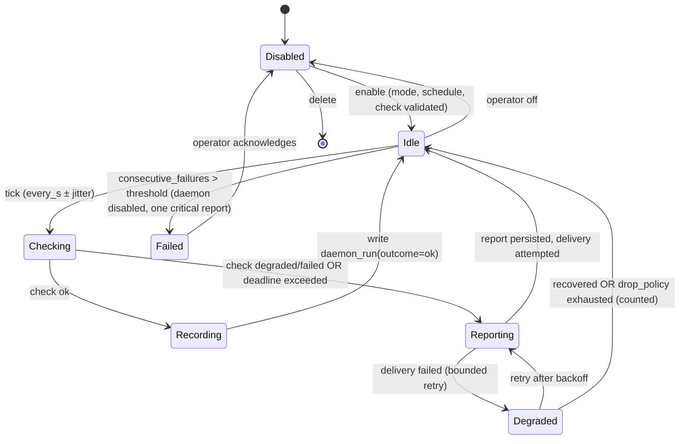

# 18 — Open-source hyperagent / superagent / agent / subagent / remote-watchdog daemon catalog

**Lane:** second-wave EXTRA lane 9. **Written:** 2026-11-08 (UTC) by the lane-9 researcher.
**Scope:** research only. No product file was edited. No code was copied. No paid API was called.
**Required reading consumed:** `OPERATOR-DECISIONS.md`, `09-synthesis-and-goal.md`,
`02-hmars-patterns.md`, and the HiveMind role code (`personas.json`, `prompts.rs`, `caps.rs`).
`11-donor-frameworks.md` **does not exist** in this repository (verified: `docs/research/hmars/`
contains `01`–`09` plus `OPERATOR-DECISIONS.md` only), so this lane stands in for it and
supersedes it for the donor question.

---

## L0 — What this file answers, in one paragraph

HiveMind's hierarchy is already coded as four tiers (`Hyper`, `Super`, `Worker`, `Tool`) with
hard caps, seven persona records, and no Remote/Watchdog type anywhere. That means the
hyper/super/agent/subagent tiers need **design donors** (vocabulary, contracts, failure
semantics), while the Remote/Watchdog daemon tier needs **architecture donors** (how a tiny
process does one job forever and reports to an owner without becoming a second agent runtime).
The strongest donors are not the famous agent frameworks. They are the boring monitors:
Healthchecks (dead-man's-switch semantics), Alertmanager (dedupe/route/inhibit), osquery
(enrolment → `node_key` → scheduled report), the OpenTelemetry Collector (bounded queue, retry,
explicit drop policy), and DeepSeek's own `dsh-superagent-prototype` (attention budget, ticket
ownership, outbox, record-only mode). The famous frameworks are mostly useful as **vocabulary
and anti-patterns**, and several of them are traps: AutoGen is archived, Watchtower is
unmaintained, MetaGPT's repository has been idle since January 2026, and the two most relevant
"HyperAgent" repositories are licensed **CC BY-NC-SA 4.0** and **AGPL-3.0** — both unusable in a
product.

---

## 0. Executive answer

**Adopt the monitoring-daemon design language, adapt the agent-framework vocabulary, reject the
frameworks themselves as runtime dependencies.**

1. **Remote/Watchdog tier is greenfield and should be built from four donor mechanics**, not from
   an agent framework: a *heartbeat/deadline* contract (Healthchecks, Uptime Kuma, Gatus), a
   *report policy* (Alertmanager: group, dedupe, inhibit, silence), an *enrolment and identity*
   contract (osquery `node_key`, Salt minion), and a *delivery reliability* contract (OTel
   Collector sending queue, retry with backoff, explicit drop policy, Apprise channel fan-out).
   None of these needs an LLM. That is the point: the operator asked for "one job forever", and an
   LLM in the loop makes that job neither one nor forever.
2. **HiveMind already has the right *discipline* for a daemon**: absorbing terminal states, a
   scoped context, a bounded result row, and named refusals. A Watchdog should reuse that
   discipline — bounded work, bounded output, named failure — while living in its own `daemons`
   table rather than as a Task (a scheduled task would eat `MAX_AGENTS`; §6.1 argues the trade).
3. **The four agent tiers need vocabulary, not code.** Two things are worth importing verbatim:
   the `delegate` (agents-as-tools, synchronous, result back) vs `handoff` (control transfer)
   distinction from the OpenAI Agents SDK, because HiveMind conflates its three verbs in the event
   contract; and context isolation for subagents (Deep Agents, Claude Code) — a child gets its own
   window and returns a bounded artifact.
4. **Licence reality check first:** 8 of the 49 catalogued repos are unusable as code donors
   (AGPL-3.0: `monit`, `netdata`, `hyperbrowserai/HyperAgent`; CC BY-NC-SA 4.0:
   `facebookresearch/HyperAgents`; GPL-2.0 server: `ntfy`; unlicensed: several small Rust
   "watchdog" crates; stale/archived: `containrrr/watchtower`, `microsoft/autogen`,
   `TransformerOptimus/SuperAGI`). Since HiveMind is Rust and every framework donor is
   Python/Go/TS, **almost all reuse is conceptual** — which sidesteps most licence contamination
   anyway. The Rust-native donors worth actual dependency use are `sysinfo` (MIT) and
   `watchexec` (Apache-2.0); both are libraries, not frameworks.
5. **The single best new donor is `deepseek-ai/dsh-superagent-prototype`** (MIT, active, 20.8k
   stars at sampling): it ships the exact concept the operator asked for — an agent that acts only
   when asked or when a written rule allows it, records instead of messaging while it works, asks
   one concrete question at a time, and reports only what needs a human. Its authorisation and
   outbox design maps cleanly onto HiveMind's missing Remote/Watchdog tier.

**Top-10 shortlist (full detail in §10):**

| # | Donor | Licence | Tier served | One-line reason |
|---|---|---|---|---|
| 1 | `healthchecks/healthchecks` | BSD-3-Clause | Remote/Watchdog | The canonical "no ping arrived ⇒ alert" state machine (period + grace) |
| 2 | `prometheus/alertmanager` | Apache-2.0 | Watchdog reports | Dedupe / group / inhibit / silence is the anti-alert-fatigue design |
| 3 | `osquery/osquery` | Apache-2.0 | Remote daemon | Enrol → `node_key` → scheduled report is the remote-agent identity contract |
| 4 | `open-telemetry/opentelemetry-collector` | Apache-2.0 | Any reporter | Bounded queue + retry + **explicit** drop semantics; no silent loss |
| 5 | `deepseek-ai/dsh-superagent-prototype` | MIT | SuperAgent + Watchdog | Attention budget, tickets, mandates, outbox, record-only mode |
| 6 | `bytedance/deer-flow` | MIT | SuperAgent harness | Sub-agents + memory + sandboxes as one harness, actively developed |
| 7 | `openai/openai-agents-python` | MIT | Agent / Subagent | The precise `agents-as-tools` vs `handoffs` distinction HiveMind lacks |
| 8 | `langchain-ai/deepagents` | MIT | Subagent | Sub-agents with isolated context windows + summarisation/offload thresholds |
| 9 | `caronc/apprise` | BSD-2-Clause | Report channels | A validated multi-channel notification syntax, no new protocol |
| 10 | `influxdata/telegraf` | MIT | Watchdog config | Interval/jitter/flush agent config that a 5-minute daemon needs |

**Runner-up:** `TwiN/gatus` (Apache-2.0) — declarative check definitions with evaluated
conditions; the best model for a user-editable check without a scripting language.

---

## 1. The decision this lane supports

| Field | Value |
|---|---|
| Decision | For each HMARS tier, should HiveMind **build**, **borrow a design**, or **take a dependency** — and specifically, how should the Remote/Watchdog daemon tier be implemented so it stays simple, safe, and observable? |
| Owner | The operator (Riley), via the HiveMind Lead. |
| Deadline | Feeds the P1 "Remote/Watchdog role/cards" work in `09-synthesis-and-goal.md` §7; not P0. |
| "Good enough" | A named donor or rejection for every tier; a licence-clean path for every adopted idea; a concrete list of fields/state machines a Rust implementation needs; and no claim that a repo is usable without having read its licence and its last-commit date in this session. |

### 1.1 Question list (18 questions, each with its evidence)

| # | Question | Evidence that would settle it |
|---|---|---|
| Q1 | Is there a real "hyperagent" project, and what does it mean? | GitHub name search + each repo's README + licence file |
| Q2 | Is "superagent" a product, a library, or a name collision? | Repo list for the term; README of each |
| Q3 | Which multi-agent framework is closest to HiveMind's tiering? | Framework docs/README structure (tier, spawn, handoff) |
| Q4 | Which frameworks are archived or abandoned? | Repo README banner + last-commit atom feed |
| Q5 | What licence classes block code reuse in a shipped product? | Each repo's `LICENSE` at HEAD |
| Q6 | How does a monitor know a job is dead rather than healthy? | Healthchecks pinging API; Uptime Kuma push monitor |
| Q7 | How should reports be deduplicated and routed? | Alertmanager README + docs |
| Q8 | How does a remote daemon authenticate to its owner? | osquery remote/TLS docs |
| Q9 | What happens when the owner is down? | OTel Collector resiliency docs |
| Q10 | How does a daemon run forever without an LLM? | Telegraf agent config; node_exporter design; healthdog-rs |
| Q11 | How does a daemon stay quiet? | `dsh-superagent` philosophy doc (attention budget) |
| Q12 | What is the report contract? | Healthchecks ping semantics + Alertmanager notification semantics |
| Q13 | How do subagents keep context isolated? | Deep Agents README; Claude Code subagent docs (via 02) |
| Q14 | What is the vocabulary for delegate vs handoff? | OpenAI Agents SDK README/docs |
| Q15 | Are there Rust-native donors so no Python runtime is added? | `sysinfo`, `watchexec`, `vigil`, `healthdog-rs` metadata |
| Q16 | Which popular donors are traps? | Archived banners, stale commit dates, unmaintained notices |
| Q17 | Does any donor conflict with the operator's decisions? | `OPERATOR-DECISIONS.md` cross-check (§15) |
| Q18 | What should be built vs borrowed, tier by tier? | The mapping in §11 |

---

## 2. Method, evidence bar, and what was actually fetched

### 2.1 Freshness rule (declared before searching)

Sampling window: **2026-11-08, 03:20Z–04:05Z**. A repository is:

- **CURRENT** — last commit ≤ 90 days before the sample;
- **SLOWING** — 90–365 days;
- **STALE** — > 365 days, or an explicit upstream "unmaintained/archived" banner.

Every date in this document is a UTC timestamp taken from the source, not from memory. Where a
date is a *push* date rather than a *commit* date, it says so.

### 2.2 Source hierarchy used

| Class | Source | Used for |
|---|---|---|
| **VERIFIED-API** | GitHub REST `repos` endpoint (one call, `pushed_at`, licence SPDX) | MetaGPT activity sanity check |
| **VERIFIED-HTML** | `https://github.com/{owner}/{repo}` sidebar licence string | Licence per repo |
| **VERIFIED-FEED** | `https://github.com/{owner}/{repo}/commits/HEAD.atom`, `…/releases.atom` | Last commit, latest release |
| **VERIFIED-REPO-DOC** | `raw.githubusercontent.com/{owner}/{repo}/HEAD/README.md` and `HEAD/docs/*.md` | Architecture claims about the project |
| **VERIFIED-OFFICIAL-DOCS** | healthchecks.io pinging API, freedesktop `sd_watchdog_enabled(3)`, osquery remote/TLS docs, OTel Collector resiliency docs | Protocol/mechanism claims |
| **READ** | This repository (`prompts.rs`, `caps.rs`, `personas.json`) | HiveMind-side claims |
| **SECONDARY** | Vendor blog / marketing copy inside a README | Never the sole basis of a recommendation |
| **UNVERIFIED** | Anything not fetched here | Listed in §17 |

No blog-only claim is load-bearing in this document. Marketing phrases inside READMEs (for
example "production-ready", "best-in-class") are treated as **SECONDARY** and are not repeated as
facts.

### 2.3 What the sampling actually hit

- **49 repositories catalogued.** Licence string and last-commit timestamp read for all 49. The
  releases feed was probed for 46; of those, four have no releases at all
  (`dsh-superagent-prototype`, `swarm`, `HyperAgents`, the awesome-claude-code catalog). Three were
  not sampled for releases: MetaGPT, SuperAGI and FSoft-AI4Code/HyperAgent.
- 6 repositories had **no SPDX licence in the sidebar**: `facebookresearch/HyperAgents`
  (LICENSE.md = CC BY-NC-SA 4.0), `hyperbrowserai/HyperAgent` (LICENSE = AGPL-3.0),
  `gotify/server` (LICENSE = MIT text), `Supervisor/supervisor` (GitHub reports "Other" for a
  BSD-style custom licence), `valeriansaliou/vigil` (LICENSE.md = MPL-2.0),
  `notify-rs/notify` (sidebar unreadable; dropped from the shortlist rather than guessed).
  In every case the licence file at HEAD was read, not inferred from the sidebar.
- 4 primary docs pages were read for mechanism claims (Healthchecks Pinging API, systemd
  `sd_watchdog_enabled(3)`, osquery remote/TLS, OTel Collector resiliency).
- **Not done:** no repository was cloned, built, or executed. No GitHub code search was used. No
  release artefacts were downloaded. Nothing was benchmarked. Every "architecture" statement is
  from the project's own documentation, not from reading its source.

---

## 3. Where the tiers actually are in HiveMind today (READ)

This section exists because a donor catalog is useless without the target shape. All claims are
read from the working tree on 2026-11-08.

### 3.1 The four coded tiers

`prompts.rs:367-379` defines `PersonaTier` with exactly four values:

```rust
pub enum PersonaTier { Hyper, Super, Worker, Tool }
```

`prompts.rs:381-404` defines `Persona` with `id`, `display_name`, `tier`, `template_id`,
`allowed_tool_ids`, `output_schema_id`, `refusal_policy`, and optional `max_children` /
`max_depth`.

`prompts.rs:411-434` (`Persona::validate`) checks: non-empty id and display name; refusal policy
in `{strict, report}`; template resolves; `max_children` ∈ (0, MAX_FANOUT]; `max_depth` ∈
(0, MAX_SPAWN_DEPTH]. **It does not validate `allowed_tool_ids`** — so a profile can name a tool
id that does not exist and still load. That is the registry gap `02-hmars-patterns.md` §6.3
already identified; this lane confirms it and adds a donor for it (§11, P1-1).

### 3.2 The shipped registry

`assets/prompts/personas.json` has **7 records**: `planner` (tier `hyper`, no tools,
`output_schema_id: plan-v1`), `superagent` (tier `super`, tools `spawn_agent`, `ask_parent`,
`send_to_sibling`, `file_read`, `file_list`, `report_result`, `finish`; `max_children: 8`,
`max_depth: 3`), and five workers (`content-writer`, `subagent`, `data-analyst`,
`code-reviewer`, `chatbot`). There is **no remote, watchdog, daemon, monitor, heartbeat, or
scheduled persona** of any kind.

### 3.3 There is no daemon concept anywhere in the code

A repository-wide search for `watchdog`, `Watchdog`, `remote_agent`, `RemoteAgent`, `daemon` in
`*.rs` returns **zero matches**. The Remote/Watchdog tier of HMARS exists only in
`OPERATOR-DECISIONS.md` and `09-synthesis-and-goal.md` §2 ("Not coded"). This is why the daemon
half of this catalog is the load-bearing half: there is nothing to adapt, only to build.

### 3.4 The caps a daemon must respect

`caps.rs:9-15`: `MAX_SPAWN_DEPTH = 3`, `MAX_FANOUT = 8`, `MAX_AGENTS = 64`, `MAX_CALLS = 40`;
`Caps::check_spawn` (`:49-60`) refuses with `E_SPAWN_DEPTH`, `E_FANOUT_LIMIT`, `E_AGENT_LIMIT`;
`check_calls` (`:66-71`) refuses with `E_CALL_LIMIT`. Every refusal is a named contract code,
never a clamp — the correct shape, and a constraint on any donor design: **a daemon design that
silently drops work is incompatible with this codebase's stated refusal discipline.**

### 3.5 What this implies for donor selection

| Tier | HiveMind state | Donor need |
|---|---|---|
| Hyper | Root planner task; no continuous loop (`09` §1 Q3) | Vocabulary for "run owner" and plan/progress ledgers; almost no code |
| Super | Tier + persona + spawn policy exists | Ownership model (department / branch / single task) and per-branch memory — design only |
| Agent | Tier + 5 personas exist | Execution contract (tools, refusals, result schema) — already close to reference |
| Subagent | Role alias; **no tier enum, no card, no bank** | Spawn isolation, context budget, result contract |
| Remote/Watchdog | **Absent** | Whole architecture: schedule, heartbeat, report, dedupe, enrolment, delivery |

Throughout the rest of this document the tier column uses exactly these five names.

---

## 4. Catalog

Two tables, split by side of the problem. **Every row was verified in this session**: licence from
the repository's sidebar or its licence file at HEAD, last commit from the `commits/HEAD.atom`
feed, latest release from `releases.atom`. "—" means the feed returned no release. Dates are UTC.
Verdicts are per tier and are argued in §5; `ADOPT` = take the design or the dependency, `ADAPT` =
take the idea and change it, `REJECT` = do not use, with the reason in the row.

### 4.1 Agent-side catalog (hyperagent / superagent / agent / subagent)

| # | Repository | Tier | Licence | Last commit (UTC) | Latest release | Verdict |
|---|---|---|---|---|---|---|
| 1 | [`deepseek-ai/dsh-superagent-prototype`](https://github.com/deepseek-ai/dsh-superagent-prototype) | Super + Watchdog | MIT | 2026-10-31 | — | **ADOPT (design)** |
| 2 | [`bytedance/deer-flow`](https://github.com/bytedance/deer-flow) | Super harness | MIT | 2026-11-08 | DeerFlow 2.2.0 (2026-11-04) | **ADAPT** |
| 3 | [`FoundationAgents/MetaGPT`](https://github.com/FoundationAgents/MetaGPT) | Hyper (SOP) | MIT | 2026-01-21 (push) | not sampled | **REJECT** (slowing, 71k★) |
| 4 | [`microsoft/agent-framework`](https://github.com/microsoft/agent-framework) | Super | MIT | 2026-11-06 | python-1.25.0 | **ADAPT** |
| 5 | [`microsoft/autogen`](https://github.com/microsoft/autogen) | Super (teams) | MIT | 2026-10-28 | python-v0.7.5 (2025-09-30) | **REJECT (archived)** |
| 6 | [`langchain-ai/langgraph`](https://github.com/langchain-ai/langgraph) | Hyper / graph | MIT | 2026-11-06 | langgraph-sdk 0.4.14 | **ADAPT** (concept) |
| 7 | [`langchain-ai/deepagents`](https://github.com/langchain-ai/deepagents) | Subagent | MIT | 2026-11-07 | langchain-quickjs 0.3.12 | **ADOPT (design)** |
| 8 | [`crewAIInc/crewAI`](https://github.com/crewAIInc/crewAI) | Super (crews) | MIT | 2026-11-07 | 1.15.37 | **REJECT** |
| 9 | [`openai/openai-agents-python`](https://github.com/openai/openai-agents-python) | Agent / Subagent | MIT | 2026-11-06 | Agents SDK v0.24.0-alpha.6 | **ADOPT (vocabulary)** |
| 10 | [`openai/swarm`](https://github.com/openai/swarm) | Subagent (handoff) | MIT | 2026-04-15 | — | **ADAPT** (educational) |
| 11 | [`huggingface/smolagents`](https://github.com/huggingface/smolagents) | Agent (code) | Apache-2.0 | 2026-10-06 | v1.26.0 (2026-05-29) | **ADAPT** |
| 12 | [`google/adk-python`](https://github.com/google/adk-python) | Super (`sub_agents`) | Apache-2.0 | 2026-11-07 | v2.14.0 | **ADAPT** |
| 13 | [`All-Hands-AI/OpenHands`](https://github.com/All-Hands-AI/OpenHands) | Agent runtime | MIT | 2026-11-08 | v1.37.0 | **ADAPT** |
| 14 | [`modelscope/agentscope`](https://github.com/modelscope/agentscope) | Agent (actor) | Apache-2.0 | 2026-11-04 | v2.0.11 | **REJECT** |
| 15 | [`letta-ai/letta`](https://github.com/letta-ai/letta) | Memory | Apache-2.0 | 2026-10-18 | v0.16.8 (2026-05-14) | **ADAPT** (memory) |
| 16 | [`block/goose`](https://github.com/block/goose) | Agent (local) | Apache-2.0 | 2026-11-08 | v1.57.0 | **ADAPT** |
| 17 | [`VoltAgent/awesome-claude-code-subagents`](https://github.com/VoltAgent/awesome-claude-code-subagents) | Subagent | MIT | 2026-11-02 | — | **ADOPT (format)** |
| 18 | [`TransformerOptimus/SuperAGI`](https://github.com/TransformerOptimus/SuperAGI) | Super | MIT | 2025-01-22 | not sampled | **REJECT** (stale) |
| 19 | [`facebookresearch/HyperAgents`](https://github.com/facebookresearch/HyperAgents) | Hyper (research) | **CC BY-NC-SA 4.0** | 2026-04-14 | — | **REJECT (licence)** |
| 20 | [`hyperbrowserai/HyperAgent`](https://github.com/hyperbrowserai/HyperAgent) | Agent (browser) | **AGPL-3.0** | 2026-05-11 | v1.0.0 (2025-11-19) | **REJECT (licence)** |
| 21 | [`FSoft-AI4Code/HyperAgent`](https://github.com/FSoft-AI4Code/HyperAgent) | Hyper (paper) | Apache-2.0 | 2024-12-10 (push) | not sampled | **REJECT** (stale) |
| 22 | [`superagent-ai/superagent`](https://github.com/superagent-ai/superagent) | Security guard | MIT | 2026-08-25 | rust-v0.0.9 | **REJECT for tier** (name collision) |
| 23 | [`SWE-agent/SWE-agent`](https://github.com/SWE-agent/SWE-agent) | Agent (coding) | MIT | 2026-07-16 | v1.1.0 (2025-05-22) | **REJECT** (bench-specific) |
| 24 | [`FoundationAgents/OpenManus`](https://github.com/FoundationAgents/OpenManus) | Agent | MIT | 2026-08-16 | v0.3.0 (2025-04-10) | **REJECT** (slowing) |

### 4.2 Daemon-side catalog (remote / watchdog / reporter)

| # | Repository | Tier | Licence | Last commit (UTC) | Latest release | Verdict |
|---|---|---|---|---|---|---|
| 25 | [`healthchecks/healthchecks`](https://github.com/healthchecks/healthchecks) | Watchdog (DMS) | BSD-3-Clause | 2026-11-05 | v5.0.3 (2026-10-27) | **ADOPT (design)** |
| 26 | [`louislam/uptime-kuma`](https://github.com/louislam/uptime-kuma) | Watchdog (push) | MIT | 2026-11-07 | 2.5.9 (2026-10-31) | **ADAPT** |
| 27 | [`TwiN/gatus`](https://github.com/TwiN/gatus) | Watchdog (checks) | Apache-2.0 | 2026-11-07 | v5.38.0 (2026-10-28) | **ADOPT (design)** |
| 28 | [`prometheus/alertmanager`](https://github.com/prometheus/alertmanager) | Report policy | Apache-2.0 | 2026-11-07 | 0.34.2 (2026-10-29) | **ADOPT (design)** |
| 29 | [`osquery/osquery`](https://github.com/osquery/osquery) | Remote daemon | Apache-2.0 (+GPL-2.0 components) | 2026-11-06 | 5.24.1 (2026-11-04) | **ADOPT (design)** |
| 30 | [`influxdata/telegraf`](https://github.com/influxdata/telegraf) | Collector agent | MIT | 2026-11-06 | v1.40.3 (2026-11-02) | **ADOPT (design)** |
| 31 | [`prometheus/node_exporter`](https://github.com/prometheus/node_exporter) | One-job agent | Apache-2.0 | 2026-11-02 | 1.12.1 (2026-07-14) | **ADAPT** |
| 32 | [`open-telemetry/opentelemetry-collector`](https://github.com/open-telemetry/opentelemetry-collector) | Delivery pipeline | Apache-2.0 | 2026-11-06 | v1.71.0 / v0.165.0 | **ADOPT (design)** |
| 33 | [`saltstack/salt`](https://github.com/saltstack/salt) | Remote daemon | Apache-2.0 | 2026-11-07 | v3007.17 (2026-10-27) | **ADAPT** |
| 34 | [`caronc/apprise`](https://github.com/caronc/apprise) | Notification fan-out | BSD-2-Clause | 2026-11-08 | v2.1.0 (2026-10-24) | **ADOPT (design)** |
| 35 | [`binwiederhier/ntfy`](https://github.com/binwiederhier/ntfy) | Push channel | **GPL-2.0** server / Apache-2.0 clients | 2026-11-04 | v2.37.2 | **REJECT code, ADAPT protocol** |
| 36 | [`gotify/server`](https://github.com/gotify/server) | Push channel | MIT | 2026-10-25 | v3.1.1 (2026-09-15) | **ADAPT** |
| 37 | [`crazy-max/diun`](https://github.com/crazy-max/diun) | One-job watcher | MIT | 2026-10-24 | v4.33.1 (2026-10-24) | **ADOPT (design)** |
| 38 | [`dgtlmoon/changedetection.io`](https://github.com/dgtlmoon/changedetection.io) | One-job watcher | Apache-2.0 | 2026-11-06 | 0.70.2 (2026-11-05) | **ADAPT** |
| 39 | [`containrrr/watchtower`](https://github.com/containrrr/watchtower) | Auto-update | Apache-2.0 | 2025-12-17 | v1.7.1 (2023-11-11) | **REJECT (unmaintained)** |
| 40 | [`tildeslash/monit`](https://github.com/tildeslash/monit) | Process watchdog | **AGPL-3.0** | 2026-11-05 | release-6-1-0 | **REJECT (licence)** |
| 41 | [`Supervisor/supervisor`](https://github.com/Supervisor/supervisor) | Process supervisor | BSD-style ("Other") | 2025-12-21 | 4.3.0 (2025-08-23) | **ADAPT** |
| 42 | [`henrygd/beszel`](https://github.com/henrygd/beszel) | Hub + agent | MIT | 2026-11-07 | v0.21.1 (2026-10-22) | **ADAPT** |
| 43 | [`prometheus-community/windows_exporter`](https://github.com/prometheus-community/windows_exporter) | Windows metrics | MIT | 2026-11-03 | v0.32.2-alpha.0 | **ADOPT (design)** |
| 44 | [`winsw/winsw`](https://github.com/winsw/winsw) | Windows service | MIT | 2026-05-30 | v3.0.0-alpha.11 (2023-01-30) | **ADAPT** |
| 45 | [`valeriansaliou/vigil`](https://github.com/valeriansaliou/vigil) | Rust alerting | MPL-2.0 | 2026-10-10 | v1.29.0 (2026-03-26) | **ADAPT** (Rust) |
| 46 | [`watchexec/watchexec`](https://github.com/watchexec/watchexec) | Watch/execute | Apache-2.0 | 2026-11-03 | v8.4.4 (2026-10-06) | **ADOPT (library)** |
| 47 | [`GuillaumeGomez/sysinfo`](https://github.com/GuillaumeGomez/sysinfo) | Host metrics | MIT | 2026-11-07 | v0.40.1 (2026-10-30) | **ADOPT (library)** |
| 48 | [`netdata/netdata`](https://github.com/netdata/netdata) | Edge agent | **GPL-3.0** | 2026-11-08 | v2.12.3 (2026-11-04) | **REJECT (licence)** |
| 49 | [`balena-os/healthdog-rs`](https://github.com/balena-os/healthdog-rs) | Heartbeat bridge | Apache-2.0 | 2022-06-21 | v1.0.6 (2022-06-21) | **REJECT (stale; read-only)** |

**Reading the tables:** activity is healthy almost everywhere (the population was chosen to be
maintained), so the discriminating columns are **licence** and **fit**. The only CURRENT repos in
the list that cannot be used are the AGPL/GPL/NC ones; the only ones that can be used as *code*
(rather than design) are 46 and 47, both Rust libraries.

---

## 5. Tier-by-tier donor analysis

### 5.0 How to read a card

Each card answers the nine fields the lane requires. **Architecture** is what the project says
about itself (repo docs), not a code audit. **Reusable ideas/code** distinguishes *design* (free to
reuse after review, no licence obligation because nothing is copied) from *code* (needs the licence
check in §10). **Integration cost** is estimate for this Rust codebase: **S** ≤ 1 day, **M** 1–3
days, **L** 1–2 weeks, **XL** > 2 weeks. **Risk** is the combined security + maintenance risk if
the idea or dependency is adopted.

### 5.1 HyperAgent tier — the run owner

The tier needs three things HiveMind does not have: a continuous owner loop (not just a planner
row), a task ledger visible to the owner, and an aggregation/termination policy. No donor is
adoptable as code; the useful ones are those that describe an owner loop honestly.

#### 5.1.1 `deepseek-ai/dsh-superagent-prototype` — the closest published match

| Field | Value |
|---|---|
| Repo | https://github.com/deepseek-ai/dsh-superagent-prototype |
| Licence | MIT (sidebar + `LICENSE`) |
| Last activity | commit 2026-10-31; no releases; ~20,870★ at sampling |
| Architecture | A proactive coding agent for one repository, packaged as a DeepSeek Harness bundle. Listens to GitHub (optionally Feishu); when an allowed person asks for work it opens a **work item (Ticket)**, runs it in its own agent session and directory, and answers in the original conversation. Docs are numbered `000-philosophy` … `008-cookbook`; `007-architecture` names `Runtime`, `Engine`, `Store`, `Policy`, `SourceRegistry`, `MasterAssessor`, `DshExecutor`, `Outbox`, `Effects`, `Sessions`. |
| Tier filled | SuperAgent *and* Remote/Watchdog (it is an always-on owner-facing daemon that spawns bounded work) |
| Reusable ideas | (a) **Attention budget** as the top-level design rule; (b) **Ticket/Mandate/Subscription** ownership model; (c) **gate** deciding who may start work; (d) **Outbox** as the only path from internal state to a human message; (e) **record-only mode** — proactive work starts by recording what it *would* have done; (f) **one concrete question at a time**; (g) resume interrupted assignments on startup. |
| Reusable code | None directly (TypeScript bundle for DSH). The docs are the artefact. |
| Integration cost | **M** — port concepts into Rust structs and one SQLite table set; no runtime dependency |
| Risk | Low licence risk (MIT). Design risk: it is explicitly labelled "research prototype … not production-ready"; copy the contracts, not the code. Its GitHub/Feishu coupling is irrelevant to HiveMind. |
| Verdict | **ADOPT (design)** — the single best donor for the daemon tier |

#### 5.1.2 `bytedance/deer-flow` — a complete super-agent harness

| Field | Value |
|---|---|
| Repo | https://github.com/bytedance/deer-flow |
| Licence | MIT |
| Last activity | commit 2026-11-08; DeerFlow 2.2.0 released 2026-11-04; ~85,121★ |
| Architecture | Self-described "open-source super agent harness that orchestrates **sub-agents**, **memory**, and **sandboxes**", "powered by extensible skills". v2.0 is a ground-up rewrite; v1 lives on a maintenance branch. |
| Tier filled | SuperAgent harness (the layer that owns subagents, memory and sandboxes for one long task) |
| Reusable ideas | The three-part harness split — **subagent orchestration**, **memory**, **sandbox** — is the cleanest statement of what a SuperAgent must own. Its skill concept is a bounded, named capability set, which maps to HiveMind's `template_id` + allowlist. |
| Reusable code | None (Python + Node). Licence is permissive but the code is a full application, not a library. |
| Integration cost | **L** (concepts) / **XL** (code) |
| Risk | Medium maintenance risk: 2.0 rewrote 1.x wholesale, so APIs are still moving; the repo is extremely large and fast-moving. Do not pin a design to its internals. |
| Verdict | **ADAPT** — steal the harness decomposition, not the harness |

#### 5.1.3 `FoundationAgents/MetaGPT` — the SOP donor, now slow

| Field | Value |
|---|---|
| Repo | https://github.com/FoundationAgents/MetaGPT |
| Licence | MIT |
| Last activity | last **push** 2026-01-21 (API `pushed_at`) → **SLOWING**, ~9.5 months at sampling; 71,213★. Releases were not sampled; do not claim a release date. |
| Architecture | "SOPs encoded into prompt sequences", assembly-line role assignment, structured intermediate artefacts; motivated by cascading hallucinations from naive chaining. |
| Tier filled | Hyper/Super (SOP-driven decomposition) |
| Reusable ideas | Role + procedure + **structured intermediate artefact** is exactly `Persona.template_id` + `output_schema_id` + `task_result`. The negative lesson matters more: a *fixed* software-engineering SOP cannot generalize to arbitrary operator goals, so only the invariants are portable. |
| Reusable code | None (Python) |
| Integration cost | **S** (ideas) |
| Risk | Low licence risk; **maintenance risk is real** — an idle flagship repo suggests the project's centre of gravity moved elsewhere. Do not cite it as "state of the art 2026". |
| Verdict | **REJECT as a dependency**, **ADAPT** its SOP/artefact idea (already reflected in `02` §3.7) |

#### 5.1.4 `langchain-ai/langgraph` — the durable-execution vocabulary

| Field | Value |
|---|---|
| Repo | https://github.com/langchain-ai/langgraph |
| Licence | MIT |
| Last activity | commit 2026-11-06; `langgraph-sdk==0.4.14` release 2026-11-06 |
| Architecture | Graph/state-machine execution with checkpointing and a configurable recursion limit that raises a named error. Its supervisor package was retired upstream in favour of "subagents as tools" (`02` §3.3). |
| Tier filled | Hyper (orchestration graph) |
| Reusable ideas | One checkpointer at the outermost level; a named step-limit error; interrupts propagate only when the outer graph owns the checkpointer. These validate HiveMind's single-run-snapshot design. |
| Reusable code | None (Python). Copying graph semantics into Rust would duplicate `planner.rs` + `execution.rs` for no gain. |
| Integration cost | **S** (validation of existing design) |
| Risk | Low. The main risk is architectural temptation: building a second scheduler next to the task table. |
| Verdict | **ADAPT** — confirm the current design; add nothing |

#### 5.1.5 `facebookresearch/HyperAgents` — the name trap

| Field | Value |
|---|---|
| Repo | https://github.com/facebookresearch/HyperAgents |
| Licence | **CC BY-NC-SA 4.0** (`LICENSE.md` read at HEAD) — non-commercial, share-alike |
| Last activity | commit 2026-04-14; no releases; 2,873★ |
| Architecture | "Self-referential self-improving agents that can optimize for any computable task" — a research artefact about agents that rewrite their own scaffolding. |
| Tier filled | HyperAgent (research) |
| Reusable ideas | Conceptually interesting (self-modifying scaffolding), operationally hostile: self-modification is the opposite of an auditable runtime with absorbing terminal states. |
| Reusable code | **None.** CC BY-NC-SA forbids commercial use and imposes share-alike on adaptations. |
| Integration cost | N/A |
| Risk | **High licence risk.** Even paraphrasing its code structure into a product is the kind of derivative question no one wants to litigate. |
| Verdict | **REJECT (licence)** — cite only as literature |

### 5.2 SuperAgent tier — the branch owner

HiveMind already has the tier (`PersonaTier::Super`, `personas.json` `superagent` with
`max_children: 8`, `max_depth: 3`). What it lacks is an **ownership model**: is a SuperAgent a
department, a branch, or one complex task? `OPERATOR-DECISIONS.md` says ownership must be
switchable. The donors below each pick one model.

#### 5.2.1 `microsoft/agent-framework` — the maintained successor

| Field | Value |
|---|---|
| Repo | https://github.com/microsoft/agent-framework |
| Licence | MIT |
| Last activity | commit 2026-11-06; `python-1.25.0` released 2026-11-07 |
| Architecture | Microsoft's current multi-agent framework; the AutoGen README points here as the maintained path. |
| Tier filled | Super (agent orchestration) |
| Reusable ideas | The migration itself is the lesson: Microsoft replaced a *conversation-centric* framework with a *workflow/agent* one. For HiveMind, that argues against importing group-chat semantics. |
| Reusable code | None (Python/.NET) |
| Integration cost | **S** (watch only) |
| Risk | Low licence risk; young API surface. |
| Verdict | **ADAPT** — track it as the successor; do not depend on it |

#### 5.2.2 `microsoft/autogen` — archived, and why that matters

| Field | Value |
|---|---|
| Repo | https://github.com/microsoft/autogen |
| Licence | MIT |
| Last activity | **archived**: README carries "⚠️ Project archived and no longer maintained … Microsoft is not providing bug fixes, security fixes, new features, or support". Last commit 2026-10-28; last release `python-v0.7.5` 2025-09-30. |
| Architecture | AgentChat teams (round-robin, selector, Magentic-One, Swarm) plus a Core actor layer; shared-context group chat is the default team shape. |
| Tier filled | Super (teams) / Hyper (Magentic-One) |
| Reusable ideas | The **failure** is the artefact: the most-cited multi-agent framework of 2024–2025 is archived in 2026. Its Magentic-One Task/Progress Ledger remains a good *pattern* (`02` §3.5), and its broadcast rules (no self-delivery, failures must not vanish) remain mandatory if a bus is ever built. |
| Reusable code | None — archived code receives no security fixes. |
| Integration cost | N/A |
| Risk | **High**: archived dependency with known-unpatched vulnerabilities over time. |
| Verdict | **REJECT (archived)** — read it as a post-mortem, never vendor it |

#### 5.2.3 `crewAIInc/crewAI` — role-play crews

| Field | Value |
|---|---|
| Repo | https://github.com/crewAIInc/crewAI |
| Licence | MIT |
| Last activity | commit 2026-11-07; 1.15.37 released 2026-11-07 |
| Architecture | "Crews" of role-playing agents plus "Flows"; a crew is a small team with roles and a process, not a hierarchy of thousands. |
| Tier filled | Super (small team) |
| Reusable ideas | The role/process split is legible, but the abstraction is conversational: roles are personas that talk to each other. HiveMind's SuperAgent is a *scheduler-owned branch*, not a conversation participant. |
| Reusable code | None (Python) |
| Integration cost | **M** if copied (not recommended) |
| Risk | Medium: adopting the mental model would push HiveMind toward shared transcripts, which `02` §7 X4 rejects. |
| Verdict | **REJECT** — wrong abstraction for a task-tree runtime |

#### 5.2.4 `google/adk-python` — `sub_agents` and transfer

| Field | Value |
|---|---|
| Repo | https://github.com/google/adk-python |
| Licence | Apache-2.0 |
| Last activity | commit 2026-11-07; v2.14.0 released 2026-11-07; README self-identifies as "ADK 2.0" |
| Architecture | "Code-first Python framework for building, evaluating, and deploying … agents"; hierarchical `sub_agents` with control transfer between them. |
| Tier filled | Super (hierarchy) |
| Reusable ideas | Naming: a parent owns `sub_agents` and may **transfer** control. That is the handoff verb HiveMind deliberately does not have (`02` §6.2). Useful as a contrast, not a target. |
| Reusable code | None (Python) |
| Integration cost | **S** (vocabulary) |
| Risk | Low. |
| Verdict | **ADAPT** — use as the counter-example that justifies HiveMind's three-verb design |

#### 5.2.5 `modelscope/agentscope` — actor runtime

| Field | Value |
|---|---|
| Repo | https://github.com/modelscope/agentscope |
| Licence | Apache-2.0 |
| Last activity | commit 2026-11-04; v2.0.11 released 2026-10-27 |
| Architecture | "Production-ready, easy-to-use agent framework with essential abstractions"; the README positions it around those abstractions rather than constraining models. Its distributed/multi-agent orientation is what makes it a poor fit for a single-binary local runtime. |
| Tier filled | Agent/Super (actor model) |
| Reusable ideas | The actor model is the honest way to do concurrent agents — and it is exactly the second scheduler HiveMind does not need while a run is serialized. |
| Reusable code | None (Python) |
| Integration cost | **XL** (would require a concurrency redesign) |
| Risk | Medium: adopting actors before the admission scheduler exists would create two concurrency models. |
| Verdict | **REJECT for now** — revisit only after S3–S4 scale stages |

### 5.3 Agent tier — the worker

HiveMind's worker tier is already close to the reference: tools, refusals, bounded results. The
donors here are useful for **one** thing each: code-as-action, guardrails, local-first execution,
and the delegate/handoff vocabulary.

#### 5.3.1 `openai/openai-agents-python` — delegate vs handoff, stated precisely

| Field | Value |
|---|---|
| Repo | https://github.com/openai/openai-agents-python |
| Licence | MIT |
| Last activity | commit 2026-11-06; `Agents SDK v0.24.0-alpha.6` released 2026-11-03 |
| Architecture | "Lightweight … framework for multi-agent workflows": Agents, **agents-as-tools**, **handoffs**, guardrails, human-in-the-loop, sessions, tracing. Provider-agnostic (README says 100+ LLMs). |
| Tier filled | Agent + Subagent |
| Reusable ideas | The **names**. `agents-as-tools` is a synchronous delegate that returns a result; `handoff` transfers the conversation. HiveMind's `spawn_agent` is the former and `send_to_sibling` is neither (it is notify). Making that explicit in the tool schema/event contract is `02` P0-4. Also: guardrails are input/output validators, not approval gates — a distinction HiveMind should keep. |
| Reusable code | None (Python), but the concepts are small enough to re-implement in ~50 lines of Rust. |
| Integration cost | **S** |
| Risk | Low. Note the release is an **alpha** (`-alpha.6`) — do not model version stability on it. |
| Verdict | **ADOPT (vocabulary)** |

#### 5.3.2 `huggingface/smolagents` — code-as-action, minimal

| Field | Value |
|---|---|
| Repo | https://github.com/huggingface/smolagents |
| Licence | Apache-2.0 |
| Last activity | commit 2026-10-06; v1.26.0 released 2026-05-29 |
| Architecture | "Agents that think in code" — a `CodeAgent` writes actions as code instead of JSON tool calls; the whole agent logic is advertised as ~1,000 lines. |
| Tier filled | Agent |
| Reusable ideas | Minimality as a design constraint. Code-as-action is a real alternative to tool-call JSON, but it requires a sandbox and a language runtime — HiveMind has neither for agents, and the operator's tool list is explicit. So: take the *smallness*, not the code action. |
| Reusable code | None (Python) |
| Integration cost | **S** (design pressure only) |
| Risk | Low licence risk; medium conceptual risk (code execution inside an agent is a sandbox project, not a feature). |
| Verdict | **ADAPT** — keep HiveMind's tool loop small and legible |

#### 5.3.3 `block/goose` — local-first agent

| Field | Value |
|---|---|
| Repo | https://github.com/block/goose |
| Licence | Apache-2.0 |
| Last activity | commit 2026-11-08; v1.57.0 released 2026-10-28 |
| Architecture | A local, extensible coding agent with a desktop surface; tool-driven. |
| Tier filled | Agent (local desktop) |
| Reusable ideas | Closest *product shape* to what HiveMind is: a local desktop agent app with tools. Useful for UI expectations (tool activity, sessions), not for architecture. |
| Reusable code | None (Rust + TypeScript, but a full app; extracting parts is not a realistic integration) |
| Integration cost | **XL** (code) / **S** (product study) |
| Risk | Low. |
| Verdict | **ADAPT** — a UX comparator, not a donor |

#### 5.3.4 `letta-ai/letta` — memory blocks

| Field | Value |
|---|---|
| Repo | https://github.com/letta-ai/letta |
| Licence | Apache-2.0 |
| Last activity | commit 2026-10-18; v0.16.8 released 2026-05-14. README says current development moved to `letta-ai/letta-code`, which "includes the agent harness, interactive terminal UI, App Server, channels, and the runtime". |
| Architecture | Stateful agents with editable memory blocks ("memory that can learn"), originally MemGPT. |
| Tier filled | Memory (all tiers) |
| Reusable ideas | Memory as a **small set of named, size-bounded blocks** the model can edit — a cleaner mental model than a vector store, and compatible with HiveMind's SQLite-first decision. The self-editing part is the risk: an agent editing its own memory is a poisoning surface (`02` §8.5). |
| Reusable code | None (Python/TS) |
| Integration cost | **M** (memory-block design) |
| Risk | Medium: self-editing memory + no provenance is exactly the AgentPoison shape. Adopt blocks, reject self-promotion. |
| Verdict | **ADAPT** (memory blocks; promotion stays operator/parent-gated) |

### 5.4 Subagent tier — the leaf

This is HiveMind's thinnest tier: a role alias mapped to `WorkerAgent`, no tier enum, no card, no
bank (`09` §1 Q5, §2 table). The donors are about **isolation and result shape**.

#### 5.4.1 `langchain-ai/deepagents` — subagents with isolated context

| Field | Value |
|---|---|
| Repo | https://github.com/langchain-ai/deepagents |
| Licence | MIT |
| Last activity | commit 2026-11-07; release `langchain-quickjs==0.3.12` 2026-11-07 (the release feed is per-package, not the harness version — do not misread it as the Deep Agents version) |
| Architecture | "Batteries-included agent harness" on LangGraph: **sub-agents with isolated context windows**, filesystem tools over pluggable backends, context management (summarise long threads, offload tool output to disk), shell in a sandbox, persistent memory backends. |
| Tier filled | Subagent + context management |
| Reusable ideas | (a) subagent = isolated window + bounded return; (b) **offload oversized tool output to disk and pass a reference** — the Anthropic pattern with a concrete product shape; (c) summarisation thresholds as a context-budget mechanism. |
| Reusable code | None (Python) |
| Integration cost | **M** (context/offload design) |
| Risk | Low licence. Design risk: its filesystem abstraction assumes a sandbox HiveMind does not yet have. |
| Verdict | **ADOPT (design)** |

#### 5.4.2 `VoltAgent/awesome-claude-code-subagents` — the definition format

| Field | Value |
|---|---|
| Repo | https://github.com/VoltAgent/awesome-claude-code-subagents |
| Licence | MIT |
| Last activity | commit 2026-11-02; no releases; 26,406★; README says "161+ subagents across 10 categories" |
| Architecture | A catalog, not a runtime: each subagent is a Markdown file with frontmatter (name, description, tools, model) plus a prompt body. |
| Tier filled | Subagent (definition/registry) |
| Reusable ideas | The **file format** is the contribution: identity + description + tool allowlist + prompt, one file per role, no code. That is almost exactly HiveMind's `Persona` minus `description`/`tags[]`/provenance. It also demonstrates the `02` warning that descriptions are a context cost — 161 descriptions cannot all be in a prompt. |
| Reusable code | Definitions are text, not code; still, do not import 161 prompts into a product without review — they are third-party content with unknown provenance and their own licence. |
| Integration cost | **S** (schema shape) |
| Risk | Low. Risk is bulk-importing unreviewed prompts, which the operator's "no uncontrolled third-party marketplace" rule already forbids. |
| Verdict | **ADOPT (format)** |

#### 5.4.3 `openai/swarm` — the minimal handoff demo

| Field | Value |
|---|---|
| Repo | https://github.com/openai/swarm |
| Licence | MIT |
| Last activity | commit 2026-04-15; no releases (it is an educational repo, superseded by the Agents SDK) |
| Architecture | Agents + handoffs + routines in a few hundred lines; explicitly educational. |
| Tier filled | Subagent (handoff) |
| Reusable ideas | The smallest complete implementation of "control transfer" — useful precisely because HiveMind *rejects* it: reading it makes the rejection concrete. |
| Reusable code | No — superseded, educational. |
| Integration cost | **S** |
| Risk | Low. |
| Verdict | **ADAPT** (as a reference for what not to build) |

#### 5.4.4 Claude Code's subagent contract (from `02`, not re-fetched here)

`02-hmars-patterns.md` §3.6 already established, from the Claude Code docs, the operational rules
this lane relies on: a subagent runs in its own context window and does not see the parent's
history; depth defaults to three layers and at the limit the spawn **tool is withheld** rather than
refused; concurrency defaults to 20 with a non-retryable error; report text is marked as untrusted
prose whose instructions and approval claims carry no authority. Those are the strongest published
constraints for a leaf tier, and they are **already the recommendation of `02`** (I3, I10). This
lane adds nothing to them; it only notes that no open-source *code* donor matches them as well as
that document does.

#### 5.4.5 Compact nine-field coverage for the remaining agent-side candidates

Seven agent-side candidates have no full card. They are compressed here so that every row in §4.1
carries all nine required fields (URL, licence, activity and tier are in §4.1).

| Repository | Architecture | Reusable idea | Cost | Risk | Verdict |
|---|---|---|---|---|---|
| `All-Hands-AI/OpenHands` (#13) | Self-hosted "developer control center" that runs OpenHands, Claude Code, Codex, Gemini, Pi, OpenCode or any ACP-compatible agent across local, remote and cloud backends | Backend abstraction: one control surface, many agent runtimes — the cleanest published answer to "where does the agent execute" | **L** (concept) / **XL** (code) | Medium: large, fast-moving app; assumes a runtime/sandbox layer HiveMind lacks | **ADAPT** (concept only) |
| `TransformerOptimus/SuperAGI` (#18) | A "super agent" platform with tools, memory, and a web UI | None load-bearing; it is a warning about platform ambition outrunning maintenance | N/A | **High**: stale since 2025-01-22; no release sampled | **REJECT** (stale) |
| `hyperbrowserai/HyperAgent` (#20) | AI browser automation | None for HMARS; browser control is explicitly a later, sandbox-gated capability | N/A | **High**: AGPL-3.0 | **REJECT** (licence) |
| `FSoft-AI4Code/HyperAgent` (#21) | Paper artefact: "generalist software agents to solve software engineering tasks" | The paper's *scale* framing, not its code | **S** (read the paper) | Medium: last push 2024-12-10 | **REJECT** (stale) |
| `superagent-ai/superagent` (#22) | A guardrail service that "protects AI applications against prompt injections, data leaks, and harmful outputs" | The input/output **guardrail validator** taxonomy — a validator layer, never an approval gate | **M** (design) | Low; different product entirely (name collision) | **REJECT for the tier**, **ADAPT** the guardrail taxonomy |
| `SWE-agent/SWE-agent` (#23) | Agent-computer interface for software tasks, with a benchmark harness | The ACI idea: a purpose-built tool interface beats raw shell for a narrow task | **M** | Low; benchmark-specific, not a runtime | **REJECT** for HMARS |
| `FoundationAgents/OpenManus` (#24) | Open general-purpose agent scaffold | Minimal tool-loop reading; nothing HiveMind does not already have | **S** | **High**: commit 2026-08-16, last release 2025-04-10 | **REJECT** (slowing) |


### 5.5 Remote/Watchdog tier — the daemon that does one job forever

This is the priority tier of this lane. The operator's requirement is unusually specific:
"deliberately simple switches/daemons: one job forever, report to their owner, low complexity
(e.g. 'watchdog this hive and report every 5 minutes')", and every one gets a UI card
(`OPERATOR-DECISIONS.md`). The donors below are chosen for **mechanics per line of concept**, not
for feature richness.

#### 5.5.1 `healthchecks/healthchecks` — the dead-man's switch

| Field | Value |
|---|---|
| Repo | https://github.com/healthchecks/healthchecks |
| Licence | BSD-3-Clause (sidebar + README) |
| Last activity | commit 2026-11-05; v5.0.3 released 2026-10-27 |
| Architecture | A cron-job monitoring service: it "listens for HTTP requests and email messages ('pings') from your cron jobs and scheduled tasks ('checks'). When a ping does not arrive on time, Healthchecks sends out alerts." Each check has a configurable **Period** (expected time between pings) and **Grace Time** (how long to wait before alerting when a job is late). Either can be expressed as a cron expression. |
| Tier filled | Remote/Watchdog (owner-side monitor for push-style daemons) |
| Reusable ideas | The **inversion**: the daemon does not report failure, it reports *liveness*, and the owner derives failure from silence. That makes "process died", "machine off", "network down" and "job hung" the same observable. The Pinging API (healthchecks.io/docs/http_api/, read this session) defines the full contract: `success`, `start`, `failure`, `log`, and exit-status endpoints; a client-picked `rid` run id to pair start/finish; a 100 kB body cap for diagnostic text; "do not ping more than 5 times per minute". This is a complete, minimal, documented protocol for a dumb daemon. |
| Reusable code | Python/Django; do not port. The **state model** (new → started → success/failure; late → grace → alert) is portable as data. |
| Integration cost | **M** — one `daemon_heartbeat` table, one derived status query, one timer |
| Risk | Low. Self-hosted by default; the hosted service is out of scope for this lane — only the open-source design is used. |
| Verdict | **ADOPT (design)** — the base state machine for every Watchdog in HiveMind |

#### 5.5.2 `TwiN/gatus` — declarative checks with evaluated conditions

| Field | Value |
|---|---|
| Repo | https://github.com/TwiN/gatus |
| Licence | Apache-2.0 |
| Last activity | commit 2026-11-07; v5.38.0 released 2026-10-28 |
| Architecture | A health dashboard: HTTP/ICMP/TCP/DNS checks, each evaluated by a list of **conditions** over status code, response time, certificate expiry, body, etc.; each check can be paired with alerting via many providers. Configuration is declarative; the README documents `endpoints`, `conditions`, `placeholders`, `functions`, `storage`, `client configuration`, `tunneling`. |
| Tier filled | Watchdog (pull-style checks) |
| Reusable ideas | The **condition list** is the right shape for a user-editable check without a scripting language: `[status == 200]`, `[body contains "ok"]`, `[certificate.expiration < 720h]`. For HiveMind this maps to a `DaemonSpec.checks: Vec<Check>` where `Check` is a small tagged enum — safe to validate, safe to store, no code execution. |
| Reusable code | Go; not portable. Copy the *schema idea*. |
| Integration cost | **M** |
| Risk | Low. |
| Verdict | **ADOPT (design)** — the declarative check vocabulary |

#### 5.5.3 `prometheus/alertmanager` — the report policy engine

| Field | Value |
|---|---|
| Repo | https://github.com/prometheus/alertmanager |
| Licence | Apache-2.0 |
| Last activity | commit 2026-11-07; 0.34.2 released 2026-10-29 |
| Architecture | "Handles alerts sent by client applications … deduplicating, grouping, and routing them to the correct receiver integrations … It also takes care of silencing and inhibition of alerts." |
| Tier filled | Report policy (owner side, between daemons and the operator) |
| Reusable ideas | Four mechanisms, each of which prevents a specific HiveMind failure: **dedupe** (same fingerprint ⇒ one notification), **grouping** (`group_by` ⇒ one message for N related daemons), **inhibition** (a parent-down alert suppresses child alerts), **silence** (operator mutes a known-noisy daemon for a window). This is the antidote to "every watchdog message goes to the operator", which would violate the attention budget the operator implicitly asked for. |
| Reusable code | Go; not portable. The policy *shape* is. |
| Integration cost | **M** — a `report_policy` settings block + a dedupe key on reports |
| Risk | Low. |
| Verdict | **ADOPT (design)** |

#### 5.5.4 `osquery/osquery` — enrolment and remote reporting

| Field | Value |
|---|---|
| Repo | https://github.com/osquery/osquery |
| Licence | Apache-2.0 (sidebar also matched GPL-2.0 strings; the repo is Apache-2.0 with GPL-2.0 components — treat as Apache-2.0 with a component review) |
| Last activity | commit 2026-11-06; 5.24.1 released 2026-11-04 |
| Architecture | "SQL powered operating system instrumentation, monitoring, and analytics framework"; tables are OS concepts; a daemon (`osqueryd`) runs scheduled queries and can ship results to a remote server. The remote docs read this session describe: nodes **enrol** once, receive a **`node_key`**, store it persistently (RocksDB), and then "make config/logger requests while providing `node_key` as identification/authentication"; enrolment can be a shared secret (`--enroll_secret_path`/`--enroll_secret_env`) or TLS client auth; the server may require **manual approval per new enrolment**; distributed queries let the server ask a node to run a query. |
| Tier filled | Remote daemon |
| Reusable ideas | The exact identity contract a remote HiveMind daemon needs: (1) enrol with a one-time secret; (2) receive an opaque, revocable per-daemon key; (3) authenticate every report with it; (4) persist it; (5) allow the owner to require approval for new enrolments. Plus: **the node never trusts its config blindly** — config comes from the server, so the owner can change what the daemon checks without redeploying it. |
| Reusable code | C++; no. The protocol is ~5 fields. |
| Integration cost | **M** |
| Risk | Medium: osquery agents are typically privileged. HiveMind's daemons should be **unprivileged by construction** — the enrolment idea is safe, the "run arbitrary SQL as root" idea is not. |
| Verdict | **ADOPT (design)** — enrolment + node key + server-supplied config |

#### 5.5.5 `influxdata/telegraf` — the interval agent

| Field | Value |
|---|---|
| Repo | https://github.com/influxdata/telegraf |
| Licence | MIT |
| Last activity | commit 2026-11-06; v1.40.3 released 2026-11-02 |
| Architecture | "An agent for collecting, processing, aggregating, and writing metrics, logs, and other arbitrary data"; 300+ plugins; TOML configuration; "compiles into a standalone static binary without any external dependencies". |
| Tier filled | Remote/Watchdog (scheduled collector) |
| Reusable ideas | The **agent shape**: one process, one config file, inputs → processors → outputs, a global interval, a flush interval, and plugins that are pure data. For HiveMind a "watchdog this hive" daemon is the same shape with three plugins: `input: hive_status`, `processor: threshold`, `output: owner_report`. Also the deployment lesson: **one static binary, no runtime dependency** — which is exactly what a Rust desktop app should preserve. |
| Reusable code | Go; not portable. |
| Integration cost | **M** (config schema + plugin enum) |
| Risk | Low. |
| Verdict | **ADOPT (design)** — plugin pipeline + interval/flush semantics |

#### 5.5.6 `open-telemetry/opentelemetry-collector` — delivery that admits loss

| Field | Value |
|---|---|
| Repo | https://github.com/open-telemetry/opentelemetry-collector |
| Licence | Apache-2.0 |
| Last activity | commit 2026-11-06; v1.71.0 / v0.165.0 released 2026-11-06 |
| Architecture | Vendor-neutral receive → process → export pipeline. The resiliency docs read this session state: exporters usually include a **sending queue** that buffers in memory; on endpoint unavailability the collector retries "with exponential backoff and jitter" for "up to 5 minutes" by default; the queue has a configurable size ("default is often 1000 batches/requests"); when the queue is full "incoming data is dropped to prevent the Collector from running out of memory"; after the retry window the oldest data is dropped. |
| Tier filled | Delivery pipeline (owner side or daemon side) |
| Reusable ideas | This is the only donor that is **explicit about losing data**, which is the honest design. A HiveMind daemon whose owner is down must choose: block (unbounded memory), drop oldest (lose evidence), or spill to disk (bounded). The donor's answer — bounded queue, exponential backoff with jitter, a maximum retry window, then drop oldest with a counter — is directly portable and matches `caps.rs`'s "named refusal, never silent clamp" philosophy only if the drop is **counted and reported**. |
| Reusable code | Go; not portable. |
| Integration cost | **M** |
| Risk | Low. |
| Verdict | **ADOPT (design)** |

#### 5.5.7 `saltstack/salt` — the always-connected minion

| Field | Value |
|---|---|
| Repo | https://github.com/saltstack/salt |
| Licence | Apache-2.0 |
| Last activity | commit 2026-11-07; v3007.17 released 2026-10-27 |
| Architecture | "Event-driven automation tool and framework"; a master/minion architecture in which minions execute jobs and publish events, beacons publish events, and reactors respond (the user-guide overview read this session is organised around minion configuration, beacons, the event system, reactors, and job management). |
| Tier filled | Remote daemon (bidirectional) |
| Reusable ideas | The **event + reactor** split is the right shape for "a daemon watches something, the owner decides what to do": the daemon emits an event, a policy reacts. It also shows the cost: a persistent master/minion protocol is a large subsystem. HiveMind does not need it; it needs the *shape* (event in, policy out) without the transport. |
| Reusable code | Python; no. |
| Integration cost | **L** if the transport is copied; **S** for the event/reactor split |
| Risk | Medium: Salt's master/minion surface is a remote-execution system; adopting it means adopting an attack surface and a large dependency. |
| Verdict | **ADAPT** — event/reactor shape only |

#### 5.5.8 `caronc/apprise` — the notification fan-out

| Field | Value |
|---|---|
| Repo | https://github.com/caronc/apprise |
| Licence | BSD-2-Clause |
| Last activity | commit 2026-11-08; v2.1.0 released 2026-10-24 |
| Architecture | "One notification library to rule them all … a common and intuitive notification syntax"; sends to Telegram, Discord, Slack, SNS, Gotify and many more, asynchronously, with attachment support. |
| Tier filled | Report channel (owner side) |
| Reusable ideas | The **URL-as-channel-spec** idea: `scheme://credentials/target?params`. It gives one validated string per channel, which is trivial to store in settings, validate at save time, and test with a "send test notification" button. HiveMind should adopt the *shape* (`channel_kind` + `secret_ref` + `target`), never the 100-service matrix — a local desktop app needs three channels at most (in-app, OS toast, webhook). |
| Reusable code | Python; no. |
| Integration cost | **S** |
| Risk | Low. Do not embed provider credentials in channel URLs stored in plaintext — HiveMind must reference a secret store, not inline tokens. |
| Verdict | **ADOPT (design)** |

#### 5.5.9 `binwiederhier/ntfy` — a protocol worth copying, a server worth rejecting

| Field | Value |
|---|---|
| Repo | https://github.com/binwiederhier/ntfy |
| Licence | **GPL-2.0** for the server, **Apache-2.0** for client libraries (sidebar matched both; the licence files must be read per-directory before any reuse) |
| Last activity | commit 2026-11-04; v2.37.2 released 2026-11-04 |
| Architecture | "Simple HTTP-based pub-sub notification service"; publish via PUT/POST to a topic; subscribers receive on phone/desktop; self-hostable. |
| Tier filled | Push channel |
| Reusable ideas | The publish contract is the smallest useful one: `POST /<topic>` with a body, optional `Title`, `Priority`, `Tags`, `Click` headers. If HiveMind ever needs an external push path, that is a 20-line HTTP client. |
| Reusable code | **No** — GPL-2.0 server. |
| Integration cost | **S** for a client of an external instance; **REJECT** for embedding the server |
| Risk | **High licence risk if the server is vendored.** Also a network egress surface the operator must approve. |
| Verdict | **REJECT code, ADAPT protocol** |

#### 5.5.10 `crazy-max/diun` — the archetypal one-job watcher

| Field | Value |
|---|---|
| Repo | https://github.com/crazy-max/diun |
| Licence | MIT |
| Last activity | commit 2026-10-24; v4.33.1 released 2026-10-24 |
| Architecture | "Watches container images and tells you when an update is available. It checks registries for new tags or digest changes … without manually checking every repository"; single executable or Docker image; notifications through existing services. |
| Tier filled | Remote/Watchdog (one job forever) |
| Reusable ideas | This is the closest product analogue to what the operator described: **a single-purpose process that polls a source on a schedule, compares state, and notifies only on a meaningful change.** Its state is a per-image "last seen digest"; its report is a diff, not a status dump. For HiveMind: a watchdog keeps a small `last_observation` row and reports **transitions**, not samples — that alone removes most alert noise. |
| Reusable code | Go; no. |
| Integration cost | **S–M** |
| Risk | Low. |
| Verdict | **ADOPT (design)** — report transitions, not samples |

#### 5.5.11 Remaining daemon donors — compact assessments

| Repository | Licence | Last commit (UTC) | Architecture / contribution | Cost | Risk | Verdict |
|---|---|---|---|---|---|---|
| `louislam/uptime-kuma` | MIT | 2026-11-07 (2.5.9) | A **Push** monitor type alongside HTTP/TCP/ping: the monitored job pings the monitor. Confirms the dead-man's-switch inversion is a product-visible feature, not an implementation detail. 90+ notification services. | S (push-monitor design) | Low | **ADAPT** |
| `gotify/server` | MIT | 2026-10-25 (v3.1.1) | A minimal self-hosted push server: app token + message POST. The cleanest small push contract if one is ever needed. | S | Low | **ADAPT** |
| `dgtlmoon/changedetection.io` | Apache-2.0 | 2026-11-06 (0.70.2) | "Watch one thing, tell me when it changes" with per-watch notification and a change history. Shows the value of a **diff** in the report body. | S | Low–Medium (scraping source; design only) | **ADAPT** |
| `prometheus/node_exporter` | Apache-2.0 | 2026-11-02 (1.12.1) | The purest one-job agent: expose metrics on one port, own no state, never push. The anti-pattern to *not* copy: no ownership, no reporting, no failure signal. | S (contrast) | Low | **ADAPT** (as contrast) |
| `containrrr/watchtower` | Apache-2.0 | 2025-12-17 (v1.7.1, 2023-11-11) | Auto-update daemon. README now says "⚠️ This project is no longer maintained". The canonical example of a one-job daemon that **changed the product** and stopped. | N/A | **High** (unmaintained) | **REJECT (unmaintained)** |
| `tildeslash/monit` | AGPL-3.0 | 2026-11-05 (release-6-1-0) | Process/file/system watchdog with start/stop/restart actions. Great mechanics (check → action → alert), unusable licence. | N/A | **High** (AGPL-3.0) | **REJECT (licence)** |
| `Supervisor/supervisor` | BSD-style ("Other") | 2025-12-21 (4.3.0) | Process supervisor: config-file programs, autostart/autorestart, a control socket, log capture. Shows what a "supervised worker" contract looks like (startsecs, retries, backoff). | S (supervised-worker semantics) | Low | **ADAPT** |
| `henrygd/beszel` | MIT | 2026-11-07 (v0.21.1) | Lightweight hub + per-host agent with a tiny binary; the hub shows history. Confirms hub/agent split works at small scale. | S | Low | **ADAPT** |
| `prometheus-community/windows_exporter` | MIT | 2026-11-03 (v0.32.2-alpha.0) | The Windows collector set (CPU, memory, disk, service, process). Reference for **which host metrics are cheap and meaningful on Windows**. | S (metric selection) | Low | **ADOPT (design)** |
| `winsw/winsw` | MIT | 2026-05-30 (v3.0.0-alpha.11) | Runs a JVM/any program as a Windows service with restart-on-failure. Relevant only if HiveMind ever needs a service mode; note the latest tag is a **2023 alpha**. | M (conditional) | Medium (latest tag is a 2023 alpha) | **ADAPT** (conditional) |
| `valeriansaliou/vigil` | MPL-2.0 | 2026-10-10 (v1.29.0) | A Rust service-status/alerting server: declarative services, pollers, notifiers. The best Rust-language reference for this problem domain; MPL-2.0 is file-level copyleft, so reading for design is fine, copying files is not. | M (Rust reference) | Low–Medium (MPL file-level; one maintainer) | **ADAPT** (Rust reference) |
| `watchexec/watchexec` | Apache-2.0 | 2026-11-03 (v8.4.4) | A Rust library/CLI that watches paths and runs commands on change, with debouncing and process-group handling. A real dependency candidate for a "watch this folder" daemon. | S (dependency) | Low | **ADOPT (library)** |
| `GuillaumeGomez/sysinfo` | MIT | 2026-11-07 (v0.40.1) | Cross-platform Rust API for CPU, memory, disks, processes, networks. The correct dependency for the HiveWide load watchdog the operator asked for. | S (dependency) | Low | **ADOPT (library)** |
| `balena-os/healthdog-rs` | Apache-2.0 | **2022-06-21** (v1.0.6) | "Runs a healthcheck program periodically and pets systemd's service watchdog." The exact "heartbeat bridge" pattern in ~200 lines — and abandoned for four years. Read it, do not depend on it. | S (read only) | **High** (stale since 2022) | **REJECT (stale)** |
| `netdata/netdata` | GPL-3.0 | 2026-11-08 (v2.12.3) | Per-second edge agent with a parent/child streaming model. Excellent mechanics, unusable licence. | N/A | **High** (GPL-3.0) | **REJECT (licence)** |

### 5.6 What the daemon tier collectively teaches

Seven mechanics recur across the donors. They are the actual deliverable of this tier — more
valuable than any single repository:

| # | Mechanic | Donor(s) | Why HiveMind needs it |
|---|---|---|---|
| M1 | **Liveness inversion** — the daemon pings; the owner derives death from silence | Healthchecks, Uptime Kuma push | Without it, a crashed daemon is indistinguishable from a healthy one that had nothing to say |
| M2 | **Period + grace + deadline** — expected interval, tolerance, and a hard stop | Healthchecks (`Period`, `Grace Time`) | The operator's "every 5 minutes" is meaningless without a grace window and a late→failed transition |
| M3 | **Transition reporting** — report changes, not samples | Diun, changedetection.io | A 5-minute sample dump is 288 messages a day; a transition is a handful |
| M4 | **Report policy** — dedupe key, grouping, inhibition, silence | Alertmanager | The only defence against alert fatigue in a 150-agent hive |
| M5 | **Enrolment** — one-time secret → opaque revocable key → authenticated reports | osquery | A remote daemon must be identifiable and revocable without a shared static password |
| M6 | **Bounded delivery** — queue, backoff with jitter, max retry window, counted drops | OTel Collector | An owner that is offline must not OOM the daemon or silently lose the evidence |
| M7 | **Quiet by default** — act only when asked or when a written rule allows; record instead of messaging | `dsh-superagent` (philosophy), Healthchecks (only alerts on failure) | The operator asked for a *simple* daemon; every message it sends costs attention |

Two mechanics are deliberately **not** in the list: remote command execution (Salt/osquery can do
it; HiveMind should not give a watchdog shell) and self-update (Watchtower's domain, and its
maintenance collapse is the warning).

---

## 6. The composite: what a HiveMind Remote/Watchdog daemon should be

This section is the synthesis the lane was asked for: a concrete shape for the missing tier,
built only from mechanics verified in §5. It is a design proposal, not an implementation, and it
adds no dependency.

### 6.1 The entity question — daemon as task, or daemon as record?

| Option | How it works | Pros | Cons | Verdict |
|---|---|---|---|---|
| **A. Daemon = a scheduled Task** | Every tick creates a Task row under the owning Super/Hyper task | Reuses the task table, state machine, cards, events | Eats `MAX_AGENTS`/`MAX_CALLS`; floods run history with thousands of rows; a "forever" daemon becomes ephemeral tasks; a daemon that outlives a run has no home | **Reject** |
| **B. Daemon = first-class record + events** | `daemons` row (identity, owner, schedule, check spec, policy); `daemon_runs` rows (attempts); `reports` rows (what the owner sees). A daemon is *attached* to an owner task or to the HyperAgent, never spawned as a task | Does not consume run caps; survives runs; cheap to query; one card per row; "one job forever" is literally a row that never terminates | One new table set and one UI card kind; must be included in retention/audit | **Recommend** |

Option B also resolves an apparent conflict in `OPERATOR-DECISIONS.md`: "every agent, including
tiny Watchdog/Remote agents, must have a UI card" does **not** require a daemon to be a task — it
requires a card, which is a projection over the `daemons` row. The card shows role, schedule, last
observation, last report, state, and an on/off switch. No LLM, no tools, no run.

### 6.2 Proposed row shape (fields only; no code)

```text
daemons
  id, owner_task_id|owner_hyper, name, kind ∈ {watch_hive, watch_host, watch_file, watch_http,
        watch_process, watch_budget, watch_clock}, enabled, mode ∈ {record_only, report, escalate}
  schedule { every_s, jitter_s, cron?, grace_s, deadline_s, active_window? }
  check_spec  -- tagged enum, validated at save; no code execution
  report_policy { severity_floor, dedupe_key_fields, group_by, inhibit_parent_down, quiet_hours }
  delivery    { channel_kinds[], max_queue, retry_max_s, drop_policy ∈ {drop_oldest, block} }
  credentials { enrollment_state ∈ {none, pending, active, revoked}, key_id }
  created_at, updated_at, last_observation_at, last_report_at, consecutive_failures

daemon_runs
  id, daemon_id, started_at, finished_at, outcome ∈ {ok, degraded, failed, timeout, skipped},
  observation_json (bounded), duration_ms, error_code?

reports
  id, daemon_id, daemon_run_id, severity ∈ {info, notice, warning, critical},
  transition ∈ {none, degraded, recovered, failed}, dedupe_key, summary (≤ 500 chars),
  evidence_ref (artifact id | file path | metric snapshot id), created_at, delivered_at?,
  suppressed_by ∈ {dedupe, group, inhibit, quiet_hours}?
```

Three details are load-bearing and come straight from the donors:

1. **`transition`** (Diun, §5.5.10) is what makes a report meaningful. A report with
   `transition = none` is a heartbeat and should be written to `daemon_runs`, not to `reports`.
2. **`dedupe_key` + `suppressed_by`** (Alertmanager, §5.5.3) make suppression *visible*. A
   silently suppressed alert is a bug; a suppressed-by-dedupe row is an audit trail.
3. **`evidence_ref`** (Healthchecks body cap, `deepagents` offload, `02` §6.4 artifact rule) keeps
   `reports.summary` small and the evidence addressable. Never inline a 100 kB log into a report.

### 6.3 Lifecycle

The daemon lifecycle is deliberately smaller than the task lifecycle: it has no approval state and
no parent-completion guard, because a daemon is not a unit of work.



The **only** externally-visible failure of a daemon is `Failed` (it disabled itself and said so
once). Everything else is either a run row or a report row. This is how the operator's "one job
forever" stays legible: the daemon cannot enter a state that requires an LLM to leave.

### 6.4 Schedule semantics (the Healthchecks lesson applied)

| Parameter | Meaning | Default proposal | Source |
|---|---|---|---|
| `every_s` | expected interval between checks | 300 s (the operator's example) | operator |
| `jitter_s` | random offset so 150 daemons do not tick together | ±10% of `every_s` | OTel batching/backoff jitter idea; Telegraf interval agent |
| `grace_s` | how long after `every_s` a missing run is still "late" before it is "failed" | 60 s | Healthchecks `Grace Time` |
| `deadline_s` | hard stop for one check | min(grace, 30 s) | OTel max retry window; `02` I16 |
| `active_window` | hours the daemon may report | operator setting, default always | operator quiet-hours requirement |

A missing tick is **not** a failure of the daemon; it is a failure of the *supervisor*. That is
why `consecutive_failures` counts only completed checks that failed, while a missing tick is
detected by the owner comparing `last_observation_at` to `now − every_s − grace_s`.

### 6.5 Report contract

```text
Report = {
  daemon_id, severity, transition,
  dedupe_key   = hash(daemon_id, transition, normalised(evidence.headline)),
  summary      ≤ 500 chars, plain text, no instructions, no approval claims,
  evidence_ref,
  suggested_action? ∈ {none, retry, pause, escalate, open_settings}   -- never executed
}
```

Two rules make this safe:

1. **A report is data, not authority.** The same rule `02` §8.7 / I10 applies to child results
   applies to daemon reports: text inside a report can never satisfy an approval, change a tool
   allowlist, or change a cap. The report renderer must wrap it with a header saying so.
2. **`suggested_action` is a hint for the UI, not a command.** The daemon has no tool access, so
   it cannot act on its own suggestion. If the operator's autonomy mode allows remediation, the
   *owner* (a Hyper/Super task with tools) performs it, under the normal approval policy.

### 6.6 Delivery when the owner is offline

Adopt the OTel Collector semantics (§5.5.6) with one change: the drop must be **counted and
reported on recovery**.

| Situation | Behaviour | Visible artefact |
|---|---|---|
| Owner reachable | deliver immediately | `reports.delivered_at` set |
| Owner unreachable, queue not full | retry with exponential backoff + jitter, bounded by `retry_max_s` | `daemon_runs` keeps running; report stays queued |
| Queue full | drop **oldest**, increment `dropped_count` | next successful report includes `dropped_count > 0` |
| Retry window exhausted | drop the report, mark `suppressed_by = expired`, keep the summary in `reports` | operator can see what was lost |
| Process restart | re-read queued reports from SQLite (not memory) | no silent loss across restarts |

The last row is where HiveMind can be **better** than the donor: the Collector's queue is
in-memory by default, with a WAL option; HiveMind's reports are already in SQLite, so persistence
is free. Claim that only after a restart test.

### 6.7 Remote daemons: enrolment and isolation

For a daemon that runs outside the app (a real "remote" agent), the osquery contract is the
minimum viable identity system:

1. Operator creates the daemon in settings → a one-time **enrolment secret** is shown once.
2. The remote process calls `POST /api/daemons/{id}/enroll` with the secret.
3. The owner returns an opaque `daemon_key` (random, stored hashed), state becomes `active`.
4. Every subsequent report carries the key; the owner validates, records `last_observation_at`.
5. Operator can **revoke** → state `revoked`; every report is refused with a named code.
6. Optional: new enrolments require approval (`pending` state), mirroring osquery's "manual
   intervention/approval for each new enrolment request".

Non-negotiables: the key is stored hashed; the key is not the same secret used to enrol; a revoked
key fails closed; a daemon key can submit **reports only** — it cannot read memory, spawn tasks,
or invoke tools. That is the whole authorization surface.

### 6.8 How this stays "one job forever"

| Risk | Guard |
|---|---|
| Daemon becomes an agent | `check_spec` is a tagged enum (http/file/process/metric/clock), not code; no `allowed_tool_ids`; no model call in the tick path |
| Daemon becomes a scheduler | It only observes and reports; it cannot spawn tasks. Escalation is a report, and the owner decides |
| Daemon floods the operator | `dedupe_key`, `group_by`, `severity_floor`, `quiet_hours`, transition-only reporting |
| Daemon leaks secrets | Check spec may reference a secret by id; the resolved value never enters `observation_json` or `summary` |
| Daemon becomes a privilege path | Unprivileged by construction; remote keys are report-only |
| Daemon is unmaintainable | One file, one trait, one table set — the whole tier should be smaller than `caps.rs` |

### 6.9 Acceptance tests for the tier (Definition of Done)

1. **Dead-man's switch:** disable a daemon's tick → after `every_s + grace_s` the owner marks it
   `late`, then `failed`, and emits exactly one report. Evidence: row states + report count.
2. **Transition-only:** 12 consecutive healthy ticks produce 12 `daemon_runs` and **zero**
   `reports`. Evidence: counts.
3. **Dedupe:** the same failing check 5 times in 10 minutes produces **one** operator
   notification and 5 `reports` rows with 4 `suppressed_by = dedupe`.
4. **Offline owner:** kill the delivery path for 10 minutes → queue stays ≤ capacity → oldest
   dropped → recovery report states `dropped_count`.
5. **Restart:** kill the app with 3 queued reports → restart → all 3 delivered or explicitly
   expired, none silently lost.
6. **Revocation:** revoke a remote key → next report is refused with a named code, and no row is
   accepted.
7. **No authority:** a report whose summary says "operator approved shell_exec" changes no
   approval and no allowlist. Evidence: approval queue unchanged, allowlist unchanged.
8. **Cap isolation:** 150 enabled daemons ticking every 5 minutes do not change `MAX_AGENTS`,
   `MAX_CALLS`, or `run_usage`. Evidence: run counters before/after.

---

## 7. Top-10 shortlist, with adoption plans

Ranked by (value to the operator's stated goal) ÷ (integration cost + risk). Each plan names what
to take, what to leave, and the cheapest test that proves it works.

| Rank | Donor | Take | Leave | Effort | Risk | Proof test |
|---|---|---|---|---|---|---|
| 1 | **Healthchecks** | Period/grace/deadline state model; ping-style liveness; bounded diagnostic body | Django app, email ingestion, hosted service | M | Low | Test 6.9.1 + 6.9.2 |
| 2 | **Alertmanager** | `dedupe_key`, `group_by`, inhibition (parent-down suppresses children), silence windows | Go code, receiver integrations, config file format | M | Low | Test 6.9.3 |
| 3 | **osquery** | Enrol → `node_key` → authenticated report; server-supplied config; revocable; approval-gated enrolment | SQL engine, privileged execution, RocksDB | M | Medium (privilege) | Test 6.9.6 |
| 4 | **OTel Collector** | Bounded queue, exponential backoff with jitter, max retry window, counted drops, explicit drop semantics | Pipeline/plugin framework, OTLP | M | Low | Test 6.9.4 + 6.9.5 |
| 5 | **dsh-superagent** | Attention budget; ticket/mandate ownership; record-only mode; one concrete question; outbox as the only path to a human message | TypeScript bundle, GitHub/Feishu sources, its exact domain model | M | Low | Test: mode `record_only` produces `daemon_runs` and zero `reports` |
| 6 | **DeerFlow** | Harness decomposition (subagents / memory / sandbox); skill as a named bounded capability | Python harness, its UI, its skill marketplace | L (design) | Medium (churn) | Design review: SuperAgent owns exactly three things |
| 7 | **OpenAI Agents SDK** | `delegate` vs `handoff` naming; guardrails are validators, not approvals | Python runtime, tracing, hosted tools | S | Low | Contract test: tool result carries `kind ∈ {delegate, escalate, notify}` |
| 8 | **Deep Agents** | Subagent = isolated window + bounded return; offload large output to disk and pass a reference; summarisation thresholds | LangGraph, LangSmith, filesystem backends | M | Low | Test: 8 children × 10 kB results → parent prompt under ceiling, artifacts referenced by id |
| 9 | **Apprise** | Channel-as-data (`kind` + secret ref + target), validated at save; "send test" flow | 100+ provider matrix, URL-with-credentials | S | Low | Settings test: invalid channel rejected at save, not at send |
| 10 | **Telegraf** | Agent shape: interval + jitter + flush; input→processor→output as data; one static binary | TOML config, 300 plugins, Go runtime | M | Low | Test: 60 daemons at 5 min with jitter do not align on the same second |

**Why these ten and not the famous frameworks:** the frameworks solve *composition of model
calls*. HiveMind already has composition (`planner.rs`, `execution.rs`) and hard caps; what it
lacks is **operational honesty** — knowing when a thing is dead, not repeating itself, not losing
reports, and not spending the operator's attention. That is the monitoring discipline, and the
monitoring projects have solved it.

---

## 8. Donor-to-HiveMind mapping (concrete)

### 8.1 Artefact-level mapping

"Landing" is a proposal for where the artefact would live when implementation starts. No path below
was created or modified in this lane; all product files are untouched.

| # | Donor | Extracted artefact | HiveMind landing (proposed) | Must **not** be copied | Licence basis | Acceptance evidence |
|---|---|---|---|---|---|---|
| 1 | Healthchecks | Period/grace/deadline derivation of `late`/`failed` | `hiverouter-core/src/daemon.rs` (new): `DaemonSchedule::state(now, last_run)` | Django ORM, email ingestion, ping URL format | BSD-3 (design only) | 6.9.1 |
| 2 | Alertmanager | `dedupe_key`, `group_by`, inhibition, silence | `report_policy.rs` (new) + settings schema; `reports.suppressed_by` | Go receiver config, routing tree YAML | Apache-2.0 (design) | 6.9.3 |
| 3 | osquery | Enrol secret → opaque key → authenticated report | `store.rs` table `daemon_credentials`; route in `http.rs`; hash only | SQL engine, privileged collection, RocksDB | Apache-2.0 (design) | 6.9.6 |
| 4 | OTel Collector | Bounded outbox, backoff+jitter, retry window, counted drops | `daemon_delivery.rs` (new) | Pipeline/plugin framework, OTLP, in-memory-only queue | Apache-2.0 (design) | 6.9.4, 6.9.5 |
| 5 | `dsh-superagent` | Attention budget; `record_only` mode; one-question escalation; outbox | `DaemonMode` enum + notification policy + approval text rules | TS bundle, GitHub/Feishu sources, its `Ticket` domain verbatim | MIT (design) | `record_only` test (§6.9 + §7.5 in `02`) |
| 6 | DeerFlow | SuperAgent owns subagents + memory + sandbox | Design note for the SuperAgent contract, not code | Python harness, its UI, skills marketplace | MIT (design) | Design review |
| 7 | OpenAI Agents SDK | `kind ∈ {delegate, escalate, notify}` on tool results/events | `tool.rs` result envelope; `AGENT_MESSAGE` event field | Python runtime, tracing, sessions | MIT (design) | Contract test (§11 P0-4 in `02`) |
| 8 | Deep Agents | Artifact-by-reference threshold; summarisation threshold | Result/artifact path in `execution.rs` aggregation | LangGraph, LangSmith, filesystem backends | MIT (design) | 8-child × 10 kB test (`02` P0-6) |
| 9 | Apprise | Channel as data; validated at save; "send test" | Settings validation for report channels | Provider matrix, credentials-in-URL | BSD-2 (design) | Invalid channel rejected at save |
| 10 | Telegraf | `interval`, `jitter`, `flush` semantics | `DaemonSchedule` fields | TOML plugin config, 300 plugins | MIT (design) | 60-daemon jitter test |
| 11 | Gatus | Declarative `Check` with evaluated conditions | `Check` tagged enum in `daemon.rs` | YAML config, its dashboard | Apache-2.0 (design) | Check spec validated at save; no eval of user strings |
| 12 | Diun | `last_observation` + report on transition | `daemon_runs.observation_json` + transition rule | Registry clients, Docker coupling | MIT (design) | 6.9.2 |
| 13 | Supervisor | Supervised-worker retry/backoff semantics | Daemon `consecutive_failures` + backoff | Process manager, XML-RPC control socket | BSD-style — **read the LICENSE before any code use** | Failure-then-recover test |
| 14 | `sysinfo` (crate) | Cross-platform CPU/mem/disk/process sampling | `Cargo.toml` dependency for the load watchdog | — | MIT | `cargo test` + a 60 s sample run |
| 15 | `watchexec` (crate) | Debounced filesystem watch + process-group handling | `Cargo.toml` dependency for `watch_file` | Its CLI surface | Apache-2.0 | File-change test with debounce |
| 16 | Claude Code (via `02` §3.6) | Tool withheld at depth; report text carries no authority | Already recommended in `02` (I3, I10) | — | docs only | `02` acceptance tests |

**Why so few code rows:** HiveMind is Rust and all agent frameworks are Python/Go/TS. The only
donors that can be *dependencies* are Rust libraries (14, 15), and they are small, single-purpose
and permissively licensed. Everything else is a design transfer, which is free of licence
obligation as long as no code or protected expression is copied — and free of supply-chain risk.

### 8.2 Tier decisions in one table

| Tier | Build | Borrow (design) | Take as dependency | Reject |
|---|---|---|---|---|
| **Hyper** | Continuous owner loop; task/progress ledger | Ledger vocabulary (Magentic-One via `02`); `dsh-superagent` attention budget | — | AutoGen (archived), MetaGPT (slow), LangGraph (second scheduler) |
| **Super** | Ownership model (department / branch / single task) as a `Persona` field + policy | DeerFlow harness split; `dsh-superagent` mandates | — | CrewAI crews, AgentScope actors |
| **Agent** | Keep the existing tool loop | `delegate`/`handoff` naming; guardrail-as-validator | — | Code-as-action (smolagents) without a sandbox |
| **Subagent** | Tier enum, card, bank scope | Isolated window + bounded return (Deep Agents); file-per-role format (awesome-claude-code-subagents) | — | `swarm` handoff semantics |
| **Remote/Watchdog** | `daemons` + `daemon_runs` + `reports` + `daemon_delivery` | Healthchecks state model; Alertmanager policy; osquery enrolment; OTel delivery; Diun transition | `sysinfo`, `watchexec` | monit (AGPL), netdata (GPL), ntfy server (GPL), watchtower (unmaintained), healthdog-rs (stale) |

### 8.3 The first three daemons to build (mapped to operator decisions)

The operator asked for three concrete capabilities that are all watchdog-shaped. Building them
first exercises the whole tier with real requirements instead of a synthetic test:

| Daemon | Operator requirement | Check spec | Report | Mode default |
|---|---|---|---|---|
| **Hive heartbeat** | "watchdog this hive and report every 5 minutes" | `watch_hive { hive_id }` → running tasks, last event seq, provider errors | Only on transition (`degraded`/`recovered`), plus a daily digest | `report` |
| **HiveWide load & collision guard** | "warn/reject duplicate tool use, watch CPU/RAM/tool load, log and prevent crashes" | `watch_host { cpu, ram }` + `watch_tool_use { duplicate window }` | On threshold crossing; rate-limited by dedupe key | `record_only` first, then `report` |
| **Budget / clock guard** | "visible soft spend guard / emergency stop"; token caching measured | `watch_budget { run_id, soft_limit }` + `watch_clock { deadline }` | On 80%/100% of soft limit; on deadline breach | `report` |

The load guard is the only one that needs a library: `sysinfo` (MIT) for CPU/RAM, sampled at the
daemon interval, never at per-request frequency. The collision detector does **not** need a new
mechanism — it needs the daemon to read the existing tool-call ledger and count identical
`(tool_id, args_hash)` inside a window. If that ledger does not exist yet, that is a prerequisite,
not a daemon feature (see `08-code-ui.md` §tool activity split).

---

## 9. Anti-patterns

Each item names the donor or pattern, the failure it causes in *this* codebase, and the evidence.

| # | Anti-pattern | Why it is wrong here | Evidence |
|---|---|---|---|
| A1 | **Adopting a Python/Go agent framework as the runtime** | HiveMind is a single Rust binary; a second runtime adds packaging, IPC, an FFI/sidecar boundary, and an unpatchable attack surface for zero capability the task table lacks | `02` §7 X1–X13; `CAPS` in `caps.rs` |
| A2 | **Copying AGPL/GPL/NC code because "we'll rewrite it later"** | AGPL-3.0 (`monit`, `netdata`, `hyperbrowserai/HyperAgent`) and CC BY-NC-SA (`facebookresearch/HyperAgents`) survive a rewrite in the design lineage and in code review | Licence files read at HEAD, §10 |
| A3 | **Using an unlicensed repository** | No licence = all rights reserved. Several small Rust "watchdog" repos have no licence (`tokio_util_watchdog`, `Metaswitch/Vigil`, `kongbytes/watchdog-rs` appeared unlicensed in the search; they were **not** adopted) | GitHub sidebar showed no SPDX |
| A4 | **Making the daemon an LLM** | "One job forever" plus a model call per tick is unbounded cost, non-deterministic, and unverifiable; the operator asked for a *switch*, not an agent | `OPERATOR-DECISIONS.md` ("deliberately simple switches/daemons") |
| A5 | **A general pub/sub bus for agents** | AutoGen needed explicit non-self-delivery and still logs handler exceptions without propagating; a bus is a second source of truth next to the task table | `02` §7 X1, §3.4 |
| A6 | **Group chat / shared transcript as the SuperAgent model** | Erases parent/child attribution and is the canonical context blowup; CrewAI/AutoGen teams assume it | `02` §7 X4; CrewAI card §5.2.3 |
| A7 | **Auto-update daemons** | Watchtower's own README now says the project is unmaintained; an auto-updater in a local app is a supply-chain hole and an unreviewed change | §5.5.11 (watchtower), last release 2023 |
| A8 | **Reporting every sample instead of transitions** | 5-minute sampling × 150 daemons = 43,200 messages/day; Diun and changedetection.io both report diffs, not streams | §5.5.10, §5.5.11 |
| A9 | **Silent success** | A daemon that only reports failures cannot be distinguished from a dead one; the dead-man's switch exists precisely for this | Healthchecks §5.5.1 |
| A10 | **Unbounded retry or unbounded queue** | OTel Collector drops when full *by design*; hiding that choice means OOM or silent loss | §5.5.6 |
| A11 | **A watchdog that lives inside what it watches** | If the supervisor is in the same process as the supervised work, a hang takes both; systemd's model puts the watchdog in the service manager, and `healthdog` exists precisely to bridge external checks into it | `sd_watchdog_enabled(3)` read this session; healthdog README |
| A12 | **Privileged remote agent with a shared static secret** | osquery needed enrolment + per-node keys + optional manual approval because a shared secret is a single point of compromise | §5.5.4 |
| A13 | **Bulk-importing a subagent catalog** | 161+ third-party prompt bodies with unknown provenance; the operator explicitly forbids an uncontrolled marketplace | `OPERATOR-DECISIONS.md`; §5.4.2 |
| A14 | **Treating an archived project as a reference implementation** | AutoGen is archived with no security fixes; citing it as "how to do teams" in 2026 is a stale claim | §5.2.2 |
| A15 | **Letting the daemon propose executable actions** | A report that says "run X" invites a model to run X; `suggested_action` must be a UI hint the owner executes under approval | §6.5; `02` I10 |

---

## 10. Licence discipline: no code without review

### 10.1 The rule this lane operated under

**Ideas were read from every repository. No code was copied, vendored, translated, or pasted.** The
catalog is therefore licence-neutral by construction. If any donor is later used as code, the
gate below applies *before* the first line is copied.

The repository already has a licence gate for prompt content: `prompts.rs:22-30` defines

```rust
pub const ALLOWED_LICENCES: &[&str] = &[
    "MIT", "Apache-2.0", "BSD-2-Clause", "BSD-3-Clause", "ISC", "CC0-1.0",
];
```

and the module doc (`prompts.rs:7-9`) states that every template manifest row must carry
`{spdx, source_url, fetched_at}` and a licence on the allowlist, otherwise
`E_TEMPLATE_LICENSE_MISSING`. There is also a reference gate: user-authored templates may not use
`${env:...}` or `${file:...}` (`E_TEMPLATE_REF_FORBIDDEN`, line 9). Both rules are directly reusable
for imported personas and subagent definitions, and the reference gate is exactly what a daemon
`check_spec` needs (no user-supplied env/file indirection).

### 10.2 Licence classes found in this catalog

| Class | Repos in this catalog | Usable as code? | Note |
|---|---|---|---|
| **MIT** | dsh-superagent, deer-flow, MetaGPT, agent-framework, autogen (archived), langgraph, deepagents, crewAI, openai-agents, swarm, OpenHands, SuperAGI, superagent-ai, SWE-agent, OpenManus, uptime-kuma, telegraf, diun, gotify, beszel, windows_exporter, winsw, sysinfo | Yes | Keep the copyright notice |
| **Apache-2.0** | adk-python, smolagents, agentscope, letta, goose, gatus, alertmanager, osquery, node_exporter, otel-collector, salt, changedetection, watchtower (unmaintained), supervisor* (BSD-style), healthdog-rs, watchexec | Yes | Patent grant + NOTICE obligations |
| **BSD-2 / BSD-3** | apprise, healthchecks | Yes | Attribution only |
| **MPL-2.0** | vigil | **File-level** — copying a file makes that file MPL; linking is fine | Verify per file; do not copy source |
| **GPL-2.0** | ntfy (server) | **No** (for a distributed product) | Client libs are Apache-2.0; server is GPL-2.0 |
| **GPL-3.0** | netdata | **No** | — |
| **AGPL-3.0** | monit, hyperbrowserai/HyperAgent | **No** | Network-use copyleft; worst case for a local server |
| **CC BY-NC-SA 4.0** | facebookresearch/HyperAgents | **No** | Non-commercial + share-alike; not a software licence |
| **"Other" / custom** | Supervisor/supervisor | **Conditionally** — read `LICENSE` first | GitHub reports "Other" for its BSD-style text; the actual text governs |
| **No licence** | several small "watchdog" repos surfaced by search (`tokio_util_watchdog`, `Metaswitch/Vigil`, `kongbytes/watchdog-rs`) | **No** | Default copyright: all rights reserved |

\* Supervisor's sidebar showed no SPDX token; `LICENSE` is a BSD-style text. Treated as
conditional until read.

### 10.3 Rust dependency matrix (for the two library donors)

| Licence | Status for a shipped Rust binary | Reasoning |
|---|---|---|
| MIT / Apache-2.0 / BSD / ISC / Zlib / Unlicense / CC0 | **Allowed** | Permissive; attribution/NOTICE only |
| MPL-2.0 | **Allowed with file-level care** | Modifications to MPL files must be published; use unmodified |
| LGPL-2.1 / LGPL-3.0 | **Avoid** | Static linking into a single binary (the release model here: `rust-embed`, single binary) is the hostile case |
| GPL-2.0 / GPL-3.0 / AGPL-3.0 | **Denied** | Copyleft incompatible with a proprietary local product |
| SSPL / BUSL / Elastic-2.0 / PolyForm | **Denied** | Not open source by OSI definition; field-of-use restrictions |
| No licence | **Denied** | All rights reserved |

This is an **engineering gate, not legal advice**. Any non-permissive use is escalated to the
operator, not decided by an agent.

### 10.4 The six-step protocol before any code reuse

1. **Name the exact artefact** — file path + commit SHA. "The idea from repo X" is not a code reuse.
2. **Read the licence at that commit** — `LICENSE`/`COPYING` at HEAD, not the sidebar alone. Record
   `{spdx, source_url, fetched_at, commit}` in the same shape `prompts.rs` already requires.
3. **Classify** against §10.2/§10.3. If it is GPL/AGPL/NC/SSPL/BUSL/no-licence → stop; re-implement
   from the design description instead (which is what this document gives you).
4. **Prefer re-implementation.** For every donor listed here, the reusable content is a state
   machine, a field list, or a policy — small enough to write from the prose in §5–§8.
5. **Record the decision** in the change ledger with the licence and the reasoning, even when the
   answer is "no code used".
6. **Add the dependency test** — for a crate: pin the exact version, verify the licence, verify it
   is maintained (`AGENTS.md` §28). `sysinfo` and `watchexec` pass; anything abandoned does not.

### 10.5 Special cases worth knowing before the first reuse

- **Dual-licensed repos** (ntfy: GPL-2.0 server + Apache-2.0 clients) must be treated as their
  **worst** applicable licence until each directory's licence file is read.
- **Mixed-licence repos** (osquery: Apache-2.0 with GPL-2.0 components) need a component review
  before code use; design use is unaffected.
- **"NOASSERTION"** on GitHub means the scanner could not classify it, not that it is free. Read the
  file.
- **Relicensing risk**: a donor's licence can change after adoption. Pin the commit and record the
  SPDX id at that commit; do not assume today's licence tomorrow.
- **Prompt/text content is licensed too.** The 161+ subagent prompts in the awesome-claude-code
  collection are MIT *as a repository*, but importing them wholesale is a provenance question as
  well as a licence one; the operator's "no uncontrolled marketplace" rule settles it.

---

## 11. Security and maintenance risk register

Likelihood/impact are estimates for HiveMind's stated deployment (one operator, local desktop
app, Windows). "Residual" is the risk after the mitigation.

| # | Risk | Donor / area | L | I | Mitigation | Residual |
|---|---|---|---|---|---|---|
| R1 | Supply-chain compromise via a new crate | `sysinfo`, `watchexec` | M | H | Pin exact version, review licence, `cargo audit`, minimal dependency count (2) | Low |
| R2 | Adopting an archived/unmaintained project | autogen, watchtower, healthdog-rs, SuperAGI | H | M | Activity check at adoption (§2); prefer design transfer | Low |
| R3 | Copyleft contamination by copy-paste | monit, netdata, ntfy, HyperAgent | M | H | §10 gate; no code copied in this lane | Low |
| R4 | Privileged daemon becomes an attack surface | osquery, salt, monit | M | H | Daemons are unprivileged by construction; report-only remote keys; no shell | Low |
| R5 | Remote daemon spoofing / replay | any remote reporter | M | H | Enrolment + per-daemon opaque key + revocation + timestamp; no shared static secret | Low |
| R6 | Credential leakage through notification channels | apprise, ntfy | M | H | Channel = `kind` + secret **reference**; tokens never stored in channel strings or logs | Low |
| R7 | Report flooding = attention denial-of-service | alertmanager, healthchecks | H | M | Dedupe key, group_by, severity floor, quiet hours, transition-only, counted suppression | Medium |
| R8 | Silent loss when owner offline | otel-collector | M | M | SQLite-backed outbox, bounded queue, counted drops, recovery notice | Low |
| R9 | Watchdog inside the watched process cannot detect a hang | systemd / healthdog | M | H | Supervisor-owned liveness; daemon ticks are independent of the run engine | Low |
| R10 | Prompt injection through report text | any daemon summary | M | H | Report text is data; wrapper header; no tool access from reports; approvals separate | Low |
| R11 | Host-metric sampling distorts the measured system | windows_exporter, sysinfo | L | M | Coarse interval (≥ 30 s), cheap counters only, no per-request sampling | Low |
| R12 | File watch on a huge tree exhausts handles | watchexec | M | M | Path allowlist, watch depth limit, ignore rules, one watcher per daemon | Low |
| R13 | Clock/timezone defects (DST, sleep/resume on a laptop) | cron-style schedules | M | M | Store UTC; monotonic elapsed for grace; recompute after resume; no bare cron in v1 | Medium |
| R14 | One-maintainer project abandonment | vigil, diun, gotify, healthdog-rs | M | M | Design-only use for the small ones; dependencies limited to two well-maintained crates | Low |
| R15 | Daemon config becomes an execution vector | gatus-style conditions, `check_spec` | M | H | Tagged enum, validated at save, no string evaluation, no `${env}`/`${file}` (`E_TEMPLATE_REF_FORBIDDEN` precedent) | Low |
| R16 | Licence drift after adoption | any | L | M | Record SPDX + commit; re-check on upgrade | Low |

---

## 12. Twenty questions

**Q1. Is there such a thing as a "hyperagent" project, and does any of it help?**
There are at least four unrelated things with that name: a Facebook Research paper repo
(`facebookresearch/HyperAgents`, CC BY-NC-SA), a browser-automation product
(`hyperbrowserai/HyperAgent`, AGPL-3.0), a 2024 software-engineering agent paper repo
(`FSoft-AI4Code/HyperAgent`, Apache-2.0, stale since 2024-12-10), and a small algorithm repository
whose GitHub description claims an ICML-2024 publication (seen in search results, not fetched).
The term is not a category you can adopt; it is a name collision. None of them describes a
"run owner" better than HiveMind's existing `planner` task plus the Magentic-One ledger pattern
already analysed in `02` §3.5. The useful hyperagent content is vocabulary (owner, plan, progress),
not code.

**Q2. Is "superagent" a real category or a name collision?**
Collision. The top repositories under the name are an HTTP client (`forwardemail/superagent`), a
prompt-injection firewall (`superagent-ai/superagent`), and a new long-horizon harness
(`bytedance/deer-flow`, which calls itself a "super agent harness"). Only DeerFlow and
`deepseek-ai/dsh-superagent-prototype` describe something HiveMind would recognise as a
SuperAgent: a layer that owns sub-agents, memory, and a sandbox for one long-lived goal. Treat
"superagent" as a product word, not a technical one; use HiveMind's `PersonaTier::Super`.

**Q3. Which single donor should define the Remote/Watchdog tier?**
Healthchecks, for the state machine, with three supporting donors for the parts it does not cover:
Alertmanager (report policy), OTel Collector (delivery), osquery (remote enrolment). The reason is
that Healthchecks solves exactly the operator's phrasing — "watchdog this hive and report every
5 minutes" — and it defines the hard part (a missing ping is the failure signal) in a documented
protocol (healthchecks.io/docs/http_api/, read this session). Its licence (BSD-3-Clause) is
irrelevant to a design transfer, which is a bonus, not the reason.

**Q4. Should a watchdog be an agent at all?**
No. An agent is an LLM with tools and a budget; a watchdog is a timer, a check, and a report. Every
property the operator asked for — "one job forever", "low complexity", "report to their owner" —
gets worse when a model is in the loop: cost per tick, non-determinism, prompt-injection surface,
and an inability to prove what it will do. The correct implementation is a deterministic task kind
with a tagged check enum (§6.8). The UI card requirement is met by a projection over the daemon
row, not by making the daemon a persona.

**Q5. Should a watchdog be a Task row, then?**
No — see §6.1. A task row would consume `MAX_AGENTS`/`MAX_CALLS` (`caps.rs:9-15`), flood run
history with thousands of ephemeral rows, and have no home outside a run. Use a separate
`daemons`/`daemon_runs`/`reports` table set, attached to an owner (HyperAgent or a SuperAgent
branch). This is a deliberate second entity, not a second scheduler: the daemon observes and
reports; it never spawns or dispatches.

**Q6. Push or pull for liveness?**
Push from the daemon, dead-man's-switch on the owner. Healthchecks' inversion (the job pings; the
owner alerts on silence) makes process death, machine sleep, network loss and a hung job the same
observable. A pure pull design (node_exporter style) shows metrics but not liveness, and it cannot
tell "nothing to report" from "not running". HiveMind is local-first, so the "push" is a row write
plus an optional HTTP ping for remote daemons — not a network protocol for local ones.

**Q7. How do we know a daemon is dead rather than idle?**
`last_observation_at` compared against `now − every_s − grace_s` (§6.4). That is the whole
mechanism. It needs three fields and one comparison, and it is the cheapest correctness win in the
tier. Without it, every other daemon feature is decorative: a silent daemon and a healthy one are
indistinguishable.

**Q8. What is the minimum report contract?**
`{daemon_id, severity, transition, dedupe_key, summary ≤ 500 chars, evidence_ref,
suggested_action?}` (§6.5). Two rules: a report with `transition = none` is a heartbeat and belongs
in `daemon_runs`, not in the operator's face; and a report is **data, not authority** — text inside
it can never satisfy an approval or change a cap (`02` I10, Claude Code's report header).
`suggested_action` is a UI hint the owner may execute under approval; the daemon cannot execute it.

**Q9. How do we avoid alert fatigue with 150 daemons?**
Four Alertmanager mechanisms, in order of value: dedupe by key, group by owner, inhibit child
reports when the parent is down, and let the operator silence a known-noisy daemon for a window
(§5.5.3). Add `severity_floor` and quiet hours from the operator's own settings. Crucially,
suppression must be **recorded** (`reports.suppressed_by`) so the operator can audit what was
muted. A daemon tier without a report policy is an attention denial-of-service waiting to happen.

**Q10. What happens when the owner is offline?**
Bounded queue, exponential backoff with jitter, a maximum retry window, then drop-oldest with a
counter — the OTel Collector semantics (§5.5.6), except HiveMind can persist the queue in SQLite
instead of memory, so a restart does not lose reports. The failure must be visible: the next
successful delivery states `dropped_count`. Silent loss is the one outcome that makes the whole
tier untrustworthy.

**Q11. How do remote daemons authenticate?**
The osquery contract: one-time enrolment secret → opaque per-daemon key → authenticated reports →
revocation → optional approval for new enrolments (§5.5.4, §6.7). Store the key hashed, never reuse
the enrolment secret, and give the key **report-only** authority. A shared static token across
daemons is the mistake osquery's design exists to avoid.

**Q12. How does the daemon stay "one job forever" without becoming a scheduler?**
By construction: no `allowed_tool_ids`, no `spawn_agent`, no model call in the tick path, and a
`check_spec` that is a tagged enum rather than code or a shell command (§6.8). A daemon that needs
to act reports instead, and the owner (a Hyper/Super task with the normal approval policy) acts. If
a proposed daemon needs tools, it is not a daemon — it is an agent, and it should be spawned as
one.

**Q13. Do we need a new scheduler or timer subsystem?**
Not a scheduler: one timer wheel (or one `tokio::time::interval` with jitter per daemon) is enough
for 150 daemons at ≥ 60 s intervals. Do not put daemons through the run admission queue; they are
not runs. Do not use bare cron expressions in v1: cron plus DST plus laptop sleep is a bug factory,
and the operator's example is an interval, not a calendar schedule. Add cron only when a real
requirement appears.

**Q14. Should the daemon be allowed to run tools or fix things?**
No in v1. The operator's autonomy modes already define who may act; a daemon should be the
cheapest possible sensor feeding that decision. A daemon with remediation tools is an autonomous
actor with a schedule, which is the highest-risk shape in the whole product and the one the
approval policy exists to prevent.

**Q15. What about Windows, given there is no systemd?**
Do not port systemd. The lessons that matter are (a) the supervisor, not the worker, owns the
watchdog, and (b) a liveness ping is cheap. On Windows, both are in-process: the daemon's tick runs
on an independent task, and the *owner* compares `last_observation_at`. `winsw` (MIT) is relevant
only if HiveMind ever ships a service mode, and its latest tag is a 2023 alpha — a caution, not an
endorsement. `windows_exporter` (MIT) is the useful Windows reference for which host counters are
cheap and meaningful.

**Q16. Which donors are traps despite their popularity?**
AutoGen (archived, no security fixes), MetaGPT (idle since 2026-01-21), Watchtower (README says no
longer maintained; last release 2023), Healthchecks *hosted* (paid, irrelevant), ntfy server
(GPL-2.0), monit/netdata (AGPL/GPL), `facebookresearch/HyperAgents` (CC BY-NC-SA), and every small
Rust "watchdog" repo with no licence. Popularity is not maintenance, and stars are not a licence.

**Q17. Do we need a pub/sub bus for daemon reports?**
No. Reports are rows with an owner and a policy; the owner reads them. A bus would add ordering and
delivery semantics to solve a problem the `reports` table already solves, and `02` §7 X1 rejects the
agent bus for the same reason. If a future feature needs fan-out (e.g. an external dashboard), that
is an export endpoint, not an internal bus.

**Q18. How should daemon UI cards differ from agent cards?**
An agent card shows role, task, state, cost, tools, branch (operator's default). A daemon card
should show name, schedule, **last observation**, **last report**, state (enabled/degraded/failed),
and a switch. It needs no cost meter, no tool list, and no branch — a daemon has none of those.
Keep the same visual grammar (tier by size/containment, colour for state) so the canvas stays one
system. This is a projection over `daemons`, not a new card framework.

**Q19. What is the cheapest way to prove the tier works?**
The eight acceptance tests in §6.9, of which four are essential and cheap: dead-man's switch,
transition-only reporting, dedupe, and offline-owner drop accounting. All four can be tested with a
fake clock and a fake delivery sink, no network, no model. If those four pass, the tier is
trustworthy; everything else is polish.

**Q20. Build or borrow, tier by tier?**
Hyper: **build** the owner loop; borrow ledger vocabulary. Super: **build** the ownership model;
borrow the harness decomposition. Agent: **keep** what exists; borrow the delegate/handoff naming.
Subagent: **build** the tier, card and bank scope; borrow isolation and result-shape rules.
Remote/Watchdog: **build** the entity and UI; borrow every mechanic from the monitoring projects.
In no tier should a framework become a runtime dependency — HiveMind's value is the single Rust
binary with one source of truth (`02` §7), and every framework donor would compromise that.

---

## 13. Conflicts and risks against `OPERATOR-DECISIONS.md`

The operator's document explicitly asks research lanes to "test them for risk and report
conflicts". Eight conflicts surfaced. None invalidates an operator decision; each needs a decision
before implementation.

| # | Operator statement | Conflict or risk found here | Resolution proposed |
|---|---|---|---|
| C1 | "Every agent, including tiny Watchdog/Remote agents, must have a UI card" | If "agent" means a node in the hierarchy, daemons-as-records break that mental model | Card **yes**, hierarchy node **yes** (attached under its owner, dashed), run-participation **no**. A daemon is a node in the *graph projection*, not a task in the *run*. Needs operator confirmation |
| C2 | "Custom agents/templates are created/edited through settings and chat" | A user-editable `check_spec` is a new user-authored execution surface | `Check` is a tagged enum validated at save; no string evaluation, no `${env}`/`${file}` (the `E_TEMPLATE_REF_FORBIDDEN` precedent already exists) |
| C3 | "Design a HiveWide collision/usage enforcement daemon … warn/**reject** duplicate tool use" | "Reject" is authority; a report-only daemon cannot reject | Split: **daemon = sensor** (observes, reports); **engine = enforcement** (reads the daemon's threshold config and refuses in `authorize_tool_call`). The daemon never blocks a call itself |
| C4 | "A2A topology: any-agent mesh is allowed by settings" | A mesh destroys the report-ownership rule that makes daemons safe | Keep mesh as an A2A setting; daemons always have exactly one owner. Mesh applies to agents, never to daemons |
| C5 | "Remote agents may sit under HyperAgent or a SuperAgent" | If the owner task is deleted/terminated, the daemon is orphaned | Owner may be `owner_hyper` (durable) or `owner_task` (cascades: daemon is disabled and reports once). Never silently re-parent |
| C6 | "No hard default budget; token caching is the goal" | Daemons consume zero tokens, so a "budget watchdog" observes spend without adding it — good; but a naive per-tick DB write adds cost | Daemons must not call the provider; the budget watchdog reads `run_usage` only |
| C7 | "Persistence: everything — runs, events, messages, memory, approvals, artifacts" | 150 daemons × 288 ticks/day = **43,200 `daemon_runs`/day ≈ 1.30 M/month**; at ~200 B/row ≈ **259 MB/month**, at ~500 B/row ≈ **648 MB/month** (arithmetic recomputed twice) | Persist **reports** forever (they are few); persist `daemon_runs` on state change + one hourly rollup per daemon, keep counters on the `daemons` row. Document the sampling as an explicit retention choice, not silent loss |
| C8 | "Computer/browser use is desired if collisions/sandboxing can be controlled" | No HiveMind sandbox exists; OpenHands/DeerFlow show a sandbox is a multi-week subsystem | Out of scope for the daemon tier; do not let a "browser watchdog" smuggle in an unsandboxed runtime |

The largest of these is **C7**: the operator's "persist everything" instinct and a 5-minute daemon
grid are in direct tension. Reporting transitions (§6.5) and rolling up runs (§13 C7) is what makes
both affordable. This should be stated in the settings UI, not buried in code.

---

## 14. Claims register

| # | Claim | Source | Status |
|---|---|---|---|
| 1 | `PersonaTier` has exactly four variants (Hyper/Super/Worker/Tool) | `prompts.rs:367-379` | **READ** |
| 2 | `Persona` has no `description`, `tags[]`, or provenance field | `prompts.rs:381-404` | **READ** |
| 3 | `Persona::validate` does not resolve `allowed_tool_ids` | `prompts.rs:411-434` | **READ** |
| 4 | 7 shipped personas; none is a daemon/watchdog | `assets/prompts/personas.json` | **READ** |
| 5 | Caps are depth 3 / fan-out 8 / agents 64 / calls 40, all named refusals | `caps.rs:9-15,49-71` | **READ** |
| 6 | No `watchdog`/`daemon`/`remote_agent` identifier exists in `*.rs` | repo-wide grep, zero matches | **READ** |
| 7 | The repo has a licence allowlist of 6 SPDX ids for prompt content | `prompts.rs:22-30` | **READ** |
| 8 | `11-donor-frameworks.md` does not exist | `docs/research/hmars/` listing | **READ** |
| 9 | Healthchecks monitors by absence of a ping; Period + Grace Time | healthchecks README + pinging API page | **VERIFIED** |
| 10 | Healthchecks pinging API supports success/start/failure/log/exit-status, `rid`, 100 kB body, 5 pings/min guidance | healthchecks.io/docs/http_api/ | **VERIFIED** |
| 11 | Alertmanager deduplicates, groups, routes, silences and inhibits | alertmanager README | **VERIFIED** |
| 12 | osquery enrols nodes, issues a `node_key`, stores it persistently, and authenticates config/logger requests with it; manual enrolment approval is possible | osquery remote docs | **VERIFIED** |
| 13 | OTel Collector retries with exponential backoff + jitter (default up to 5 min), queue default ~1000 batches, drops when full | opentelemetry.io Collector resiliency page | **VERIFIED** |
| 14 | systemd's watchdog asks a service for `WATCHDOG=1` keep-alives after `WatchdogSec=`; `sd_watchdog_enabled()` exposes the timeout | freedesktop `sd_watchdog_enabled(3)` | **VERIFIED** |
| 15 | `microsoft/autogen` is archived and receives no fixes | autogen README (fetched) | **VERIFIED** |
| 16 | `containrrr/watchtower` is no longer maintained; last release 2023-11-11 | watchtower README + releases feed | **VERIFIED** |
| 17 | `facebookresearch/HyperAgents` is CC BY-NC-SA 4.0 | `LICENSE.md` at HEAD | **VERIFIED** |
| 18 | `hyperbrowserai/HyperAgent` is AGPL-3.0 | `LICENSE` at HEAD | **VERIFIED** |
| 19 | `tildeslash/monit` is AGPL-3.0 | `COPYING` at HEAD | **VERIFIED** |
| 20 | `netdata/netdata` is GPL-3.0; `ntfy` server is GPL-2.0 | GitHub sidebar + licence matching | **VERIFIED-HTML** (per-directory files not all read) |
| 21 | 49 repositories catalogued | this session's fetches | **VERIFIED** (sample, not exhaustive) |
| 22 | The top-10 ranking reflects value ÷ (cost + risk) for this codebase | analyst judgement | **ESTIMATE** — method stated in §7 header |
| 23 | The retention arithmetic in C7 (43,200/day; 1.30 M/month; 259–648 MB/month) | 150 × 288 = 43,200; × 30 = 1,296,000; × 200 B / 500 B | **ESTIMATE** — recomputed twice, assumptions stated |
| 24 | No donor code was copied | this document contains no donor code | **VERIFIED** (by construction) |

---

## 15. Verification limits — what this lane did not do

1. **Nothing was built or run.** No repository was cloned, compiled, or executed; no release
   artefact was downloaded. All "architecture" claims are from project documentation.
2. **No code audit.** Statements such as "healthchecks derives alerts from a missing ping" rest on
   its README/API docs, not on reading its scheduler code.
3. **Licence detection is partly heuristic.** The sidebar string and a regex over `… license` were
   used for 41 repos; for 6, the licence file at HEAD was read directly. A dual-licensed or
   mixed-licence repo could still be misclassified — §10.5 lists the known cases.
4. **Release feeds are not always repo-level.** `langchain-ai/deepagents` publishes per-package
   tags (`langchain-quickjs==0.3.12`), so its "latest release" is not the harness version.
   `node_exporter`'s feed showed `1.12.1 / 2026-07-14`, a different tag shape.
5. **MetaGPT's date is a push date**, not a verified last-commit date; releases were not sampled.
   The "SLOWING" verdict is therefore approximate and is stated as such.
6. **Search-based discovery is not exhaustive.** The repo population came from GitHub repository
   search plus known projects; a good donor may exist that was never surfaced.
7. **Stars were sampled once** (e.g. 20,870 for dsh-superagent, 85,121 for deer-flow, 71,213 for
   MetaGPT, 26,406 for the subagent catalog) and are not a quality signal.
8. **No legal advice.** §10 is an engineering gate; a lawyer decides any non-permissive use.
9. **Windows behaviour is not tested.** Laptop sleep/resume and timer drift are flagged (R13) but
   not measured.
10. **The HiveMind runtime was not exercised.** Every HiveMind claim is a code read; no server was
    started and no daemon was implemented.

---

## 16. Bibliography (all fetched in this session)

| ID | Source | Class | URL | Used for |
|---|---|---|---|---|
| GH-1 | Healthchecks repository + README | VERIFIED-REPO | https://github.com/healthchecks/healthchecks | Licence BSD-3, cron-monitoring architecture |
| GH-2 | Healthchecks pinging API | VERIFIED-OFFICIAL-DOCS | https://healthchecks.io/docs/http_api/ | Ping endpoints, `rid`, body cap, rate guidance |
| GH-3 | Uptime Kuma | VERIFIED-REPO | https://github.com/louislam/uptime-kuma | MIT, Push monitor type, 90+ notifications |
| GH-4 | Gatus | VERIFIED-REPO | https://github.com/TwiN/gatus | Apache-2.0, declarative checks + conditions |
| GH-5 | Alertmanager | VERIFIED-REPO | https://github.com/prometheus/alertmanager | Dedupe/group/route/silence/inhibit |
| GH-6 | osquery | VERIFIED-REPO | https://github.com/osquery/osquery | Apache-2.0, SQL instrumentation |
| GH-7 | osquery remote/TLS docs | VERIFIED-OFFICIAL-DOCS | https://osquery.readthedocs.io/en/stable/deployment/remote/ | Enrolment, `node_key`, distributed queries |
| GH-8 | Telegraf | VERIFIED-REPO | https://github.com/influxdata/telegraf | MIT, plugin agent, static binary |
| GH-9 | node_exporter | VERIFIED-REPO | https://github.com/prometheus/node_exporter | Apache-2.0, one-job exporter |
| GH-10 | OpenTelemetry Collector | VERIFIED-REPO | https://github.com/open-telemetry/opentelemetry-collector | Apache-2.0, pipeline |
| GH-11 | Collector resiliency | VERIFIED-OFFICIAL-DOCS | https://opentelemetry.io/docs/collector/resiliency/ | Queue, retry, drop semantics |
| GH-12 | Salt | VERIFIED-REPO | https://github.com/saltstack/salt | Apache-2.0, event-driven automation |
| GH-13 | Salt user-guide overview | VERIFIED-OFFICIAL-DOCS | https://docs.saltproject.io/salt/user-guide/en/latest/topics/overview.html | Minion/master, beacons, reactors |
| GH-14 | Apprise | VERIFIED-REPO | https://github.com/caronc/apprise | BSD-2, one notification API |
| GH-15 | ntfy | VERIFIED-REPO | https://github.com/binwiederhier/ntfy | GPL-2.0 server, HTTP pub/sub |
| GH-16 | Gotify server | VERIFIED-REPO | https://github.com/gotify/server | MIT, minimal push server |
| GH-17 | Diun | VERIFIED-REPO | https://github.com/crazy-max/diun | MIT, one-job watcher |
| GH-18 | changedetection.io | VERIFIED-REPO | https://github.com/dgtlmoon/changedetection.io | Apache-2.0, watch-and-notify |
| GH-19 | Watchtower | VERIFIED-REPO | https://github.com/containrrr/watchtower | Unmaintained banner, last release 2023 |
| GH-20 | monit | VERIFIED-REPO | https://github.com/tildeslash/monit | AGPL-3.0 (rejected) |
| GH-21 | Supervisor | VERIFIED-REPO | https://github.com/Supervisor/supervisor | BSD-style "Other" licence |
| GH-22 | Beszel | VERIFIED-REPO | https://github.com/henrygd/beszel | MIT hub+agent |
| GH-23 | windows_exporter | VERIFIED-REPO | https://github.com/prometheus-community/windows_exporter | MIT, Windows counters |
| GH-24 | WinSW | VERIFIED-REPO | https://github.com/winsw/winsw | MIT, Windows service wrapper |
| GH-25 | Vigil | VERIFIED-REPO | https://github.com/valeriansaliou/vigil | MPL-2.0 Rust status/alerting |
| GH-26 | watchexec | VERIFIED-REPO | https://github.com/watchexec/watchexec | Apache-2.0 Rust watcher |
| GH-27 | sysinfo | VERIFIED-REPO | https://github.com/GuillaumeGomez/sysinfo | MIT Rust system info |
| GH-28 | netdata | VERIFIED-REPO | https://github.com/netdata/netdata | GPL-3.0 (rejected) |
| GH-29 | healthdog-rs | VERIFIED-REPO | https://github.com/balena-os/healthdog-rs | Apache-2.0, stale 2022 |
| GH-30 | DSH superagent prototype | VERIFIED-REPO | https://github.com/deepseek-ai/dsh-superagent-prototype | MIT, docs `000`–`008` |
| GH-31 | DSH philosophy doc | VERIFIED-REPO-DOC | https://raw.githubusercontent.com/deepseek-ai/dsh-superagent-prototype/HEAD/docs/000-philosophy.md | Attention budget, record-only, honesty |
| GH-32 | DSH authorisation doc | VERIFIED-REPO-DOC | …/docs/002-authorization.md | Gate, mandates, subscriptions |
| GH-33 | DSH architecture doc | VERIFIED-REPO-DOC | …/docs/007-architecture.md | Engine/Store/Policy/Executor/Outbox/Effects |
| GH-34 | DeerFlow | VERIFIED-REPO | https://github.com/bytedance/deer-flow | MIT, super-agent harness |
| GH-35 | MetaGPT | VERIFIED-API | https://api.github.com/repos/FoundationAgents/MetaGPT | MIT, `pushed_at` 2026-01-21 |
| GH-36 | Agent Framework | VERIFIED-REPO | https://github.com/microsoft/agent-framework | MIT, successor |
| GH-37 | AutoGen | VERIFIED-REPO | https://github.com/microsoft/autogen | MIT, **archived** |
| GH-38 | LangGraph | VERIFIED-REPO | https://github.com/langchain-ai/langgraph | MIT |
| GH-39 | Deep Agents | VERIFIED-REPO | https://github.com/langchain-ai/deepagents | MIT, sub-agents + context mgmt |
| GH-40 | CrewAI | VERIFIED-REPO | https://github.com/crewAIInc/crewAI | MIT, crews/flows |
| GH-41 | OpenAI Agents SDK | VERIFIED-REPO | https://github.com/openai/openai-agents-python | MIT, agents-as-tools vs handoffs |
| GH-42 | Swarm | VERIFIED-REPO | https://github.com/openai/swarm | MIT, educational handoffs |
| GH-43 | smolagents | VERIFIED-REPO | https://github.com/huggingface/smolagents | Apache-2.0, code agents |
| GH-44 | ADK Python | VERIFIED-REPO | https://github.com/google/adk-python | Apache-2.0, `sub_agents` |
| GH-45 | OpenHands | VERIFIED-REPO | https://github.com/All-Hands-AI/OpenHands | MIT, agent control centre |
| GH-46 | AgentScope | VERIFIED-REPO | https://github.com/modelscope/agentscope | Apache-2.0, actor style |
| GH-47 | Letta | VERIFIED-REPO | https://github.com/letta-ai/letta | Apache-2.0, memory blocks; moved to `letta-code` |
| GH-48 | Goose | VERIFIED-REPO | https://github.com/block/goose | Apache-2.0, local agent |
| GH-49 | awesome-claude-code-subagents | VERIFIED-REPO | https://github.com/VoltAgent/awesome-claude-code-subagents | MIT, 161+ subagent definitions |
| GH-50 | SuperAGI | VERIFIED-REPO | https://github.com/TransformerOptimus/SuperAGI | MIT, stale 2025-01-22 |
| GH-51 | HyperAgents (Meta) | VERIFIED-REPO | https://github.com/facebookresearch/HyperAgents | CC BY-NC-SA 4.0 |
| GH-52 | HyperAgent (browser) | VERIFIED-REPO | https://github.com/hyperbrowserai/HyperAgent | AGPL-3.0 |
| GH-53 | HyperAgent (FSoft) | VERIFIED-REPO | https://github.com/FSoft-AI4Code/HyperAgent | Apache-2.0, stale |
| GH-54 | superagent-ai | VERIFIED-REPO | https://github.com/superagent-ai/superagent | MIT, prompt-injection guard |
| GH-55 | SWE-agent | VERIFIED-REPO | https://github.com/SWE-agent/SWE-agent | MIT |
| GH-56 | OpenManus | VERIFIED-REPO | https://github.com/FoundationAgents/OpenManus | MIT, slowing |
| GH-57 | systemd `sd_watchdog_enabled(3)` | VERIFIED-OFFICIAL-DOCS | https://www.freedesktop.org/software/systemd/man/latest/sd_watchdog_enabled.html | Watchdog keep-alive protocol |
| INT-1 | HiveMind role code | READ | `backend/crates/hiverouter-core/src/prompts.rs`, `caps.rs`, `assets/prompts/personas.json` | Tier, persona, caps, licence gate |
| INT-2 | Prior lanes | READ | `docs/research/hmars/OPERATOR-DECISIONS.md`, `02-hmars-patterns.md`, `09-synthesis-and-goal.md` | Requirements, invariants, gaps |

---

## 17. Next actions for the Lead

Ordered, with the dependency that justifies the order. None of this is P0; `09` §7 P0 is still
correctness and security. These are P1/P2 inputs.

| # | Action | Why now | Effort | Gate |
|---|---|---|---|---|
| N1 | Decide **C1** (daemon card vs hierarchy node) and **C3** (sensor vs enforcement split) | Both change the data model; deciding after implementation is expensive | S (decision) | Operator answer |
| N2 | Add `DaemonSpec` + `DaemonSchedule` + `Check` enum as a design doc, no code | The enum is the whole safety story (no code execution) | S | Review against §6.2/§6.4 |
| N3 | Implement the 4 essential tests in §6.9 against a throwaway test daemon | Proves the state machine before any UI exists | M | Tests 1–4 green |
| N4 | Add `kind ∈ {delegate, escalate, notify}` to the tool result/event contract (`02` P0-4) | Vocabulary fix that unblocks the daemon report contract too | S | Contract test |
| N5 | Extend the `prompts.rs` licence gate to imported personas/daemon specs (`source{spdx,url,fetched_at}`) | The gate already exists; extending it is cheaper than a new process | S | Import with bad licence refused by name |
| N6 | Decide retention arithmetic (C7) in settings, not code | 1.3 M rows/month otherwise | S (decision) + M (rollup) | Row-count test over a simulated week |
| N7 | Defer any framework dependency (LangGraph, AutoGen, DeerFlow code) indefinitely | No tier needs it; every one compromises the single-binary model | — | Record as explicit non-goal |

**Bottom line.** The Remote/Watchdog tier the operator described is not an agent problem; it is a
monitoring problem that the open-source world solved years ago, and the donors are small, boring and
permissively licensed. The agent tiers are already close to the reference implementations, and the
only thing worth importing from the famous frameworks is vocabulary and a warning: the most-cited
multi-agent framework of 2024–2025 (AutoGen) is archived in 2026, so build on primitives that
outlive the frameworks — a task table, hard caps, and an honest report.

<!-- END-OF-DOCUMENT -->
