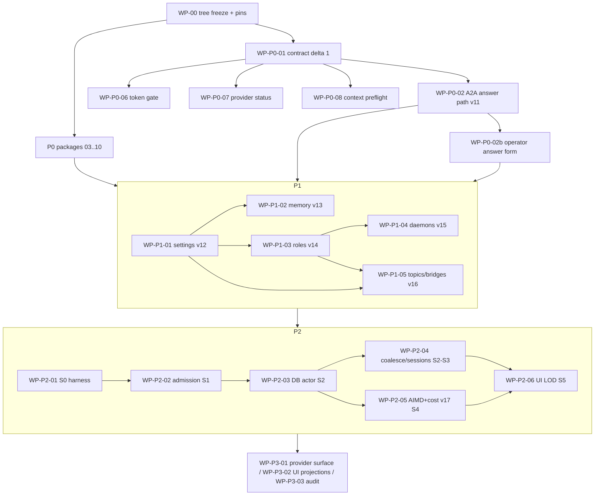

# 20 — Implementation architecture and sequencing for the real codebase

Wave 3 · seat 20 · written 2026-11-07 (local) · live-data probe at 2026-11-08T03:52Z
Repo: `C:\Users\Riley\Desktop\hiverouter-v1` · HEAD `bd575ba` · working tree **dirty** (18 files when this seat
started, 19 at the final write — another writer modified the provider client mid-session)
Output: this file only. No product source, test, config, ledger, database, server process or provider
account was edited, restarted, migrated or called. The live database was copied to a temp directory and
opened read-only; the copy was deleted.

## 0. Discipline used, stated honestly

The requested primary discipline, **`/deep-inspection`, is not mounted in this profile.** The skill catalog
contains `deep-investigate` and `trace` but no `deep-inspection`. I substituted:

- **`/deep-investigate`** (baseline → three hypotheses → cheapest discriminating check → reproduction →
  mechanism) for every P0 defect whose root cause this plan depends on;
- **`/trace`** (render → handler → client call → request → route → service → store → response → render-back)
  for every claim about what a route, event or UI surface actually does.

This is a substitution, not an equivalence claim. Where `/deep-investigate` demands a reproduction and this
seat could not run one (no build, no test run, no server start are permitted here), the finding is marked
**E_NOT_REPRODUCIBLE-BY-SEAT** and the plan carries the test that closes it. Nothing in this file is
"fixed", "landed" or "verified working".

Evidence classes used throughout: **V** = verified by tool in this seat (command output quoted or DB
query result); **R** = read from a file at the cited anchor; **D** = derived/arithmetic from V/R;
**U** = unverified, do not build on it without a check.

---

## 1. Executive answer

1. **The wave-2 corpus is a design set, not a program.** It contains four incompatible phase orders
   (`03` scheduler-first, `09` P0→P1→P2, `17` C0…C17, `15` UI-in-P0), five separate claims on the number
   **v11**, and at least three mutually exclusive shapes for the Subagent/daemon tiers. This document turns
   them into one ordered program with one migration chain, one contract-delta owner and one file-owner per
   stage.
2. **The tree is moving under the reports — during this seat's session.** The working tree already contains five
   of the wave-2 "P0" fixes, uncommitted, with no test pin: persona-on-tool-turn, tool-loop 12/40 +
   `E_CALL_LIMIT`, Host allowlist, approval `args_preview` render, and a shell-allowlist expansion. A sixth
   change (provider status mapping) appeared in `client.rs` *while this document was being written*, and it
   implements the shape `17` P0-3 rejects (402 still reports `E_PROVIDER_AUTH`). Any implementation wave that
   starts without freezing and committing these will build on an unversioned base and will collide with
   whichever seat is editing `execution.rs`/`http.rs`/`client.rs` next. **WP-00 is therefore a gate, not a
   chore.**
3. **P0 is correctness and security, and it is 11 work packages, not 6.** Wave 2 under-counts: it omits
   run-scoped snapshots (a persisted-lie defect, `10` X9), assigns the `ask_parent` answer path to "another
   lane" (`17` P0-7) while `09` lists it as P0, and never assigns the operator-answer UI that the answer
   path needs to be usable by a human. This plan owns all three.
4. **P1 is the operator's priority and it must come before the scheduler.** Roles/offices, memory banks,
   A2A roster and daemons are P1; the admission scheduler is P2. The only `03` element that moves earlier
   is the **S0 measurement harness** (no product change), because every later scale claim is unprovable
   without it.
5. **One migration chain, seven new migrations, no duplicate v11.** `v11 a2a_escalation` →
   `v12 settings` → `v13 memory_banks` → `v14 roles_ownership` → `v15 daemons` →
   `v16 a2a_topics_bridges` → `v17 cost_ledger`. `v18` is reserved (legacy `agent_messages` drop) and
   `v19` reserved (memory FTS5); neither is written by this program.
6. **The minimum first release is a truthful single-run HMARS**, not a scaled one: hierarchy + cards,
   bank-tree memory (read/write, no promotion), escalation answers with a deadline and an operator
   fallback, one watchdog daemon kind, and autonomy mode 1. No scheduler, no topics, no cost governor, no
   provider expansion, no UI redesign. Scale claims stay at today's measured envelope.

| Phase | Contents | Exit gate (all commands from `backend/` unless stated) |
|---|---|---|
| **P0** | tree freeze + 10 correctness/security packages | `cargo test -p hiverouter-contract -p hiverouter-core -p hiverouter-provider -p hiverouter-tools` green; `npm --prefix web run typecheck`; `npm --prefix web run test`; one offline end-to-end run (plan → approved spawn → ask/answer → terminal) |
| **P1** | roles/offices, memory banks, daemons, roster, settings modes, topics/bridges last | migration round-trips v11–v16; bank-tree invariants; roster/card trace; no live claim without a UI trace |
| **P2** | S0 harness → admission → DB actor → coalescing → sessions → AIMD/cost governor → LOD | S0–S4 thresholds per `03` §13; `17` §6 acceptance; no scale claim above the stage proven |
| **P3** | provider surface + full UI projections | FigCraft parity + a11y + refusal/error-state tests; provider capability tests offline |

---

## 2. Baseline actually verified in this seat

### 2.1 Static baseline (V/R)

| Fact | Value | Anchor |
|---|---|---|
| HEAD | `bd575ba` "feat: real SuperAgent/Subagent personas and persona prompt execution" | `git log --oneline -8` **V** |
| Working tree | dirty: 18 files, 182 insertions / 73 deletions | `git diff --stat` **V** |
| Schema | 10 applied migrations, `schema_migrations` max = 10 | `db.rs:32-249`; live DB **V** |
| Frozen vocabulary | 24 event names, 17 command names, 16-state agent enum, 4 node kinds | `event.rs:19-68`; `command.rs:46-105`; `state.rs:18-50`; `event.rs:240` **R** |
| Refusal table | 65 named codes | `refusal.rs:73-282` **V** (counted) |
| Caps | depth 3 / fan-out 8 / 64 agents / 40 calls | `caps.rs:10-17` **R** |
| Tool loop | 12 turns / 40 calls / 8 approval waits (working tree; HEAD was 4/16) | `tool_loop.rs:14-21` **R** |
| Event bus | fan-out 1,024 / replay 256 | `bus.rs:18-20` **R** |
| DB access | one `Mutex<Connection>`; SQLite 3.53.1 (live) | `db.rs:294-350`; probe **V** |
| Routes | 18 routes: `/health`, `/diagnose`, `/api/session`, 4 history, 4 agents, usage, projects, 2 provider, `/ws`, static fallback | `http.rs:511-535` **R** |
| Host allowlist | **present in working tree** (`host_guard`, `host_allowed`, `loopback_host`), absent at HEAD | `http.rs:511-596` vs `git show HEAD:…http.rs` **V** |
| `ask_parent` | writes one row, publishes, returns a handle; no answer path, no deadline, no status | `execution.rs:2417-2487` **R** |
| `spawn_agent` | dispatched before the approval branch; comment "No approval is consumed" | `execution.rs:1682-1691` **R** |
| Snapshot scope | `graph.snapshot()` = whole-process graph, not the run's nodes | `snapshot.rs:254-271` **R** |
| Prompt estimator | `serde_json bytes / 4` | `provider_executor.rs:436-442` **R** |
| Provider mapping | `401 \| 402` → `E_PROVIDER_AUTH`; other 4xx → `E_PROVIDER_INVALID_RESPONSE` | `client.rs:492-524` **R** |
| Memory read | `agent_memory(&role, 8)` injected as `memory:<key>` facts | `execution.rs:880-884` **R** |
| Role mapping | unknown role → `WorkerAgent`; empty persona allowlist = no narrowing | `execution.rs:113-163, 984-1008` **R** |

### 2.2 Live data probe (V, read-only copy, no server touched)

No HiveMind server is listening: nothing on `127.0.0.1:8080` (the default bind, `config.rs:10`); the
processes on loopback are the harness and an unrelated python. Runtime truth is therefore taken from the
database the last run left behind, copied and opened `mode=ro`.

| Query | Result |
|---|---|
| `sqlite_version()` | **3.53.1** |
| `max(schema_migrations.version)`, count | **10**, 10 rows (names v1…v10 as shipped) |
| runs | 5 — `01a1b92e…` failed `E_BUDGET_EXCEEDED` 03:23:11Z, `01a1b92f…` failed `E_BUDGET_EXCEEDED` 03:24:49Z, `01a1b930…` failed `E_BUDGET_EXCEEDED` 03:25:33Z, `01a1b931-2a4f…` completed 03:26:09Z, `01a1b931-941a…` completed 03:26:36Z |
| tasks | 27 — `worker` 19, `planner` 5, `superagent` 3 |
| chat_messages / task_results / tool_turns / run_usage / snapshots | 13 / 8 / 22 / 3 / 34 |
| agent_messages | **0** — the A2A path has never been exercised live |
| agent_memory | 7 |
| agent_profiles | **0** — profile import has never been exercised live |
| projects | 1 |

Three consequences the plan uses:

- **`E_BUDGET_EXCEEDED` on three runs is the live proof of `10` X10** (tool/call cap reported as a money
  refusal). The working tree's switch to `Refusal::CallLimit` fixes the label but is uncommitted and
  untested → WP-00.
- **`agent_messages = 0`** means every A2A test in this program is new ground, and the rollback for the
  answer path cannot rely on historical data.
- **SQLite 3.53.1 ≥ 3.51.3** answers `17`'s open unknown U6: the WAL-reset bug that gated the read pool
  (`03` §5.1) does **not** apply to this binary. The DB-actor work package is unblocked on that specific
  gate (not on the rest of its acceptance).

### 2.3 Drift ledger — P0 work already sitting in the dirty tree, unversioned

| # | Change in working tree | Anchor | Wave-2 status |
|---|---|---|---|
| D1 | persona prompt on the tool-turn continuation + role normalization | `provider_executor.rs:81-92, 375` | `09` P0, `17` C0, `10` X3 — **already coded, uncommitted** |
| D2 | tool loop 4/16 → 12/40 and `E_BUDGET_EXCEEDED` → `E_CALL_LIMIT` at the cap | `tool_loop.rs:14,16,253-270`; `execution.rs:2845-2851` | `10` X8/X10 — **already coded, uncommitted** |
| D3 | `Host` allowlist middleware before every route | `http.rs:511-596` | `17` P0-2 step 1 — **already coded, uncommitted**; token gate/Origin-on-mutators still missing |
| D4 | approval `args_preview` rendered in the overlay + store | `ApprovalOverlay.tsx:26-31,259-268`; `store.ts:103,1586` | `15` §5.1 P0 — **already coded, uncommitted** |
| D5 | shell allowlist adds `powershell.exe`, `pwsh.exe` | `shell.rs:68-73` | **not in any wave-2 report** — a security-surface expansion with no decision record |
| D6 | launcher `--workspace-root`, rebuilt `HiveMind.exe` | `HiveMindLauncher.cs` (+22), `HiveMind.exe` binary | `10` Appendix A — uncommitted; a tracked binary with no reproducible build note |
| D7 | provider status mapping **appeared during this seat's session** (another writer): `402` → `ProviderAuth` with a balance *message*, `400\|422` → `ProviderInvalidResponse` | `client.rs:505-535` (now modified; was clean at session start) | **Collision with WP-P0-07**. It splits the labels but keeps the codes lossy: 402 still reports `E_PROVIDER_AUTH`, 400/422 still report `E_PROVIDER_INVALID_RESPONSE`. Per `17` P0-3 this must become `E_PROVIDER_BALANCE` / `E_PROVIDER_REQUEST_REJECTED`, so the slice needs a code-level rework, not just a commit |

**Rule that follows:** no implementation work package may start before WP-00 commits D1–D6 in reviewable
slices with their pins, and D5 is put to the operator (Q-list) rather than silently kept.

### 2.4 What this baseline invalidates in wave 2

- `17` C2 ("Host validation absent") is true **at HEAD**, false **in the tree**. Any plan that re-implements
  it will collide.
- `09` P0 item 6 ("persona continuation") and `17` C0 are already coded; the remaining work is the pin and
  the test, not the fix.
- `10` X11 ("current app data is empty") is refuted: 5 runs / 27 tasks / 34 snapshots exist.
- `09` §8 ("live SuperAgent run unverified") is partly refuted: 3 `superagent` task rows exist. Whether the
  persona prompt reached them is still **U** (no prompt snapshot table exists).

### 2.5 Not verified by this seat (do not inherit as fact)

No build, no test run, no server start, no paid call. Therefore: no compiled claim about the dirty tree,
no runtime claim about any route, no claim that any P0 defect is fixed, and no claim that any proposed
constant (deadline, permit count, batch size) is correct. Every such item below is a **proposed** design
with an acceptance test named.

---

## 3. Sequencing conflict register — every place the reports disagree

Rule used to resolve each row: **(1)** a correctness/security defect that corrupts persisted truth or
authority precedes any feature; **(2)** a schema migration is ordered by its first consumer, not by which
report wrote it; **(3)** no scale work precedes the guards that stop it amplifying a race; **(4)** the
operator's stated priority (hierarchy → memory/A2A → DeepSeek completeness → scale → UI polish) breaks ties
between equally safe orderings; **(5)** measurement-only work may move ahead of features because it creates
no contract.

| ID | Conflict | Side A | Side B | Resolution in this program | What settles it |
|---|---|---|---|---|---|
| **XS-1** | **What comes first** | `03` §13: S0→S5 scheduler/capacity first; `17` §6 puts C9–C17 (scheduler, DB, AIMD) immediately after P0 | `OPERATOR-DECISIONS.md:15`: "agent hierarchy + memory/A2A first; then DeepSeek completeness, scale, and UI polish"; `09` §7: P0 → P1 roles/memory → P2 scheduler | **P0 correctness/security → P1 hierarchy/memory/A2A → P2 scheduler.** `03`'s S0 measurement harness moves into P0/P2 boundary as a non-product package (WP-18) so the baseline exists before any P1 claim about scale | Operator priority (rule 4) + the fact that S1 admission on an unguarded engine amplifies the parent/child races in `17` §6 |
| **XS-2** | **Which report owns the migration numbers** | `04` v11 = memory banks | `12` v12 = offices/daemons, "or v11 if this lands first"; `14` v11 = messages/settings + `tasks.hive_id`, v12 topics, v13 bridges, v14 remote; `15` v11 = bank tree **and** message columns, v12 = budget/settings/watchdogs; `17` C15 = "v11/v12" for cost | **One chain, assigned by first consumer:** v11 a2a_escalation (P0), v12 settings (P1), v13 memory_banks (P1), v14 roles_ownership (P1), v15 daemons (P1), v16 topics+bridges (P1-late), v17 cost_ledger (P2). Memory banks are **v13, not v11**; `04`'s DDL is preserved verbatim apart from the number | §4 below; every report's claimed number is mapped in §4.3 |
| **XS-3** | **Destructive migration vs additive-only** | `14` §14.2: **rebuild** `agent_messages` in v11 (SQLite cannot drop `NOT NULL`) | `17` §7 G4: "DB schema v1–v10; **no destructive migration**" | **New table `a2a_messages` in v11; `agent_messages` frozen and dual-written; dropped only in reserved v18 after exit criteria.** Avoids the table rebuild *and* the FK-in-transaction trap (§4.4) | Round-trip test + a live DB where `agent_messages` is empty (V) makes the dual-write cheap; the rebuild is recorded as rejected-for-now |
| **XS-4** | **Subagent: tier or profile** | `09` §7 P1 "Subagent tier"; operator's four ranks (`OPERATOR-DECISIONS.md:39`) | `12` §2.2/Q1: Subagent is a **profile on the Worker tier** with a narrowed grant + distinct wire kind; `07`/`08`: today it is a spawn role mapped to Worker with no card | **No new tier enum value.** New wire kind `subagent` + persona profile + depth floor + narrowed grant; documented as 12's answer. Operator asked to confirm (Q4) because the visible hierarchy still shows four ranks | `card_every_agent` + `subagent_depth_floor` tests; UI trace |
| **XS-5** | **Daemon entity and naming** | `12` §7 + `18` §6: first-class record, not a task; `12` §17.2 wants node kinds `daemon`; `14` wants `remote`; `15` wants a `watchdogs` table + `WATCHDOG_*` events | Operator calls them "Remote/Watchdog agents … simple switches/daemons" (`OPERATOR-DECISIONS.md:32-33`) | **One entity `daemons`** with `job.kind` (`watch_hive`, `watch_file`, `watch_budget`, …); tables `daemons`, `daemon_runs`, `daemon_reports`; events `DAEMON_STATE`, `DAEMON_REPORT`; node kind `daemon`. UI label "Watchdog" is a job-kind label, not a type. `15`'s `watchdogs` table and `WATCHDOG_*` names are **superseded** | Operator decision Q11/Q12; daemon acceptance tests from `12` §14.1 and `18` §6.9 |
| **XS-6** | **How many contract deltas** | `17` C1: seven additive refusal codes | `14` §14.6/§14.5: ten A2A codes, five events, five commands; `04` §12.6: `E_MEMORY_SCOPE`; `12` §6.5: profile/ownership/daemon codes | **Two intentional contract commits:** Delta-1 (P0: codes + `A2A_ANSWER` + `AGENT_MESSAGE` extension + `args_preview`) and Delta-2 (P1: kinds, daemon/A2A events, remaining codes). Golden schemas regenerated exactly twice, each with a ledger row | `ui_command_matrix`, `golden_schemas`, `refusal_matrix` and the web mirrors all green in the same commit |
| **XS-7** | **Is the read pool allowed** | `17` Q16/G4: read pool only after a `sqlite_version()` proof; `03` §5.1: WAL-reset bug 3.7.0–3.51.2 | — (open unknown in both) | **Answer exists now: bundled SQLite is 3.53.1 (V)**, which is **outside** the buggy range. WP-20 is unblocked on that gate; the rest of its acceptance stands | `SELECT sqlite_version()` in CI (WP-20 test `sqlite_version_gate`) |
| **XS-8** | **Is `ask_parent` P0 and who owns it** | `09` §7 P0: yes, P0; `14` §4: full answer path + deadline | `17` P0-7.1: "assign to the memory/A2A lane as P0-AAA; this lane adds only the deadline side" | **Owned here as WP-P0-02**, full path (policy gate → question row → bounded parent answer turn → operator fallback → deadline), plus the minimum operator answer UI (WP-P0-02b) without which the path is unusable | `a2a_escalation` tests + one traced operator answer |
| **XS-9** | **Snapshot truth defect priority** | `10` X9: snapshots are process-global, not run-scoped (a product defect) | `09` P0/P1 and `17` §6: not listed at all | **Added as WP-P0-09.** A persisted replay that shows other runs' nodes is a lying surface; it is cheap (filter + envelope field) and blocks any truth claim about replay | `run_snapshot_is_run_scoped` + a two-run fixture |
| **XS-10** | **Where the approval UX lands** | `15` §5.1: approval inbox/`args_preview` is **P0** | This seat's brief: UI is **P3**; `17` puts approval UX after the scheduler | **Split:** the render fix (`args_preview`, D4) is already in the tree → WP-00 pins it; the *inbox* (queue, ledger, dismiss) is P3; the *operator answer form* for escalations is P0 because WP-P0-02 needs it | Approval integration test + a11y/reduced-motion checks |
| **XS-11** | **Settings channel** | `15` §6.3: HTTP `GET/PUT /api/settings` | `17`/`14`: engine-affecting mutations must be WS commands so they order with events | **Reads over HTTP, mutations over WS** (`SETTINGS_SET`), one refusal vocabulary for both | `http_boot` + `ws_transport` + settings tests |
| **XS-12** | **Topics/bridges scope** | `14` §6/§7: real designs, P1 | `02` X1 (reject agent pub/sub bus); operator: topics **optional**, default safest tree; `18` §13 C4: mesh never for daemons | **Topics/bridges land last in P1 (WP-P1-05), default off, operator-created only, no model create/join.** Mesh stays a settings value that no MFR build enables | Operator Q8–Q10; `a2a_topic`/`a2a_bridge` tests |
| **XS-13** | **Binding call ceiling** | `03`/`09`: 40 calls/run | `07`: 4 tool turns / 16 calls binds first (live: three runs died at 4 turns) | **Both were right at different times.** Dirty tree is 12/40 (D2). The remaining question is money vs calls naming, fixed by D2 + WP-00; the *budget* decision is Q16 | `tool_loop_engine`, `tool_loop_matrix`, and one live-shaped 12-turn fixture |
| **XS-14** | **Budget posture** | `03` §8: hard caps are the only thing that stops a runaway; `06`: $0.50/400K/40 | Operator: no hard default; soft guard + emergency stop acceptable; `09` §5 tries to reconcile | **Keep today's caps through P0/P1 (Q2 unanswered); no new governor until P2.** Removing a cap before a governor exists is the unsafe direction | Q2 + WP-P2-07 acceptance |
| **XS-15** | **Retention vs "persist everything"** | Operator: persist runs, events, messages, memory, approvals, artifacts | `18` §13 C7: 150 daemons × 288 ticks/day = 43,200 rows/day ≈ 259–648 MB/month if every tick is a row | **Persist reports forever; roll up `daemon_runs` hourly; counters on the `daemons` row.** Stated in settings, not buried in code | Q12; `daemon_runs_rollup` test |
| **XS-16** | **Hierarchy planning depth** | `09` §6/`03` §10.4: 300–600 needs hierarchical planning; `09` §4 target has SuperAgents owning branches | `07` G4/`10` X15: `PLANNER_SYSTEM` has no `parent` field; planned nodes attach to the root; the plan is flat | **No hierarchy claim in MFR.** SuperAgent tasks appear only when the planner emits `role=superagent` (3 such rows exist, V). A `parent` field in the planner schema is a P2 prerequisite, not a P1 deliverable | `planned_tree_two_levels` (P2) |
| **XS-17** | **Scale target claims** | `03` §13 / operator: 50–150 active, 300–600 total | `17` §7 G1: caps frozen until S1–S4 green; current engine is serial with 8 permits | **MFR claims nothing above "single run, 8 in-flight permits, 64 agents".** Each later number is claimable only when its stage's acceptance passes and is recorded in the claim register | Stage harness artifacts (WP-18…WP-22) |
| **XS-18** | **Provider scope** | `01`: Files/Search/Fetch/Responses/FIM/Vision are documented and unused | Operator: DeepSeek completeness after hierarchy/memory; Search/Fetch "gated by approval/budget" | **P3 only; Search/Fetch behind approval + budget, default off** (Q19). No provider surface in MFR | Offline capability tests + one explicit paid smoke, operator-run |

**Tie-break rule for the rest of this document:** when two packages are independent and both safe, the one
that removes a *lie* (a surface or record that misrepresents state) goes first, because every later UI/claim
work inherits the lie.

---

## 4. The single migration chain (no duplicate v11s)

### 4.1 Rules that bind every migration

1. **Append only.** `db.rs:31` ("Append only; never edit a migration that has shipped") is a hard rule; a
   shipped `up`/`down` string is never edited, only superseded.
2. **One review owner.** A named migration reviewer signs every version in the chain. `12` §17.1 is right:
   `owner_task_id` and the bank tree both reference task ids, so one reviewer must hold v11–v17.
3. **One first consumer.** A migration lands in the same commit as its first reader/writer, never earlier.
   No table ships without a route, engine path or test that reads it.
4. **Every version has an exercised inverse.** `Migration { version, name, up, down }` (`db.rs:18-29`) and
   `migrate_down_to` (`db.rs:420-454`); the round-trip test pattern in `db.rs:806-830` extends to each new
   version.
5. **No schema change in the same commit as a concurrency change** (`17` §7 fine print). Schema commits are
   behaviour-neutral except for the one engine call site they wire.
6. **Census updates in the same commit:** the applied-migrations test (`db.rs:777-800`) expects
   `applied.len() == N` and name-at-index; the reopen test (`db.rs:819-830`) asserts the last version.
   Both are edited in the same commit as the migration that changes them.
7. **Production rollback is a backup restore**, not `migrate_down_to`. The down path exists for tests and for
   a *pre-data* revert; running it against a live DB with v11+ rows loses those rows by design.

### 4.2 The chain

| Ver | Name | Phase | Objects | First consumer | Inverse (exercised in test) |
|---|---|---|---|---|---|
| **v11** | `a2a_escalation` | P0 | **new** `a2a_messages` (envelope: `message_id PK, run_id, from_task_id NULL, from_actor TEXT NOT NULL, to_task_id, verb, status, priority, correlation_id, in_reply_to, text, deadline_at, answered_at, answered_by_task_id, delivered_at, expires_at, seq, trust, origin_tool_call_id, bridge_id, created_at`); unique `(run_id, seq)`; unique `(run_id, origin_tool_call_id)` where not null; partial unique `in_reply_to` where not null; **new** `a2a_answer_attempts(id, run_id, question_id, attempted_at, outcome, code)` | WP-P0-02 answer path | `DROP TABLE a2a_answer_attempts; DROP TABLE a2a_messages;` |
| **v12** | `settings` | P1 | **new** `settings(scope, scope_id, key, value_json, rev, updated_at, updated_by, audit_id)` PK `(scope, scope_id, key)`; **new** `settings_audit(id, at, actor, scope, scope_id, key, old_json, new_json, reason)` | WP-P1-01 autonomy/approval policy; A2A mute/blind keys; daemon bounds | drop both |
| **v13** | `memory_banks` | P1 | **new** `memory_banks`, `memory_entries`, `memory_entry_links`, `memory_journal`, `memory_context_snapshots` + indexes **exactly as `04` §5**; backfill from `agent_memory` **exactly as `04` §12.2**; `agent_memory` untouched | WP-P1-02 | drop the five tables in reverse dependency order (`memory_context_snapshots`, `memory_journal`, `memory_entry_links`, `memory_entries`, `memory_banks`); `agent_memory` intact |
| **v14** | `roles_ownership` | P1 | `ALTER TABLE tasks ADD COLUMN` `hive_id TEXT`, `profile_id TEXT`, `profile_version INTEGER`, `ownership_mode TEXT`, `ownership_scope TEXT`, `owner_task_id TEXT`, `grant_hash TEXT`, `retry_of TEXT`; backfill `hive_id` by recursive CTE (root = own id, `superagent` = own id, child inherits parent); index `(run_id, hive_id)`; **new** `agent_offices(office_id, mode, scope, profile_id, profile_version, defaults_json, created_at, retired_at)`; **new** `agent_audit(id, at, actor_kind, actor_id, action, subject_kind, subject_id, detail_json)` | WP-P1-03 | drop index, `ALTER TABLE tasks DROP COLUMN` ×8 (SQLite 3.53 supports it; v4 already exercises `DROP COLUMN`), drop `agent_offices`, `agent_audit` |
| **v15** | `daemons` | P1 | **new** `daemons(daemon_id PK, generation, job_kind, job_json, owner_kind, owner_id, enabled, switch_rev, heartbeat_s, report_s, grace_s, health_state, last_heartbeat_at, last_report_at, last_success_at, consecutive_failures, attempts_in_window, window_start, created_by, created_at, retired_at, retire_reason)`; **new** `daemon_runs(run_id PK, daemon_id, generation, started_at, ended_at, outcome, observation_json, duration_ms, error_code)`; **new** `daemon_reports(report_id PK, daemon_id, generation, daemon_run_id, seq, at, severity, transition, dedupe_key, summary, evidence_ref, suppressed_by, delivered_at)` unique `(daemon_id, generation, seq)` | WP-P1-04 | drop `daemon_reports`, `daemon_runs`, `daemons` |
| **v16** | `a2a_topics_bridges` | P1-late | **new** `a2a_topics(topic_id PK, run_id, owner_task_id, name, max_members, status, created_by, created_at, closed_at)`; `a2a_topic_members(topic_id, task_id, added_at, added_by)`; `a2a_topic_notices(notice_id PK, topic_id, from_task_id, seq, text, created_at, status)`; `a2a_bridges(bridge_id PK, run_id, source_hive_id, target_hive_id, source_task_id, target_task_id, target_topic_id, verb, scope, content_sha256, status, requested_at, decided_at, decided_by, expires_at, reason)` | WP-P1-05 | drop in reverse order |
| **v17** | `cost_ledger` | P2 | `ALTER TABLE runs ADD COLUMN` `calls_attempted INTEGER`, `cost_usd TEXT`, `cost_status TEXT`, `ended_at TEXT`; **new** `provider_calls(call_id PK, run_id, task_id, model, purpose, prompt_tokens, completion_tokens, cache_hit_tokens, cache_miss_tokens, reasoning_tokens, cost_usd, status, http_status, error_code, started_at, ended_at)`; **new** `budget_reservations(reservation_id PK, run_id, task_id, call_id, reserved_usd, settled_usd, state, created_at, settled_at)` | WP-P2-07 | drop `budget_reservations`, `provider_calls`, `ALTER TABLE runs DROP COLUMN` ×4 |
| *(reserved v18)* | `legacy_agent_messages_drop` | post-MFR | `DROP TABLE agent_messages` (only after the v11 dual-write exit criteria: 20 completed runs, 0 legacy fallbacks, journal verify OK) | — | not written |
| *(reserved v19)* | `memory_fts5` | post-MFR | `04` §5.3 FTS5 virtual table + three triggers + rebuild command test | — | not written |

Numbers are **not** free for the taking: `v11` and `v12` are consumed by P0/P1 in this document, and no other
lane may claim them.

### 4.3 Where each report's claimed number went (resolution of XS-2)

| Report | Claimed | Assigned here | Note |
|---|---|---|---|
| `04` §5/§12 | v11 `memory_banks` | **v13** | DDL + backfill preserved verbatim; only the number moves |
| `04` §5.3 | v12 FTS5 | **reserved v19** | not in this program |
| `04` §12.4 | v12 drops `agent_memory` | **reserved v18 analogue** | drop of `agent_memory` is a second later migration after its own exit criteria |
| `12` §17.1 | v12 (or v11) offices/daemons + task columns | **v14** (roles/ownership) + **v15** (daemons) | split by consumer: cards/roster before the daemon control plane |
| `14` §14.2 | v11 messages + settings + `tasks.hive_id`; v12 topics; v13 bridges; v14 remote | **v11** (messages, no `a2a_settings`), **v12** (one settings home), **v14** (`hive_id`), **v16** (topics + bridges), **v15** (daemons) | `a2a_settings` is folded into v12 `settings` to avoid two settings homes |
| `15` §6.3 | v11 message columns **and** v12 budget/settings/watchdogs | **v11** (messages via new table), **v12** (settings), **v17** (budget/cost), **v15** (daemons) | `watchdogs` table name dropped; one daemon entity |
| `17` C11/C15 | "v11/v12" for cost | **v17** | cost lands with the governor (P2), not with roles |

**Reconciliation observed after this document's first write** (2026-11-07 ~22:06 local): sibling wave-3
documents landed in the same directory — `19-wave3-gap-audit.md`, `21-roles-daemons-implementation.md`,
`22-memory-bank-implementation.md`, `23-a2a-implementation.md`, `25-provider-cache-implementation.md`,
`26-scale-security-audit.md`, `27-open-source-daemon-catalog.md`. `22` §3 states it adopts this chain
(memory = **v13**, v11 stays A2A only), which retires the `04`-vs-`13` "two v11s" collision that `19` records
as X20; `19` also records a second memory-topology conflict (`04` five banks with no `global` vs `13` six
scopes including `global`), which is Q5 in §13 and must be answered before the v13 DDL is written. These are
peer claims I did **not** audit; they are recorded here so the chain is not re-litigated, not endorsed.

### 4.4 Why a new table instead of rebuilding `agent_messages`

`14` §14.2 is right that SQLite cannot relax `from_task_id NOT NULL` in place. A 12-step rebuild is
*possible* (create new → copy → drop → rename, with `PRAGMA defer_foreign_keys=ON` as the first statement of
the transaction), but it is a destructive migration and its inverse must rebuild the old shape. Given
`17` §7 G4 ("no destructive migration") and the live fact that `agent_messages` holds **0 rows** (V), the
cheaper honest shape is:

- v11 creates `a2a_messages` with the correct envelope and nullable `from_task_id`;
- `store.rs::record_agent_message` (`store.rs:526-554`) keeps writing `agent_messages` as a legacy projection
  and gains a sibling `record_a2a_message(NewA2aMessage)` that writes the envelope; both happen in one
  transaction (`04`'s dual-write pattern, applied to A2A);
- the HTTP message route (`http.rs:667-702`) reads `a2a_messages`, falling back to `agent_messages` and
  reporting `source: "legacy"` in the payload so the UI can label it;
- v18 drops the legacy table after the exit criteria.

Recorded deviation: `14`'s rebuild is **not adopted**. If the operator prefers one table, the rebuild is the
alternative and it must add a `Migration.pre` hook executed outside the transaction plus its own round-trip
test — that is a larger, riskier change than the plan above.

### 4.5 Rollback policy per version

| Version | Pre-boot action | Rollback (production) | Rollback (test) |
|---|---|---|---|
| v11 | copy DB (`VACUUM INTO` or file copy) | restore copy; no down against live data | `migrate_down_to(10)`; assert `agent_messages` row count unchanged |
| v12 | same | restore | `migrate_down_to(11)` |
| v13 | same; also export `agent_memory` via the API | restore | `migrate_down_to(12)`; `agent_memory` count unchanged |
| v14 | same | restore | `migrate_down_to(13)`; `tasks` columns gone, rows intact |
| v15 | same | restore | `migrate_down_to(14)` |
| v16 | same | restore | `migrate_down_to(15)` |
| v17 | same | restore | `migrate_down_to(16)` |

### 4.6 Migration tests (names are the acceptance)

`migration_v11_creates_a2a_envelope_and_keeps_legacy`, `migration_v11_roundtrip_down_to_v10`,
`migration_v11_is_idempotent_on_reopen`; `migration_v12_settings_roundtrip`; `migration_v13_preserves_legacy_rows_and_unknown_trust`
(+ the four SQL invariants from `04` §12.3), `migration_v13_roundtrip_down_to_v12_restores_agent_memory`,
`migration_v13_is_idempotent_on_reopen`; `migration_v14_backfills_hive_id_by_parent_chain`,
`migration_v14_roundtrip`; `migration_v15_roundtrip`, `migration_v15_reports_unique_per_generation`;
`migration_v16_roundtrip`; `migration_v17_roundtrip`, `migration_v17_cost_stays_null_when_unmeasured`;
`applied_migrations_census_matches_chain` (replaces the hard-coded counts at `db.rs:777-800, 819-830`).

---

## 5. Program shape

### 5.1 Dependency graph



**Hard edges (do not reorder):** WP-00 before everything; WP-P0-01 before 02/07/08 (it introduces the codes
and the command); WP-P0-03 and WP-P0-04 **before** WP-P2-02 (`17` §6: "the scheduler must not amplify a
race"); WP-P2-01 before WP-P2-02 (no threshold without a baseline); WP-P2-03 before WP-P2-05 (v17 rides the
DB actor); WP-P1-01 before every other P1 package (it is the policy home).

### 5.2 Parallel lanes and file ownership

Only one writer per file per stage. The contended files and their serialized owners:

| File | Owner order within a stage | Rule |
|---|---|---|
| `db.rs` | migration reviewer only | one commit per version; no other WP touches `MIGRATIONS` |
| `execution.rs` | WP-P0-02 → WP-P0-03 → WP-P0-04 → WP-P0-05 → WP-P0-10 → WP-P1-02 → WP-P2-02 → WP-P2-04 | each lands separately; rebases on the previous |
| `store.rs` | WP-P0-02 (v11 read/write) → WP-P1-03 (roster) → WP-P2-03 (writer actor) | |
| `http.rs` | WP-P0-06 → WP-P1-03 (roster route) → WP-P0-02 (message route) → WP-P1-02 (memory routes) | guards first, then routes |
| `contract/{event,command,refusal,schema}.rs` + `web/src/api/contract.ts` | WP-P0-01, then WP-P1-00 (delta 2) only | mirrors move together; golden schemas regenerated deliberately |
| `web/src/state/store.ts` | WP-P0-02b → WP-P1-06 → WP-P2-06 | |
| `provider_executor.rs`, `client.rs`, `budget.rs` | WP-P0-07 → WP-P0-08 → WP-P2-05 | |

### 5.3 Stage gates

| Gate | Green means | Blocks |
|---|---|---|
| **G-FREEZE** | tree clean at a recorded commit; D1–D6 pinned with tests; claim register row per pin | every later WP |
| **G-P0** | full workspace tests + web typecheck/tests; one offline end-to-end (plan → approved spawn → ask → answer → terminal) | P1 |
| **G-P1** | migrations v11–v16 round-trip; bank invariants; roster/card trace; daemon lifecycle; no lied surface in the P1 surfaces | P2 |
| **G-S0** | baseline artifacts captured (in-flight ≤ 1, throughput, p50/p95, `sqlite_version()`) | S1 |
| **G-S1…S5** | `03` §13 thresholds + `17` §6 commands | each later stage |
| **G-P3** | FigCraft parity + a11y + refusal/error states | release |

---

## 6. Phase P0 — correctness and security (11 packages + the freeze gate)

Every package lists the evidence that would let the Lead call it done. Commands run from `backend/` unless
stated.

### WP-00 · Tree freeze, pins, and review (gate)

- **Change:** commit the dirty tree as reviewable slices, each with its pin: (a) persona continuation +
  normalization, (b) tool-loop 12/40 + `E_CALL_LIMIT`, (c) Host allowlist, (d) `args_preview` render,
  (e) shell-allowlist expansion (decision-gated), (f) launcher `--workspace-root` + rebuilt binary,
  (g) the provider status-mapping slice that landed mid-session (D7) — which is **reworked**, not committed as
  is, because it keeps the lossy codes.
- **Files/symbols:** `provider_executor.rs:81-92,375`; `tool_loop.rs:14,16,253-270`; `execution.rs:2845-2851`;
  `http.rs:511-596`; `ApprovalOverlay.tsx:26-31,259-268`; `store.ts:103,1586`; `shell.rs:68-73`;
  `client.rs:505-535` (D7); `HiveMindLauncher.cs`; `HiveMind.exe`.
- **New surface:** none. One claim-register row per slice; one `CHANGE-LEDGER-IMPL.md` row for the contract-
  affecting slice.
- **Boundary:** none new; the pin is the boundary — every later WP names the commit it is based on.
- **Migration:** none.
- **Tests:** `tool_turn_persona` (continuation system message equals the persona prompt for `role=superagent`
  and falls back to `TASK_SYSTEM` for an unknown role); extend `tool_loop_engine`/`tool_loop_matrix` for
  12/40 + `E_CALL_LIMIT`; `http_boot`/`http_origin` for `host_guard`; `approval.integration` for
  `args_preview`; `shell_policy_expansion_is_approval_gated` for (e); `error_matrix` for the D7 rework.
- **Acceptance evidence:** `cargo test -p hiverouter-core -p hiverouter-tools` and
  `npm --prefix web run typecheck` green; `git status --porcelain` empty; the recorded HEAD hash in this
  document's successor.
- **Rollback:** per-slice `git revert` (the slices are independent).
- **Not yet:** no refactor inside these slices; no new features; do not re-run the paid live smoke as "proof"
  (it is not part of the gate).

### WP-P0-01 · Contract delta 1 (codes, `A2A_ANSWER`, `AGENT_MESSAGE` extension)

- **Change:** add the P0 refusal codes and one command; extend `AGENT_MESSAGE` with the envelope fields;
  regenerate golden schemas; mirror in the web contract.
- **Codes (additive, 13 → 78 total):** `E_ESCALATION_TIMEOUT`, `E_ESCALATION_CANCELLED`,
  `E_ESCALATION_BUDGET`, `E_A2A_DISABLED`, `E_MESSAGE_EXPIRED`, `E_MESSAGE_NOT_ADDRESSEE`,
  `E_ANSWER_DUPLICATE`, `E_PROVIDER_BALANCE`, `E_PROVIDER_REQUEST_REJECTED`, `E_CONTEXT_WINDOW_EXCEEDED`,
  `E_DESCENDANTS_LIVE`, `E_DEADLINE`, `E_STALLED`. Each needs a sample, a retryable flag, a message, a
  how-to-fix and a UI mapping; the count is pinned by the uniqueness test (`refusal.rs:304-316`). The
  approval-coverage check is a **static** test over `ToolId::all()`, so it needs no runtime code and adds no
  contract surface.
- **Files/symbols:** `refusal.rs:73-282`; `command.rs:46-105,152-163,168-490` (add `A2aAnswer`, mutating);
  `event.rs:607-622` (`AgentMessagePayload` + `message_id/verb/status/correlation_id/in_reply_to/deadline_at/
  answered_at/answered_by/from_actor/seq/trust`, `from_task_id: Option<TaskId>`); `event.rs:706-826` (variant,
  name, decoder); `schema.rs:95-146,215-380` (payload + matrix rows); `web/src/api/contract.ts:315-322,947`;
  `web/src/api/refusals.ts`; `web/src/state/strings.ts`; `docs/contracts/UI-COMMANDS-v1.md`;
  `CHANGE-LEDGER-IMPL.md` (CL-I-007).
- **New surface:** command `A2A_ANSWER { message_id, answer(1..2000), reason?(≤500) }`.
- **Boundary:** `A2A_ANSWER` is operator-only (WS, same gate as approvals); no model tool maps to it; a model
  frame carrying it is `E_TOOL_NOT_FOUND`/`E_SCHEMA_INVALID`, never a silent accept.
- **Migration:** none.
- **Tests:** `ui_command_matrix::every_command_has_exactly_one_matrix_row` (18 rows),
  `every_command_has_named_refusal_and_ack`, `golden_schemas` (deliberate regeneration), `refusal_matrix`
  (sample + retryable flag for each new code), `contract.test.ts`/`state.parity.test.ts` (mirror + counts).
- **Acceptance evidence:** `cargo test -p hiverouter-contract`; `cargo test -p hiverouter-provider --test
  refusal_matrix`; `npm --prefix web run typecheck && npm --prefix web run test`; the regenerated
  `schemas/contract-v1.json` diff is in the commit.
- **Rollback:** `git revert` (no code uses the codes until 02/07/08; the command is inert without a handler).
- **Not yet:** the five P1 events and the daemon/topic/bridge commands (delta 2); no new event **names** in
  delta 1.

### WP-P0-02 · v11 + the `ask_parent` answer path with a deadline

- **Change:** make `execute_ask_parent` `async`, persist the question with a deadline and status, get an
  answer from the inline parent in one bounded tool-free call, fall back to the operator, expire by deadline,
  and return the answer as the tool result. Record the inline wait so a planned/aggregate parent is never
  re-entered.
- **Files/symbols:** `execution.rs:2417-2487` (rewrite), `:1693-1694` (await), `:386-439` (add
  `inline_waits: Mutex<HashMap<TaskId, TaskId>>`, cleared on run terminal/cancel), `:2681` (insert before the
  await in `execute_spawn_agent`, remove in a guard), `:181-232` (add `answer_escalation_turn` to the
  `ProviderExecutor` trait with a default refusal), `provider_executor.rs` (production implementation:
  no tools, `{answer, needs_operator}`, counted as one provider call), `:2747-2762` (prompt: answer block is
  data, not instructions), `store.rs:526-554,560-605` (`record_a2a_message`, `answer_message` CAS,
  `open_escalations_for_run`, `count_answer_attempts`), `http.rs:667-702` (message route reads the envelope,
  legacy fallback labelled), `ws.rs` (`A2A_ANSWER` handler → engine), `db.rs` (v11).
- **New surface:** table `a2a_messages`, `a2a_answer_attempts`; command handler; route shape extension
  (`status`, `verb`, `in_reply_to`, `deadline_at`, `answered_at`, `answered_by`, `seq`).
- **Boundary:** `trait ProviderExecutor { async fn answer_escalation_turn(&self, run_id, parent: &TaskRecord,
  question: &A2aQuestion, cancel: &CancellationToken) -> Result<EscalationAnswer, Refusal> }` — default
  returns `E_PROVIDER_INVALID_RESPONSE` so every existing test double compiles unchanged. The answer turn
  must not publish `REPLY_*`, mutate the parent's state or `task_result`, execute a tool, write memory, or run
  an approval.
- **Migration:** **v11**.
- **Tests:** `a2a_escalation::inline_child_gets_parent_answer`, `parent_answer_needs_operator`,
  `unanswered_expires_named`, `planned_parent_not_reentered`; `a2a_spoof::answer_addressee_only`,
  `duplicate_answer_refused`, `late_answer_refused`, `answer_grants_no_authority`, `secret_text_refused`;
  `a2a_bounds::message_storm_is_refused`, `replay_is_idempotent`;
  `a2a_aggregation::messages_never_in_aggregate`; `migration_v11_*`.
- **Acceptance evidence:** `cargo test -p hiverouter-core --test a2a_escalation --test a2a_spoof --test
  a2a_bounds --test a2a_aggregation --test migration_v11`; one traced operator answer over WS with the
  question and answer rows quoted.
- **Rollback:** `git revert` + restore the pre-v11 DB copy; the legacy table still has the old rows, so the
  revert loses only envelope rows written during the window (none in the live DB, V).
- **Not yet:** no `answer_escalation` **tool** (`14` §4.4: dead surface until a parent can take turns while a
  child waits); no roster injection into the child prompt (`14` §14.3: separate package); no topics.

### WP-P0-02b · Minimum operator answer surface

- **Change:** render open escalations with their deadline and an answer box; submit `A2A_ANSWER`; show status
  transitions in place.
- **Files/symbols:** `web/src/panels/AgentMessagesPanel.tsx:10-17,35,52-60,87-107`; new
  `web/src/panels/A2AAnswerForm.tsx`; `store.ts` (append/replace by `message_id`, `status`, `deadline_at`).
- **New surface:** answer form (operator-only, disabled while pending).
- **Boundary:** the UI sends only `{message_id, answer}`; it never composes a status or an `answered_by`.
- **Migration:** none.
- **Tests:** `mailbox.test.ts` (rows, status, count, no compose for notify), `a2a_ui.rs::status_and_answer_flow`.
- **Acceptance evidence:** `npm --prefix web run test`; a DOM trace of one question → answer → answered.
- **Rollback:** revert the two files.
- **Not yet:** no inbox redesign, no topic replies.

### WP-P0-03 · `spawn_agent` approval gate

- **Change:** route `spawn_agent` through the approval branch **before** any child row exists; on deny/timeout
  return a named refusal and continue the parent loop; count the wait against `MAX_APPROVAL_WAITS_PER_RUN`.
- **Files/symbols:** `execution.rs:1682-1736`; `tool.rs:332-339,55-57`; approval bridge
  (`execution.rs:2000-2140`, `tools_bridge.rs:169-247`).
- **New surface:** `spawn_proposed` audit row (role, depth, fanout, args hash; never the instruction body).
- **Boundary:** operator `SPAWN_SUB_HIVE` remains authorized as it is today; model `spawn_agent` is
  approval-gated; `APPROVAL_EXEMPT` stays **empty** for spawn.
- **Migration:** none.
- **Tests:** `approval_coverage::every_approval_tool_is_gated_or_declared_exempt`,
  `engine_spawn_approval::{spawn_without_approval_creates_no_child, denied_spawn_creates_no_child_and_continues,
  approved_spawn_runs_once}`; extend `approval_ledger`.
- **Acceptance evidence:** `cargo test -p hiverouter-core --test approval_coverage --test engine_spawn_approval
  --test approval_ledger`.
- **Rollback:** revert the commit (no release env bypass).
- **Not yet:** no delegation-budget grant (Q3 option B) before S1 load gates.

### WP-P0-04 · Parent-completion guard

- **Change:** a task cannot complete while a descendant is live; defer completion and drain children under
  `task_state_lock`; refuse a spawn from a terminal parent.
- **Files/symbols:** `execution.rs:2973-3030` (`complete_task`), `:1069-1073` (`spawn_sub_hive`),
  `:1216-1244` (reconcile), `:2747-2762`; new `parent_completion.rs`.
- **New surface:** refusal `E_DESCENDANTS_LIVE`; one drain path.
- **Boundary:** `complete_task(task) -> Result<CompletionOutcome, Refusal>` where
  `CompletionOutcome::{Completed, Deferred{children: Vec<TaskId>}}`; the caller publishes exactly one terminal
  node event.
- **Migration:** none.
- **Tests:** `parent_completion::{parent_cannot_complete_with_live_child, deferred_parent_completes_after_drain,
  spawn_from_terminal_parent_is_refused}`; `run_lifecycle` regression.
- **Acceptance evidence:** `cargo test -p hiverouter-core --test parent_completion --test run_lifecycle`.
- **Rollback:** revert.
- **Not yet:** no dependency on the scheduler; do not use this guard to reorder fan-out.

### WP-P0-05 · Run deadline and stall detector

- **Change:** one watchdog with a run deadline and a progress counter; a stall produces one terminal frame
  with branch attribution.
- **Files/symbols:** `execution.rs:1245-1307` (dispatch loop); `config.rs:170-200` (new settings with `0` =
  off); new `run_deadline.rs`.
- **New surface:** refusals `E_DEADLINE`, `E_STALLED`; no new state.
- **Boundary:** `RunGuard::check(&self, progress: Progress) -> Result<(), Refusal>`; exactly one terminal
  write per run; paused-time (approval waits) excluded from the stall clock.
- **Migration:** none.
- **Tests:** `run_deadline::{deadline_fires_once, stale_clock_excludes_approval_wait, stall_fires_after_n_calls}`;
  `kill_restore` regression.
- **Acceptance evidence:** `cargo test -p hiverouter-core --test run_deadline --test kill_restore`.
- **Rollback:** `HIVEROUTER_RUN_DEADLINE_SECS=0` (documented dev escape) or revert.
- **Not yet:** no per-hive fairness (that is the scheduler).

### WP-P0-06 · HTTP token gate + provider-origin tightening

- **Change:** the Host guard exists in the tree (D3); add the missing token gate on mutating and per-run read
  routes, require an explicit Origin for provider proxies, and pin the `/health` policy.
- **Files/symbols:** `http.rs:511-596` (guard), `:926-945` (`provider_origin_allowed`, `provider_error_response`),
  `:1078-1105` (`api_session`); `config.rs` (token + allowlist flags); `main.rs` (bind/advertise);
  `web/src/api/client.ts:183-306` (send the header); `AgentProfilesPanel.tsx`, `AgentMemoryPanel.tsx` fetch
  calls.
- **New surface:** `401 E_TOKEN_INVALID` on the gated routes; no new route.
- **Boundary:** token in `Authorization: Bearer`; bootstrap (`/health`, `/api/session`) Host-only; `/ws` keeps
  its existing Origin+token gate (`ws.rs:43-100`).
- **Migration:** none.
- **Tests:** `http_origin::{rebound_host_header_is_rejected, loopback_host_still_works,
  mutating_endpoints_require_session_token_and_origin, provider_proxy_without_origin_is_refused,
  health_policy_is_pinned}`; `http_boot`; `ws_transport`.
- **Acceptance evidence:** `cargo test -p hiverouter-core --test http_origin --test http_boot --test
  ws_transport`; a raw-TCP probe quoting 403/401 for a foreign Host and a missing token.
- **Rollback:** `HIVEROUTER_HOST_ALLOWLIST=off` / `HIVEROUTER_HTTP_TOKEN=off` dev-only with a loud warning.
- **Not yet:** no cookie auth, no multi-user auth, no TLS.

### WP-P0-07 · Provider status mapping (401/402/400/422) + balance freeze

- **Change:** 402 → `E_PROVIDER_BALANCE` (non-retryable, freezes further calls before HTTP until the operator
  refreshes); 400/422 → `E_PROVIDER_REQUEST_REJECTED`; 401 unchanged; the HTTP error response carries the
  status truthfully.
- **Tree state at writing:** `client.rs:505-535` already splits the *messages* (D7) but keeps
  `ProviderAuth` for 402 and `ProviderInvalidResponse` for 400/422. This package therefore **replaces** that
  slice's code mapping and its test; it must not be "committed as done".
- **Files/symbols:** `client.rs:492-524`; `provider/error.rs`; `http.rs:926-945`; `budget.rs:235-284`;
  new `account_state.rs` (or a field on the client).
- **New surface:** account freeze state surfaced as a code in `/health`/`/diagnose` (boolean/code only, never
  a balance).
- **Boundary:** `ProviderError { refusal, http_status: Option<u16>, retryable, detail }`; a 402 never
  auto-retries; `classify_status` is the single mapping owner.
- **Migration:** none.
- **Tests:** `error_matrix::{http_402_is_balance_not_auth, http_400_and_422_are_request_errors,
  http_401_remains_auth, http_429_still_retries}`; `provider_error_response_maps_balance_to_402`.
- **Acceptance evidence:** `cargo test -p hiverouter-provider --test error_matrix --test refusal_matrix`;
  `cargo test -p hiverouter-core --test http_boot`; the old 402 assertion is updated in the same commit.
- **Rollback:** revert mapping + contract together (codes are additive, so an unused variant is harmless).
- **Not yet:** no retry-policy change for 5xx; no provider failover (single provider by decision).

### WP-P0-08 · Context-window preflight + conservative estimator + projected cost

- **Change:** refuse over-context requests **before** any HTTP; replace `bytes/4` with a documented
  conservative estimate; apply the projected-cost check at the same seam.
- **Files/symbols:** `provider_executor.rs:94-151,291-318,320-353,362-429,436-442`; `config.rs:23-70`;
  `provider/dto.rs:887-907`; `budget.rs:235-284`; new `context_window.rs`.
- **New surface:** `E_CONTEXT_WINDOW_EXCEEDED`.
- **Boundary:** `preflight_context(request, estimated_prompt, max_output, context_window) -> Result<(), Refusal>`;
  context window from env → `/models` metadata → static 1,048,576, in that order; never blocks boot.
- **Migration:** none.
- **Tests:** `context_window::{over_context_request_is_refused_before_send,
  exactly_within_context_is_sent, cjk_estimate_is_conservative, context_window_comes_from_env_or_metadata}`;
  `cost_governor::projected_cost_refuses_before_send`.
- **Acceptance evidence:** `cargo test -p hiverouter-core --test context_window --test provider_adapter`; a
  provider-double request count of 0 on the refusal path.
- **Rollback:** `HIVEROUTER_CONTEXT_WINDOW=0` dev escape; estimator stays conservative.
- **Not yet:** no tokenizer dependency; no per-model tokenizer table.

### WP-P0-09 · Run-scoped snapshots (truth fix)

- **Change:** a snapshot for run R contains only R's nodes; the envelope says which run and which node count;
  replay never mixes runs.
- **Files/symbols:** `snapshot.rs:254-271` (`build_envelope` uses `graph.snapshot()`); `graph.rs` (add
  `snapshot_for_run(run_id)` or filter by run id); `contract` history payload; `web/src/flow/graph.ts:196-234`
  (replay flattening — minimal change here, full fix in P3).
- **New surface:** envelope `run_id` + `nodes[]` scoped; history route unchanged in shape.
- **Boundary:** `SnapshotStore::write_for_run(&self, run_id) -> Result<SnapshotEnvelope, Refusal>`; the
  authority is the run's task set, never the process graph.
- **Migration:** none (snapshots are files; the DB index already carries `run_id`).
- **Tests:** `run_snapshot_is_run_scoped` (two runs, disjoint tasks → run 2's snapshot has only run 2's
  nodes), `snapshot_history` regression, `graph.replay.test.ts` (no foreign nodes).
- **Acceptance evidence:** `cargo test -p hiverouter-core --test snapshot_history --test history_replay`;
  `npm --prefix web run test`.
- **Rollback:** revert; old snapshots remain readable (the envelope gains a field, nothing is rewritten).
- **Not yet:** do not change the snapshot schema version until the UI replay consumers are updated in the same
  commit; do not delete historical snapshots.

### WP-P0-10 · Planner blank-response retry

- **Change:** one bounded retry (max 1, same request, no tools) **only** when the planner completion is empty
  or `finish_reason` is `length`/`content_filter` with no tool calls; never retry malformed JSON.
- **Files/symbols:** `provider_executor.rs:291-318,452-488`.
- **New surface:** none.
- **Boundary:** `plan()` retries at most once and returns `E_PROVIDER_INVALID_RESPONSE` after the second
  failure; the retry is visible in `run_usage`/traces as two attempts.
- **Migration:** none.
- **Tests:** `planner_blank_response_retries_once_then_refuses`, `malformed_planner_json_is_not_retried`
  (provider-double call counts 2 and 1).
- **Acceptance evidence:** `cargo test -p hiverouter-core --test planner_blank_retry`.
- **Rollback:** revert.
- **Not yet:** no plan repair, no JSON salvage, no second planner model.

---

## 7. Phase P1 — roles, daemons, memory, A2A (7 packages)

### WP-P1-00 · Contract delta 2 (kinds, P1 events, P1 commands, P1 codes)

- **Change:** one contract commit for everything P1 needs, so golden schemas and the web mirror change once.
- **New surface:**
  - node kinds: `hyperagent, superagent, worker, subagent, daemon, tool` (`event.rs:240`; `error` stays
    client-only). `remote` is **not** a kind — it is an enrolment attribute of a daemon (XS-5).
  - events (+6 → **30 total**): `A2A_ROSTER_CHANGED`, `A2A_TOPIC`, `A2A_BRIDGE`, `A2A_SETTINGS`,
    `DAEMON_STATE`, `DAEMON_REPORT`.
  - commands (+10 → **28 total**: 17 today + `A2A_ANSWER` in delta 1 + these 10): `SETTINGS_SET`,
    `PROFILE_APPLY`, `OWNERSHIP_REBIND`, `A2A_SETTINGS_SET`, `A2A_TOPIC_CONTROL`, `A2A_BRIDGE_RESOLVE`,
    `DAEMON_CREATE`, `DAEMON_SWITCH`, `DAEMON_KILL`, `DAEMON_REPORT_NOW`. Each is mutating and operator-only.
  - codes (+28 → **106 total**): `E_PROFILE_UNKNOWN`, `E_CAPABILITY_EMPTY`, `E_SPAWN_PROFILE_DEPTH`,
    `E_SPAWN_PROFILE`, `E_OWNERSHIP_BUSY`, `E_SETTINGS_FORBIDDEN`, `E_SETTINGS_INVALID`,
    `E_SETTINGS_HUMAN_ONLY`, `E_MEMORY_SCOPE`, `E_MEMORY_WRITE_DENIED`, `E_MEMORY_ENTRY_TOO_LARGE`,
    `E_MEMORY_RATE_LIMIT`, `E_DAEMON_JOB_IMMUTABLE`, `E_DAEMON_RESTART_LIMIT`, `E_DAEMON_SELF_CONTROL`,
    `E_DAEMON_RETIRED`, `E_REPORT_TOO_LARGE`, `E_A2A_SECRET`, `E_AGENT_BLIND`, `E_AGENT_INVISIBLE`,
    `E_TOPIC_NOT_MEMBER`, `E_TOPIC_NOT_ANSWERABLE`, `E_BRIDGE_CONTENT_MISMATCH`, `E_BRIDGE_SCOPE`,
    `E_BRIDGE_REVOKED`, `E_BRIDGE_EXPIRED`, `E_MESSAGE_BUDGET`, `E_DUPLICATE_MESSAGE`.
- **Files/symbols:** `refusal.rs`; `event.rs` (names, payloads, decoders, `NODE_KIND_VOCABULARY`);
  `command.rs` (names, payload structs, `validate`, `is_mutating`); `schema.rs` (`COMMAND_MATRIX`,
  payload schemas); `web/src/api/contract.ts` (all mirrors, decoders); `web/src/state/strings.ts`;
  `web/src/state/agentState.ts:126-135`; `docs/contracts/UI-COMMANDS-v1.md`; ledger rows CL-I-008/009.
- **Boundary:** every new command has an ACK path and ≥1 named refusal in `COMMAND_MATRIX`; every payload is
  `1..N` bounded; no command has a model-tool alias.
- **Migration:** none.
- **Tests:** `ui_command_matrix` (24 rows), `every_payload_schema_validates_its_sample`, `golden_schemas`
  (second deliberate regeneration), `refusalParity.test.ts`, `contract.test.ts`, `state.parity.test.ts`.
- **Acceptance evidence:** `cargo test -p hiverouter-contract`; `npm --prefix web run typecheck && npm --prefix
  web run test`; the regenerated schema diff.
- **Rollback:** revert (no handler exists yet for the commands; the kinds are additive and ignored by the old
  UI, which is the documented rule `event.rs:262-266`).
- **Not yet:** do not add a memory event (`04` §12.6: the UI polls; a live memory event is a later decision).

### WP-P1-01 · Settings, autonomy modes 1–4, approval policy (v12)

- **Change:** one settings home (typed keys, human-only fields, audit); the engine reads a policy snapshot
  instead of env constants for approval/autonomy, A2A visibility, memory defaults, daemon bounds and budget
  mode.
- **Files/symbols:** new `settings.rs`; `config.rs` (env values become defaults for the settings row, not the
  authority); `execution.rs:984-1008` (`authorize_tool_call` consults the policy snapshot);
  `http.rs` (`GET /api/settings`); `ws.rs` (`SETTINGS_SET`); new
  `web/src/panels/settings/*` sections; `SettingsPanel.tsx:8-120`.
- **New surface:** tables `settings`, `settings_audit`; route `GET /api/settings`; command `SETTINGS_SET`;
  event `SETTINGS_STATUS_RESULT` already exists (reuse it or add `SETTINGS_CHANGED` only if the UI needs a
  push — default: reuse the existing read).
- **Boundary:**
  ```rust
  pub enum AutonomyMode { One, Two, Three, Four }
  pub struct PolicySnapshot { autonomy, approval: ApprovalPolicy, budget: BudgetMode,
                              a2a: A2aPolicy, memory: MemoryPolicy, daemons: DaemonPolicy, rev: u64 }
  pub trait Policy { fn snapshot(&self) -> PolicySnapshot;
                     fn decide(&self, mode: AutonomyMode, class: PermissionClass,
                               tool: ToolId, side_effect: SideEffect) -> ApprovalDecision; }
  pub enum ApprovalDecision { Auto, RequireApproval, Refuse(&'static str) }
  ```
  Human-only keys (retention, blindness, autonomy, budget mode) refuse with `E_SETTINGS_HUMAN_ONLY` unless the
  actor is the operator session; every write is audited with old/new.
- **Migration:** **v12**.
- **Tests:** `settings::{human_only_requires_operator, audit_row_per_change, rev_increments_cas,
  unknown_key_is_invalid, mode_matrix_is_total}`; `policy::{mode1_approves_all_side_effects,
  mode1_auto_allows_reads, mode_never_auto_allows_spend}`; `settingsModes.test.ts`;
  `migration_v12_settings_roundtrip`.
- **Acceptance evidence:** `cargo test -p hiverouter-core --test settings --test policy`; `npm --prefix web run
  test`; one traced settings change with its audit row.
- **Rollback:** revert + restore the pre-v12 DB copy; env defaults remain, so the engine still boots.
- **Not yet:** do not let any model tool write settings; do not move the provider key or bind/port into the
  settings table (they stay env/boot); do not ship a settings UI for a field with no reader.

### WP-P1-02 · Memory bank tree (v13)

- **Change:** replace the role-global `agent_memory(&role, 8)` read with a bank-scoped, revision-pinned read;
  write branch observations, hive summaries and the run digest; keep the legacy role memory writing during a
  dual-write window with a fallback counter.
- **Files/symbols:** new `memory.rs`; `execution.rs:860-886` (bank resolution + render instead of the role
  read), `:3013-3026` (completion write), `:1427-1465` (aggregation unchanged — add a regression test that
  memory never enters the aggregate prompt); `context.rs:71,113-118` (render header + secret screen on values
  as well as keys), `:138-186` (rewind/clear semantics with `bank:` keys); `http.rs:804-840` (new routes,
  legacy route kept); `db.rs` (v13).
- **New surface:** five tables; routes `GET /api/memory/banks`, `GET /api/memory/banks/{id}`,
  `POST /api/memory/promote`, `POST /api/memory/purge` (operator-only); no new event.
- **Boundary:**
  ```rust
  pub struct BankRef { pub id: String, pub kind: BankKind, pub rev: u64 }
  pub struct RenderedMemory { pub banks: Vec<BankRef>, pub entry_ids: Vec<String>, pub text: String,
                              pub rendered_chars: usize, pub truncated: bool }
  pub trait MemoryBanks {
      fn resolve_banks(&self, task: &TaskRecord) -> Result<Vec<BankRef>, Refusal>;
      fn read_scoped(&self, actor: ActorRef, banks: &[BankRef], budget: RenderBudget, now: Timestamp)
          -> Result<RenderedMemory, Refusal>;
      fn write_entry(&self, bank: &BankRef, new: NewEntry) -> Result<EntryId, Refusal>;
      fn promote(&self, entry: EntryId, to: &BankRef, actor: ActorRef) -> Result<EntryId, Refusal>;
      fn purge(&self, scope: PurgeScope, actor: OperatorRef, reason: &str) -> Result<PurgeReceipt, Refusal>;
      fn record_snapshot(&self, task: &TaskRecord, rendered: &RenderedMemory, prompt_sha256: &str)
          -> Result<(), Refusal>;
  }
  ```
  Budgets: ≤5 banks, ≤12 entries, ≤4,000 rendered chars, truncation recorded; trust rules per `04` §6.1/§6.2;
  `NULL` trust renders as `trust=unassessed`, never as `unverified`.
- **Migration:** **v13** (DDL + backfill verbatim from `04` §5/§12.2).
- **Tests:** the full `04` §12.8 list — `migration_v13_preserves_legacy_rows_and_unknown_trust`,
  `bank_read_is_snapshot_scoped`, `sibling_branches_cannot_read_each_other`,
  `root_reads_hive_summaries_not_observations`, `hive_owner_reads_child_summaries_only`,
  `prompt_block_tags_trust_and_provenance`, `legacy_note_renders_only_with_unassessed_tag`,
  `expired_entry_is_excluded_before_delete`, `purge_writes_receipt_and_keeps_journal`,
  `journal_chain_detects_a_modified_row`, `memory_read_failure_is_visible_not_empty`,
  `render_budget_truncates_and_records_it`, `tool_output_enters_quarantined`,
  `agent_cannot_self_certify_memory`, `promotion_is_idempotent_per_source`,
  `write_validation_rejects_reserved_keys_and_oversize_values`; plus
  `memory_never_enters_aggregate_prompt`.
- **Acceptance evidence:** `cargo test -p hiverouter-core --test memory_banks --test migration_v13`; a traced
  prompt block with entry ids/trust tags; `legacy_fallbacks = 0` over the dual-write window (measurement, not
  opinion — `04` §12.4).
- **Rollback:** restore the pre-v13 DB copy; v13's down is exercised in tests only; `agent_memory` is
  untouched, so a revert loses only new-bank writes (promotions/operator facts).
- **Not yet:** no FTS5/vector search; no cross-bank global ranking; no memory UI beyond a read list; do not drop
  `agent_memory`; do not add a memory event; do not backfill trust/hash/expiry.

### WP-P1-03 · Roles, offices, capability grants, roster, Subagent profile (v14)

- **Change:** profiles are versioned and resolved by id; a child grant is attenuated from its parent; every
  task carries profile/ownership/`hive_id`; a roster projection exists; `subagent` becomes a wire kind +
  profile with a depth floor and no spawn/write/exec tools.
- **Files/symbols:** new `capability.rs`, `ownership.rs`, `roster.rs`; `execution.rs:113-163` (role→tier
  resolver replaced by a profile resolver that refuses unknown ids), `:550-575` (persona limits),
  `:984-1017` (grant mint), `:1061-1118` (spawn admission + `validate_spawn_role`), `:1337-1375`
  (planned spawn), `:2618-2729` (inline spawn); `prompts.rs:381-434` (persona `description/tags/
  profile_version`, validate tool ids); `ws.rs:200-293` (`TEMPLATE_INSERT` role normalization);
  `http.rs` (roster route); `db.rs` (v14).
- **New surface:** route `GET /api/agents/runs/{run_id}/roster`; commands `PROFILE_APPLY`,
  `OWNERSHIP_REBIND`; tables `agent_offices`, `agent_audit`; task columns; kinds `subagent`.
- **Boundary:**
  ```rust
  pub struct ProfileRef { pub id: String, pub version: u32 }
  pub struct Grant { pub caps: BTreeSet<CapabilityId>, pub hash: String }
  pub trait ProfileResolver { fn resolve(&self, role_or_id: &str) -> Result<(Persona, u32), Refusal>; }
  pub fn attenuate(parent: &Grant, child: &Grant) -> Result<Grant, Refusal>; // child ⊆ parent ∪ engine_base
  pub struct RosterEntry { pub id: TaskId, pub display_name: Option<String>, pub role: String,
      pub tier: Tier, pub class: AgentClass, pub state: AgentState, pub parent: Option<TaskId>,
      pub depth: u8, pub hive: Option<String>, pub visibility: Visibility,
      pub tags: Vec<String>, /* ≤8 */ pub updated_at: Timestamp, pub rev: u64 }
  ```
  `RosterEntry` never carries prompt, instruction, memory, result, message text, tool args, cost or key
  presence (`14` Q11). Roster bounds: ≤64 entries, ≤2 KB rendered, parent/children first, `+N` marker.
- **Migration:** **v14**.
- **Tests:** `12` §14.1 — `profile_unknown_refuses_spawn`, `empty_grant_has_no_tools`,
  `child_cannot_widen_grant`, `subagent_depth_floor`, `spawn_withheld_at_limit`, `super_cannot_spawn_super`,
  `ownership_exclusive`, `ownership_rebind_quiescent`, `profile_pin`, `card_every_agent`,
  `replay_kind_honest`; plus `roster_bounds_and_scopes`, `roster_hides_memory_and_prompts`,
  `migration_v14_backfills_hive_id_by_parent_chain`.
- **Acceptance evidence:** `cargo test -p hiverouter-core --test roles --test roster --test migration_v14`; a
  card trace for all five classes; one profile edit mid-run proving v1 stays pinned on the live task.
- **Rollback:** restore DB; revert; `tasks` columns are additive so an old binary reads the table fine.
- **Not yet:** no new tier enum value (Q4); no in-place promotion Agent→Super; no long-lived agent processes;
  no office UI beyond the roster column.

### WP-P1-04 · Daemons — the watchdog/remote control plane (v15)

- **Change:** a first-class daemon record with one immutable job, one switch, one cadence, one health state and
  one report stream; a separate scheduler lane that never consumes run caps or provider permits; start/pause/
  stop/report-now from the operator; restart bounded.
- **Files/symbols:** new `daemon.rs`; `execution.rs:1032-1052` (engine services) or a sibling owner that owns
  the ticker; `http.rs` (`GET /api/daemons`, `GET /api/daemons/{id}`); `ws.rs` (`DAEMON_CREATE`,
  `DAEMON_SWITCH`, `DAEMON_REPORT_NOW`); `db.rs` (v15); `web/src/flow/nodes.tsx` (daemon card),
  `state/agentState.ts`.
- **New surface:** tables `daemons`, `daemon_runs`, `daemon_reports`; events `DAEMON_STATE`, `DAEMON_REPORT`;
  commands; node kind `daemon`.
- **Boundary:**
  ```rust
  pub enum DaemonHealth { Registered, Starting, Healthy, Degraded, Faulted, Paused, Stopped, Retired }
  pub trait DaemonRuntime { async fn tick(&self, d: &DaemonRecord, cancel: &CancellationToken)
                                -> Result<DaemonOutcome, Refusal>; }
  pub struct DaemonOutcome { pub outcome: RunOutcome, pub observation: BoundedJson,
                             pub report: Option<ReportDraft> }
  ```
  Prohibitions (from `12` §7.9 + `18` §6): no provider call, no tool, no spawn, no approval, no self-control,
  no second scheduler, no target that is its own owner/ancestor (cycle refusal), no auto-kill of a target.
  A missed tick is a **supervisor** fact (owner compares `last_observation_at`), not a daemon failure.
  Restart cap: 3 per 3600 s, then `Faulted` + one critical report.
- **Migration:** **v15**.
- **Tests:** `remote_watchdog::{fault_once_and_restart_cap, stale_command_and_report,
  remote_cannot_spawn_or_topic}`; `daemon::{daemon_target_cycle, daemon_no_self_control, daemon_job_immutable,
  daemon_restart_limit, daemon_report_bounded, daemon_catchup_once, kill_is_terminal,
  daemon_tick_makes_no_provider_call, daemon_runs_rollup}`; `watchdog.rs` (15 §6.4 style) folded into these.
- **Acceptance evidence:** `cargo test -p hiverouter-core --test daemon --test remote_watchdog`; a card trace
  of a daemon in `Healthy` then `Faulted`; a provider-call counter of 0 across 100 ticks.
- **Rollback:** disable the lane (`HIVEROUTER_DAEMONS=off`), restore DB; reports are additive.
- **Not yet:** no daemon memory bank; no daemon-created tasks; no remote enrolment (network) in MFR; no
  "browser watchdog".

### WP-P1-05 · A2A roster settings, topics, bridges, mute/blind (v16, late P1)

- **Change:** enforce per-agent A2A visibility; add operator-created private topics with one-way notices; add
  the cross-hive bridge approval and its content binding.
- **Files/symbols:** new `a2a_policy.rs`, `topic.rs`, `bridge.rs`; `execution.rs:2509-2609`
  (`send_to_sibling` as Notify + `bridge_id` verification + dedupe), `:2747-2762` (inbox/roster block behind a
  `PromptScope`), `tool_loop.rs:206-216` (withhold disabled tools, not just refuse), `tool.rs` (add
  `ListAgents`, `TopicPost`; `PermissionClass::Coordinate`), `ws.rs` (three commands), `db.rs` (v16).
- **New surface:** four tables; tools `list_agents` (Read) and `topic_post` (Coordinate); events `A2A_TOPIC`,
  `A2A_BRIDGE`, `A2A_SETTINGS`; commands.
- **Boundary:** topics have no reply verb, no self-delivery, no shared transcript, 32-row ring, 1,000-char
  posts, 4 per digest; bridges bind `content_sha256` and expire in 300 s; a bridge is one hop only. `mute`
  suppresses notify/topic only — never an escalation, a refusal, or a fault.
- **Migration:** **v16**.
- **Tests:** `a2a_roster::{scopes_and_caps, invisible_hidden_from_peers, list_agents_run_bound}`;
  `a2a_topic::{one_way_no_self_delivery, ring_evicts_and_audits, not_answerable, non_member_refused}`;
  `a2a_bridge::{content_hash_binding, one_hop_no_forward, revoke_immediate}`;
  `a2a_settings::{mute_never_hides_escalation_or_fault, blind_all_starves_named,
  agent_cannot_change_settings}`.
- **Acceptance evidence:** `cargo test -p hiverouter-core --test a2a_roster --test a2a_topic --test a2a_bridge
  --test a2a_settings`; a traced topic notice and a refused bridge.
- **Rollback:** revert + restore DB; topics/bridges default off, so nothing else depends on them.
- **Not yet:** no model-created topics, no mesh default, no topic history in prompts, no cross-run topics.

### WP-P1-06 · Minimal P1 UI (cards, roster, memory list, settings sections, daemon card)

- **Change:** make the new records visible truthfully, with a fallback label whenever a field is unknown.
- **Files/symbols:** `web/src/flow/nodes.tsx:141-275` (card registry by class), `graph.ts:143-188` (sizes,
  edges), `state/agentState.ts`, `state/strings.ts:274-279`, `panels/AgentHierarchy.tsx`,
  `panels/AgentMemoryPanel.tsx` → bank list (read-only), `panels/SettingsPanel.tsx` sections,
  `panels/ApprovalOverlay.tsx` (unchanged), `api/client.ts` (new GETs).
- **New surface:** five card classes; roster column; bank list; settings sections; daemon card.
- **Boundary:** the UI renders only fields the server sends; unknown → `—` with a reason, never a default that
  looks like data; `kind` unknown → generic card, no coercion.
- **Migration:** none.
- **Tests:** `agentCards.test.ts` (one card per class, exhaustive switch), `roster.test.ts`,
  `memoryList.test.ts` (honest "role memory only" banner until v13 is wired), `settingsModes.test.ts`.
- **Acceptance evidence:** `npm --prefix web run typecheck && npm --prefix web run test`; a DOM trace of one
  card per class.
- **Rollback:** revert; the old four-kind renderer still works.
- **Not yet:** no Treegrid virtualization, no LOD, no budget meters, no inspector — those are P3.

---

## 8. Phase P2 — scheduler, storage, scale (6 packages)

**Freeze before starting P2** (`17` §7 G1–G3): `MAX_AGENTS 64`, `MAX_FANOUT 8`, `MAX_SPAWN_DEPTH 3`,
`MAX_CALLS 40`, 400K tokens, current money cap, single active run, 8 in-flight permits. Nothing in P2 raises a
cap; P2 makes the current caps hold under load and produces the evidence for a later decision.

### WP-P2-01 · S0 measurement harness (no product change)

- **Change:** a harness that reproduces today's envelope and records it: in-flight ≤1, throughput at 20 s
  latency, p50/p95/p99, `select sqlite_version()`, sequential baseline.
- **Files/symbols:** new `backend/tests/load/`; no product code.
- **New surface:** artifacts under `docs/evidence/` (recorded, not committed as product).
- **Boundary:** the harness drives the engine through its public API only; it must fail loudly if a target
  claim cannot be reproduced.
- **Migration:** none.
- **Tests:** harness self-check + one recorded run.
- **Acceptance evidence:** baseline artifacts with the quoted numbers and the SQLite version.
- **Rollback:** n/a (non-product).
- **Not yet:** do not tune constants to make the baseline look better.

### WP-P2-02 · Admission queue + fair dispatcher (S1)

- **Change:** per-hive fair admission with call deadlines; the dispatcher stops being a serial loop.
- **Files/symbols:** new `scheduler.rs`; `execution.rs:1309-1550,2793-2799,2928-2935`; `lib.rs`; `config.rs`.
- **New surface:** named cap refusal already exists (`E_SEMAPHORE_FULL`, `E_AGENT_LIMIT`); queue metrics in
  `/health` (counts only).
- **Boundary:** `Admission::acquire(AdmissionRequest) -> Lease`; call tickets, not task tickets (`17` Q11);
  queue capacity 2× permits, deadline 9 min (`03` §13); FIFO within a hive, round-robin across hives.
- **Migration:** none.
- **Tests:** `scheduler::{fair_across_hives, queue_cap_refuses_named, deadline_expires_named,
  no_deadlock_when_child_queued_before_parent_release}`; `run_lifecycle`; S1 harness.
- **Acceptance evidence:** `cargo test -p hiverouter-core --test scheduler --test run_lifecycle`; S1 numbers
  (in-flight p99 = permits, wait p99 < 250 ms, 0 deadline expiries, flat memory).
- **Rollback:** `HIVEROUTER_SCHEDULER=off` → the serial loop.
- **Not yet:** do not raise the permit count in this package; do not add multi-run support.

### WP-P2-03 · DB writer actor + read pool (S2)

- **Change:** one writer actor batching writes, plus a small read-only pool; the version gate is now satisfied
  (**3.53.1**, V).
- **Files/symbols:** `db.rs:294-350`; `store.rs` writes; new `db_actor.rs`.
- **New surface:** none public; `/health` reports writer queue depth (count only).
- **Boundary:** `DbWriter::submit(DbCommand) -> Result<DbReply, Refusal>` (bounded channel, batch 20–50 ms or
  200 rows); readers open `PRAGMA query_only=ON` with `busy_timeout`; exactly one writer connection.
- **Migration:** **none** (v17 rides the next package's dependency, not this one).
- **Tests:** `db_actor::{batched_write_is_ordered, read_after_write_is_visible, writer_queue_is_bounded,
  sqlite_version_gate, query_only_reader_cannot_write}`; `chat_store`, `snapshot_history`, `kill_restore`.
- **Acceptance evidence:** `cargo test -p hiverouter-core --test db_actor --test chat_store --test
  snapshot_history --test kill_restore`; a soak with the S2 numbers.
- **Rollback:** `HIVEROUTER_DB_ACTOR=off`; pre-migration DB backup.
- **Not yet:** no migration in this commit; no second writer.

### WP-P2-04 · Delta coalescing + bounded sessions (S2/S3)

- **Change:** coalesce reply deltas before the bus; bound each session's outbound queue with a resync budget.
- **Files/symbols:** new `coalesce.rs`, `session_outbound.rs`; `execution.rs:1764-1820,2791,2922`;
  `bus.rs` unchanged; `ws.rs:401-462,1013-1024`.
- **New surface:** none (event shapes unchanged).
- **Boundary:** coalescing tick 16 ms (tunable); control events are never coalesced; the last delta of a turn
  is always flushed; a slow client gets ≤10 resyncs then `E_RESYNC_REQUIRED`.
- **Migration:** none.
- **Tests:** `delta_coalesce::{thousand_fragments_become_one_event, no_text_loss, control_order_preserved}`;
  `session_outbound::{slow_client_does_not_block_others, resync_budget_is_ten, queue_cap_is_256}`.
- **Acceptance evidence:** `cargo test -p hiverouter-core --test delta_coalesce --test session_outbound --test
  ws_transport`; S2/S3 ratios recorded.
- **Rollback:** `HIVEROUTER_DELTA_COALESCE=off`, `HIVEROUTER_SESSION_QUEUE=off`.
- **Not yet:** no event-vocabulary change; no per-agent subscription.

### WP-P2-05 · AIMD lease, budget reservation, cost governor, v17 (S4)

- **Change:** per-model AIMD lease replaces the fixed 8-permit limiter; budget reservations with settle; the
  two-level cost governor; the cost ledger; the seven meters' data source.
- **Files/symbols:** new `aimd.rs`, `cost_governor.rs`, `cost_ledger.rs`; `client.rs:380,569`
  (in-flight); `budget.rs:235-305,371-431`; `provider_executor.rs:94-151,162-243`;
  `http.rs` (`GET /api/runs/{id}/budget`); `db.rs` (v17).
- **New surface:** tables `provider_calls`, `budget_reservations`; four `runs` columns; route; no new event
  (the UI polls the read model — `15` §5.4).
- **Boundary:**
  ```rust
  pub struct Reservation { pub id: Uuid, pub run_id: RunId, pub task_id: TaskId,
                           pub reserved_usd: Decimal, pub state: ReservationState }
  pub trait BudgetGovernor { fn reserve(&self, est: &CallEstimate) -> Result<Reservation, Refusal>;
                             fn settle(&self, r: Reservation, usage: Option<&Usage>) -> Result<(), Refusal>; }
  ```
  Missing usage keeps the reservation and marks the call `INCOMPLETE`; never settle zero; never settle twice;
  a 429 halves the per-model lease and recovers additively; `E_BUDGET_EXCEEDED` is only ever a money refusal.
- **Migration:** **v17**.
- **Tests:** `aimd::{429_halves_and_recovers, floor_respected}`, `provider_concurrency::two_streams_overlap`,
  `cost_ledger::{reserve_then_settle, missing_usage_keeps_reservation, no_double_settle, cap_hit_is_money_only}`,
  `budget_read::{seven_meters_null_not_zero, cost_only_when_complete}`; `accounting`; S4 soak.
- **Acceptance evidence:** `cargo test -p hiverouter-provider --test aimd --test budget --test accounting`;
  `cargo test -p hiverouter-core --test cost_ledger --test budget_read`; an S4 soak report.
- **Rollback:** `HIVEROUTER_MODEL_LEASE=off` (8 permits), `HIVEROUTER_BUDGET_RESERVATION=off`,
  `HIVEROUTER_BUDGET_MODE=observe`; restore backup for v17.
- **Not yet:** do not change the default budget posture (Q2); do not raise caps; do not add a global hard cap
  without the operator.

### WP-P2-06 · UI LOD and culling (S5)

- **Change:** zoom bands with hysteresis, culling, cluster projection, animated-edge cap; no new fields.
- **Files/symbols:** new `web/src/flow/lod.ts`; `graph.ts:143-165`; `Canvas.tsx:351-435`;
  `nodes.tsx` (cluster card); `web/tests/lod.test.ts`.
- **New surface:** cluster card only.
- **Boundary:** effective content = min(zoom band, density setting); ≤120 mounted nodes, ≤50 animated edges,
  pan/zoom ≥50 fps at 600 seeded nodes; selection never changes the layout key.
- **Migration:** none.
- **Tests:** `lod.test.ts` (bands, hysteresis ±0.04, culling count, cluster projection), `designParity.test.ts`
  (no regression), Playwright seeded 600-node trace.
- **Acceptance evidence:** `npm --prefix web run test` + the seeded trace numbers.
- **Rollback:** `HIVEROUTER_UI_LOD=off` (client setting) → full render.
- **Not yet:** no viewport-subscription command (`17` Q20: contract change later, only if bandwidth fails).

---

## 9. Phase P3 — provider surface and full UI (3 packages)

### WP-P3-01 · Provider surface (capability-gated)

- **Change:** Search/Fetch behind approval + budget (default off); Files/Vision decided per operator; measure
  the context-cache prefix program; decide Responses/FIM (likely "not now").
- **Files/symbols:** `provider/client.rs` (new methods), `provider/dto.rs`, `provider/pricing.rs` (per-request
  billing rows), `provider_executor.rs` (stable prefix construction), `config.rs`, `web/src/panels/
  ModelsPanel.tsx` → Provider & Cache; `http.rs` provider routes.
- **New surface:** cache-prefix builder + `prompt_cache_hit_tokens` per agent/run persisted; cost rows for
  per-request billed surfaces; refusal `E_PROVIDER_UNSUPPORTED` if a surface is disabled.
- **Boundary:** the cacheable prefix is immutable identity/system → persona → stable memory digest →
  transcript; no ids/timestamps before the boundary; a cache hit is measured, never assumed.
- **Migration:** none in this program (usage columns exist in v8; per-call detail would be a v20 decision).
- **Tests:** `cache_prefix_is_stable_across_turns`, `search_requires_approval_and_budget`,
  `per_request_cost_row_is_sourced`, `vision_path_is_refused_until_enabled`, `no_key_in_any_response`.
- **Acceptance evidence:** offline capability tests + a measured cache-hit table from **one** operator-run paid
  smoke (explicitly excluded from CI).
- **Rollback:** feature flags per surface, default off.
- **Not yet:** do not claim "better than DeepSeek's harness" without the measured table; no Anthropic key; no
  Responses migration.

### WP-P3-02 · UI projections and honesty pass

- **Change:** one graph, two projections (canvas + Treegrid), card registry, inspectors (agent, run, approval,
  memory, mailbox), seven budget meters, run-detail ledger, settings surface, tutorial; delete or repair every
  lying surface listed in `15` §7 and `08` §6.
- **Files/symbols:** `web/src/state/agentView.ts` (new), `store.ts` (view/settings/budget/providerCache/
  memoryBank/mailbox slices), `flow/*`, `panels/AgentTree.tsx`, `RunDetailPanel.tsx`, `ApprovalInbox.tsx`,
  `MemoryInspector.tsx`, `MailboxPanel.tsx`, `BudgetStrip.tsx`, `AgentInspector.tsx`, `TutorialOverlay.tsx`,
  `App.tsx:29-140`, `NavRail.tsx`, `SwarmPanel.tsx` (remove tiles/hero), `RoutingPanel.tsx` (remove
  destination), `styles/tokens.css`, `tokens.ts`.
- **New surface:** read-model client `api/views.ts`; no new WS events beyond P1/P2.
- **Boundary:** every rendered number carries provenance and `as_of`; unknown → `—`, never `0`; no optimistic
  approval close; a disabled control is `aria-disabled` with a reason.
- **Migration:** none.
- **Tests:** `15` §6.4 list — `agentView.test.ts`, `agentCards.test.ts`, `treegrid.test.ts`,
  `budgetMeters.test.ts`, `approvalInbox.test.ts`, `memoryInspector.test.ts`, `mailbox.test.ts`,
  `providerCache.test.ts`, `tutorial.test.ts`, `designParity.test.ts` (updated), `contract.test.ts`,
  `state.parity.test.ts`; backend `agent_view.rs`, `budget_read.rs`, `http_boot` update.
- **Acceptance evidence:** `npm --prefix web run typecheck && npm --prefix web run test`; `cargo test
  -p hiverouter-core --test agent_view --test budget_read`; a manual a11y/reduced-motion pass recorded with the
  capture time (not asserted from memory).
- **Rollback:** the projection toggle falls back to the canvas; removals are separate commits.
- **Not yet:** no dashboard decoration before the truth fixes are green; no new event for a view-only need.

### WP-P3-03 · Independent audit, evidence, and claim close

- **Change:** re-run every gate on a quiet tree; reconcile the claim register; write the release evidence.
- **Files/symbols:** `docs/claims/CLAIM-REGISTER.*`, `docs/evidence/`, this file's successor; no product code.
- **New surface:** none.
- **Boundary:** claims only as high as the quoted evidence; failed/unrun gates are listed as unverified.
- **Migration:** none.
- **Tests:** the full gate list from `17` §6 + `03` §13.
- **Acceptance evidence:** the gate transcript with commands and outputs.
- **Rollback:** n/a.
- **Not yet:** do not publish a scale or capability claim the stage did not prove.

---

## 10. Interface boundaries (consolidated)

Every new boundary in one place, with its owner and stability class. **FROZEN** = wire contract (may only change
through a ledger row); **SEAM** = in-process trait that may evolve inside its owner's commits; **TEST** = used
only by tests.

| # | Boundary | Owner | Class | Exact shape |
|---|---|---|---|---|
| B1 | `ProviderExecutor::answer_escalation_turn` | WP-P0-02 | SEAM | `async fn answer_escalation_turn(&self, run_id: RunId, parent: &TaskRecord, question: &A2aQuestion, cancel: &CancellationToken) -> Result<EscalationAnswer, Refusal>`; default refuses; one provider call; no tools |
| B2 | `A2aMessage` record + envelope | WP-P0-02 | FROZEN (payload) | `{ message_id, run_id, from_actor, from_task_id?, to_task_id, verb ∈ {escalate, notify, answer, topic, report}, status, correlation_id, in_reply_to?, text, deadline_at?, answered_at?, answered_by?, seq, trust, origin_tool_call_id?, bridge_id? }` |
| B3 | `A2A_ANSWER` command | WP-P0-01 | FROZEN | `{ message_id: Uuid, answer: String(1..2000), reason?: String(≤500) }`; operator session only |
| B4 | `MemoryBanks` trait | WP-P1-02 | SEAM | see WP-P1-02; read is always `(banks, as_of_rev, budget, now)` → `RenderedMemory` with `truncated` |
| B5 | `Policy` trait + `PolicySnapshot` | WP-P1-01 | SEAM (values FROZEN via settings keys) | `snapshot() -> PolicySnapshot`; `decide(mode, class, tool, side_effect) -> ApprovalDecision` |
| B6 | `ProfileResolver` / `attenuate` | WP-P1-03 | SEAM | `resolve(role_or_id) -> Result<(Persona, u32), Refusal>`; `attenuate(parent, child) -> Result<Grant, Refusal>` |
| B7 | `RosterEntry` + roster route | WP-P1-03 | FROZEN (read model) | fields as WP-P1-03; never prompt/memory/result/args/cost/key |
| B8 | `DaemonRuntime` | WP-P1-04 | SEAM | `tick(&self, &DaemonRecord, &CancellationToken) -> Result<DaemonOutcome, Refusal>`; no provider, no tools |
| B9 | `Admission::acquire` / `Lease` | WP-P2-02 | SEAM | `acquire(AdmissionRequest) -> Result<Lease, Refusal>`; call tickets; deadline mandatory |
| B10 | `DbWriter::submit` / read pool | WP-P2-03 | SEAM | bounded command channel; `DbReply` per command; readers `query_only` |
| B11 | `BudgetGovernor::{reserve, settle}` | WP-P2-05 | SEAM | `reserve(&CallEstimate) -> Result<Reservation, Refusal>`; `settle(Reservation, Option<&Usage>)`; no double settle |
| B12 | HTTP read routes (new) | WP-P1-02/03/04, P2-05 | FROZEN (response shape) | `GET /api/settings`, `/api/agents/runs/{id}/roster`, `/api/memory/banks`, `/api/memory/banks/{id}`, `/api/daemons`, `/api/daemons/{id}`, `/api/runs/{id}/budget` (P2) |
| B13 | HTTP mutations (new) | — | **none** | All mutations are WS commands; the only new HTTP posts are `POST /api/memory/promote` and `POST /api/memory/purge`, both operator-token + Host + Origin gated and using the one refusal envelope. Record this exception in the ledger |
| B14 | WS commands (new) | WP-P0-01/03/04/05, P1-01 | FROZEN | `A2A_ANSWER`, `PROFILE_APPLY`, `OWNERSHIP_REBIND`, `SETTINGS_SET`, `A2A_SETTINGS_SET`, `A2A_TOPIC_CONTROL`, `A2A_BRIDGE_RESOLVE`, `DAEMON_CREATE`, `DAEMON_SWITCH`, `DAEMON_KILL`, `DAEMON_REPORT_NOW` |
| B15 | WS events (new) | WP-P1-00 | FROZEN | the six names in WP-P1-00, each with a payload schema and a golden snapshot |
| B16 | Test-only seams | all | TEST | the provider double, the fixed clock (`execution.rs:576-582`), the temp DB (`tests/support/mod.rs`) — never reachable from production code |

**Boundaries that must not be crossed** (each is a wave-2 rejection, restated as a rule):

- No JSON-RPC/gRPC A2A wire internally (`14` Q1); the verbs are tools and rows.
- No second scheduler inside daemons (`12` §17.4); daemons request, the engine executes.
- No settings mutation over HTTP for engine-affecting values (XS-11).
- No model tool may write settings, answers, statuses, or memory trust.
- No event name for a view-only need (`04` §12.6 precedent).
- No memory value, message text or report text ever enters a system prompt or an aggregate prompt.

---

## 11. Test program and gates

### 11.1 Test inventory by phase

| Phase | Rust suites (new/updated) | Web suites (new/updated) |
|---|---|---|
| P0 | `tool_turn_persona`, `approval_coverage`, `engine_spawn_approval`, `approval_ledger`, `a2a_escalation`, `a2a_spoof`, `a2a_bounds`, `a2a_aggregation`, `parent_completion`, `run_deadline`, `http_origin`, `http_boot`, `ws_transport`, `error_matrix`, `refusal_matrix`, `context_window`, `provider_adapter`, `run_snapshot_is_run_scoped`, `planner_blank_retry`, `migration_v11_*` | `approval.integration`, `mailbox`, `contract`, `state.parity`, `graph.replay` |
| P1 | `settings`, `policy`, `memory_banks`, `roles`, `roster`, `daemon`, `remote_watchdog`, `a2a_roster`, `a2a_topic`, `a2a_bridge`, `a2a_settings`, `migration_v12_*`…`v16_*` | `agentCards`, `roster`, `memoryList`, `settingsModes`, `refusalParity` |
| P2 | `scheduler`, `db_actor`, `delta_coalesce`, `session_outbound`, `aimd`, `cost_ledger`, `budget_read`, `accounting`, `migration_v17_*`, `tests/load/*` | `lod`, `designParity` |
| P3 | `agent_view`, `budget_read`, `http_boot` | `agentView`, `treegrid`, `budgetMeters`, `approvalInbox`, `memoryInspector`, `providerCache`, `tutorial`, `designParity` |

### 11.2 The gate commands (copy-paste, no paid call)

```powershell
# backend workspace (run from backend/)
cargo test -p hiverouter-contract
cargo test -p hiverouter-provider
cargo test -p hiverouter-tools
cargo test -p hiverouter-core
# focused P0 gate
cargo test -p hiverouter-core --test approval_coverage --test engine_spawn_approval --test a2a_escalation `
  --test a2a_spoof --test a2a_bounds --test parent_completion --test run_deadline --test http_origin `
  --test context_window --test migration_v11
# web (run from repo root)
npm --prefix web run typecheck
npm --prefix web run test
npm --prefix web run build
```

### 11.3 What counts as acceptance evidence

Per §22 of the operating contract: the command plus its observed output, or a file path plus line numbers. For
runtime claims: a request/response capture with a UTC timestamp and the run id; for DB claims: the query and
its rows; for UI claims: a DOM/ARIA capture with the time and the run id. "Tests should pass" is not evidence.
No paid provider call and no credential read is part of any gate.

### 11.4 Failure modes every package must exercise at least once

Empty input, oversized input, wrong type, invalid enum, unauthorized actor, duplicate submit/idempotency,
terminal state, stale response, missing provider, provider 402/429, DB busy, and one rollback (revert or
flag-off) executed on purpose.

---

## 12. Minimum first release (MFR) cut

**MFR = the smallest build that is a truthful HMARS and can be operated by one person.** It is a cut of this
program, not a rewrite: every excluded item is excluded by *line*, not by intention.

### 12.1 In

| Package | Why it is in MFR |
|---|---|
| WP-00 | nothing is trustworthy on an unversioned tree |
| WP-P0-01, -02, -02b, -03, -04, -05, -06, -07, -08, -09, -10 | correctness/security; an answer path, an approval gate and a truthful snapshot are the minimum honest envelope |
| WP-P1-00 | the contract delta the rest of the cut needs |
| WP-P1-01 | autonomy mode 1 + approval policy + audit (operator requirement) |
| WP-P1-02 (phase A: v13 write/read + prompt block; **no** promote/purge UI) | the operator's first priority; the bank tree is the memory model |
| WP-P1-03 (v14 + roster + subagent profile/kind) | hierarchy + a card per class is a headline requirement |
| WP-P1-04 (phase A: one `watch_hive` job kind, start/pause/stop/report-now, report-only) | "every agent, including tiny Watchdog agents, has a card" |
| WP-P1-06 | the records must be visible, or the release is a claim without a surface |

### 12.2 Out (and the reason)

| Excluded | Reason |
|---|---|
| WP-P1-05 topics/bridges, mesh | operator: topics optional; `02` X1/`18` C4 caution; not needed for tree coordination |
| WP-P2-01…06 (scheduler, DB actor, coalescing, AIMD, cost governor, LOD) | no scale claim in MFR; the guards that make scale safe are P0, the scale itself is P2 |
| WP-P3-01 provider surface | DeepSeek completeness is explicitly after hierarchy/memory |
| WP-P3-02 full UI projections | P1-06 makes the records visible; the inspector/treegrid/meters are the next release |
| v17 cost ledger, v16 tables, v18/v19 | no consumer in MFR |
| Search/Fetch, Files, Vision, Responses, FIM | operator-ordered later; each needs its own decision |

### 12.3 MFR gate and claims

MFR ships only when: full workspace tests + web typecheck/tests green; migrations v11–v15 round-trip; the MFR
end-to-end trace exists (plan → approved spawn → child escalates → parent answers → memory write → hive
summary → terminal); no P0 defect from §2.1 remains reproducible; the claim register lists each MFR claim with
its evidence row.

**Claims MFR may make:** "hierarchical single-run runtime with per-class cards"; "bank-scoped memory with
provenance and trust tags"; "blocking escalation with a deadline and an operator fallback"; "one watchdog
daemon kind with persisted reports"; "autonomy mode 1 with audited settings".
**Claims MFR may not make:** any concurrency/scale number above the measured single-run envelope; "A2A mesh",
"topics", "bridges"; "cost governor", "budget modes"; "token cache optimization"; "SuperAgent hierarchy owned
by the planner" (the planner is still flat, XS-16); "Remote (remote-host) daemons" (enrolment is not in scope).

---

## 13. Twenty decisions for the operator

Each question states what it blocks. Where the operator does not answer, the program proceeds with the
"default meanwhile" column — which is always the safe, reversible direction.

| # | Question | Options | Recommended | Blocks | Default meanwhile |
|---|---|---|---|---|---|
| Q1 | What does each autonomy mode 1–4 permit? | A: 1 = approve every side effect (write/shell/network/spend), 2 = auto-allow network, 3 = auto-allow network+write, 4 = auto-allow all but spend. B: modes gate only spawn+spend. C: ship 2 modes. | **A**, with the exact matrix in settings and in one contract test | WP-P1-01, WP-P0-03 | Mode 1 = today's behaviour (all non-Read tools need approval) |
| Q2 | Default spend posture under "no hard default budget"? | A: soft guard + always-available emergency stop, hard caps opt-in. B: keep the current per-run hard cap. C: no cap. | **A** (soft guard measures settled cost; stop is operator-only; a global hard ceiling still exists as the denial-of-wallet backstop) | WP-P2-05, P3 budget meters | Keep today's caps; add nothing |
| Q3 | Spawn approval shape | A: one approval per model spawn. B: delegation grant (one approval → N children, audited). C: `Delegate` class exempt with a cap. | **A** for MFR, **B** after S1 load gates | WP-P0-03 | A |
| Q4 | Is Subagent a tier or a profile? | A: profile on Worker + distinct kind/card (12's answer). B: fourth tier. C: role only, no card. | **A** | WP-P1-03, kind vocabulary | A |
| Q5 | Memory topology: tree or Venn? | A: tree with one-level promotion (`04`). B: multi-membership Venn (needs a membership table). C: tree now, membership table later. | **C** | WP-P1-02 DDL (B would change it) | A (tree) |
| Q6 | HyperAgent raw-memory access | A: summaries + counts only. B: raw with an explicit setting. C: raw always. | **A** default, **B** available as a setting in the next release | WP-P1-02 read policy | A |
| Q7 | Retention defaults and who may change them | A: `unset` → keep until the operator sets a policy, all changes audited. B: 90-day default. C: per-project only. | **A** | WP-P1-02, WP-P1-01 | A |
| Q8 | Default A2A topology | A: tree + siblings (safest). B: hive-wide. C: any-agent mesh. | **A**; mesh stays a setting no MFR build enables | WP-P1-05 | A |
| Q9 | Cross-hive messaging default | A: HyperAgent bridge only, per message approval. B: SuperAgent↔SuperAgent with approval. C: free. | **B** with approval and a content hash | WP-P1-05 | A (most auditable) |
| Q10 | Are private topics in the first release? | A: no, defer. B: yes — operator-created, one-way notices, read-only for agents. C: yes with model participation. | **A** for MFR, **B** next | WP-P1-05 | A |
| Q11 | Daemon representation | A: first-class record + `daemon` card kind, attached under its owner. B: task rows. C: not on the canvas. | **A** | WP-P1-04, kind vocabulary | A |
| Q12 | Daemon cadence + retention | A: reports forever, `daemon_runs` hourly rollup, counters on the row (`18` C7). B: persist every tick. C: memory only. | **A** | WP-P1-04 | A |
| Q13 | May a daemon restart its target without approval? | A: never, in any mode. B: auto in mode 3+. C: always auto. | **A** | WP-P1-04 | A |
| Q14 | Settings mutation channel | A: WS command for engine-affecting values, HTTP GET for reads. B: HTTP PUT only. C: both. | **A** | WP-P1-01 | A |
| Q15 | Snapshot scope | A: run-scoped snapshots (fix). B: keep global with a label. | **A** | WP-P0-09 | A |
| Q16 | Tool-loop budget | A: 12 turns / 40 calls per run (current tree). B: per-task turns + per-run calls. C: raise to 40/120. | **A** for MFR, **B** when the scheduler lands | WP-P2-02, WP-P0-03 | A |
| Q17 | First-release scale claim | A: single run, 8 permits, 64 agents — no higher claim. B: 25 in-flight. C: 50. | **A** for MFR; **B** only after S1 | P2 acceptance, marketing | A |
| Q18 | Default projection and card facts | A: canvas + Treegrid toggle; cards show role/task/state/branch, cost/tools one click away. B: all facts on cards. C: dashboard tiles. | **A** | WP-P3-02, WP-P1-06 | A |
| Q19 | Search/Fetch | A: off by default, per-use approval + budget. B: on with budget only. C: off entirely. | **A** | WP-P3-01 | A |
| Q20 | Who chooses model/thinking/effort? | A: one global setting. B: per tier. C: per agent profile. | **B** now, **C** via the profile field | WP-P1-01, WP-P3-01 | A (global) |

Two decisions not in the twenty because they are cheap and reversible, but they still need a recorded answer:
(a) the shell allowlist expansion to `powershell.exe`/`pwsh.exe` (D5) — keep with approval, or revert;
(b) committing a rebuilt `HiveMind.exe` binary (D6) — keep with a reproducible build note, or stop tracking it.

---

## 14. Risk program and rollback discipline

| Risk | Shape | Mitigation in this plan |
|---|---|---|
| R1 tree collision | two seats edit `execution.rs`/`http.rs` concurrently | WP-00 freeze + §5.2 ownership matrix + one commit per package |
| R2 unversioned P0 | five P0 fixes exist only as working-tree edits | WP-00 pins each with a test before anything builds on it |
| R3 migration deadlock | two lanes claim v11 | §4.2/§4.3 single chain; only the migration reviewer writes `db.rs` |
| R4 dual-write drift | `agent_messages` and `a2a_messages` diverge | one transaction per write, a `legacy_fallbacks` counter, and the v18 drop gated on `= 0` |
| R5 answer-path deadlock | child waits on a suspended parent | the inline-wait map + "planned parent is never re-entered" rule + a deadline on every wait |
| R6 approval fatigue | one approval per spawn at 8 waits/run | Q3; A for MFR, delegation grant after S1 |
| R7 memory leakage | a child reads a sibling bank, or the root reads raw observations | `04` §6.1 matrix implemented as a single `read_scoped` owner + the "never in aggregate" regression |
| R8 daemon cost | 150 daemons × 288 ticks = rows, not tokens | report-only ticks, zero provider calls, hourly rollup (Q12) |
| R9 scale overclaim | a threshold passes on a laptop and becomes a product claim | stage gates + claim-register row per number + `17` §7 freeze |
| R10 contract churn | five events/commands per lane | two deltas only, each with a ledger row and a golden regeneration |

**Rollback drills that must be executed once, not assumed:** (1) revert WP-P0-03 on a branch and observe the
approval coverage test fail (proves the test bites); (2) flag-off the scheduler and re-run the S1 harness
(proves the escape works); (3) restore a pre-v13 DB copy and boot (proves the restore path); (4) disable a
daemon mid-flight (proves `Retired` is terminal). Each drill's output is evidence, not a plan.

---

## 15. Top 10 for the Lead

1. **Freeze and commit the dirty tree before any wave-3 implementation.** Five wave-2 "P0" fixes (persona
   continuation, 12/40 + `E_CALL_LIMIT`, Host allowlist, `args_preview`, launcher workspace root) already exist
   uncommitted, plus an unreviewed `powershell`/`pwsh` shell expansion, **plus a provider-mapping slice that
   landed in `client.rs` during this seat's session and keeps the lossy codes (D7)**. Two seats editing
   `execution.rs`/`client.rs` will cost more than the fixes save. WP-00 is the gate.
2. **The program is P0 correctness/security → P1 hierarchy/memory/A2A → P2 scheduler → P3 provider/UI.** `03`'s
   scheduler-first order is overruled by the operator's stated priority, with one concession: the S0
   measurement harness (no product change) stays early so no scale claim is unprovable.
3. **One migration chain, seven versions, no duplicate v11.** v11 a2a_escalation, v12 settings, v13
   memory_banks, v14 roles_ownership, v15 daemons, v16 topics/bridges, v17 cost_ledger; v18/v19 reserved. `04`'s
   memory DDL moves from v11 to v13 unchanged; `12`/`14`/`15`/`17` all had competing claims on v11/v12.
4. **Use a new `a2a_messages` table instead of rebuilding `agent_messages`.** It keeps `17` G4
   ("no destructive migration"), gives a one-line inverse, and costs almost nothing because the live table holds
   zero rows (V).
5. **`ask_parent` is P0 and this plan owns it**, including the minimum operator answer surface. `17`'s
   "assign to another lane" plus "deadline only" would ship a path no human can complete.
6. **Add the snapshot truth fix to P0.** `10` X9 (snapshots are process-global) is in nobody's P0 list and makes
   every replay/reload claim false. It is cheap (filter by run) and it precedes any UI replay work.
7. **Subagent is a profile + wire kind, not a fourth tier** (`12`), and a daemon is one record entity named
   `daemons` (not `watchdogs`, not `remote`). Both need the operator's confirmation because the visible
   hierarchy and the card list are product surface.
8. **The contract changes exactly twice.** Delta 1 (P0): 13 codes (65 → 78), `A2A_ANSWER`,
   `AGENT_MESSAGE` envelope, `args_preview`. Delta 2 (P1): 28 codes (→ 106), 6 events (24 → 30), 10 commands
   (17 → 28), 3 new kinds. Each delta has a ledger row and one deliberate golden-schema regeneration.
9. **Nothing in P2 may raise a cap.** 64 agents / 40 calls / 8 permits / single run stay frozen until S1–S4
   pass; the MFR claims nothing above the measured single-run envelope. The operator must answer Q16/Q17 before
   any number appears in a README.
10. **The minimum first release is a truthful single-run HMARS**: hierarchy + cards, bank-tree memory
    (read/write, no promotion UI), escalation answer with deadline, one watchdog daemon kind, autonomy mode 1,
    audited settings. No scheduler, topics, cost governor, provider expansion, Treegrid or LOD.

---

## 16. Sources, verification, and non-claims

### 16.1 What this seat read (and what each source contributed)

| Source | Contribution | Class |
|---|---|---|
| `OPERATOR-DECISIONS.md` (107 lines, full) | product target, priority order, autonomy/approval, memory scopes, daemons, A2A, persistence | R |
| `09-synthesis-and-goal.md` (268 lines, full) | truth map, priority plan P0–P5, target HMARS, unverified list | R |
| `10-gap-meta.md` §4, §4.1, §6 pointer, Appendix D | contradiction register X1–X18 and the cross-report disagreement index (the base for §3) | R |
| `12-role-capability-model.md` §7.12, §14, §14.1, §17 | daemon sketch, RC-01…RC-26, acceptance tests, "do not fork the schema" order rule | R |
| `14-a2a-bus-roster.md` §4, §14, §15 | answer-path algorithm, exact route/table/event/command deltas, acceptance list | R |
| `15-ui-ux-goal.md` §6 | file-level UI change map, store contract, backend additions, acceptance tests | R |
| `17-scale-security-impl.md` §5, §6, §7 | P0 fix specifications, C0–C17 ordered commits, freeze gates G0–G10, Q1–Q20 | R |
| `18-open-source-agents.md` §6, §13 | daemon composite (entity, lifecycle, report contract), operator conflicts C1–C8 | R |
| `03-scale-concurrency.md` §11, §13 headings; `04-memory-architecture.md` §5, §6, §12, §18; `07`, `08` via `09`/`10` claims | scale stages, memory DDL/read policy/migration, backend/UI anchors | R |
| Backend source: `db.rs`, `http.rs`, `execution.rs`, `store.rs`, `event.rs`, `command.rs`, `refusal.rs`, `state.rs`, `caps.rs`, `bus.rs`, `run_state.rs`, `prompts.rs`, `entities.rs`, `config.rs`, `ws.rs`, `tool_loop.rs`, `provider_executor.rs`, `snapshot.rs`, `client.rs`, `tool.rs`, `shell.rs`, `lib.rs`, contract tests | every anchor quoted in §2.1/§10 | R |
| Web source: `web/src/state/store.ts`, `api/contract.ts`, `panels/*`, `flow/*`, `web/package.json`, `web/tests/*` | UI seam anchors, script names, test inventory | R |
| Working tree diff (`git diff --stat`, `git diff` for 5 files) | D1–D6 drift ledger | V |
| Live DB read-only copy: `schema_migrations`, 11 count queries, run rows, task roles | §2.2 table | V |

### 16.2 Commands actually executed in this seat

`Get-ChildItem`/`Select-String`/`Get-Content` reads; `git log --oneline -8`; `git status --porcelain`;
`git diff --stat`; `git diff` (6 files, one of them the provider `client.rs` that another writer modified
mid-session); `git show HEAD:…http.rs`, `…execution.rs`; a PowerShell copy of `hiverouter.db`+WAL+SHM into
`%TEMP%` and a Python `sqlite3` read-only session (schema, eleven table counts, run rows, task roles), then
deletion of the copy. No build, no test run, no server start, no HTTP request to the product, no provider call,
no credential read (the DB copy contains no key; `provider.key` was never opened).

### 16.3 Non-claims — do not inherit these as facts

- That any P0 defect is fixed, or that the dirty tree compiles or passes tests.
- That the proposed constants (120 s escalation deadline, 16 ms coalescing, 2× permits, 9-minute queue
  deadline, 3 restarts/hour, 4,000-char memory budget) are correct. They are proposals with named tests.
- That v11–v17 DDL as summarized in §4.2 is complete enough to apply: it is a shape plus the anchors; the
  implementer writes the SQL and the round-trip test, and `04` §5 remains the authority for v13.
- That the live DB is representative (5 runs, one machine, one operator, no A2A traffic ever).
- That the operator has agreed to anything in §13.
- That 50–150 active or 300–600 total is achievable; the live evidence covers a serial engine with 8 permits.

### 16.4 Unfinished-code sweep (mandatory record)

Command run against this file at the final write (the §23 banned-token pattern, thirteen alternatives, one
case-insensitive pass):

```powershell
Select-String -Path docs\research\hmars\20-implementation-architecture.md `
  -Pattern 'TODO|FIXME|XXX|HACK|placeholder|NotImplemented|not implemented|mock|stub|dummy|lorem|simplified for|for illustration'
```

**Result: exactly one hit — the pattern argument on the command line above.** Classification: **permitted**
(gate vocabulary describing the sweep, not an instance of unfinished work). A run that excludes this appendix
returns zero hits. The document contains no fabricated code, no unfinished implementation body, and no test
double described with a banned token: the offline provider double is called "provider double" throughout. The
DDL in §4.2 is a *plan*, explicitly marked as a shape whose authority for v13 is `04` §5; a documented plan is
not an unfinished deliverable, but it is also not apply-ready SQL — the implementer writes it with `04` §5 open.

### 16.5 Handoff to the Lead

1. Answer Q1–Q3, Q5, Q8, Q11, Q16, Q17 **before** WP-P0-03 / WP-P1-01 / WP-P1-02 / WP-P2-02 start; the rest can
   follow their defaults.
2. Order WP-00 first and assign one migration reviewer for v11–v17.
3. Assign §5.2 file owners; the four files that can stall the program are `execution.rs`, `db.rs`, `http.rs`
   and (now) `client.rs`.
4. Put this document's §3 conflict register into the merge review checklist so no later report silently
   re-orders the phases or re-claims a migration number.
