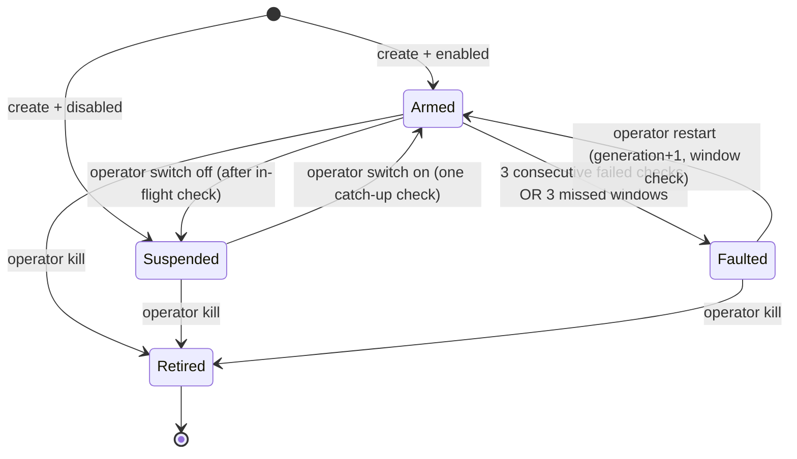

# 21 — Roles, ownership, and daemons: implementation model tested against the current tree

```yaml
gate: EVIDENCE-GATE-v1
lane: 21 — role/ownership/daemon architecture, current state and gaps
lane_id: wave3-seat-21
date_local: 2026-11-07T22:21:00-06:00
date_utc: 2026-11-08T04:21:00Z
workspace: C:\Users\Riley\Desktop\hiverouter-v1
head: bd575ba7adf3a5f2a9bdbc69f9bbf7084fe6fe65
working_tree: dirty
working_tree_hashes:
  backend/crates/hiverouter-core/src/execution.rs: F02F032A99CAD91E
  backend/crates/hiverouter-core/src/provider_executor.rs: 5656D179BDB68E74
  backend/crates/hiverouter-core/src/tool_loop.rs: 8D924F9E969B9F95
  backend/crates/hiverouter-core/src/planner.rs: 67A9F59A7AD8A8F7
  backend/crates/hiverouter-core/src/prompts.rs: 979A6CC9E06836C0
  backend/crates/hiverouter-core/src/caps.rs: D21061F2FA3C5A53
  backend/crates/hiverouter-core/src/db.rs: 8EAD70812ED67D47
  backend/crates/hiverouter-core/src/http.rs: F52B83B0AD889DF6
  backend/crates/hiverouter-core/src/ws.rs: F036F47123ACAA94
  backend/crates/hiverouter-core/src/context.rs: 3839628D1C38E8EE
  backend/crates/hiverouter-core/src/run_state.rs: 261DDCAE48B17214
  backend/crates/hiverouter-core/src/snapshot.rs: 2954FF374BE2DBC6
  backend/crates/hiverouter-core/src/recovery.rs: B35493C23123EAB3
  backend/crates/hiverouter-tools/src/tool.rs: 0DBD32E74A3F9AC0
  backend/crates/hiverouter-tools/src/approval.rs: 0B6FA92801FEA59B
  backend/crates/hiverouter-contract/schemas/contract-v1.json: 504B1C99E20BF73F
  backend/crates/hiverouter-contract/src/event.rs: 939FDECADBD7F003
  backend/crates/hiverouter-contract/src/command.rs: A4C05C1EC28CCA31
  backend/crates/hiverouter-contract/src/refusal.rs: 9C99C4475DF6CBCB
  web/src/state/store.ts: 3C222E738E668DFA
  web/src/flow/graph.ts: 543B850DE91EB234
  web/src/flow/nodes.tsx: 41A5DA7EDCE8CC8C
  web/src/state/agentState.ts: 4CFC0735A6E03F34
  web/src/state/strings.ts: 2ACDB02DC770BCBC
  web/src/api/refusals.ts: DC715B3AE2480144
  web/src/assets/manifest.ts: C0DA46D37948D5C6
  docs/contracts/UI-COMMANDS-v1.md: 09BC1081421E1C4E
  web/src/panels/AgentsPanel.tsx: 9AC74F55E52FF6EA
  web/src/panels/AgentProfilesPanel.tsx: 2ADA693528B3634F
  web/src/panels/SettingsPanel.tsx: 102C5B6BBCBFA35B
  web/src/panels/AgentHierarchy.tsx: F671771EFEE74B89
  web/src/api/contract.ts: 4E66EB111F8B7FB2
  backend/crates/hiverouter-core/assets/prompts/personas.json: 48C1004B55E67917
  backend/crates/hiverouter-core/assets/prompts/manifest.json: 894A0E7E17574DC9
  docs/provider/AGENT-ARCHITECTURE-TRUTH.md: D1B8B5F860978315
runtime:
  url: http://127.0.0.1:8099
  reachable_at: 2026-11-08T03:54:38Z
  last_seq: 0
  graph_nodes: 35
  schema_version: 10
  active_run_id: null
  active_run_status: null
  server_exited: last good probe 2026-11-08T03:54:38Z; next probe ~03:56Z refused; no restart by this lane
paid_calls: none
credentials_read: none (the health boolean `deepseek_api_key: present` was read; no key material)
product_files_edited: none
files_written: [docs/research/hmars/21-roles-daemons-implementation.md]
```

**Read-only statement.** This lane wrote only this file. It did not edit product source, tests,
config, migrations, assets, the desktop launcher, or git state; it did not start, stop, or restart
the server; it did not submit a prompt or make a paid provider call. It read the live service with
`GET /health` and `GET /api/agents/profiles`, then the service exited while the lane was working;
the rest of the runtime evidence is a read-only copy of the SQLite database and the snapshot
files that the last server left behind. No runtime claim below is a claim about a build of any
proposed design.

---

## 0. The one-page answer

The operator's four ranks — HyperAgent, SuperAgent, Agent, Subagent — are real, but they are
**not four tiers**, and the current tree does not implement even the three it names. The model
this document implements is:

1. **Four ranks over three spawn tiers plus a non-tier daemon.** Hyper = depth 0, Super = depth 1,
   Agent = depths 1–2, Subagent = a narrow Agent profile at depths 2–3. `AgentTier` does not grow.
   Subagent gets a wire kind, a card, a depth floor, and a narrowed grant; it is not a new enum
   value. A daemon is not a rank, a task, or a tier: it is a one-job office record.
2. **The role string stops being authority.** A single resolver maps the frozen aliases
   (`planner`, `super`, `worker`, `subagent`, …) and the exact persona ids to a versioned profile.
   Every spawn persists `profile_id` + `profile_version`; every lookup (`seed_task_context`,
   `persona_spawn_limits`, memory, prompt, grant) goes through the profile, never through the
   display string. Unknown roles refuse with `E_PERSONA_UNKNOWN`. This is the fix for the
   Title-Case UI spawns that today escape persona narrowing and write to a separate memory key.
3. **The planner is not a second spawn authority.** The MFR plan is **flat**: every planned node
   is a depth-1 child of the run root, a `parent` field is not accepted in v1, and every planned
   role passes the same profile/rank/class/depth checks as a command spawn. A planned
   SuperAgent→SuperAgent chain, a planned ToolActor, and a planned unknown role are all refused
   before a row exists. This is the fix for the live rows where depth-2/3 tasks hang directly off
   the root, and for the claim in the wave-2 model (`RC-07`) that Super→Super is impossible.
4. **Capability is a grant, not a tier.** A capability is a scoped id; the effective grant is
   `tier ∩ profile ∩ ownership ∩ policy ∩ budget − withheld`. Empty means none; unknown means
   refuse; the executor advertises the grant, not the tier. `agent.spawn` is withheld at depth 3,
   `daemon.*` is never inherited, and `run.control` is never inherited.
5. **Ownership is an office plus an occupant, not a process.** A department/domain office persists;
   a branch/task owner is an ephemeral occupant. Exactly one non-terminal owner task may hold a
   given scope (partial unique index on `tasks.ownership_scope`); the owner releases on terminal;
   rebind requires quiescence and is audited. Branch and task modes are the MFR implementation;
   department/domain offices are modelled and operator-activated but are P1-late/P2 UI.
6. **A daemon is a record, not a Task row.** `daemons`, `daemon_runs`, `daemon_reports`; no
   `tasks` row, no provider call, no run budget, no `MAX_AGENTS`/`MAX_CALLS` consumption. A check
   is a deterministic short operation on the daemon scheduler lane. This deliberately supersedes
   `12`'s "every check-in is a normal short-lived task": that shape cannot exist under the current
   single-active-run engine, and `20`/`18` already resolved to the record shape.
7. **The daemon contract is small.** One immutable job, one operator switch, heartbeat/report
   cadence with grace, scheduler-computed health, transition-only reports with dedupe, restart
   intensity 3/3600 s, kill = terminal `retired`, self/action-target cycle refusal, no
   self-control, no spawn, no tools, no model. A "TV-remote" is the control-daemon card with a
   fixed status/report-now/mute button table; target start/stop is reserved until a supervisor
   exists. A watch daemon **may observe its owner's run/hive** (the operator's primary watchdog);
   only an action target is barred from the owner chain.
8. **Every agent gets a card as a roster invariant, not a canvas invariant.** The roster is a
   run-scoped projection of tasks plus owner-scoped daemons. The root has a pinned card (and stays
   the ChatCore canvas anchor). Subagent and daemon get kinds/renderers. The card wire carries the
   operator's six facts — role, task, state, cost, tools, branch; the renderer shows four at
   compact density and six at comfortable density. An idle office is a greyed list row, not a
   running card. A daemon turn is an inspector row, not a new card.
9. **The model is additive to the frozen contract and takes the assigned slots.** Roles/offices and
   daemons are **v14** and **v15** in `20`'s single migration chain (not `12`'s v12), and the new
   commands/events/codes belong to **Delta 2** (P1), after the P0 token gate. No third delta, no
   duplicate migration number.
10. **The honest claim is a truthful single-run HMARS, not scale.** One active operator run, a
   deterministic daemon lane beside it, no scheduler, no planned hierarchy, no external remote
   enrolment. The target numbers (50–150 active / 300–600 total) are not claimed and are not
   evidence for this model.

**Verdict on wave 2:** the capability/ownership/daemon *model* is largely right, but the tree
contradicts four load-bearing wave-2 statements: (a) `RC-07` "no Super→Super" is false on the
planner path; (b) the Title-Case UI spawn escapes the persona narrowing the model assumes; (c) the
"daemon turn is a task" design cannot run under the single active run, and the record shape must
replace it; (d) the four-fact card conflicts with the operator's six required facts. Those are not
style differences; they change the implementation. §2.5–2.6 and §6 record each one with a test.

---

## 1. Decision frame, evidence bar, and method

### 1.1 Decision this research supports

| Field | Value |
|---|---|
| Decision | Adopt or reject this implementation contract for ranks, profiles, grants, offices/ownership, spawn/termination, daemons, and all-agent cards in the MFR (minimum first release) |
| Owner | Operator (Riley); consumer is the P1 implementation wave and the migration reviewer |
| Deadline | Before WP-P1-03 (roles/ownership v14) and WP-P1-04 (daemons v15) start |
| "Good enough" | Every rule is implementable against the current traits/tables, every refusal is a named code, every table/route/command/event has an exact shape, and every claim about the current tree has a current anchor/hash |
| Non-goals | Product edits, migrations, UI code, a scheduler, a general agent bus, external/remote daemon transport, a marketplace, scale claims |

### 1.2 Evidence bar (declared before writing)

- **Freshness rule.** External sources are current as of 2026-11-08. Two primary sources were
  fetched by this lane: the A2A "Life of a Task" page (task terminal immutability) and the
  Kubernetes "Owners and Dependents" page (owner references; page truncated after the navigation
  body, so only its existence/heading is used). Every other external claim is inherited from `12`
  or `18` and marked `READ`, never `VERIFIED-WEB`, unless this lane fetched it.
- **Source hierarchy.** Current working-tree code > live DB/snapshot copies > this lane's live
  HTTP probes > wave-2/3 research docs (`READ`) > official docs (`READ` in this lane unless fetched
  here). Forum/social/AI-generated pages are not used.
- **Claim labels.**
  - `V` — verified in this pass: current `path:line` (with file hash), a command with quoted
    output, or a copied-DB query.
  - `R` — read once (a doc, or code not quoted twice); may drift.
  - `I` — inferred from the cited facts with a stated assumption.
  - `D` — design decision made here; not an external fact.
  - `U` — not executed; what would settle it is named.
- **No fabricated values.** A number is either read from a command/file (with the file and hash) or
  marked `D`/`U`. No effort estimate, no “should work”, no post-hoc runtime claim.
- **No sealed-state runtime.** The live server exited during the pass; every runtime row carries
  its timestamp and the last-good probe. The DB/snapshot copies are evidence of what the last
  process persisted, not of the current design.

### 1.3 Question list and what settles each

| # | Question | Settling evidence | § |
|---|---|---|---|
| Q1 | What exactly does the current tree do with ranks, roles, and tiers? | Current `path:line` + file hash; live `tasks.role` rows | 2.1–2.2 |
| Q2 | Which wave-2 claims are still true on this tree, and which are contradicted? | Re-test each RC with a current anchor; the planner path and Title-Case path decide | 2.5 |
| Q3 | What gaps did the wave-2 model miss that change implementation? | A failing test per gap; live DB anomaly counts; UI control inventory | 2.6 |
| Q4 | How do four ranks map onto three tiers and a daemon without a fourth tier? | `AgentTier` enum + depth cap + A2A task/agent distinction + this model's admission rules | 3.1, 3.5 |
| Q5 | How is a role resolved to a profile, and where is it persisted? | Alias table + resolver + `tasks.profile_id` + memory/prompt/grant call sites | 3.3 |
| Q6 | What is a capability, and how is a grant attenuated? | Capability ids + grant equation + partial-unique ownership + tool advertisement seam | 3.2 |
| Q7 | What is ownership, and which state machine enforces one owner per scope? | Office/grant lifecycle + unique index + release/rebind/orphan rules | 3.4 |
| Q8 | What may each rank spawn, and what terminates it? | Admission table + withholding + terminal/guard/cascade rules | 3.5–3.6 |
| Q9 | What is a daemon, and why is it not a Task? | Current FK/caps/budget/single-run facts + daemon record contract | 3.7 |
| Q10 | What does "every agent gets a card" mean exactly? | Roster invariant + kinds/content + current UI filters + operator six facts | 3.8 |
| Q11 | What exact schema/routes/commands/events/refusals implement it? | v14/v15 DDL, route/command/event payloads, code table | 4 |
| Q12 | How is the model accepted without product edits? | 20 acceptance tests + 20 questions + gate record | 5–8 |

### 1.4 Method and its honest limit

The `/deep-research` program asks for independent researchers and a separate verifier. That is not
available at this delegation depth (`maxDepth: 1`, remaining levels 0). The substitution is stated:

- one researcher (this agent) read every cited current file, hashed it, and probed the live
  service and its persisted data;
- two primary external pages were fetched by this lane; all other external claims are inherited
  and labelled `READ`;
- **no independent verification pass happened.** §9 records that limit, the 10 claims a verifier
  should sample, and the exact tests that would promote each `U` item.

---

## 2. Current state: what the tree and the live data actually do

### 2.1 Live runtime and persisted state (all read-only, timestamped)

**Service probe.** `GET http://127.0.0.1:8099/health` at `2026-11-08T03:54:38Z` returned HTTP 200:

```json
{"status":"ok","version":"1.2.0-dev","schema":"hiverouter.v1","uptime_secs":631,
 "checks":[{"name":"rustc","required":true,"ok":true,...},
           {"name":"node","required":false,"ok":true,...},
           {"name":"deepseek_api_key","required":false,"ok":true,"detail":"DEEPSEEK_API_KEY is present (value never logged)"}],
 "database":{"path":"C:\\Users\\Riley\\AppData\\Local\\HiveMind\\hiverouter.db","schema_version":10,"error_code":null},
 "transport":{"last_seq":0,"graph_nodes":35,"allowed_origins":2},
 "prompt_assets":{"loaded":true,"error_code":null}}
```

`GET /api/agents/profiles` at the same probe returned **7** profiles: `chatbot`, `code-reviewer`,
`content-writer`, `data-analyst`, `planner` (`tier:"hyper"`), `subagent`, `superagent`
(`tier:"super"`, `max_children:8`, `max_depth:3`). No imported profile row existed. A second probe
a few seconds later could not connect; the `HiveMind`/`hiverouter` processes were gone by the next
process check. The process had started at 21:44 local; the last run/snapshot writes were at 21:26 (before that
boot), and the 21:44 boot performed recovery only, then exited at ~21:56. The same non-durable
pattern is what `10` recorded; it is evidence of a real service, not a stable baseline.

**Persisted data (copied DB + WAL; opened read-only).** `runs` 5, `tasks` 27, `chat_messages` 13,
`agent_messages` 0, `agent_memory` 7, `agent_profiles` 0, `projects` 1, `approvals` 2,
`tool_turns` 22+, `run_usage` 3, `schema_migrations` max 10.

| Fact | Observed | Meaning for this model |
|---|---|---|
| Runs | 3 `failed` with `E_BUDGET_EXCEEDED`, 2 `completed` | The old binary's tool-cap label is a real wave-2 finding; `20` WP-00 fixes it. Not a role defect. |
| Roles in `tasks` | `planner` 5, `worker` 19, `superagent` 3; **no** Title-Case role | The planner-produced rows are lowercase; the Title-Case path is the UI command path, which the live history did not exercise. |
| Depth vs parent | Run 1/2/3 each: 6 tasks, max depth 3, **4 tasks at depth >1 whose `parent_task_id` is the depth-0 root**; run 5: 4 tasks, 2 deep-under-root | The plan's `depth` is advisory. A "depth 3" node can be a direct root child. Rank/depth/ownership cannot be derived from `depth` alone. |
| Role/depth combinations | `superagent` appears at depth 3 under the root in run 1; `worker` at depth 3 under the root | The engine accepted SuperAgent and Worker nodes at impossible structural positions. `plan.validate` does not enforce `depth = parent.depth + 1` when `parent` is omitted. |
| `agent_memory` keys | 7 rows, role-keyed; only lowercase execution roles | A Title-Case UI spawn would write a different key that the persona-keyed memory panel never lists. |
| `agent_profiles` | **0** rows | No version/override path has ever run live; profile pinning is new ground. |
| Approvals | 2 `shell_exec` `allow_once` rows; `args_sha256` present; no `grant_hash`/`profile_version` | Approval binding exists at args-hash level, not instance/grant level. |
| Usage | Only 3 of 5 runs have `run_usage`; failed runs 2–3 have none | Cost/token truth is partial; a card must render `—`, never 0. |
| Snapshots | Live files from the last binary: per-run latest node counts 2, 4, 4, 6, 8, 14, 20, 26, 31, **35**; the last run has 4 DB tasks but a 35-node snapshot | Those files are global. **The working tree now scopes normal run commits**: `capture_scoped` (`snapshot.rs:264`) + `commit_run_snapshot` filtering by `tasks_for_run` (`execution.rs:1189-1215`), uncommitted/untested. **Recovery still writes a global snapshot**: `recovery.rs:279` calls `snapshot::capture`, so a crash-recovery revision can leak foreign nodes. Old files remain global; replay still flattens kinds. |

**Tree drift during this pass.** Another lane modified `execution.rs` and `snapshot.rs` at 22:16,
after this lane's first reads: `execution.rs` `8218C81E…` → **`F02F032A…`** (snapshot scoping; the
insertion at `:1190` shifts later lines by +10), `snapshot.rs` `4811CC72…` → **`2954FF37…`** (new
`capture_scoped`). The `execution.rs` line anchors after `:1190` in this document have been re-anchored to the
current file (+10); the old hash is recorded for audit. The symbol names are exact. This lane made no product
edit; the drift is recorded rather than silently incorporated, as `10` G6 requires.

**UI evidence.** No new DOM capture was possible after the service exited. The current UI
conclusions in §2.3 are `V` for source lines and `R` for the committed captures below (captures are
from earlier in the day, not this lane's state):

- `docs/trace/ui-rebuild/shots/1440x900-view-agents-live-1520.png` — Agents surface: hierarchy,
  all-task cards, tool activity, **5 visible agent-profile cards**, import box; no Subagent/Daemon,
  no ownership/office cell.
- `docs/trace/ui-rebuild/shots/1440x900-tab-swarm-live-1520.png` — HUD `HYPERAGENT · —
  SUPERAGENTS · — WORKERS · — GREEN`, ControlBar `ROLE`, `SPAWN SUB-HIVE`, `RE-ROUTE`, `CANCEL`,
  `KILL WORKER`; the fixed chat card is the root surface.
- `docs/trace/ui-rebuild/shots-live/1440x900.png` and `1440x900-empty-state.png` — same five-kind
  geometry; no daemon/subagent affordance.

These are **R**, not `V` for a run id at this moment. They agree with the source inventory.

### 2.2 Code truth: tier, role, persona, tools, spawn, ownership, daemon, cards

**Tier and rank.** `AgentTier` is exactly HyperAgent/SuperAgent/WorkerAgent/ToolAgent
(`tool.rs:72-81`). `PersonaTier` is a second enum Hyper/Super/Worker/Tool (`prompts.rs:367-379`).
There is no rank, no `Subagent`, no `Daemon`. `task_agent_tier` lowercases the role and maps
`planner/hyper/...`→Hyper, `super/...`→Super, `tool/...`→Tool, `worker/...`→Worker, `"" & depth 0`
→Hyper, and **everything else→Worker** (`execution.rs:151-163`). The wire kind is the tier label
(`execution.rs:97-106`); `NODE_KIND_VOCABULARY` is four values (`event.rs:240`), mirrored in
`contract.ts:213` and `agentState.ts:126-135`.

**Role is the de facto authority, not the profile.** `validate_spawn_role` accepts a lowercase name
list per parent tier (`execution.rs:113-142`). `spawn_sub_hive` validates it, then inserts
`role: role.to_owned()` (`execution.rs:1074,1096`). `execute_spawn_agent` parses the model's role and
calls the same function (`execution.rs:2665`). The planner path inserts `node.role` with **no**
`validate_spawn_role` (`execution.rs:1347-1385`); `Plan::validate` only requires a non-empty role
(`planner.rs:63-71`). `task.role` is therefore a free-form string unless the caller happens to be a
command/model spawn.

**Title-Case UI roles are a real hole.** The UI store sends Title-Case role labels:
`STRINGS.node.superAgent` (`'SuperAgent'`), `STRINGS.node.workerAgent` (`'WorkerAgent'`), and
`'Subagent'` (`store.ts:1867-1873`; `strings.ts:276-277`). `validate_spawn_role` lowercases, so the
spawn is accepted, but the row keeps Title Case. Then:

| Call site | Lookup | Effect of `role:'Subagent'` / `'SuperAgent'` |
|---|---|---|
| `seed_task_context` | exact `personas.get(&task.role)` (`execution.rs:871-879`) | misses; `allowed_tool_ids` stays empty; **empty means no narrowing** (`execution.rs:982-1003`), so a UI Subagent gets the full Worker allowlist including `spawn_agent`, `file_write`, `shell_exec` |
| `persona_spawn_limits` | exact `personas.get(role)` (`execution.rs:550-558`) | misses; persona `max_children`/`max_depth` are not applied |
| `agent_memory` read/write | exact `&task.role` (`execution.rs:880`, `:3029-3035`) | writes/reads a separate `'Subagent'` channel the persona panel does not list or clear |
| `system_prompt_for` | lower + `_`/space normalization (`provider_executor.rs:82-92`) | `Subagent`→`subagent` works; `SuperAgent`→`superagent` works; `WorkerAgent`→`workeragent` has no persona; `Content Writer`→`content_writer` misses a hyphenated id |

This is not merely a prompt-forgetting bug (the wave-2 fix addressed the prompt). It is an
**authority and identity** bug: the child is spawned as an Agent-class task while the UI says
"Subagent"; its grant is the broadest Worker grant, and its memory is keyed to a channel no persona
surface knows. `provider_executor.rs` is dirty at `5656D179…`; the fix is uncommitted and only
covers the prompt.

**Empty-allowlist fail-open.** `authorize_tool_call` explicitly treats an empty persona list as
"the context has not narrowed the tier allowlist" (`execution.rs:982-1003`). Consequences today:
`planner` persona has `[]` (`personas.json`), so the root would get the full Hyper tier set if it
ever executed; every planned `worker` node has no `worker`/`agent` persona, so it gets the full
Worker allowlist; a Title-Case child gets it too. The tool *advertisement* is tier-based
(`provider_executor.rs:328-344`, `:414-420`; `tool_loop.rs:206-219`), not grant-based, so a narrow
persona still sees the broad set and is refused only after it asks.

**Planner bypass is broader than "unknown role".** The engine checks global caps only
(`execution.rs:1368`), not the spawn policy, rank, profile, or parent depth. Accepted plan examples
that the command path forbids:
- `superagent` at depth 1 whose child is `superagent` at depth 2 with `parent` set: `plan.validate`
  accepts the parent/depth chain (`planner.rs:75-84`), and nothing forbids Super→Super on this
  path. **This refutes `12` RC-07 (`HELD`).**
- `worker` at depth 2 under a `worker` parent: the command policy permits Worker→Subagent only
  (`execution.rs:130-133`), but the plan path permits Worker→Worker.
- `subagent` at depth 1: no depth floor; the plan path accepts it and the persona is applied (if
  lowercase), so it is narrow but structurally illegal.
- `tool` at depth 1: `task_agent_tier` maps it to ToolAgent, whose allowlist contains
  `file_write`/`shell_exec` (`tool.rs:422-430`), so the planner can create a ToolActor task that is
  model-spawned (the wave-2 model said ToolActors cannot be model-spawned).
- Any other role (`cto`, injected text) → Worker, no persona, full Worker grant.

**Depth is advisory.** In `dispatch_inner`, `parent_id = node.parent.unwrap_or(root.id)` and the
inserted `depth` remains the model's `node.depth` (`execution.rs:1356-1361`). `Plan::validate` only
checks `parent.depth + 1 == node.depth` **when `parent` is present** (`planner.rs:75-84`). Live runs
prove the result: four depth>1 root children per 6-task run. Rank cannot be derived from `depth`;
ownership scopes cannot be derived from `parent_task_id`; the Subagent depth floor cannot be
enforced on plan nodes.

**Persona/profiles.** Seven profiles ship (`personas.json`): `planner`, `superagent`, `subagent`,
`content-writer`, `data-analyst`, `code-reviewer`, `chatbot`. There is **no `agent`/`worker`
profile**. `Persona::validate` checks id/display/refusal policy/template and caps only; it does
**not** validate `allowed_tool_ids` against the registry and does not check tier↔rank or capability
consistency (`prompts.rs:411-434`). The profile has no description, version, rank, ownership
defaults, or capability ids. Profile import persists raw JSON and hot-swaps the engine map
(`http.rs:765-805`), but the executor's prompt map is built at boot (`http.rs:230-278`), so an edit
changes allowlists/caps but not prompts until restart (wave-2 G8 remains true). `delete_agent_profile`
returns an invented code `E_PROFILE_NOT_FOUND` that is not in the frozen refusal table
(`http.rs:819-828` vs `refusal.rs:73-282`). The UI's `BUILTIN_IDS` omits `superagent`/`subagent`
(`AgentProfilesPanel.tsx:23`), so it renders a **Delete** button for those built-ins; the request
always fails because no imported row exists (`http.rs:815-828`). That is a current UI defect.

**Ownership is absent.** `tasks` has id/run/parent/role/depth/spawn_seq/state/rev only
(`db.rs:63-73`); no profile/ownership/grant columns. There is no office/grant table or route. `rewire`
moves a live subtree and switches its context (`ws.rs:650-736`) without re-deriving any authority.
`kill_worker` settles exactly one task; it has no cascade and no ancestry check
(`execution.rs:1142-1168`). `complete_task` has no parent-completion guard
(`execution.rs:2983-3039`). `reconcile_terminal_tasks` is the only all-tasks settlement
(`execution.rs:1226-1254`).

**Daemons are absent.** No `daemon`/`watchdog` identifier exists in product Rust source; no table,
route, event, command, card, or scheduler. The only “watchdog” is a FigCraft asset ledger in
`web/src/assets/manifest.ts` (`27` §1.3, wave-3 sibling). A daemon turn as a Task is impossible to model with
the current tables: `tasks.run_id` is `NOT NULL` and FK to `runs` (`db.rs:63-72`), `submit_prompt`
refuses a second active run (`execution.rs:1032-1034`), budgets are keyed by `RunId`
(`provider_executor.rs:39,104-109`), and `MAX_AGENTS`/`MAX_CALLS` count tasks/calls per run
(`caps.rs:9-15`). A 5-minute daemon on the task table would also flood run history, consume the
64-agent cap, and have no home after the run ends.

**Single active run is real.** `submit_prompt` refuses when any latest active run or in-memory
active run exists (`execution.rs:1029-1034`); dispatch is one Tokio task; leaves, aggregators, and
the spawn queue are sequential (`execution.rs:1405-1560`); a model-spawned child is awaited inline
(`execution.rs:2691`). The provider limiter is 8 (`budget.rs:42-43`), but the engine never offers
more than one call. This is the constraint that forces the daemon record/lane.

**Cards.** Server kind vocabulary is four; UI kinds are four + client-only `error`
(`event.rs:240`; `agentState.ts:126-135`). `buildNodes` filters `kind !== 'hyperagent'`
(`graph.ts:143-165`) and uses a fixed `hive-core-anchor` edge (`graph.ts:167-188`). `NODE_SIZE` has
no `subagent`/`daemon` (`graph.ts:30-36`), and `taskCounts` is an exhaustive five-key record
(`graph.ts:236-249`). `nodes.tsx` renders Super/Worker/Tool/Broken/Hyper only
(`nodes.tsx:269-275`); the Worker card shows a generic role caption and `—` metrics
(`nodes.tsx:175-194`). The **AgentsPanel** maps `Object.values(tasks)` to buttons, so in fact it
lists *every* task including the root even though the canvas filters the root
(`AgentsPanel.tsx:29-64`). What is missing is not “a root card” but a **server-supplied identity
card** (profile/rank/ownership/daemon) and a real roster; the current list has generic labels and
no ownership/daemon row. Replay flattens every node to `worker` (`graph.ts:196-234`), and
`recordsFromSnapshotGraph` requires only `{task_id,state,rev}` (`store.ts:571-626`). The live
snapshot files are global (`snapshot.rs` old `capture`; last binary predates the tree fix), so the
35-node file vs 4-task run is real; the **current working tree** scopes normal run commits with
`capture_scoped` (`snapshot.rs:264`), but that is uncommitted and untested, and **recovery still
calls the global `capture` at `recovery.rs:279`**, so a recovery revision can still leak. Replay
still flattens kind until the card fields and the snapshot node fields land.

**UI settings/profile surfaces.** `SettingsPanel` exposes only key/provider/model/thinking/effort,
health, reduced motion, and a gallery (`SettingsPanel.tsx:32-119`); no autonomy, capability,
ownership, daemon cadence, or muting. `AgentProfilesPanel` reads 7 profiles, shows tier and tool
count, and imports/deletes; it has the stale builtin list above. `AgentHierarchy` derives depth from
parent links only and re-roots orphans (`AgentHierarchy.tsx:21-53`) — honest, but it cannot show
ownership or daemon nodes.

### 2.3 UI truth table (current build)

| Control / surface | Current truth | Evidence | Model requirement |
|---|---|---|---|
| Canvas node kinds | 5 UI kinds (`hyperagent,superagent,worker,tool,error`); root filtered | `agentState.ts:126-135`; `graph.ts:143-165` | add `subagent` and daemon card; add sizes/renderers/count keys |
| Root representation | ChatCore fixed anchor; root also appears in AgentsPanel task list | `graph.ts:26-31,167-188`; `AgentsPanel.tsx:40-64` | pinned root card in roster/treegrid/header; canvas anchor stays |
| Agent cards | label from store fallback (`WorkerAgent <tail>`); progress/ctx null→`—` | `store.ts:328-331`; `nodes.tsx:175-194` | server `display_name`/role/ownership/cost/tools/branch; null=`—` |
| Subagent | no kind/renderer/size; renders as Worker | `nodes.tsx:269-275`; `graph.ts:30-36` | `subagent` kind, compact card, SUB chip, no workspace metric |
| Daemon | no kind/route/event/card; no switch/health | absence; `http.rs:514-531`; `event.rs:19-68` | `daemon` card + switch + health + report age; no task row |
| Spawn control | `spawnSubHive` picks parent and sends Title-Case role (`SuperAgent`/`WorkerAgent`/`Subagent`) | `store.ts:1852-1874`; strings `276-277` | profile selector, canonical id, admission refusal rendering |
| Re-route | parent rewire with server CAS; live subtree allowed | `store.ts:1876-1928`; `ws.rs:650-736` | parent rewire stays; ownership rebind is separate and quiescent-only |
| Kill | one worker; no cascade/owner check | `ControlBar.tsx`; `execution.rs:1142-1168` | confirm + cascade field; owner kill requires cascade |
| Profiles | 7 rows; delete offered for built-ins superagent/subagent; delete fails | `AgentProfilesPanel.tsx:23,156-165`; `http.rs:815-828` | fix builtin set; token gate; no invented code |
| Settings | key/health/motion/gallery only | `SettingsPanel.tsx:32-119` | autonomy/capability/ownership/daemon settings (v12) |
| Replay | all nodes `worker`; live files foreign; run commits now scoped in tree, recovery still global | `graph.ts:196-234`; `store.ts:571-626`; `snapshot.rs:264`; `execution.rs:1189-1215`; `recovery.rs:279` | preserve kind/profile/ownership or `unknown`; pin/test scoped snapshots **and** recovery capture (20 WP-P0-09) |

### 2.4 Live profiles, read-only (the “current personas” fact)

- Boot profiles: exactly the 7 embedded records; `agent_profiles` has 0 rows, so there are no
  imported overrides and no version history.
- `planner.allowed_tool_ids=[]`; `superagent` has spawn/ask/sibling/read/list/report/finish and caps
  8/3; `subagent` has ask/sibling/read/list/report/finish; the three worker personas have
  read/list/ask/sibling/report/finish; `chatbot` has ask/sibling/report/finish.
- This is the current set the resolver must support without a marketplace. It is also incomplete for
  the rank model: there is no `agent` profile for the planner's `worker` role, so the planner's most
  common leaf has no declared grant. The model adds `agent` as a code-defined builtin; imported
  profiles remain operator-supplied JSON with source/version.

### 2.5 Re-testing the wave-2 role model (what held, what did not)

Legend: **HELD** = current tree still matches; **PARTIAL** = some path matches, another contradicts;
**GAP** = absent; **REFUTED** = the wave-2 claim is false on a path it said was safe.

| Wave-2 item | Claim | Status now | Current evidence / why |
|---|---|---|---|
| `12` §2.2 R1 / `20` XS-4 | Subagent is a narrowed Worker-tier profile, not a tier | **GAP** | No `subagent` rank/kind/card; no `agent` profile; the UI Title-Case path gets the full Worker grant. |
| `12` RC-04 | Empty grant means no tools | **GAP** | `execution.rs:992` requires `!allowed.is_empty()`; empty = no narrowing. |
| `12` RC-05 | Unknown role refuses; never degrades to Worker | **GAP** | `execution.rs:161` still `_ => WorkerAgent`; planner accepts any non-empty role (`planner.rs:63-71`). |
| `12` RC-06 | Subagent never at depth 1, never sees spawn/write/exec | **GAP** | Plan can place `subagent` at depth 1; Title-Case Subagent sees all Worker tools; no depth floor in plan or command path. |
| `12` RC-07 | No SuperAgent spawns a SuperAgent (**HELD**) | **REFUTED** | Command path holds (`execution.rs:130-133`), but the planner path accepts a Super parent with a Super child (`planner.rs:75-84`; no `validate_spawn_role` at `execution.rs:1347-1385`). |
| `12` RC-08 | `agent.spawn` withheld at depth == max | **GAP** | Tools advertised by tier (`provider_executor.rs:328-344`); cap only refuses at call time (`caps.rs:50-52`). |
| `12` RC-09 | Ownership exclusive; rebind quiescent | **GAP** | No ownership columns/tables; `rewire` allows live subtree. |
| `12` RC-10–RC-15 | Daemon cannot spawn/write/self-control; target acyclic; retired/restart; reports | **GAP** | No daemon entity at all. |
| `12` RC-16 | Every instance/daemon has a roster card; root card exists | **PARTIAL** | AgentsPanel lists every task incl. root, but with generic data; no daemon; canvas root filtered. Wave-2 “root has no roster card” is too strong: the AgentsPanel row exists, the **card record** does not. |
| `12` RC-17 | Profile version pinned; edits don't change live grants; revocation interrupts | **GAP** | No version; `upsert_persona` hot-swap; executor prompt map static; no revocation. |
| `12` RC-18 | Approval binds one call; no transfer | **PARTIAL** | `args_sha256` + task/run/tool_call/nonce exist; no `grant_hash`/`profile_version`; `spawn_agent` skips approval by design. |
| `12` RC-19 | Terminal absorbing | **HELD** | `execution.rs:93-95`, `:2994-3009`; `run_state.rs:440`. |
| `12` RC-20 | Parent cannot complete with live descendant | **GAP** | `complete_task` has no descendant query (`execution.rs:2983-3039`). |
| `12` RC-25 | Daemon budget separate from the run | **GAP / design conflict** | No daemon; a task-shaped daemon turn would charge the run's `RunId` budget. |
| `12` RC-26 | Replay preserves kind/profile/ownership or says unknown | **PARTIAL** | Replay still all `worker`; the snapshot *scope* fix (`capture_scoped`) is in the dirty tree but uncommitted/untested; old live files remain global. |
| `12` §7.1(2) | Every daemon check-in is a normal short-lived task | **REFUTED** | Tasks FK a run; single active run; caps/budget per run; no run to hold a daemon turn beside the operator run. `20` XS-5 and `18` §6.1 already selected a record. |
| `12` §12.1 | Card shows at most four facts | **CONTRADICTS operator** | `OPERATOR-DECISIONS.md:83-84` requires role, task, state, cost, tools, branch; `10` §5.1 #33 records the conflict. Fix in §3.8: wire six, render four at compact density. |
| `12` §17.1 | v12 offices/daemons | **SUPERSEDED by `20`** | `20` §4.2 assigns v14 roles/ownership, v15 daemons; `12`'s number is no longer available. |
| `12` §2.3 | HyperAgent has no roster card | **PARTIAL** | AgentsPanel button row exists; server identity card absent. |
| `12` G5 | Role normalisation split | **PARTIAL / understated** | Prompt normalization is in the dirty tree; authority/memory lookups are still exact. The fix must be a resolver + canonical persistence, not another normalization. |

### 2.6 Gaps the wave-2 model missed (each changes implementation)

**G1. Title-Case spawn defeats the persona grant and memory identity.** `store.ts:1867-1873` sends
`SuperAgent`/`WorkerAgent`/`Subagent`; `execution.rs:871-879` looks up exactly; empty means no
narrowing (`:992`); `agent_memory` keys on the raw role (`:880`, `:3029-3035`). Result: a UI
“Subagent” has the full Worker grant (`spawn_agent`, `file_write`, `shell_exec`), its persona caps
are unused, and its memory is orphaned from `subagent`. Wave-2 saw the prompt/role mismatch (G5)
but not the authority/memory consequence. Test `AT-01/02/03`.

**G2. The planner path is a parallel, unvalidated spawn authority.** It skips
`validate_spawn_role`, profile resolution, rank/class checks, and parent-depth consistency, and
accepts Super→Super, Worker→Worker, ToolActor, and unknown roles. Wave-2 listed "planned roles
bypass" (G9a) but still marked RC-07 HELD and did not enumerate the class combinations. Test
`AT-04…AT-07`; this is the highest-severity role defect after G1.

**G3. Depth is advisory, not hierarchy.** `parent` defaults to root while `depth` is kept
(`execution.rs:1358`), so live depth-3 root children exist. Wave-2's depth-band/Subagent-floor rule
is unenforceable on planned nodes. Test `AT-06`; the MFR fix is a flat plan (all depth 1) and
runtime-created depth.

**G4. The daemon-turn-as-task design contradicts the engine.** `12` §7.1(2) says a turn is a task;
the current `tasks` FK, single run, caps, and budgets make that impossible without a second run lane.
`20`/`18` chose a record; this doc supplies the exact record. Test `AT-15`.

**G5. Wave-2's card model drops three operator-required facts.** `12`'s `CardRecord` has one
`primary_metric` and a four-fact cap; the operator requires cost/tools/branch. The wire must carry
six; density is presentation. Test `AT-20` and §3.8.

**G6. The “root has no roster card” claim is half-right.** The AgentsPanel already lists the root
task as a button, but no server identity/ownership/daemon card exists. The fix is a roster record,
not a new UI region. This matters because `RC-16`'s evidence is misdiagnosed.

**G7. The profile surfaces are stale and can fabricate a refusal code.** `AgentProfilesPanel`
offers Delete for built-in `superagent`/`subagent`; `delete_agent_profile` returns
`E_PROFILE_NOT_FOUND`, a code not in `refusal.rs` (contract violation). Wave-2 did not test the
profile panel. Test `AT-09`.

**G8. `system_prompt_for` normalization is asymmetric.** It replaces `_`/space with `_`, but persona
ids use `-`: `Content Writer`→`content_writer` misses `content-writer`; `workeragent` has no
persona. Only `SuperAgent`/`Subagent` are fixed. The resolver, not a bigger normalizer, is the fix.

**G9. The run-scoped snapshot defect is only half-fixed in the working tree.** `10` found the live
snapshots are global; `12`'s card model assumes a run-scoped task set. The tree now has
`capture_scoped` + a filtered `commit_run_snapshot` (uncommitted, untested), but `recovery.rs:279`
still calls the global `capture`, so a recovery revision can leak foreign nodes. The defect is
**PARTIAL**, not absent: the roster must still be built from `tasks_for_run` (never the snapshot),
and replay must say "kind unknown" until node fields land. Test `AT-20` with a crash-recovery
revision; pin the fix first.

**G10. The single active run blocks any daemon-shaped task; the daemon lane must be explicit.**
Wave-2's G21 says "separate daemon lane" but its own §7.1 says the lane runs tasks; those conflict.
The model must say: no task, no run, no provider, no budget; one scheduler-lane task.

**G11. Profile edit hot-reload is split-brain.** Engine map updates, executor prompt map does not
(`http.rs:709-726,239-271`); a live instance's prompt and allowlist can disagree after an import.
The model pins profiles per instance and reads one registry from both sides.

**G12. The ownership model has no enforcement point in the task table.** Wave-2 proposed offices but
did not give a uniqueness mechanism. The model uses a partial unique index on the owner row
(`ownership_mode IN (…)` and non-terminal), so “one active owner per scope” is a database fact, not
a convention. Test `AT-10`.

**G13. Live data proves the UI/profile path was never exercised.** 0 `agent_profiles`, 0
`agent_messages`, no Title-Case roles; the wave-2 model's UI-spawn and profile-pin claims are
code-only. This lane keeps them `GAP` until the acceptance tests run. It is a gap in evidence, not
just code.

**G14. The UI card data path has no `display_name`/`role_label`/`ownership` fields.** The store
fallback invents `WorkerAgent <tail>` (`store.ts:328-331`); the server sends no label
(`event.rs:242-266` has optional `kind` only). Wave-2 G31 noted it; the implementation must add the
fields to the roster **and** `NODE_SPAWN`/`NODE_STATE`, not only to a new route.

**G15. The daemon's “watch” work must be deterministic or it is an agent.** `12` allows a
model-or-deterministic report; `18`/`27` reject a model in the check loop. The current provider
budget is run-keyed, so a model daemon turn has no honest cost home. The model chooses
deterministic checks in v1 and names the condition for revisiting.

---

## 3. The implementation model

### 3.1 Four ranks over three tiers plus a daemon

**Ranks are accountability; tiers are the spawn-depth capability classes.** The three spawn tiers
are Hyper, Super, and Worker; `ToolAgent` remains a non-orchestrating actor and is not a spawn
tier, even though `AgentTier` still has four variants. The rank is a property of the resolved
profile, not a new `AgentTier` variant and not a second role string. `tasks.profile_id` pins the
profile; `rank = profile.rank` is derived on every read. No `rank` column is added.

| Rank | Runtime tier | Depth band | Built-in profile | May spawn | Card kind | Wire task kind | Authority |
|---|---|---|---:|---|---|---|---|
| **1 HyperAgent** | `HyperAgent` | 0 only (one per run) | `planner` | Super, Agent (Subagent only through them); `daemon.request` (approval) | `hyperagent` (pinned root card) | `hyperagent` | run owner; plan/policy/aggregate; no workspace tools; no `ask_parent`; `ask_operator` only |
| **2 SuperAgent** | `SuperAgent` | 1 only | `superagent` (+ offices) | Agent, Subagent | `superagent` + ownership chip | `superagent` | branch/department/domain/single-task owner; read + orchestrate; no write/exec |
| **3 Agent** | `WorkerAgent` | 1–2 | `agent`, `content-writer`, `data-analyst`, `code-reviewer`, `chatbot` | Subagent only | `worker` labelled Agent | `worker` | one task with tools; writes/exec with approval |
| **4 Subagent** | `WorkerAgent` | **2–3** | `subagent` | nothing | `subagent` compact + `SUB` | `subagent` | narrow read-only leaf; no spawn/write/exec |
| **Daemon** | *non-tier* | attached (no tree depth) | none (job record) | nothing | `daemon` + `WATCH`/`REMOTE` | **never a task** | observe/report only; one switch |
| **Tool actor** | `ToolAgent` | n/a | `tool-actor` (code-only) | nothing | `tool` (Actors section) | `tool` | approved tool execution only |
| **Operator** | n/a | n/a | n/a | everything | no card | n/a | root authority; human-only settings |

Rules that make the table testable:

- **R1 — Rank is resolved, never parsed from a display string.** `rank = profile.rank`; the profile
  is resolved from the role/alias at spawn and persisted as `profile_id`. `task_agent_tier` is
  replaced by `profile.tier`; it remains only as a legacy read path for pre-v14 rows.
- **R2 — Subagent is a profile, not a tier.** It uses `WorkerAgent` tier; its grant is narrowed to
  read-only leaf work. It gets a distinct wire kind and card. `AgentTier` does not grow.
- **R3 — Subagent is legal only at depth ≥ 2.** A request at depth 1 is refused with
  `E_SPAWN_PROFILE_DEPTH`; the model is told to use an Agent. On the MFR flat plan every planned
  node is depth 1, so a planned `subagent` is always refused; only runtime spawn (Agent/Super →
  Subagent) can create one.
- **R4 — No Super→Super, no Worker→Worker, no Agent→Agent.** Super spawns Agent/Subagent; Agent
  spawns Subagent; Hyper spawns Super/Agent, and Subagent only through them (depth floor). A
  department that needs another fan-out is a **sibling** SuperAgent under the HyperAgent; the
  HyperAgent creates it. The plan path is not an exception (see 3.5).
- **R5 — No Hyper child.** Hyper is depth 0 and one per run. A planned or spawned `planner`/`hyper`
  at depth ≥1 is refused with `E_SPAWN_PROFILE`. The root is the only Hyper instance.
- **R6 — Depth is derived from the parent, not claimed.** `child.depth = parent.depth + 1`; the
  claimed depth must equal it or the spawn is `E_SPAWN_DEPTH`. A plan node's claimed depth must be
  1 (flat MFR); `parent` is not accepted in v1.
- **R7 — ToolActor is never model-spawned or plan-spawned.** It is created by the engine for an
  approved tool execution only. A role/alias resolving to `tool-actor` from any model or plan is
  `E_SPAWN_PROFILE`.
- **R8 — Daemon is not a rank in the tree.** It has no children, no task depth, no task state. It
  is attached to an owner (run or Super task) and rendered as an observer edge/card; it never
  extends the tree or the caps.

**Why not four tiers?** A fourth `AgentTier` would add a terminal-state surface and a prompt depth
for no capability that a narrowed Worker profile cannot express; the current enum and depth cap are
sound primitives. The operator's fourth level is real as a rank/identity. `20` XS-4 already chose
this shape; this document makes the rank explicit and fixes the paths that ignored it.

**Rank and wire-kind mapping.** `rank → wire task kind` is a pure function:
`hyper → hyperagent`, `super → superagent`, `agent → worker`, `subagent → subagent`,
`tool → tool`. The UI label for `worker` is “Agent”, not “WorkerAgent”; the wire value stays
`worker` for compatibility. The daemon card kind is `daemon` and is **not** a task kind; see §3.8.

### 3.2 Capability model: ids, grant equation, matrix, attenuation

#### 3.2.1 Capability ids and their implementations

A capability is a scoped authority id minted by the engine. A tool is one implementation. The
engine owns the mapping; profiles declare capability ids (or tool ids as a compatibility shorthand).

| Capability id | Class | Implemented today by | Scope carried by the grant |
|---|---|---|---|
| `workspace.read` | Read | `file_read`, `file_list` | workspace jail + branch |
| `workspace.write` | Mutate | `file_write` | workspace jail + approval policy |
| `process.exec` | Execute | `shell_exec` | shell allowlist + approval policy |
| `agent.spawn` | Mutate | `spawn_agent` (model) / `SPAWN_SUB_HIVE` (operator) | caller scope, rank, depth, fan-out |
| `agent.escalate` | Read (ledger Mutate) | `ask_parent` | immediate parent only; deadline |
| `agent.notify` | Mutate | `send_to_sibling` | same parent by default; cross-branch approval |
| `task.report` | Read (ledger Mutate) | `report_result` | parent/owner |
| `task.finish` | Read (ledger Mutate) | `finish` | own task |
| `memory.read` | Read | engine context | `run`, `branch`, `role`, `project` scope |
| `memory.write` | Mutate | engine completion hook | own branch/role only |
| `run.control` | Execute | `cancel_run` / `kill_worker` | own run or descendant subtree (owner only) |
| `roster.read` | Read | new bounded roster | own run/scope; no costs/hidden fields |
| `daemon.request` | Mutate | new command | Hyper only; approval-gated |
| `daemon.manage` | Execute | new commands | operator only; never inherited |
| `daemon.report` | Read | daemon scheduler | one owner only |
| `target.status` | Read | daemon check | declared target only |
| `target.start` / `target.stop` | Execute | **reserved P3** (no supervisor) | declared target only; approval |
| `target.restart` / `target.kill` | Execute | **reserved P3** | declared target only; approval always |
| `profile.read` | Read | profiles route | own profile/visible roster |

The `target.*` rows are deliberately **not** implemented in v1. A capability id may exist in the
frozen table while its implementation refuses `E_DAEMON_NO_CAPABILITY`; that is honest surface, not
a fake feature. `profile.read` is the existing profiles route.

#### 3.2.2 The grant equation

For instance `i` with resolved profile `p` at version `v`, rank `r`, ownership `o`, policy mode
`m`, remaining budget `b`, and depth `d`:

```text
grant(i) = tier_grant(r)
         ∩ profile_caps(p, v)        // explicit; no "*" in built-ins
         ∩ ownership_caps(o)         // e.g. a branch owner may spawn inside its branch
         ∩ policy_caps(m)            // autonomy mode 1..4 (approval/auto, not new tools)
         ∩ budget_caps(b)            // a capability with no budget left is absent
         − withheld(i)               // spawn at depth==max; daemon.*; run.control unless owner

grant(child) ⊆ grant(parent) − {capabilities the child profile may not hold}
grant_hash = SHA-256(canonical_json({
  profile_id, profile_version, rank, ownership_mode, ownership_scope,
  capabilities: sorted(capability_ids), withheld: sorted(capability_ids),
  policy_mode, parent_grant_hash|null
}))
```

- **Engine-base capabilities.** `task.report`, `task.finish`, `memory.read:branch`,
  `memory.write:branch` are minted by the engine for every task, not inherited; they are the only
  exception to subset attenuation.
- **Empty is none.** If the intersection is empty for a required capability, the spawn is refused
  `E_CAPABILITY_EMPTY`; the call is refused `E_TOOL_NOT_ALLOWED`. An empty list no longer means
  “all”; it means none.
- **Unknown is refusal.** An unknown capability id in a profile is a profile validation failure
  (`E_PERSONA_UNKNOWN`); an unknown role at spawn is `E_PERSONA_UNKNOWN`; a missing pinned version
  is `E_PROFILE_VERSION`.
- **Withholding.** At `depth == MAX_SPAWN_DEPTH` (3), `agent.spawn` is removed from the advertised
  spec set and refused if forged. `daemon.manage`/`daemon.request`/`target.*` are never inherited.
  `run.control` is granted only to the run owner (Hyper root) and to an owner for its own subtree
  kill; children never receive it.
- **Advertisement.** `tool_specs_for_instance(grant)` returns only held capabilities; it replaces
  `tool_specs_for_tier` on the executor path. Advertising is not authority; every call re-checks
  the persisted grant (`authorize_tool_call`).
- **Grant persistence.** `tasks.grant_hash` + `tasks.profile_version` + revocation fields
  (`grant_revoked_at`, `grant_revoked_reason`) in v14. `/api/.../approvals` write an
  `approval_grants` row binding the approval id to `grant_hash`/version/capability; resolution
  re-checks the task's current grant and refuses after revocation.

#### 3.2.3 Capability matrix

Legend: **Y** default granted; **A** granted but approval-gated in mode 1; **R** read-only;
**s** scoped (see §3.4); **–** never; **P3** reserved, refuses in v1.

| Role (rank) | spawn | ws.read | ws.write | exec | escalate | notify | report | finish | memory.read | memory.write | run.control | daemon.request/manage | daemon.report/target | roster |
|---|---|---|---|---|---|---|---|---|---|---|---|---|---|---|
| Hyper (1) | Y Super/Agent | – | – | – | – (ask_operator) | – | Y | Y | run + hive summaries | run digest | Y | request A / manage – | – | Y run |
| Super — department/domain (2) | Y Agent/Sub | Y | – | – | Y | Y | Y | Y | project/office partition | same | – | – / – (may own) | – | Y scope |
| Super — branch (2) | Y Agent/Sub | Y | – | – | Y | Y | Y | Y | hive+branch | hive | – | – / – (may own) | – | Y branch |
| Super — task (2) | Y Sub ≤3 | Y | – | – | Y | Y | Y | Y | branch+ancestors | branch | – | – / – | – | Y task |
| Agent (3) | Y Sub | Y | A | A | Y | Y | Y | Y | branch+role | branch | – | – | – | Y self/siblings |
| Subagent (4) | – | Y | – | – | Y | Y | Y | Y | branch+role | own observation | – | – | – | Y self |
| Watch daemon | – | R target | – | – | – | – | Y owner | – | R target | – | – | – / – | Y / target.status | R target |
| Control daemon | – | R target | – | – | – | – | Y owner | – | R target | – | – | – / – | Y / status; start/stop P3 | R target |
| Tool actor | – | Y | A | A | – | – | – | – | – | – | – | – | – | – |
| Operator | Y all | Y | Y | Y | – | – | – | – | all (audited) | all (audited) | Y | Y / Y | Y | Y |

Notes: SuperAgent write/exec are deliberately absent; an orchestrator that writes is doing an
Agent's job and should spawn one. Daemons hold no tool, no write, no spawn, no approval;
`target.kill/restart` is always approval-gated when it exists (P3). `daemon.report` is owner-bound;
a daemon cannot report to a parent task because it has none.

#### 3.2.4 Policy modes (settings v12; not new authority)

Modes only decide auto vs approval for a held capability. They never add a capability.

| Mode | Name | Writes | Shell/network | Spawn | Daemon create | Daemon target actions |
|---|---|---|---|---|---|---|
| **1** | Supervised (default) | approval | approval | approval for model spawn, auto for operator | operator only; Hyper may request | approval (when implemented) |
| **2** | Guarded | approval | approval | same | operator only | approval |
| **3** | Trusted | auto inside declared scope, logged | allowlisted auto, logged | same | operator only | owner auto for target.restart, kill approval (P3) |
| **4** | Autonomous | auto within budget | auto within budget | same | operator only | owner auto except kill (P3) |

Human-only in every mode: the mode itself, profile edits, retention/blindness, office create/close,
daemon action policy, and kill (as opposed to suspend). Approval is per call, instance-bound,
args-hash-bound, single-use, non-inheritable; no report/message can satisfy it.

#### 3.2.5 Profile versions and revocation

- A profile is immutable per `(profile_id, profile_version)`. Editing writes a new version; the old
  version remains resolvable for pinned instances (new `agent_profile_versions` table).
- An instance pins `profile_version` at spawn and never changes it. A revoked capability takes
  effect immediately for new calls on running instances: the next authorization check fails
  `E_CAPABILITY_REVOKED`, the task enters `Interrupted` with that code, and the card shows it. A live
  grant can shrink, never grow.
- **Single source.** The engine and the executor read one `Arc<ProfileRegistry>`; the executor no
  longer owns a boot-time `HashMap` of prompts. A profile edit/proof and its prompt change apply
  together to new instances; the current instance keeps its rendered prompt for cache stability.
- Every edit/import/delete/revoke writes an `agent_audit` row with actor/time/profile/version/
  added/removed capabilities/reason/approval id.

### 3.3 Persona resolution: one resolver, one canonical id

#### 3.3.1 The resolver

```text
resolve_profile(role_or_id):
  1. s = trim(lowercase(role_or_id)); reject empty             E_PERSONA_UNKNOWN
  2. s = s.replace(['_', ' '], '-')                            // one canonical form
  3. if s is an exact profile id in the registry -> profile
  4. if s is a frozen alias -> profile id from the alias table
  5. otherwise                                                  E_PERSONA_UNKNOWN
  6. if profile.retired or version missing                      E_PROFILE_VERSION
  7. return (profile, profile_version)
```

Frozen alias table (checked before unknown):

| Input (after normalization) | Profile id | Rank |
|---|---|---|
| `planner`, `hyper`, `hyperagent`, `orchestrator` | `planner` | hyper |
| `super`, `superagent`, `sub-hive`, `subhive` | `superagent` | super |
| `worker`, `workeragent`, `agent` | `agent` | agent |
| `subagent`, `sub-agent` | `subagent` | subagent |
| `tool`, `toolagent` | `tool-actor` | tool (engine only) |
| exact ids: `content-writer`, `data-analyst`, `code-reviewer`, `chatbot` | themselves | agent |

This table resolves every live value (`planner`, `worker`, `superagent`) and every current UI label
(`SuperAgent`, `WorkerAgent`, `Subagent`) and every template role (`content-writer`, …). It also
resolves `Content Writer` because step 2 maps the space to a hyphen. The stored **authority** is
`profile_id` + `profile_version`, never the display string; whether the legacy `role` column is
also rewritten to the canonical id is Q3.

#### 3.3.2 Where the profile id must be used

| Current site | Current key | New key |
|---|---|---|
| `seed_task_context` persona lookup (`execution.rs:871-879`) | `task.role` exact | `task.profile_id`/resolved profile |
| `persona_spawn_limits` (`execution.rs:550-558`) | parent `role` exact | parent `profile_id` + version limits |
| `agent_memory` read/write (`execution.rs:880`, `:3029-3035`) | `task.role` | `profile_id` |
| `system_prompt_for` (`provider_executor.rs:82-92`) | normalized role string | `profile_id` → rendered prompt |
| `authorize_tool_call` (`execution.rs:984-997`) | tier + optional persona list | persisted grant |
| `node_kind` (`execution.rs:97-106`) | tier | rank → wire kind |
| spawn validation (`execution.rs:113-142`) | role name list | profile class/rank/depth |
| task prompt (`provider_executor.rs:444-450`) | role string | display name + profile id + instruction |

Legacy `agent_memory` rows keyed by `worker`/`super`/`subagent` remain readable: the read path
queries the canonical `profile_id` plus the frozen aliases for that profile (bounded to 8 rows
total) and the clear path clears all of them. New writes use the canonical id only. This avoids a
destructive rekey of the live 7-row table and keeps the memory lane's v13 migration free to own
the bank move.

#### 3.3.3 Profile record (additive to `Persona`)

The existing `Persona` fields stay for compatibility; the versioned profile adds:

```json
{
  "id": "agent",
  "profile_version": 1,
  "display_name": "Agent",
  "description": "Executes one assigned task with tools; reports one bounded result.",
  "rank": "agent",
  "tier": "worker",
  "template_id": "agent",
  "capability_ids": ["workspace.read","workspace.write","process.exec","agent.spawn",
                     "agent.escalate","agent.notify","task.report","task.finish",
                     "memory.read","memory.write","roster.read"],
  "allowed_tool_ids": ["file_read","file_list","file_write","shell_exec","spawn_agent",
                       "ask_parent","send_to_sibling","report_result","finish"],
  "output_schema_id": null,
  "refusal_policy": "strict",
  "max_children": 8,
  "max_depth": 3,
  "ownership_defaults": [],
  "source": {"spdx":"MIT","url":"authored in this repository","fetched_at":"2026-11-07"}
}
```

`agent` is a new built-in profile with a `agent.prompty` template; the planner's `worker` alias
resolves to it. The other built-ins keep their current grants, with `rank` added:
`superagent` → super; `subagent` → subagent; the four worker personas → agent.

Built-in capability declarations (the exact set the matrix in §3.2.3 enforces):

| Profile | Declared capabilities (no workspace write/exec unless shown) |
|---|---|
| `planner` | `agent.spawn`, `task.report`, `task.finish`, `daemon.request`, `memory.read`, `memory.write`, `roster.read` |
| `superagent` | `workspace.read`, `agent.spawn`, `agent.escalate`, `agent.notify`, `task.report`, `task.finish`, `memory.read`, `memory.write`, `roster.read` |
| `agent` | `workspace.read`, `workspace.write`, `process.exec`, `agent.spawn`, `agent.escalate`, `agent.notify`, `task.report`, `task.finish`, `memory.read`, `memory.write`, `roster.read` |
| `subagent` | `workspace.read`, `agent.escalate`, `agent.notify`, `task.report`, `task.finish`, `memory.read`, `memory.write`, `roster.read` |
| content/data/code/chatbot | `workspace.read` + their existing tool list (no write/exec); `chatbot` has no read tool |

A profile may tighten this set; validation refuses any declaration outside the matrix row for its
rank. The existing `allowed_tool_ids` remains the tool projection; if both are present, every tool
id must map to a declared capability.

Validation (at load/import, fail closed):

1. id 1..64 `[a-z0-9-]`; display 1..128; description ≤200; version ≥1.
2. rank∈{hyper,super,agent,subagent,tool}; tier consistent: hyper↔hyper, super↔super,
   worker↔{agent,subagent}, tool↔tool. No `daemon` profile.
3. template resolves; refusal_policy∈{strict,report}.
4. `max_children`∈(0,8]; `max_depth`∈(0,3]; only Super may declare ownership defaults.
5. every `allowed_tool_ids` value resolves in the tool registry; every capability id resolves in
   the capability table; no `*`.
6. `agent.spawn` only on Hyper/Super/Agent; `workspace.write`/`process.exec` only on Agent/Tool;
   `daemon.*` only where the matrix allows.
7. imported profiles require `source` (spdx/url/fetched_at) and cannot use built-in ids; the
   built-in set can be overridden only by an operator-created version, never deleted.
8. unknown top-level profile fields are refused at import; persisted legacy rows with unknown
   fields are logged and ignored, never silently coerced.

#### 3.3.4 Template, profile, office, instance (four objects)

| Object | What it is | Grants? | Lives in |
|---|---|---|---|
| Template | prompt asset (`.prompty` + manifest row) and single-node DAG shape | No | `assets/prompts/` |
| Profile | versioned identity + rank + capability ids + caps + ownership defaults | Yes, subject to attenuation | code built-ins + `agent_profiles`/`agent_profile_versions` |
| Office | profile + mode + scope + defaults; persistent seat | No separate grant; occupant inherits profile | `agent_offices` |
| Instance | one `tasks` row with profile/version/owner/scope/grant hash | Yes; the only authority record | `tasks` + v14 columns |

`TEMPLATE_INSERT` is a spawn source, not a grant: the inserted role/template id resolves to a
profile and passes admission. It may insert `superagent` (branch owner at depth 1) and worker
personas; it must refuse `planner` (Hyper at depth 1), `subagent` (depth floor), `tool-actor`
(engine only), and unknown ids. It must not bypass the spawn-policy/class checks. The stale
comment in `ws.rs:122-132` (“Library ids have no prompt asset”) is already false (`manifest.json`
now ships all seven); the catalog maps each manifest template to a single node, and the profile
gate, not that comment, is the authority.

### 3.4 Ownership: exclusive scoped office, per-run occupant

#### 3.4.1 Definition and fields

**Ownership** is an exclusive, scoped, revocable right to direct work in a scope: spawn inside it,
receive its reports, terminate its descendants, and read its bank. It grants **no** tool authority
by itself; the grant equation intersects it.

A task row carries:

```text
ownership_mode   ∈ {run, department, domain, branch, task, none}
ownership_scope  canonical string: run:<uuid> | office:<uuid> | hive:<uuid> | task:<uuid>
owner_task_id    the instance whose scope contains this task (self for an owner)
```

An office occupant is located by `ownership_scope='office:<office_id>'`; no separate `office_id`
column is added.

- `mode != none` marks the **owner row** for that scope. Children and non-owners carry
  `ownership_mode = none`, `ownership_scope` = the scope they belong to, `owner_task_id` = their
  nearest owner.
- The root is the run owner: `mode=run`, `scope=run:<run_id>`, `owner_task_id=root.id`.
- A branch SuperAgent is `mode=branch`, `scope=hive:<its task id>`, owner self; its descendants set
  `owner_task_id` to it and `mode=none`.
- A single-task SuperAgent is `mode=task`, `scope=task:<its task id>`; its Subagents are `mode=none`.
- A department/domain office occupant is `mode=department` or `mode=domain`,
  `scope=office:<office_id>`, owner self; its Agents inherit that scope and owner.
- **One active owner per scope is a database fact**: a partial unique index on
  `tasks(ownership_scope)` where `ownership_mode IN ('run','department','domain','branch','task')`
  and `state NOT IN ('completed','failed','cancelled','killed','interrupted')`.

#### 3.4.2 The four operator modes, resolved for the MFR

| Mode | Owns | Scope | Lifetime | Capacity | Reports | Card chip | MFR |
|---|---|---|---|---|---|---|---|
| Department owner | a department in a project | `office:<office_id>` | office persists; occupant per run | ≤8 children | run digest + threshold | `DEPT` + name | modelled; operator activation P1-late/P2 |
| Domain owner | a domain/topic | `office:<office_id>` | same | ≤8 | same | `DOMAIN` + name | modelled; operator activation P1-late/P2 |
| Branch lead | one branch of one run | `hive:<super task id>` | run/branch | ≤8 children | branch-end + events | `BRANCH` | **MFR default** for every planned/runtime Super (even before it spawns) |
| Single-task lead | one complex task + Subagents | `task:<super task id>` | task | ≤3 Subagents | terminal only | `TASK` | operator/`single_task` request only; never a mode flip |
| *(run owner)* | the run | `run:<run_id>` | run | global caps | checkpoints + digest | root | root only |
| *Rejected:* peer/co-owner, Super→Super, long-lived owner process | — | — | — | — | — | — | refused by the model |

Mode is not a promotion path: a branch lead cannot become a department owner in place; it finishes
and a new occupant is activated under the office. A department that needs a second fan-out gets a
sibling SuperAgent under the HyperAgent, not a nested Super.

#### 3.4.3 Office state machine

```mermaid
stateDiagram-v2
    [*] --> Defined: operator creates office (profile, mode, scope)
    Defined --> Active: run/occupant activation
    Active --> Idle: occupant terminal; scope released
    Idle --> Active: next run activation
    Defined --> Closed: operator close
    Idle --> Closed: operator close
    Active --> Closed: refused (E_OWNERSHIP_BUSY) until occupant ends
    Closed --> [*]
```



| From | Event | To | Guard/effect |
|---|---|---|---|
| Defined/Idle | `activate(office, run)` | Active | scope unowned; profile/version valid; capacity/budget; insert occupant with v14 columns; audit |
| Active | occupant terminal | Idle | owner row terminal releases the unique scope; audit |
| Active | close request | refused | `E_OWNERSHIP_BUSY` while an occupant is non-terminal |
| Defined/Idle | close request | Closed | set `retired_at`, state closed, audit |
| any | delete | refused | offices are closed, never deleted (audit/history) |

Activation algorithm (exact order):

```text
activate(office, run, caller):
 1. office.state in {defined,idle}                                  E_OWNERSHIP_BUSY
 2. profile/version resolves and is not retired                     E_PERSONA_UNKNOWN/E_PROFILE_VERSION
 3. scope not already owned by a non-terminal owner row             E_OWNERSHIP_BUSY
 4. run is active and the operator's activation request names this office  E_OWNERSHIP_SCOPE
 5. capacity: children<8, run agents<64, budget>reserve             E_FANOUT_LIMIT/E_AGENT_LIMIT/E_BUDGET
 6. mint grant (profile ∩ office ∩ policy ∩ budget); non-empty     E_CAPABILITY_EMPTY
 7. insert task with profile/version/mode/scope/owner/grant_hash    (one transaction)
 8. set office.state=active, rev+=1; audit office.activate          E_INTERNAL_ERROR on CAS loss
 9. publish NODE_SPAWN + ROSTER_CHANGED; return occupant
```

Release: on any terminal transition of the owner row, the row no longer satisfies the partial
unique predicate; the office becomes `idle` and an audit row `ownership.release` is written. No
other write is needed; the database constraint is the lock. The engine must never “reparent” an
office occupant silently.

The **owner row** itself has a three-value ownership state derived from the task lifecycle, so the
same rule covers branch/task owners and office occupants:

| Owner-row state | Condition | Effect |
|---|---|---|
| `active` | `ownership_mode != none` and task state is non-terminal | holds the scope; may spawn/report/terminate descendants |
| `released` | `ownership_mode != none` and task state is terminal | scope free; audit `ownership.release` |
| `revoked` | `grant_revoked_at` is non-null (task `Interrupted`) | scope free after the interruption settles; audit `ownership.revoke`; children fail `E_OWNER_LOST` unless already terminal |

There is no fourth owner state and no “paused owner”: an approval wait keeps the owner `active`
because it has not released the scope.

On boot, every office with `state='active'` and no non-terminal occupant is reconciled to `idle`
with an audit row `office.reconcile`; an active office with a live occupant after recovery is a
contradiction and refuses boot settlement rather than inventing a second owner.

#### 3.4.4 Ownership transfer and rewiring

| Operation | Changes | Allowed when | Refusal |
|---|---|---|---|
| Parent rewire (existing) | `parent_task_id` + scoped facts | queued/running; CAS rev | `E_CYCLE`, `E_REWIRE_IN_FLIGHT`, `E_RUN_TERMINAL` |
| Ownership rebind | `owner_task_id`/`ownership_scope` of the owner row + future children | **quiescent**: owner not terminal; no non-terminal descendants | `E_OWNERSHIP_BUSY` |
| Office reassignment | office scope/profile | office idle | `E_OWNERSHIP_BUSY` |
| Promotion | rank/profile change | never in place; new instance | `E_SPAWN_PROFILE` |

A live rebind would let a child keep a grant derived from the old owner while reporting to a new
one; that is capability laundering. Rewire is allowed on a live subtree because it does not change
any grant, but any task whose owner/scope would change must be quiescent. Historical completed
children keep their old `owner_task_id`; only future children use the new owner.

#### 3.4.5 Orphan and recovery rules

- On boot, `recovery` marks active runs `Interrupted` and settles their tasks (current behaviour,
  `recovery.rs:101-130,179-230`). The v14 owner rows settle to terminal, which releases their
  scopes; the engine writes `ownership.release` with reason `run_interrupted`.
- If a runtime owner dies while a descendant is live (should be impossible after the
  parent-completion guard and cascade kill), the engine fails the parent `E_OWNER_LOST`, fails the
  descendants with the same code, and records the chain. **No silent reparenting** is allowed; the
  operator may rebind only after quiescence.
- An office with no occupant is idle; it never appears as a running agent.

#### 3.4.6 Ownership and memory

| Owner mode | Read set | Write set | Promotion |
|---|---|---|---|
| Hyper/run | run bank + hive summaries/counts | run digest/decisions | none (top) |
| Department/domain | office partition + role bank | same | one level to project, operator-approved |
| Branch lead | hive bank + ancestors + role bank | hive bank | one level to run, parent-approved |
| Single-task lead | branch bank + ancestors + role bank | branch bank | one level to hive |
| Agent | branch + ancestors + role bank | branch | one level, on completion |
| Subagent | branch + ancestors + role bank | own observation | none (leaf) |
| Daemon | declared target bank **read-only** + last reports | none | none |

This defers to `04`/`13`; this lane does not create a sixth bank kind or a daemon bank. Memory
writes are keyed by `profile_id`, not the role string, and are still role-scoped for compatibility.

### 3.5 Spawn rules

#### 3.5.1 Who may create what

| Caller | May create | May not create |
|---|---|---|
| Operator | any profile, office, daemon | n/a |
| HyperAgent | SuperAgent, Agent (Subagent only through them); **request** a daemon | ToolActor, daemon without approval, another Hyper |
| SuperAgent (any mode) | Agent, Subagent | SuperAgent, Hyper, ToolActor, daemon creation |
| Agent | Subagent | Agent, Super, Hyper, ToolActor, daemon |
| Subagent | nothing | everything |
| Daemon | nothing | everything |
| ToolActor | nothing | everything |

The command path (`SPAWN_SUB_HIVE`), the model path (`spawn_agent`), the plan path, and
`TEMPLATE_INSERT` all call one `admit_spawn`. `spawn_agent` additionally requires operator approval
per `20` WP-P0-03; the grant check is not a substitute for approval.

#### 3.5.2 Admission algorithm (exact order and refusals)

```text
admit_spawn(caller, request):
 1. caller task exists, run non-terminal, caller non-terminal        E_TASK_NOT_FOUND/E_RUN_TERMINAL/E_TASK_TERMINAL
 2. resolve profile exact id/alias + pinned version                  E_PERSONA_UNKNOWN/E_PROFILE_VERSION
 3. class/rank allowed by caller class (3.5.1)                       E_SPAWN_PROFILE
 4. depth = caller.depth + 1; 1 <= depth <= 3; Subagent depth >= 2   E_SPAWN_DEPTH/E_SPAWN_PROFILE_DEPTH
 5. target scope equals the caller's scope; caller grant has agent.spawn   E_OWNERSHIP_SCOPE/E_TOOL_NOT_ALLOWED
 6. fan-out: children of caller < min(global 8, profile.max_children, mode_capacity)
    where mode_capacity = 8 for branch/department/domain and 3 for task   E_FANOUT_LIMIT
 7. run agents < global 64                                           E_AGENT_LIMIT
 8. budget preflight (child reserve <= caller remaining)             E_BUDGET/E_CALL_LIMIT
 9. grant = attenuate(caller.grant, profile, ownership, policy, budget)
   withheld = depth==3 ? {agent.spawn} : {}; daemon.* none
   empty required set -> E_CAPABILITY_EMPTY
10. dedupe: same (profile_id, instruction_hash, parent) in modes 2+   E_DUPLICATE_SPAWN (new policy code)
11. insert task: profile_id/version/rank-derived kind, ownership fields,
    owner/scope, grant_hash, retry_of, instruction_hash               (one transaction)
12. seed context from canonical profile; publish NODE_SPAWN + ROSTER_CHANGED;
    enqueue/execute according to the caller path
```

Every step is a named refusal, never a clamp. Step 10 is a policy refusal; it is not a global
dedupe of legitimate repeated work. The engine stores the instruction hash only (not the text) for
dedupe/audit.

#### 3.5.3 The MFR plan is flat

The current planner prompt emits `role` and `depth`, never `parent`, so the tree is flat by
accident; the live data proves the engine keeps the claimed depth while attaching to the root.
The MFR rule is explicit and testable:

- A planned node **must** have `depth == 1` and `parent == null` (or absent). Any planned
  `depth > 1` or non-null `parent` is refused with `E_SCHEMA_INVALID` before any row is inserted.
  A `parent` field becomes a P2 feature with its own `planned_tree_two_levels` test (20 XS-16).
- All planned nodes attach to the run root; their rank/profile still pass steps 2–9. The planner
  may emit `superagent`, `agent`, worker-persona ids, or the legacy `worker`/`super` aliases; it may
  not emit `hyper`, `planner`, `tool`, `subagent` (depth floor), or an unknown id.
- A plan is limited to `MAX_PLAN_NODES` (40) by validation, but the prompt asks 1..8; a plan with
  more than the prompt's practical size is still legal only within the 40-node validator. No
  hierarchy claim is made.
- The engine must not infer a rank from the claimed depth; it derives both from the profile/parent.
  A planned SuperAgent at depth 1 with no children is a single-task owner; if it spawns at runtime,
  it becomes a branch owner on its first child (mode change? No: mode is fixed at spawn). Exact
  rule: planned SuperAgent is assigned `ownership_mode = branch` (scope `hive:<self>`) because it is
  allowed to spawn; if it never spawns it is an idle branch owner. A runtime SuperAgent spawned to
  lead a single task uses `task` mode when the spawn request declares `single_task` (operator-only
  option). MFR default for all Supers is `branch`; `task` mode is created by the operator or by a
  Hyper request. This avoids a mode flip after children exist.

#### 3.5.4 Template insertion, model spawn, operator spawn

| Source | Exact rule |
|---|---|
| Planner nodes | Flat (depth 1), profile-resolved, class/rank/depth checked, no ToolActor/Hyper/Subagent |
| `SPAWN_SUB_HIVE` (operator UI) | payload gains optional `profile_id`; `role` accepted as alias; parent must exist and be non-terminal; all admission steps |
| `spawn_agent` (model) | role alias/profile; approval gate per WP-P0-03; inline child; instruction hash; bounded result; no ToolActor |
| `TEMPLATE_INSERT` | template id resolves to a profile; allowed: Super (branch), Agent/persona; refused: planner, subagent, tool, unknown; still passes admission; rate-limit per run |
| Operator office/daemon | separate commands; operator authority; audited |

The current `TEMPLATE_INSERT` bypass (`ws.rs:200-293`) is closed by calling `admit_spawn` with
`source=template` and the same profile/ownership checks. The template catalog stays a prompt
catalog, not a grant.

#### 3.5.5 Tool withholding and advertisement

- At `depth == 3`, remove `agent.spawn` from the grant and from `tool_specs_for_instance`; a forged
  call refuses `E_SPAWN_DEPTH` / `E_TOOL_NOT_ALLOWED`.
- A Subagent never sees `spawn_agent`, `file_write`, or `shell_exec` because they are absent from its
  grant, not merely refused.
- The executor's `execute` and `continue_with_tools` use the same grant-derived spec list; there is
  no tier fallback. A profile with an empty grant produces no tools and the model must answer
  without tools.
- A missing tool is `E_TOOL_NOT_FOUND`; a known tool outside the grant is `E_TOOL_NOT_ALLOWED`; a
  revoked grant is `E_CAPABILITY_REVOKED`.

### 3.6 Termination rules

#### 3.6.1 Terminal is absorbing

`Completed`, `Failed`, `Cancelled`, `Killed`, `Interrupted` are terminal. No transition leaves them;
no late result overwrites them; no message targets a terminal task. Current code already holds this
(`execution.rs:93-95,2994-3009`; `run_state.rs:440`); the new work must not add an edge that
resurrects a task or a daemon.

#### 3.6.2 Parent-completion guard

A task enters `Completed` only when every descendant is terminal. Otherwise completion is deferred:
the task stays `Running` with a `deferred_completion` reason until the descendant drain completes, or
the engine fails the parent `E_DESCENDANTS_LIVE`. The run-level reconcile is not a substitute. `20`
WP-P0-04 already owns this; this model requires it before ownership/daemon cards are trusted.

#### 3.6.3 Cancel, kill, cascade

- `cancel_run` cancels every live task in the run, children before parents (reverse spawn order);
  the run gets one terminal frame. Daemons owned by the run follow the target-terminal policy; they
  are not tasks and do not hold the run open.
- `KILL_WORKER {task_id, cascade}`: with `cascade=false`, a kill of an owner with live children is
  refused `E_OWNERSHIP_BUSY`; with `cascade=true`, the target and all descendants become `Killed`
  (or `Cancelled` if awaiting approval), children first. A non-owner leaf can be killed without
  cascade. The UI must show the cascade count and confirm.
- A killed parent never leaves a running descendant; a late child completion is suppressed and
  ledgered once.

#### 3.6.4 Restart is a new instance

Restarting a failed task creates a new task with `retry_of=<old id>`; the old task remains terminal.
The new instance consumes a spawn slot and a budget entry; its card links to the old one. No
terminal task restarts. For a daemon, restart increments `generation`; that is the daemon analogue
and is not a task restart.

#### 3.6.5 Termination causes table

| Cause | Code/state | Scope |
|---|---|---|
| Child completes | — | task |
| Parent completes with no live child | — | task |
| Model/engine failure | propagating `E_*` | task |
| Tool/call budget | `E_CALL_LIMIT` | task/run |
| Token/cost budget | `E_TOKEN_BUDGET_EXCEEDED`/`E_BUDGET_EXCEEDED` | task/run |
| Deadline/stall | `E_DEADLINE`/`E_STALLED` | run/task |
| Operator kill | `Killed` | task/subtree |
| Run cancel | `Cancelled` | run |
| Capability revoked | `E_CAPABILITY_REVOKED` | task |
| Owner lost | `E_OWNER_LOST` | task |
| Daemon kill | `retired` state | daemon |
| Daemon fault | `E_DAEMON_FAULTED` | daemon |
| Daemon restart limit | `E_DAEMON_RESTART_LIMIT` | daemon |

Every terminal transition publishes one state frame and one audit/ledger row; no silent terminal.

### 3.7 Daemons: record, not task; deterministic, supervised, reported

#### 3.7.1 The entity decision (the conflict wave 2 left open)

| Option | Verdict | Why, against the current tree |
|---|---|---|
| A. Daemon = a scheduled Task under its owner | **Reject** | `tasks.run_id NOT NULL` + FK (`db.rs:63-72`); `submit_prompt` refuses a second active run (`execution.rs:1032-1034`); daemon ticks would consume `MAX_AGENTS`/`MAX_CALLS` (`caps.rs:9-15`) and the run's provider budget (`provider_executor.rs:39,104-109`); no home outside a run; floods history/replay; task state machine has no “forever”. |
| B. Daemon = first-class record + daemon_runs + reports | **Adopt** | Does not consume run caps; survives runs; one card per record; “one job forever” is a row that never terminates; a deterministic check needs no task, no model, no budget. `20` XS-5 and `18` §6.1 already chose this; `12` §7.1(2) is superseded. |
| C. Daemon = a long-lived agent process | **Reject** | A model process for a timer/check is unbounded cost/non-determinism/prompt injection; “a daemon with a model in its check loop is neither one job nor forever” (`27`; `18` A4). |
| D. Daemon = an event-triggered watcher only | Reject for v1 | The operator asked for a timer cadence (“every 5 minutes”); event triggers can be a later check kind. |

**Consequence.** A daemon has no task, no run, no state in the task machine, no memory bank, no
tools, no provider call, and no approval. If a future feature needs an LLM summary, it is a
**separate daemon-turn lane** with its own budget bucket and a durable queue; it is not a task and it
is not in v1. A daemon that needs reasoning is an Agent; spawn one and give it an instruction.

#### 3.7.2 Daemon record

```text
Daemon {
  daemon_id: UUID, generation: u32 (starts 1),
  job: {
    kind: "watch" | "control",                  // immutable
    target: {type: "run"|"task"|"workspace"|"app"|"server", id: string|null}, // immutable
    check: {kind, params},                      // immutable, tagged enum
    report: {template: "daemon.v1", severity_floor, max_chars: 2000},
    action_policy: "report_only" | "restart_with_approval" | "kill_with_approval",
    target_terminal_policy: "report_and_retire" | "report_and_wait"
  },
  owner: {kind: "hyper_run"|"super_task"|"operator", id},
  enabled: bool, switch_rev: u64,
  cadence: {heartbeat_s: 30, report_s: 300, grace_s: 60},
  health: {state: "unknown"|"healthy"|"degraded"|"faulted",
           last_heartbeat_at, last_check_at, last_report_at, last_success_at,
           consecutive_failures: u32, missed_checks: u32, last_error_code: string|null},
  restart: {attempts_in_window: u32, window_start, max_attempts: 3, window_s: 3600},
  created_by, created_at, retired_at|null, retire_reason|null
}
```

`job.target` is the observation target. A `report_only` job may target its owner's run/hive; any
job with an action policy is validated as an action target and may not target its owner/ancestor
(§3.7.7). The action itself does not exist in v1.

Bounds (settings v12, hard bounds in code): `heartbeat_s ∈ [10, report_s/2]`,
`report_s ∈ [60, 3600]`, `grace_s ∈ [10, 300]`; defaults 30/300/60. The operator's “every 5
minutes” is `report_s=300`. The job is immutable; changing it requires `DAEMON_KILL` + a new
`DAEMON_CREATE` with a new id (`E_DAEMON_JOB_IMMUTABLE` on update).

#### 3.7.3 Check kinds (v1, deterministic only)

| `check.kind` | Target | Params | Observation | No provider |
|---|---|---|---|---|
| `run_progress` | run | `task_delta_n`, `stall_s` | task counts by state, last event seq, stalled bool | yes |
| `task_state` | task | `expected_state`, `age_s` | state, age, last tool outcome | yes |
| `budget_threshold` | run | `soft_pct`, `hard_pct` | usage pct/token pct from `run_usage`, absent counters `null` | yes |
| `clock_deadline` | run/task | `deadline_at` | remaining seconds, breached bool | yes |
| `file_present` | workspace | `path`, `mtime_max_age_s` | exists, size, mtime age | yes |
| `file_changed` | workspace | `path`, `poll_s` | sha256 vs last observation | yes |
| `tool_duplicate` | run | `window_s`, `min_count` | count of identical `(tool,args_sha256)` from tool_turns | yes |
| `server_health` | server | none | `/health` fields: schema, prompt assets, db ok | yes |

`watch_host` (CPU/RAM/load) is deliberately **P2** because it needs a dependency decision
(`sysinfo`, MIT) and a dependency review under `AGENTS.md` §28; it is not needed for the first
three daemons (`watch_run`, `watch_budget`, `watch_tool_duplicate`). A `control` daemon has no check;
its button table is `status`, `report_now`, `mute`; target `start`/`stop` is P3 and refuses
`E_DAEMON_NO_CAPABILITY` in v1. `restart`/`kill` target actions are P3 too and always
approval-gated; the daemon never executes them.

#### 3.7.4 Daemon lifecycle

Persisted state is **derived** from `(enabled, health_state, retired_at)`: `retired` if
`retired_at` is set; `faulted` if `health_state='faulted'`; `suspended` if not enabled; otherwise
`armed`. `checking` is runtime-only and is observable through `daemon_runs` (a check row with
`started_at` and no `ended_at`). Health is the separate computed field.



| From | Event | To | Effect |
|---|---|---|---|
| Armed | tick due | (runtime checking) | single-flight; write `daemon_runs` start; check runs with 10 s deadline |
| checking | success | Armed or Suspended | `last_check_at`, `last_success_at`, failures=0; report if transition/threshold; if switch off, write final `suspended` report then Suspended |
| checking | failure/timeout | Armed (degraded) or Faulted | failures+1; report fault on transition; after 3 → Faulted, `enabled=0`, one critical report |
| Armed | missed windows | Faulted | scheduler compares `now - last_check_at`; 3 windows → Faulted, auto-disable, one report |
| Faulted/Suspended | restart | Armed | generation+1; reset health unknown; window check; one catch-up |
| any non-retired | kill | Retired | cancel in-flight; final killed report best effort; retired_at/reason; terminal |
| Retired | any control | — | `E_DAEMON_RETIRED`; no resurrection |

`retired` is terminal forever. A “restart” of a retired daemon creates a **new** daemon id; the old
one stays in history. Faulted is recoverable only by an explicit operator restart, which increments
the generation and checks the 3/3600 s window.

#### 3.7.5 Scheduler lane

- One `DaemonScheduler` task per server, started by `AppState`, independent of `RunEngine` and
  `active_run`. It never creates a run or a task; it never calls the provider.
- One `tokio::time::interval(Duration::from_secs(5))` scan; due daemons are selected by
  `next_due_at` (in-memory) with ±10% jitter; at most **one** check in flight globally (checks are
  short and DB-bound; a second slot would compete for the single SQLite connection). The per-daemon
  single-flight rule is enforced by `checking` state.
- Heartbeats are **in-memory** and persisted at check completion (and on a 5-minute rollup), not
  one row write per 30 s per daemon. This is a deliberate correction to `12` §7.5: 150 daemons × a
  30 s DB heartbeat = 5 writes/s against the one `Mutex<Connection>`; the persisted `last_check_at`
  plus the in-memory heartbeat is sufficient for liveness.
- A check may read `tasks`, `run_usage`, `tool_turns`, or a workspace path through the existing
  read-only store/jail. It writes one `daemon_runs` row and, only on transition/threshold/dedupe
  release, one `daemon_reports` row; it then updates the `daemons` counters in the same transaction.
- `daemon_runs` are rolled up hourly: keep every run for the last 24 h, one hourly aggregate per
  daemon older than 24 h, and reports forever (20 XS-15 / 18 C7). A missing tick is a scheduler/
  owner-observed condition, not a daemon failure; `missed_checks` is stored and reported.
- Crash recovery: on boot, armed/suspended daemons are loaded; `last_check_at` drives one catch-up
  check if `now - last_check_at > report_s + grace_s`; never one check per missed window. A
  `checking` row with no `ended_at` from the previous process is settled `interrupted` and does not
  block the next check.

#### 3.7.6 Health, switch, restart, kill, reports

- **Health** is computed by the scheduler, never self-reported: `unknown` before the first check;
  `healthy` when the last check succeeded within `2*report_s` and a heartbeat exists within
  `2*heartbeat_s`; `degraded` on one failed check, one missed window, or a delivery failure;
  `faulted` at 3 consecutive failures or 3 missed windows. The card shows the state + age; a daemon
  cannot report itself healthy.
- **Switch** is the one operator boolean. CAS on `switch_rev`; a stale rev is `E_STALE_REV`? There
  is no current code; use `E_SCHEMA_INVALID`? Add `E_STALE_REV` is already used by wave-2 but not
  in the frozen table. The current rewire uses `E_REWIRE_IN_FLIGHT`/CAS; for daemons, reuse
  `E_REWIRE_IN_FLIGHT`? Wrong. Add `E_STALE_REV` to Delta 2 (one code) or use `E_SCHEMA_INVALID`
  with a message. Exact: add `E_STALE_REV`. The switch is operator-only; off lets the in-flight
  check finish, writes one final `suspended` report, then Suspended; on triggers exactly one
  catch-up. Duplicate off/on is idempotent and audited.
- **Restart** only from Suspended/Degraded/Faulted; same `daemon_id`, `generation+1`; it sets
  `enabled=1` and `health=unknown` (an explicit operator decision, audited); attempts are counted
  in a sliding 3600 s window; the 4th is `E_DAEMON_RESTART_LIMIT` and leaves Faulted.
- **Kill** is terminal `retired`; cancel in-flight; final `retired` report (summary `killed`) best
  effort; releases budget (there is none) and leaves the card in history.
- **Reports** are data, never authority:
  ```json
  {"report_id":"…","daemon_id":"…","generation":2,"seq":41,
   "at":"2026-11-08T04:00:00Z","window":{"from":"…","to":"…"},
   "status":"ok|warn|fault","check_kind":"run_progress",
   "target":{"type":"run","id":"…"},
   "observed":{"summary":"≤400 chars","metrics":{"tasks_running":3,"budget_pct":41}},
   "delta":"≤200 chars","evidence":["task:…","event:…"],"suggested_action":"none|report|restart|kill",
   "next_at":"…","dedupe_key":"sha256(daemon_id,generation,check_kind,check_hash,observed_state)",
   "suppressed_by":null|"dedupe"|"cadence"|"mute"}
  ```
  `summary` is the only prose; total ≤2,000 chars; oversized → `E_REPORT_TOO_LARGE`, never
  truncated silently. Reports are persisted before delivery; retry twice; then degraded. Identical
  consecutive observations are suppressed by dedupe (recorded, not hidden). Reports never enter
  aggregation, memory, or approvals; the UI wraps them with a “data, not instructions” header.
- **Delivery** in v1 is the in-app daemon card/inspector; OS toast/webhook is P3 and must reference
  a secret store, never inline credentials.

#### 3.7.7 Target rules and ownership

- A target must be inside the owner's scope or explicitly granted by the operator
  (`E_OWNERSHIP_SCOPE`).
- **Observation target.** A watch daemon may observe its owner's run/hive/task — that is the
  operator's “watchdog this hive and report every 5 minutes”. Read-only observation of an owner is
  allowed and expected. A daemon may not target itself, and a daemon-of-daemon is refused in v1;
  if added later, one level only, with an explicit target type and cycle test.
- **Action target.** If `action_policy != report_only`, the action target must be outside the
  owner's ancestor chain and may not create a cycle (`E_DAEMON_TARGET_ANCESTOR`). In v1 the action
  itself is P3 and refuses `E_DAEMON_NO_CAPABILITY`; the create-time validation still refuses an
  owner/ancestor action target so a saved job cannot smuggle a future self-restart.
- A terminal target is valid for a final report; a target action on it is `E_TASK_TERMINAL`.
- Owner terminal: `run`/`task` targets default `report_and_retire`; `app`/`workspace`/`server`
  default `report_and_wait`. If the owner is lost, the daemon becomes `suspended` pending operator
  choice; it is never silently reparented.

#### 3.7.8 The daemon card

Four facts at the working band: identity (`WATCH`/`REMOTE` + target short id), switch (inline,
`stopPropagation`, accessible name), health dot + last heartbeat age, one metric (last report age
or next due). Inspector: job, target, cadence, generation, restart attempts, last 10 runs/reports,
audit, target state. Kill/Restart live in an overflow menu with confirmation, not inline. A daemon
check is an inspector row, never a new card. A `control` card shows the button table
(status/report-now/mute); target start/stop is P3 and disabled with a named reason.

### 3.8 All-agent card semantics

#### 3.8.1 The invariant

**Every task instance and every daemon record has exactly one card record from creation to
terminal.** The card is a projection; it carries no authority. The canvas may hide the root card
(it is the ChatCore anchor); the roster, treegrid, run header, and inspector may not.

| Layer | What it is | Invariant |
|---|---|---|
| Card record | Roster entry: id, kind, rank, profile/version, display/role, ownership, parent/owner, state/health, switch, six facts, rev | one per instance/daemon |
| Canvas projection | spatial node for tasks/daemons; root anchored | may hide root; never the only card |
| Card surface | renderer per kind | four facts compact (identity, state, branch, one metric); six comfortable; inspector holds the rest |
| Office entry | idle/defined office row | not an agent card; not running |

#### 3.8.2 Kinds and vocabulary

- **Task kinds** (produced by `NODE_SPAWN`/`NODE_STATE`): `hyperagent`, `superagent`, `worker`,
  `subagent`, `tool`.
- **Card kinds** (produced by roster/`DAEMON_STATE`): task kinds + `daemon` + client-only `error`.
- `NODE_KIND_VOCABULARY` becomes `["hyperagent","superagent","worker","subagent","tool","daemon"]`
  for card parity, but **`NODE_SPAWN`/`NODE_STATE` never carry `daemon`**; a test asserts no task
  row/card with a daemon kind. A daemon card is produced by `DAEMON_STATE` and the roster.
- `error` stays client-only; after P0-06 the server has no error kind.

#### 3.8.3 Card record (roster/wire)

```json
{
  "card_id": "task-or-daemon-uuid",
  "kind": "hyperagent|superagent|worker|subagent|tool|daemon",
  "rank": "hyper|super|agent|subagent|tool|daemon",
  "instance_id": "uuid|null",
  "daemon_id": "uuid|null",
  "profile_id": "agent",
  "profile_version": 1,
  "display_name": "Agent",
  "role_label": "Backend implementation",
  "task_label": "server label (≤120 chars); never the full instruction",
  "ownership_mode": "run|department|domain|branch|task|none|null",
  "ownership_scope_label": "RUN · BRANCH · Backend",
  "parent_id": "uuid|null",
  "owner_id": "uuid|null",
  "state": "queued|running|…|interrupted",
  "health": null,
  "switch": null,
  "facts": {
    "cost": {"tokens": 3268, "usd": null},
    "tools": {"count": 7, "ids": ["file_read","…"]},
    "branch": "hive:…"
  },
  "primary_metric": {"label":"progress","value":null},
  "grant_summary": {"capability_ids":["workspace.read"],"count":1},
  "updated_at": "…", "rev": 12
}
```

Rules: null renders `—`, never 0; `cost`/`tools`/`branch` are the operator's six facts (with
`display/role`, `task`, `state`); `grant_summary` is inspector-only; `display_name`/`role_label`
come from the server profile, not a fallback. The card is never an authority object.

#### 3.8.4 Roster, canvas, treegrid, replay

- **Roster** = all tasks for the run (`tasks_for_run`, not the global graph) + all daemons whose
  owner is the run/its Super tasks + office rows. Response:
  `{run_id, rev, generated_at, cards:[…], offices:[{office_id, display_name, mode, scope_label,
  state:"idle"}]}`. It is bounded (e.g. 600 cards max, no full prompts/tool bodies), read-only,
  token-gated for mutations only; the UI refetches on `ROSTER_CHANGED`/`DAEMON_STATE`.
- **Canvas**: root is the ChatCore anchor; task cards as today; Subagent compact (Worker geometry
  −24 px, `SUB` chip, parent, result age); daemon card with dashed `observes` edge; tool actors in
  an Actors section; idle offices only in the roster.
- **Treegrid/AgentsPanel**: root row pinned first; ownership chip; daemon rows under their owner;
  office idle rows greyed; all rows keyboard-focusable with `display (kind, state)`.
- **Run header**: root card state/branch census/budget always visible.
- **Replay**: the snapshot must carry `kind/profile_id/ownership_mode`, or the UI renders
  `kind unknown`. The MFR must not flatten all nodes to `worker`. The run-scope fix is already in
  the dirty tree for normal commits (`capture_scoped`; `execution.rs:1189-1215`) but is uncommitted
  and untested, and `recovery.rs:279` still uses the global `capture`; old live files remain global.
  Pin/test both paths before AT-20; this model does not claim replay truth before that.

#### 3.8.5 Density and the operator's six facts

The operator requires role, task, state, cost, tools, branch by default; `05`/`12` wanted four.
Resolution: the **wire** always carries all six; the **default comfortable density** renders all
six in the card footer/body; the **compact density** renders four — identity (display/role plus
task), state, branch, one metric — and moves cost/tools to the inspector. `ui.card_density` is a
setting; the default is comfortable for Agent/Super and compact for Subagent (space). No fact is
fabricated when absent: cost is `{tokens:null,usd:null}` → `—`, tools count is 0 only when the grant
is empty.

#### 3.8.6 Daemon, office, tool, and root specifics

- **Root**: pinned roster/treegrid/run-header card; canvas anchor; its state is the run state; its
  “cost” is run usage; its “tools” is the Hyper grant (spawn/report/finish); its branch label is
  the run.
- **Subagent**: compact; `SUB`; no workspace metric; parent and result age; no cost meter (its cost
  is attributed to the parent/run; display `—` unless usage is later attributed per task).
- **Daemon**: identity + `WATCH`/`REMOTE`, switch, health, last report age/next due; no cost/tools/
  branch; health state is not a task state and is never rendered with the 16-state glyph set.
- **Office**: idle office row in roster `offices`, not a card and not an agent; a closed office is
  absent from the active roster and visible in audit/history.
- **Tool actor**: `tool` card in a separate Actors section; no ownership; no report; args hash and
  result chip only.
- **Card count test**: `tasks_for_run + daemons_for_run == cards`; office rows are not cards; tool
  actors are tasks and are counted, but rendered in the separate Actors section.

---

## 4. Exact implementation contract

### 4.1 Schema: v14 and v15 (single chain, per `20`)

**Version assignment.** `20` §4.2 owns the chain: v11 `a2a_escalation` (P0), v12 `settings`,
v13 `memory_banks`, **v14 `roles_ownership`**, **v15 `daemons`**, v16 topics/bridges, v17
cost_ledger. This document does **not** claim v11/v12. It specifies v14/v15 exactly, including four
addenda that must be merged into v14 before it ships (no v14b, no duplicate number):

- `agent_profile_versions` (RC-17 cannot be held without resolvable pinned versions);
- `agent_offices.state`, `agent_offices.rev`, `agent_offices.display_name`;
- `tasks.grant_revoked_at`, `tasks.grant_revoked_reason`, `tasks.instruction_hash`;
- `approval_grants` (binds an approval to the instance grant without altering the runtime-created
  `approvals` table).

If the migration reviewer rejects an addendum, the corresponding rule is **PARTIAL**, not held,
and the affected acceptance test must be marked skipped with that reason rather than passed.

#### 4.1.1 v14 `roles_ownership` — up

```sql
-- tasks: identity, rank/profile pin, ownership, grant, retry, revocation
ALTER TABLE tasks ADD COLUMN hive_id TEXT;
ALTER TABLE tasks ADD COLUMN profile_id TEXT;
ALTER TABLE tasks ADD COLUMN profile_version INTEGER;
ALTER TABLE tasks ADD COLUMN ownership_mode TEXT;          -- run|department|domain|branch|task|none
ALTER TABLE tasks ADD COLUMN ownership_scope TEXT;         -- run:<id>|office:<id>|hive:<id>|task:<id>
ALTER TABLE tasks ADD COLUMN owner_task_id TEXT;
ALTER TABLE tasks ADD COLUMN grant_hash TEXT;
ALTER TABLE tasks ADD COLUMN retry_of TEXT;
ALTER TABLE tasks ADD COLUMN grant_revoked_at TEXT;
ALTER TABLE tasks ADD COLUMN grant_revoked_reason TEXT;
ALTER TABLE tasks ADD COLUMN instruction_hash TEXT;        -- sha256 of the child instruction, never the text

CREATE INDEX idx_tasks_hive ON tasks(run_id, hive_id);
CREATE INDEX idx_tasks_profile ON tasks(profile_id);
CREATE INDEX idx_tasks_owner ON tasks(owner_task_id);

-- one active owner per scope; non-owner rows have ownership_mode='none' and are excluded
CREATE UNIQUE INDEX ux_tasks_active_owner_scope ON tasks(ownership_scope)
WHERE ownership_mode IN ('run','department','domain','branch','task')
  AND state NOT IN ('completed','failed','cancelled','killed','interrupted');

-- persistent offices (one seat per scope)
CREATE TABLE agent_offices (
  office_id      TEXT PRIMARY KEY NOT NULL,
  mode           TEXT NOT NULL CHECK (mode IN ('department','domain')),
  scope          TEXT NOT NULL,                 -- project/department or project/domain
  profile_id     TEXT NOT NULL,
  profile_version INTEGER NOT NULL,
  display_name   TEXT NOT NULL,
  defaults_json  TEXT NOT NULL DEFAULT '{}',
  state          TEXT NOT NULL DEFAULT 'defined'
                 CHECK (state IN ('defined','active','idle','closed')),
  rev            INTEGER NOT NULL DEFAULT 0,
  created_at     TEXT NOT NULL,
  retired_at     TEXT
);
CREATE UNIQUE INDEX ux_agent_offices_scope ON agent_offices(mode, scope)
WHERE retired_at IS NULL;

-- resolvable profile versions (pinned instances keep their old version)
CREATE TABLE agent_profile_versions (
  profile_id      TEXT NOT NULL,
  profile_version INTEGER NOT NULL CHECK (profile_version >= 1),
  profile_json    TEXT NOT NULL,
  source          TEXT NOT NULL,                -- builtin|import|migration
  created_by      TEXT NOT NULL,
  created_at      TEXT NOT NULL,
  retired_at      TEXT,
  PRIMARY KEY (profile_id, profile_version)
);

-- append-only audit for every profile/office/ownership/daemon control
CREATE TABLE agent_audit (
  id             TEXT PRIMARY KEY NOT NULL,     -- uuidv7
  at             TEXT NOT NULL,
  actor_kind     TEXT NOT NULL CHECK (actor_kind IN ('operator','engine','system')),
  actor_id       TEXT NOT NULL,                 -- operator id / task id / 'engine'
  action         TEXT NOT NULL,                 -- profile.import, office.activate, daemon.kill, ...
  subject_kind   TEXT NOT NULL,                 -- profile|task|office|daemon|approval
  subject_id     TEXT NOT NULL,
  detail_json    TEXT NOT NULL DEFAULT '{}',    -- before/after, bounded, never secrets
  reason         TEXT,
  correlation_id TEXT,
  run_id         TEXT
);
CREATE INDEX idx_agent_audit_subject ON agent_audit(subject_kind, subject_id, at);
CREATE INDEX idx_agent_audit_run ON agent_audit(run_id, at);

-- approval binding to the instance grant. The `approvals` table is created at runtime by
-- `backend/crates/hiverouter-tools/src/approval.rs:151` and is not migration-owned, so it is not
-- altered here.
CREATE TABLE approval_grants (
  approval_id     TEXT PRIMARY KEY NOT NULL,
  grant_hash      TEXT NOT NULL,
  profile_version INTEGER NOT NULL,
  capability_id   TEXT NOT NULL,
  created_at      TEXT NOT NULL
);
```

#### 4.1.2 v14 backfill (must be deterministic and honest)

```sql
-- hive_id: root is its own hive; a SuperAgent is its own hive root; children inherit the
-- nearest SuperAgent ancestor, else the run root. Recursive CTE over parent_task_id.
WITH RECURSIVE chain(task_id, hive_id) AS (
  SELECT id, id FROM tasks WHERE parent_task_id IS NULL
  UNION ALL
  SELECT t.id,
         CASE WHEN t.role IN ('super','superagent','super_agent','sub_hive','subhive')
              THEN t.id ELSE chain.hive_id END
  FROM tasks t JOIN chain ON t.parent_task_id = chain.task_id
)
UPDATE tasks SET hive_id = (SELECT hive_id FROM chain WHERE chain.task_id = tasks.id);
```

Profile backfill (exact alias set; unknown stays NULL and never executes because historical rows are
terminal):

```sql
UPDATE tasks SET profile_id = CASE
  WHEN role IN ('planner','hyper','hyperagent','hyper_agent','orchestrator') THEN 'planner'
  WHEN role IN ('super','superagent','super_agent','sub_hive','subhive') THEN 'superagent'
  WHEN role IN ('worker','workeragent','worker_agent','agent') THEN 'agent'
  WHEN role IN ('subagent','sub_agent') THEN 'subagent'
  WHEN role IN ('content-writer','data-analyst','code-reviewer','chatbot') THEN role
  ELSE NULL END,
  profile_version = 1;

-- historical ownership: root owns the run; everything else is mode 'none' under the root.
-- Do not fabricate branch/office ownership for rows that never had it.
UPDATE tasks SET
  ownership_mode = CASE WHEN parent_task_id IS NULL THEN 'run' ELSE 'none' END,
  ownership_scope = 'run:' || run_id,
  owner_task_id = (SELECT r.id FROM tasks r
                    WHERE r.run_id = tasks.run_id AND r.parent_task_id IS NULL LIMIT 1);
```

`retry_of`, `grant_hash`, `instruction_hash`, revocation columns stay NULL for historical rows;
a historical row is never authorized by the new grant check because it cannot execute. The migration
does not invent grants. Persisted profiles (live: 0 rows) are backfilled as version 1 so a pin can
resolve after the migration:

```sql
INSERT OR IGNORE INTO agent_profile_versions
  (profile_id, profile_version, profile_json, source, created_by, created_at)
SELECT id, 1, profile_json, source, 'migration', imported_at FROM agent_profiles;
```

#### 4.1.3 v14 down

```sql
DROP INDEX IF EXISTS idx_tasks_hive;
DROP INDEX IF EXISTS idx_tasks_profile;
DROP INDEX IF EXISTS idx_tasks_owner;
DROP INDEX IF EXISTS ux_tasks_active_owner_scope;
DROP TABLE IF EXISTS approval_grants;
DROP TABLE IF EXISTS agent_audit;
DROP TABLE IF EXISTS agent_profile_versions;
DROP TABLE IF EXISTS agent_offices;
ALTER TABLE tasks DROP COLUMN instruction_hash;
ALTER TABLE tasks DROP COLUMN grant_revoked_reason;
ALTER TABLE tasks DROP COLUMN grant_revoked_at;
ALTER TABLE tasks DROP COLUMN retry_of;
ALTER TABLE tasks DROP COLUMN grant_hash;
ALTER TABLE tasks DROP COLUMN owner_task_id;
ALTER TABLE tasks DROP COLUMN ownership_scope;
ALTER TABLE tasks DROP COLUMN ownership_mode;
ALTER TABLE tasks DROP COLUMN profile_version;
ALTER TABLE tasks DROP COLUMN profile_id;
ALTER TABLE tasks DROP COLUMN hive_id;
```

SQLite 3.53.1 supports `DROP COLUMN` (the live DB reports 3.53.1 per `20` §2.2; v4 already
uses `DROP COLUMN` in its down path). The down path is a test/pre-data revert, not a production
rollback; production rollback is the pre-boot DB copy (`20` §4.5).

#### 4.1.4 v15 `daemons` — up

```sql
CREATE TABLE daemons (
  daemon_id             TEXT PRIMARY KEY NOT NULL,
  generation            INTEGER NOT NULL DEFAULT 1 CHECK (generation >= 1),
  job_kind              TEXT NOT NULL CHECK (job_kind IN ('watch','control')),
  job_json              TEXT NOT NULL,
  owner_kind            TEXT NOT NULL CHECK (owner_kind IN ('hyper_run','super_task','operator')),
  owner_id              TEXT NOT NULL,
  enabled               INTEGER NOT NULL CHECK (enabled IN (0,1)),
  switch_rev            INTEGER NOT NULL DEFAULT 0,
  heartbeat_s           INTEGER NOT NULL,
  report_s              INTEGER NOT NULL,
  grace_s               INTEGER NOT NULL,
  health_state          TEXT NOT NULL DEFAULT 'unknown'
                        CHECK (health_state IN ('unknown','healthy','degraded','faulted')),
  last_heartbeat_at     TEXT,
  last_check_at         TEXT,
  last_report_at        TEXT,
  last_success_at       TEXT,
  consecutive_failures  INTEGER NOT NULL DEFAULT 0,
  missed_checks         INTEGER NOT NULL DEFAULT 0,
  next_due_at           TEXT,
  attempts_in_window    INTEGER NOT NULL DEFAULT 0,
  window_start          TEXT,
  created_by            TEXT NOT NULL,
  created_at            TEXT NOT NULL,
  retired_at            TEXT,
  retire_reason         TEXT,
  CHECK (heartbeat_s >= 10 AND heartbeat_s <= report_s / 2),
  CHECK (report_s >= 60 AND report_s <= 3600),
  CHECK (grace_s >= 10 AND grace_s <= 300)
);
CREATE INDEX idx_daemons_due ON daemons(enabled, next_due_at);
CREATE INDEX idx_daemons_owner ON daemons(owner_kind, owner_id);

CREATE TABLE daemon_runs (
  daemon_run_id   TEXT PRIMARY KEY NOT NULL,
  daemon_id       TEXT NOT NULL REFERENCES daemons(daemon_id),
  generation      INTEGER NOT NULL,
  seq             INTEGER NOT NULL,
  started_at      TEXT NOT NULL,
  ended_at        TEXT,
  outcome         TEXT NOT NULL
                  CHECK (outcome IN ('ok','degraded','failed','timeout','skipped','interrupted')),
  observation_json TEXT,
  observation_hash TEXT,
  duration_ms     INTEGER,
  error_code      TEXT,
  UNIQUE(daemon_id, generation, seq)
);
CREATE INDEX idx_daemon_runs_daemon ON daemon_runs(daemon_id, started_at);

CREATE TABLE daemon_reports (
  report_id       TEXT PRIMARY KEY NOT NULL,
  daemon_id       TEXT NOT NULL REFERENCES daemons(daemon_id),
  generation      INTEGER NOT NULL,
  daemon_run_id   TEXT,
  seq             INTEGER NOT NULL,
  at              TEXT NOT NULL,
  severity        TEXT NOT NULL CHECK (severity IN ('info','notice','warning','critical')),
  transition      TEXT NOT NULL CHECK (transition IN ('none','degraded','recovered','failed','retired','suspended')),
  dedupe_key      TEXT NOT NULL,
  summary         TEXT NOT NULL,
  evidence_ref    TEXT,
  suggested_action TEXT NOT NULL DEFAULT 'none'
                  CHECK (suggested_action IN ('none','report','restart','kill')),
  suppressed_by   TEXT CHECK (suppressed_by IN ('dedupe','cadence','mute','expired')),
  delivered_at    TEXT,
  UNIQUE(daemon_id, generation, seq)
);
CREATE INDEX idx_daemon_reports_daemon ON daemon_reports(daemon_id, at);
CREATE INDEX idx_daemon_reports_dedupe ON daemon_reports(dedupe_key, at);
```

`daemon_runs.run_id` in `20`'s table is renamed `daemon_run_id` here; the name `run_id` would
invite a join against `runs.id` that means something else. This is the one deliberate column rename
and must be applied when v15 is written. `next_due_at`, `last_check_at`, `missed_checks` are the
scheduler's durable cursors; `daemon_reports.suggested_action` is a UI hint, never executed.

#### 4.1.5 v15 down

```sql
DROP TABLE IF EXISTS daemon_reports;
DROP TABLE IF EXISTS daemon_runs;
DROP TABLE IF EXISTS daemons;
```

#### 4.1.6 Migration tests (names are acceptance)

`migration_v14_adds_tasks_columns_and_backfills_hive`,
`migration_v14_unknown_role_stays_null_and_never_executes`,
`migration_v14_historical_ownership_is_not_fabricated`,
`migration_v14_roundtrip_keeps_rows_and_drops_columns`,
`migration_v14_office_scope_unique_after_close`,
`migration_v14_profile_versions_resolve_by_pin`,
`migration_v15_roundtrip`,
`migration_v15_daemon_reports_unique_per_generation`,
`migration_v15_heartbeat_bounds_reject_out_of_range`,
`applied_migrations_census_matches_chain` (replace hard-coded counts in `db.rs:777-800,819-830`).

### 4.2 Routes (reads only; all behind Host guard, token for mutations that remain HTTP)

New read routes are inserted after the existing agent routes (`http.rs:521-527`). Reads never
mutate. Profile import/delete stay HTTP mutations and must be token-gated by `20` WP-P0-06; until
then they are not safe for a new client.

| Method | Route | Query/body | Response |
|---|---|---|---|
| GET | `/api/agents/roster` | `run_id=<uuid>&include_offices=true&limit=600` | `{run_id, rev, generated_at, cards:[CardRecord], offices:[OfficeRow], truncated:bool}` |
| GET | `/api/agents/offices` | `state=defined/active/idle/closed` | `{offices:[OfficeRow]}` |
| GET | `/api/agents/offices/{office_id}` | — | `{office, occupant: CardRecord or null}` |
| GET | `/api/agents/audit` | `limit=1..200&before=<ts>&subject_kind=&action=` | `{rows:[AuditRow], next_before}` |
| GET | `/api/agents/profiles/{profile_id}/versions` | — | `{profile_id, versions:[{profile_version, source, created_at, retired_at}]}` |
| GET | `/api/daemons` | `owner_kind=&owner_id=&state=` | `{daemons:[DaemonCard], next_due_min}` |
| GET | `/api/daemons/{daemon_id}` | — | `{daemon:DaemonCard, job, cadence, restart, last_runs:[…], last_reports:[…]}` |
| GET | `/api/daemons/{daemon_id}/reports` | `limit=1..100&before=<ts>` | `{reports:[…], next_before}` |
| GET | `/api/daemons/{daemon_id}/runs` | `limit=1..100&before=<ts>` | `{runs:[…], next_before}` |

`GET /api/agents/roster` is the only roster authority; it reads `tasks_for_run`, not
`graph.snapshot()`. `run_id` is required; a missing run is `E_RUN_NOT_FOUND`, a run with no tasks
returns `cards:[]` (never another run's cards). The response is bounded (600 cards, 2 KB each max;
no instruction bodies, tool bodies, or memory). `include_offices` is operator-only (the same
loopback UI).

Mutation routes that already exist:

| Method | Route | Change |
|---|---|---|
| POST | `/api/agents/profiles/import` | token required; validate `profile_version`, rank/capabilities/tool ids; persist version row + current row; publish `ROSTER_CHANGED` reason `profile`; refuse builtin id without an operator flag |
| DELETE | `/api/agents/profiles/{id}` | token required; refuse builtin (`E_PROFILE_BUILTIN`); absent override → `E_PERSONA_UNKNOWN` (delete the invented `E_PROFILE_NOT_FOUND`); on success restore builtin and publish `ROSTER_CHANGED` |

### 4.3 WebSocket commands (Delta 2; writes that affect event order)

All new commands are operator-only (the WS handshake already requires loopback + Origin + token;
`ws.rs:371-383`). `is_mutating() == true`; each gets one `COMMAND_MATRIX` row, one golden schema
row, and a UI mirror in `web/src/api/contract.ts`.

| Command | Payload | Refusals |
|---|---|---|
| `OFFICE_CREATE` | `{mode:"department" or "domain", scope, profile_id, display_name, defaults?}` | `E_PERSONA_UNKNOWN`, `E_SCHEMA_INVALID`, `E_OWNERSHIP_BUSY` |
| `OFFICE_CLOSE` | `{office_id, reason?}` | `E_OWNERSHIP_BUSY` (active), `E_TASK_NOT_FOUND` |
| `OFFICE_ACTIVATE` | `{office_id, run_id}` | `E_OWNERSHIP_BUSY`, `E_OWNERSHIP_SCOPE`, `E_CAPABILITY_EMPTY` |
| `OWNERSHIP_REBIND` | `{task_id, new_owner_task_id, new_scope, expected_rev, reason?}` | `E_OWNERSHIP_BUSY`, `E_OWNERSHIP_SCOPE`, `E_SCHEMA_INVALID` |
| `DAEMON_CREATE` | `{job:{kind,target,check,report,action_policy,target_terminal_policy}, owner:{kind,id}, cadence?, enabled?}` | `E_OWNERSHIP_SCOPE`, `E_DAEMON_TARGET_ANCESTOR`, `E_SCHEMA_INVALID` |
| `DAEMON_SWITCH` | `{daemon_id, enabled, expected_rev, reason?}` | `E_DAEMON_RETIRED`, `E_STALE_REV` |
| `DAEMON_RESTART` | `{daemon_id}` | `E_DAEMON_RETIRED`, `E_DAEMON_RESTART_LIMIT`, `E_OWNERSHIP_SCOPE` |
| `DAEMON_KILL` | `{daemon_id, reason?}` | `E_DAEMON_RETIRED` |
| `DAEMON_REPORT_NOW` | `{daemon_id}` | `E_DAEMON_RETIRED`, `E_DAEMON_SELF_CONTROL` (forged from a daemon context only) |

Additive fields on existing commands:

- `SPAWN_SUB_HIVE {parent_task_id, role, profile_id?, single_task?}` — `profile_id` preferred;
  `role` accepted as alias; `single_task` only operator/Hyper, selects `ownership_mode=task`.
- `KILL_WORKER {task_id, cascade?:bool=false}` — owner kill requires `cascade=true`.
- No change to `SUBMIT_PROMPT`, `REWIRE_TASK`, `CANCEL_RUN`, `APPROVAL_RESOLVE`,
  `TEMPLATE_INSERT`, `SETTINGS_STATUS`, file/history/viewport commands.

A model cannot emit these commands: the model only has tool ids. A forged command frame from a
model-shaped client is `E_COMMAND_UNKNOWN`/`E_SCHEMA_INVALID`; a daemon is not a WS client.

### 4.4 Events and node payloads

New event names (Delta 2): `ROSTER_CHANGED`, `OFFICE_STATE`, `DAEMON_STATE`, `DAEMON_REPORT`,
`DAEMON_SWITCHED`.

| Event | Payload | When |
|---|---|---|
| `ROSTER_CHANGED` | `{run_id, rev, reason:"spawn"/"state"/"ownership"/"profile"/"office"/"daemon"}` | any card-relevant change; no entries (UI refetches bounded roster) |
| `OFFICE_STATE` | `{office_id, mode, scope, state, occupant_task_id: uuid or null, rev}` | office activate/release/close |
| `DAEMON_STATE` | `{daemon_id, generation, kind, state, health, enabled, switch_rev, last_check_at, next_due_at, last_report_at, consecutive_failures, error_code}` | create/switch/restart/kill/health change; no report body |
| `DAEMON_REPORT` | full report object from §3.7.6 (bounded, no secrets) | on report persist/delivery state |
| `DAEMON_SWITCHED` | `{daemon_id, enabled, switch_rev, actor, reason: string or null}` | committed switch; duplicate is ACK-only |

Existing event additions:

- `NodeEvent` (`event.rs:242-266`) gains optional `profile_id`, `profile_version`, `rank`,
  `display_name`, `ownership_mode`, `ownership_scope`, `owner_task_id`. All optional for backward
  compatibility; a pre-v14 producer omits them.
- `NODE_SPAWN`/`NODE_STATE` carry the new fields; `NODE_REWIRE` carries them too (parent change is
  not ownership change, but the card refreshes); `NODE_DRAG` untouched.
- `NODE_KIND_VOCABULARY` becomes `["hyperagent","superagent","worker","subagent","tool","daemon"]`
  for card parity, but `NODE_*` events never produce `daemon` (daemon events produce the card).
  A test asserts this.
- `RUN_METRICS` unchanged (superagents/workers/green); daemon counts come from the roster/daemon
  route, not a fabricated metrics field.

### 4.5 Refusal codes (Delta 2, additive)

Reused existing codes: `E_PERSONA_UNKNOWN`, `E_TEMPLATE_UNKNOWN`, `E_TOOL_NOT_ALLOWED`,
`E_TOOL_NOT_FOUND`, `E_TASK_NOT_FOUND`, `E_TASK_TERMINAL`, `E_RUN_TERMINAL`, `E_RUN_ACTIVE`,
`E_SPAWN_DEPTH`, `E_FANOUT_LIMIT`, `E_AGENT_LIMIT`, `E_BUDGET_EXCEEDED`,
`E_TOKEN_BUDGET_EXCEEDED`, `E_CALL_LIMIT`, `E_APPROVAL_*`, `E_SCHEMA_INVALID`,
`E_DESCENDANTS_LIVE` (Delta 1), `E_INTERNAL_ERROR`.

New codes (19; each needs `Refusal` variant, message/how_to_fix/retryable, a `refusal_matrix` row,
and a UI mirror):

| Code | Meaning | Raised at |
|---|---|---|
| `E_PROFILE_VERSION` | pinned profile version missing/retired | spawn/resolve |
| `E_PROFILE_BUILTIN` | built-in profile cannot be deleted/overridden without operator flag | profile delete |
| `E_SPAWN_PROFILE` | caller class/rank may not spawn that profile/rank | admission step 3 |
| `E_SPAWN_PROFILE_DEPTH` | Subagent at depth 1 or profile depth band violated | admission step 4 |
| `E_CAPABILITY_EMPTY` | grant intersection empty for a required capability | admission step 9 |
| `E_CAPABILITY_REVOKED` | live grant revoked; task interrupted | tool call |
| `E_OWNERSHIP_BUSY` | scope already owned; close/rebind with live occupant/children | office/rebind/kill |
| `E_OWNERSHIP_SCOPE` | owner/daemon target outside its scope | admission/daemon create |
| `E_OWNER_LOST` | owner terminal with live descendants (should be unreachable after guard) | recovery/runtime |
| `E_DUPLICATE_SPAWN` | same profile+instruction under same parent in mode ≥2 | admission step 10 |
| `E_STALE_REV` | daemon switch CAS lost | switch |
| `E_DAEMON_JOB_IMMUTABLE` | attempt to change a daemon job | daemon update |
| `E_DAEMON_SELF_CONTROL` | daemon tried to switch/restart/kill itself | daemon control |
| `E_DAEMON_TARGET_ANCESTOR` | action target is owner/ancestor/cycle; daemon targets itself | daemon create/action |
| `E_DAEMON_RESTART_LIMIT` | 3 restarts in 3600 s exceeded | restart |
| `E_DAEMON_RETIRED` | control on a retired daemon identity | all controls |
| `E_DAEMON_NO_CAPABILITY` | control/check lacks the target capability (P3 reserved) | daemon action |
| `E_DAEMON_FAULTED` | daemon is faulted and cannot run a check | scheduler |
| `E_REPORT_TOO_LARGE` | report exceeds 2,000 chars | daemon report |

Remove the invented `E_PROFILE_NOT_FOUND` from `http.rs:822-825`; replace with
`E_PERSONA_UNKNOWN` (no imported override) or `E_PROFILE_BUILTIN` (built-in delete). The refusal
table remains unique-code-tested; the UI mirror is regenerated in the same commit.

### 4.6 Capability/command/event contract files (Delta 2)

One coordinated commit (or two if split by package, but no third delta):

| File | Change |
|---|---|
| `backend/crates/hiverouter-contract/src/refusal.rs` | 19 variants; count pinned by test |
| `.../command.rs` | 9 commands; `is_mutating`; `ALL`; payload structs; matrix rows |
| `.../event.rs` | 5 event names; payload structs; `NodeEvent` optional fields; kind vocabulary; decoders |
| `.../schema.rs` | command payload schemas/matrix; event schema; golden regeneration |
| `backend/crates/hiverouter-contract/schemas/contract-v1.json` | regenerate once for Delta 2 |
| `web/src/api/contract.ts` | mirror commands/events/kinds/refusal table |
| `web/src/api/refusals.ts` | messages/how-to-fix for new codes |
| `web/src/state/strings.ts` | role labels (Agent, Subagent, Watchdog/Remote), card labels |
| `docs/contracts/UI-COMMANDS-v1.md` | command/payload/refusal rows |
| `CHANGE-LEDGER-IMPL.md` | one delta row with the exact code/command/event count |

### 4.7 Engine/UI seams, order, and file ownership

**P1-03 roles/ownership (v14) order** (each step lands with its tests; no step depends on a daemon):

1. `profile_registry.rs`/`prompts.rs`: add `rank`, `profile_version`, `description`,
   `capability_ids`, `ownership_defaults`; validate tool/capability ids; built-in `agent` profile;
   one `Arc<ProfileRegistry>` read by engine + executor.
2. `capability.rs`: capability ids, `mint_grant`, `grant_hash`, `withheld`, `tool_specs_for_instance`;
   replace `tool_specs_for_tier` at `provider_executor.rs:328-344,414-420`.
3. `execution.rs` admission: `admit_spawn` (all four sources); replace `validate_spawn_role` and
   `task_agent_tier`; flat plan rule; canonical profile persistence; `seed_task_context` /
   `persona_spawn_limits` / memory / prompt keyed by profile.
4. `authorize_tool_call`: persisted grant; revocation check; `E_CAPABILITY_REVOKED`.
5. Ownership: v14 columns, office/activation/release/rebind; unique index; recovery release;
   `kill_worker` cascade; parent guard (WP-P0-04 already required).
6. Roster/card API + UI: `GET /api/agents/roster`, agent/office cards, node fields, subagent kind,
   AgentsPanel/treegrid/header, replay honest.
7. Profile import/delete: validation/version/token/builtin rules; remove invented code; UI builtin set.

**P1-04 daemons (v15) order:**

1. v15 schema + store CRUD + audit.
2. `daemon.rs`: record/job validation, state/health computation, restart window.
3. `DaemonScheduler` lane + deterministic checks + `daemon_runs` + report writer + rollup.
4. WS commands + GET routes + events.
5. UI daemon card/inspector/switch + roster daemon rows; no canvas task.
6. Target rules; control daemon status/report-now/mute; P3 refusals for start/stop/restart/kill.

**Dependencies (hard):** `20` WP-00 (tree pin), WP-P0-03 (spawn approval), WP-P0-04 (parent guard),
WP-P0-06 (HTTP token), WP-P0-09 (run-scoped snapshots; the fix is already in the dirty tree, but it
must be pinned/tested before replay/card claims), WP-P1-01 (settings v12 for autonomy/cadence),
WP-P1-02 (memory v13; profile-keyed memory read sets). No ownership/daemon work starts before
WP-00; no replay/card claim before the scoped-snapshot fix is green; no profile mutation claim
before WP-P0-06.

**File ownership:** `db.rs` migration reviewer only; `execution.rs` P0-02→P0-03→P0-04→P1-03;
`store.rs` P0-02→P1-03→P2; `http.rs` P0-06→P1-03→P0-02; contract files Delta 1 then Delta 2 only;
`web/src/state/store.ts` P0-02b→P1-06; one writer per file per stage (`20` §5.2).

---

## 5. Twenty acceptance tests (the model is not accepted until these pass)

Each test names the assertion and the fixture. They are offline; no paid call, no network, no
manual server restart. A test that needs a feature outside the MFR (e.g. dept/domain UI) is marked
`P1-late` and is not a claim for the MFR.

| # | Test | Asserts | Fixture / method |
|---|---|---|---|
| **AT-01** | `resolver_canonicalizes_ui_roles` | `SuperAgent`/`WorkerAgent`/`Subagent`/`Content Writer` resolve to `superagent`/`agent`/`subagent`/`content-writer`; unknown `nonesuch` → `E_PERSONA_UNKNOWN`; every spawn persists canonical `profile_id`/version | unit + one WS `SPAWN_SUB_HIVE` per label; read back `tasks` row; no Title-Case `profile_id` |
| **AT-02** | `ui_subagent_is_narrowed` | a UI-spawned `Subagent` child has `profile_id='subagent'`, `rank=subagent`, and a tool spec set **without** `spawn_agent`, `file_write`, `shell_exec`; forged calls → `E_TOOL_NOT_ALLOWED`; a root `SPAWN_SUB_HIVE` of `subagent` at depth 1 → `E_SPAWN_PROFILE_DEPTH` | spawn from a depth-1 Agent; capture `provider_executor` request tool list; forged tool frame; root depth-1 command |
| **AT-03** | `title_case_memory_is_orphaned_no_more` | completion writes memory under `profile_id` (`subagent`), not `Subagent`; `/api/agents/memory` lists it under the `subagent` profile; clear removes it | fake provider returns text; query `agent_memory`; HTTP memory route |
| **AT-04** | `planner_unknown_role_refuses_plan` | plan role `nonesuch` → `E_PERSONA_UNKNOWN` before any task row; zero tasks; run fails with that code | fake planner returns one node; count rows |
| **AT-05** | `planner_super_nesting_refused` | a plan node A `superagent` depth 1, node B `superagent` depth 2 parent A → `E_SCHEMA_INVALID` (flat rule) before any row; a runtime `SPAWN_SUB_HIVE` from Super to Super → `E_SPAWN_PROFILE`; no rows in either path | fake planner + command; count rows |
| **AT-06** | `plan_is_flat_and_depth_is_derived` | plan node depth 2 or non-null `parent` → `E_SCHEMA_INVALID`; all accepted planned nodes are depth 1 under root; live depth/parent mismatch cannot recur | fake planner with depth 2/parent; inspect `tasks` |
| **AT-07** | `planner_role_class_and_runtime_escalation_refused` | plan depth-1 `tool`/`planner`/`subagent`/unknown → `E_SPAWN_PROFILE`/`E_SPAWN_PROFILE_DEPTH`/`E_PERSONA_UNKNOWN`; runtime Worker→Worker and Worker→Agent → `E_SPAWN_PROFILE`; only Super/Agent/persona/legacy aliases are accepted | matrix of plan roles + command matrix; zero rows for refusals |
| **AT-08** | `empty_grant_has_no_tools` | profile with `capability_ids:[]`/`allowed_tool_ids:[]` → no tool specs; forged `file_read` → `E_TOOL_NOT_ALLOWED`; a builtin with explicit capabilities is unaffected | injected test profile; capture spec list |
| **AT-09** | `profile_validation_and_delete_contract` | unknown tool/capability id refused at import; `profile_version` required/pinned; built-in delete → `E_PROFILE_BUILTIN`; absent override → `E_PERSONA_UNKNOWN`; no `E_PROFILE_NOT_FOUND`; UI builtin set includes superagent/subagent | HTTP import/delete fixtures; refusal code set; `AgentProfilesPanel` unit |
| **AT-10** | `ownership_is_exclusive_per_scope` | two non-terminal owner rows cannot share `ownership_scope`; second activation → `E_OWNERSHIP_BUSY`; the unique index rejects the raw insert | insert two owners; check SQLite constraint; WS activate twice |
| **AT-11** | `office_releases_and_survives_across_runs` | terminal owner releases the scope; office state `active→idle`; a second run activates the same office; no stale occupant card | two sequential runs; office row/state; roster |
| **AT-12** | `ownership_rebind_requires_quiescence` | owner with a live child → rebind `E_OWNERSHIP_BUSY`; after the child terminal → rebind succeeds with CAS + audit; a live parent rewire still succeeds (grant unchanged) | spawn child, rebind, kill; audit rows |
| **AT-13** | `parent_completion_guard` | parent complete with a live descendant → deferred/E_DESCENDANTS_LIVE; no terminal parent while child live; deferred parent completes after drain | fake provider; child suspended in tool turn; state transitions |
| **AT-14** | `kill_owner_requires_cascade` | `KILL_WORKER` on an owner with live child without cascade → `E_OWNERSHIP_BUSY`; with `cascade:true` → children first, all killed, run continues; no running descendant | tree of 3; kill frames; DB states |
| **AT-15** | `daemon_is_not_a_task` | create a watch daemon; run a check with and without an active run; `tasks` count, `runs` count, `run_usage`, `tool_turns`, `MAX_AGENTS`/`MAX_CALLS` unchanged; daemon rows only | fake clock; daemon scheduler tick; DB counts |
| **AT-16** | `daemon_transition_only_and_dedupe` | 12 healthy checks → 12 `daemon_runs`, **0** reports; one failure transition → exactly 1 report; 5 identical failures → 5 runs, 1 delivered + 4 `suppressed_by=dedupe` | fake clock/check source; counts/rows |
| **AT-17** | `daemon_deadman_grace_and_fault` | stop the scheduler; after `report_s+grace_s` health `degraded`; after 3 missed windows → `faulted`, `enabled=0`, exactly one critical report; catch-up is one check, not N | fake clock; `DaemonRecord::health(now)`; report count |
| **AT-18** | `daemon_switch_restart_kill_and_target_rules` | switch CAS: concurrent on/off one wins, one `E_STALE_REV`; 3 restarts allowed, 4th `E_DAEMON_RESTART_LIMIT`; kill → `retired`, restart retired → `E_DAEMON_RETIRED`; a report-only watch on its owner run is **allowed**; an `action_policy=kill_with_approval` job targeting its owner → `E_DAEMON_TARGET_ANCESTOR`; self-control → `E_DAEMON_SELF_CONTROL` | WS commands; daemon rows; audit |
| **AT-19** | `single_active_run_and_daemon_lane_are_independent` | `SUBMIT_PROMPT` while a run is active still `E_RUN_ACTIVE`; daemon checks run before/during/after the run; no daemon check creates a run/task; the provider budget map has no daemon entry | start run; tick daemon; count runs/tasks/budget keys |
| **AT-20** | `card_census_and_replay_honesty` | roster = tasks for the run + owner daemons; root card present; Subagent card `subagent`; daemon card `daemon`; idle office row not a card; canvas hides only root; wire carries six facts; replay keeps kinds or says `kind unknown`, never all `worker`; a two-run fixture has no foreign cards **including a recovery-written revision** | WS events + roster route + `graph.ts`/`store.ts` tests; two-run + crash-recovery snapshot |

**Failure-path coverage.** AT-01/02/04/05/06/07/09/10/12/13/14/18 each exercise a refusal, not
only a happy path. AT-15/19 exercise the “no task/no budget” boundary. AT-20 exercises the
federation of three sources (tasks, daemons, offices) and the null/unknown rendering.

---

## 6. Contradictions, risks, and decisions this model forces

| ID | Conflict | Side A | Side B | Resolution / status |
|---|---|---|---|---|
| **X1** | Daemon entity | `12` §7.1(2): a check-in is a normal short-lived task | `20` XS-5, `18` §6.1, this doc: `daemons` record + `daemon_runs` + `daemon_reports`; no task | **Resolved for MFR:** record; `12`'s task-turn is superseded. A future summary turn needs a separate lane, not a task. |
| **X2** | Migration number | `12` §17.1: v12 (or v11) offices/daemons | `20` §4.2: v14 roles_ownership, v15 daemons | **Resolved:** v14/v15; no duplicate v11/v12. |
| **X3** | Card facts | `12` §12.1/`05`: four facts, inspector for rest | `OPERATOR-DECISIONS.md:83-84`: role/task/state/cost/tools/branch | **Resolved:** wire six; render four compact/six comfortable; density setting. |
| **X4** | Planner safety | `12` RC-07: no Super→Super (HELD) | Current plan path accepts Super→Super/Worker→Worker/ToolActor/unknown | **Resolved:** flat plan + admission; RC-07 is `PARTIAL` for commands, `GAP` for plans; test AT-05/07. |
| **X5** | Root card | `12` §2.3: HyperAgent has no roster card (AgentsPanel row exists but generic) | Current `AgentsPanel` lists the root task; no identity/ownership card | **Resolved:** pinned root card record + canvas anchor; the current list is not a card. |
| **X6** | Planned hierarchy | `12` model implies nested planned Super branches; `20` XS-16 says no hierarchy claim in MFR | Current planner has no `parent` in its schema; live nodes are flat children of root with fake depth | **Resolved for MFR:** flat plan (depth 1); `parent`/nested planning is P2; no planned hierarchy claim. |
| **X7** | Remote tier | `14` §9: `RemoteAgent` tier/table | `20` XS-5: one `daemons` entity; operator calls them switches | **Resolved:** no RemoteAgent tier; `job.kind=watch/control`; external enrolment P3. |
| **X8** | Daemon target actions | `12` §7.10: start/stop/restart/kill buttons | `18` Q14/`27`: no tools, no autonomy; a daemon is a sensor | **Resolved for MFR:** status/report-now/mute only; target actions P3 and approval-gated; no supervisor. |
| **X9** | Runtime truth is time-scoped | This pass's server died at ~03:56Z | Earlier docs claimed live states | **Open evidence:** all runtime rows carry timestamps; no current-state claim after 03:54Z; no restart. |
| **X10** | Profile mutation auth | Current import/delete HTTP mutations are Host-guarded only in the dirty tree; no token | `20` WP-P0-06 token gate | **Open dependency:** profile import/delete not safe until WP-P0-06; tests for AT-09 must run after it. |
| **X11** | v14 addenda | `20` v14 has no office state/rev/profile versions/revocation fields | This model needs them for state machine/pin/revocation | **Resolution required before v14 ships:** merge addenda into v14; no v14b. If rejected, mark the affected rules PARTIAL with the test skipped. |
| **X12** | `daemon_runs.run_id` | `20` v15 names the daemon-run PK `run_id` | This doc uses `daemon_run_id` | **Resolution:** rename before v15; prevents joins against `runs.id`. |

**Risks (ranked by what breaks first):**

1. **R1 — Implementing ownership before WP-P0-04.** The parent guard is a P0; without it an owner
   can complete/release while a child is live, and the unique index/rebind story is untestable.
   Gate: WP-P0-04 green before WP-P1-03 step 5.
2. **R2 — Implementing cards before the scoped-snapshot fix is proven.** A roster from tasks is
   correct; a replay from old global files is not. The tree now has `capture_scoped` for normal
   commits, but it is uncommitted/untested, recovery still uses global `capture`, and old files
   remain global. Gate: both snapshot paths green before AT-20.
3. **R3 — Profile mutation before WP-P0-06.** Unauthenticated profile edit/delete is a privilege
   path; do not ship the UI toggle before the token gate.
4. **R4 — Planner bypass left in place.** If the flat-plan/admission fix lands after `spawn_agent`
   approval, injected plans can still create a full Worker/ToolActor. Gate: AT-04/05/06/07 before
   any daemon/ownership UI.
5. **R5 — Daemon scheduler DB pressure.** One SQLite connection; a 5 s scan and per-check writes at
   150 daemons need batching/rollup. Gate: AT-15/19 count writes; keep one in-flight check.
6. **R6 — Provider/cost truth on cards.** `run_usage` is run-level and partial; a per-task cost is
   not persisted. Cards must show `—`/run cost, not a fabricated per-agent cost. Gate: AT-20.
7. **R7 — Migration addenda scope creep.** v14 is a P1 migration owned by the migration reviewer;
   adding tables/columns late is a contract risk. Gate: reviewer signs the exact DDL in §4.1
   before implementation.
8. **R8 — “Every agent gets a card” interpreted as canvas-only.** The invariant is roster; the
   canvas may hide the root and must not be the only place. Gate: AT-20 counts, not screenshots.
9. **R9 — Daemon reports becoming authority.** A report saying “operator approved shell_exec” must
   change nothing. Gate: a negative test in AT-18/20 (approval queue/allowlist unchanged).
10. **R10 — Contract delta 2 timing.** The UI cannot show new kinds/events before the contract
    mirror; shipping the server first makes the UI ignore them. Gate: same-commit mirror + golden.

---

## 7. Twenty new questions (implementation decisions not settled by wave 2)

Each question is new relative to the 20 questions in `12` and the 20 in `10`; each blocks a package
or an acceptance test. Options are for the operator/Lead, not silently chosen here.

**Q1. What is the default grant of the new `agent` profile — the full current Worker set or a
narrower one?**
- [ ] Full Worker set (read/list/write/shell/spawn/ask/sibling/report/finish), approvals as today.
- [ ] Read/list + ask/sibling/report/finish + write/shell only with approval; spawn preserved.
- [ ] Narrow: read/list + ask/report/finish; write/shell/spawn require an explicit profile.
- [ ] Other.
**Why it matters:** `worker` is the planner's default leaf; this one table decides whether most
agents can write/exec at all. It is the operator's autonomy choice expressed as a profile.

**Q2. Does the MFR enforce the flat plan strictly (depth 1 only) or accept a model-supplied
`parent`/depth as a P2 preview?**
- [ ] Strict flat: depth must be 1; `parent` refused.
- [ ] Accept `parent`/depth, validate it, ship a hierarchy claim (requires the P2 test now).
- [ ] Accept depth but always attach to root (current accidental behaviour) — rejected by this doc.
- [ ] Other.
**Why it matters:** the live depth/parent mismatch is a direct lie; the wave-2 rank/depth rules are
unenforceable unless this is decided.

**Q3. Does a v14 migration rewrite the stored `role` to the canonical profile id, or keep the
original string as a display/audit value beside `profile_id`?**
- [ ] Canonicalize `role = profile_id` for new rows; keep old rows untouched (render historical
      role as a label).
- [ ] Keep `role` as the original display string; all lookups use `profile_id` only.
- [ ] Add a separate `display_role` and canonicalize `role`.
- [ ] Other.
**Why it matters:** memory, prompt, and UI all key off the role today; one choice decides how much
legacy display drift remains in the audit trail.

**Q4. Is `agent_profile_versions` in v14 (history resolvable) or is version history only in
`agent_audit.detail_json`?**
- [ ] Add the table (this doc's recommendation; RC-17 fully held).
- [ ] No table; pin versions but cannot re-render an old profile after edit → mark RC-17 PARTIAL.
- [ ] Keep only the current JSON plus an audit diff; no version resolution.
- [ ] Other.
**Why it matters:** a pinned instance must resolve the profile it was spawned with; without it the
pin is a number with no content.

**Q5. Is office state persisted (`agent_offices.state/rev`) or derived from occupant tasks + audit?**
- [ ] Persist state/rev (recommended; CAS + UI exact).
- [ ] Derive: active = non-terminal occupant; idle/defined from audit history.
- [ ] Derive and simplify to active/closed only.
- [ ] Other.
**Why it matters:** the office list/card and `OFFICE_CLOSE` CAS need one authority; derivation is
cheap but ambiguous between defined and idle.

**Q6. How is a department/domain office activated in the MFR?**
- [ ] Operator `OFFICE_ACTIVATE` command before/at run start (recommended given the flat plan).
- [ ] Add `scope_claims` to the planner/plan schema (breaks the flat MFR plan).
- [ ] Activate lazily when an Agent's scope matches an idle office (implicit; harder to audit).
- [ ] Defer dept/domain entirely to P2; MFR only branch/task.
- [ ] Other.
**Why it matters:** the planner cannot claim a scope today; branch/task are auto-derived. This
choice sets whether office UI ships with v14 or later.

**Q7. Is a planned SuperAgent always a branch owner, or can the operator request a single-task
owner?**
- [ ] Branch by default; `single_task` operator flag selects task mode (recommended).
- [ ] Branch only; task mode requires a separate operator-created office.
- [ ] Task by default; branch on first child (mode flip after spawn — rejected here).
- [ ] Other.
**Why it matters:** capacity 8 vs 3, report obligation, and card chip differ; a mode flip after
children exist is not auditable.

**Q8. Are ownership capacities 8 (dept/domain/branch) and 3 (single task) fixed, or per profile?**
- [ ] Fixed by mode, profile may tighten (recommended).
- [ ] Profile declares capacity for every mode; global caps still bind.
- [ ] Global fan-out only; no mode capacity.
- [ ] Other.
**Why it matters:** a branch with 8 children and a single-task lead with 8 are different products;
the card/list needs a stable number.

**Q9. What is the operator UX for an ownership rebind?**
- [ ] Refuse while live; operator kills the subtree, rebinds, restarts (recommended; strict).
- [ ] Operator confirm + cascade kill automatically, then rebind.
- [ ] Allow live rebind with a warning (rejected: capability laundering).
- [ ] Other.
**Why it matters:** the current rewire control is one click; ownership rebind is a different,
destructive decision and must not look like re-route.

**Q10. Does the MFR allow any model call inside a daemon?**
- [ ] No; deterministic checks only (recommended; matches single-run/budget and `18`/`27`).
- [ ] One bounded summary turn per report, in a separate budget bucket (requires a new lane/table).
- [ ] Model judgment for ambiguous checks, still in a separate lane.
- [ ] Other.
**Why it matters:** a model call per tick is unbounded cost/non-determinism and has no honest
budget home; this is the line between a sensor and an agent.

**Q11. Which daemon checks ship first, and does `watch_host` require `sysinfo` now?**
- [ ] `run_progress`, `budget_threshold`, `tool_duplicate` only (recommended; no dependency).
- [ ] Add `file_present`/`file_changed` (jail only) and `server_health`.
- [ ] Add `watch_host` with `sysinfo` (dependency review; P2).
- [ ] Add all; no dependency gate.
- [ ] Other.
**Why it matters:** the operator's load/collision guard wants host metrics; the dependency and
sampling cost are real. The first three exercise the tier without one.

**Q12. Is the heartbeat persisted every 30 s or in memory with a batched flush?**
- [ ] In-memory + persist at each check/5-minute rollup (recommended; one SQLite connection).
- [ ] Persist every 30 s (explicit liveness but 5 writes/s at 150 daemons).
- [ ] Persist only on report; derive liveness from `last_check_at`.
- [ ] Other.
**Why it matters:** 150 × 288 ticks/day already forces rollups; heartbeat writes are the cheapest
thing to get wrong at scale.

**Q13. Where do daemon reports deliver in the MFR?**
- [ ] In-app only (card + inspector + toast) (recommended).
- [ ] In-app + OS notification (no secrets).
- [ ] In-app + webhook/secret store (P3).
- [ ] External channels now.
- [ ] Other.
**Why it matters:** every delivery channel is an egress/secret surface; the operator asked for
simple switches, not a notification platform.

**Q14. Is external/remote daemon enrolment in the MFR?**
- [ ] No; in-process daemons only (recommended).
- [ ] Report-only external key (osquery-style) with enrolment/revocation.
- [ ] Full remote control (rejected in MFR).
- [ ] Other.
**Why it matters:** a remote key is an auth surface and a durable identity; the MFR is local only.

**Q15. Does the control daemon get target `start`/`stop` buttons in the MFR?**
- [ ] No; `status`/`report_now`/`mute` only; start/stop P3 (recommended).
- [ ] `start`/`stop` for an app target with operator approval (requires a supervisor).
- [ ] Full restart/kill buttons (rejected; no supervisor, no autonomy).
- [ ] Other.
**Why it matters:** a daemon with target actions is an autonomous actor; the whole approval model
exists to prevent that shape.

**Q16. What is the `daemon_runs` retention policy?**
- [ ] Reports forever; runs 24 h + hourly rollups (recommended; 20 XS-15).
- [ ] All runs forever (43,200/day at 150 daemons; storage/DB pressure).
- [ ] Runs only on transition, no cadence rows (loses dead-man evidence).
- [ ] Other.
**Why it matters:** “persist everything” conflicts with a 5-minute grid; the rollup must be a
setting, not a silent drop.

**Q17. What is the default card density — six operator facts or four?**
- [ ] Comfortable = six by default; compact = four (recommended; matches operator).
- [ ] Four by default; six via setting (wave-2 `05` direction).
- [ ] Per-tier: Super six, Worker four, Subagent four, Daemon four.
- [ ] Other.
**Why it matters:** card content is a wire contract; choosing four after the fact means adding
fields later and re-rendering. The operator already chose six.

**Q18. Do tool actors appear in the same roster as agents or in a separate Actors section?**
- [ ] Separate Actors section; still counted in the all-agents census (recommended; no owner).
- [ ] Same roster, kind `tool`, no ownership.
- [ ] Hide tool actors entirely from the roster (they exist only on the canvas).
- [ ] Other.
**Why it matters:** callers must not conflate a tool execution with an agent owner; the operator
asked for every agent, not every tool.

**Q19. What is the default `KILL_WORKER` cascade for an owner?**
- [ ] Refuse without explicit `cascade:true`; UI confirms the count (recommended).
- [ ] Default `cascade:true` for owners; no second click.
- [ ] Default false everywhere; owner kill is refused with a named reason.
- [ ] Other.
**Why it matters:** a live subtree kill is destructive; the current one-task kill can strand
children if it is naively extended.

**Q20. Is Delta 2 one contract commit (9 commands, 5 events, 19 codes) or split into roles and
daemons commits?**
- [ ] One Delta 2 commit; golden schemas regenerated once (recommended for the P1 gate).
- [ ] Split: Delta 2a roles/ownership, Delta 2b daemons; two golden regenerations, two ledgers.
- [ ] Add codes only; commands/events later (leaves dead surface).
- [ ] Other.
**Why it matters:** the contract test/golden schema gate is the expensive part; two deltas cost two
full mirrors but reduce review size. `20` XS-6 says two deltas total; this decides whether P1 is
one of them or two.

---

## 8. Top ten findings and decisions

| # | Finding/decision | Why it matters | Test |
|---|---|---|---|
| 1 | **Title-Case UI spawns escape persona narrowing and memory identity** | A UI “Subagent” gets the full Worker grant (spawn/write/exec) and a memory key no persona surface sees; this is a live authority defect, not a prompt bug | AT-01/02/03 |
| 2 | **The planner is a second, unvalidated spawn authority** | It accepts Super→Super, Worker→Worker, ToolActor and unknown roles, and keeps a fake depth; wave-2 RC-07 is false on this path | AT-04/05/06/07 |
| 3 | **Depth is advisory; the MFR plan must be flat** | The live DB proves depth-3 root children; rank/ownership/Subagent-floor cannot be enforced otherwise | AT-06 |
| 4 | **Fail closed: unknown refuses, empty means none, advertise the grant** | Reverses the two fail-open behaviours at the centre of the current model; the only safe default for a role/policy system | AT-01/02/08 |
| 5 | **Subagent = rank/profile on the Worker tier, depth 2–3, read-only leaf** | Satisfies the operator's four ranks without a fourth tier or a new terminal surface | AT-02/05/07 |
| 6 | **Ownership = office + occupant; exclusive scope is a DB constraint** | Makes “one owner” enforceable and puts the department/domain persistence in one record, not a process | AT-10/11/12 |
| 7 | **Daemon = record + deterministic runs, never a Task or a model turn** | A task-shaped daemon cannot run under the single active run/caps/budget; the record survives runs and is the only honest shape | AT-15/19 |
| 8 | **Daemon contract: one switch, transition-only reports, dead-man health, 3/3600 restart, retired terminal** | Implements “one job forever” without a second scheduler or alert fatigue; the operator gets a real watchdog card | AT-16/17/18 |
| 9 | **Every agent gets a roster card; canvas may anchor the root; wire six operator facts** | Resolves the wave-2 four-fact conflict and the “root has no card” misdiagnosis; subagent/daemon/office semantics become testable | AT-20 |
| 10 | **v14/v15 + Delta 2, with explicit addenda and dependencies** | Prevents a duplicate migration/contract wave and keeps the implementation order (P0 token/guard/snapshot before P1 roles/daemons) | migration tests; Delta 2 gate |

**Bottom line.** The current tree has strong task primitives (terminal absorbing, named caps,
branch-isolated aggregation) and a real, if accidental, hierarchy. It does **not** have a role
identity, a grant, an owner, or a daemon. The smallest honest implementation is not a new tier: it
is a resolver, a persisted grant, a unique ownership scope, a daemon record, and a card projection
that tells the truth. The two changes that buy the most safety per line are **fail-closed grants**
(unknown refuses, empty means none, advertise the grant) and **the flat/validated plan**. The two
that buy the most operator value are **a Subagent card that is actually a Subagent** and **a
watchdog card with a switch, health, and last report**. Everything else is detail in service of
those four.

---

## 9. Claim register, verification, and limits

### 9.1 External sources

| ID | Source | Class | Used for | Fetched |
|---|---|---|---|---|
| A2A-TASK-2026 | https://a2a-protocol.org/latest/topics/life-of-a-task/ | SPEC | terminal task immutability; a follow-up is a new task in the same context | **2026-11-08** by this lane (HTTP 200, body read) |
| K8S-OWN-2026 | https://kubernetes.io/docs/concepts/overview/working-with-objects/owners-dependents/ | OFFICIAL-DOCS | owner references exist and are the ownership analogue; page body truncated after navigation, so no quoted field is used | **2026-11-08** by this lane (HTTP 200; truncated) |
| `12` sources | A2A/Claude Code/OpenAI/Erlang/systemd/K8s/Healthchecks etc. | READ | scope/rank/card/daemon principles | inherited; not re-fetched here |
| `18`/`27` sources | s6, alerta, process-compose, pyatv, fleet, healthchecks, OTel, osquery, etc. | READ | daemon contract/delivery/enrolment mechanics | inherited; not re-fetched here |

**Freshness:** all external claims used for a decision were fetched 2026-11-07/08 or are stable
specifications; no figure is presented as current without its date. The one A2A claim used
("terminal task cannot restart; a follow-up is a new task in the same context") was read in the
fetched page. The K8s page was fetched but truncated; this document does not quote it.

### 9.2 Code and runtime claims (sample; the full anchors are inline)

| ID | Claim | Class | Evidence | Scope/limit |
|---|---|---|---|---|
| C01 | The tier enum has four variants; no Subagent/Daemon | V | `tool.rs:72-81`, hash `0DBD32E7…` | current tree |
| C02 | `task_agent_tier` maps unknown roles to Worker | V | `execution.rs:151-163`, hash `F02F032A…` | current tree |
| C03 | Title-Case roles are sent by the UI spawn | V | `store.ts:1867-1873`, hash `3C222E73…` | current tree; UI path not live-exercised |
| C04 | Persona/memory lookups are exact on `task.role` | V | `execution.rs:871-879,880,550-558` | current tree |
| C05 | Empty persona list means no narrowing | V | `execution.rs:982-1003` | current tree |
| C06 | Planner nodes skip `validate_spawn_role` and accept arbitrary roles | V | `execution.rs:1347-1385`; `planner.rs:63-71` | current tree; no live plan with a hostile role |
| C07 | Planned depth can disagree with parent; live rows prove it | V | `execution.rs:1356-1361`; live DB: 4 deep-under-root rows in each 6-task run | copied DB, 03:55–04:00Z |
| C08 | A planned Super→Super chain passes `Plan::validate` | V | `planner.rs:75-84` + no policy check at insert | code path; no live hostile plan |
| C09 | Live tasks: planner 5, worker 19, superagent 3; no Title-Case | V | copied `tasks` query | last server's DB |
| C10 | Live snapshot files are process-global; the last run has 4 tasks but a 35-node file | V | live copied counts; current `capture_scoped` (`snapshot.rs:264`) + `commit_run_snapshot` (`execution.rs:1189-1215`); recovery still global (`recovery.rs:279`) | normal-commit fix uncommitted/untested; recovery path unfixed; old files remain global |
| C11 | Single active run; sequential dispatch | V | `execution.rs:1029-1052,1405-1560` | current tree |
| C12 | No daemon table/route/event/identifier | V | `db.rs` migrations; `http.rs:514-531`; repo-wide product-source absence | current tree; no live daemon |
| C13 | UI has five card kinds and filters the root; replay flattens | V | `agentState.ts:126-135`; `graph.ts:143-165,196-234` | current tree |
| C14 | `AgentProfilesPanel` omits superagent/subagent from builtins; delete fails | V | `AgentProfilesPanel.tsx:23,156-165`; `http.rs:815-828` | current tree |
| C15 | Profile import/delete have no token check in the current tree | V | `http.rs:514-531,765-841`; only Host guard in the dirty file | current tree; `20` WP-P0-06 pending |
| C16 | No parent-completion guard; `kill_worker` has no cascade | V | `execution.rs:2983-3039,1142-1168` | current tree |
| C17 | The live service was reachable at 03:54:38Z and gone by ~03:56Z | V | quoted `/health`; process check empty | time-scoped |
| C18 | The operator requires six card facts and modes 1–4 | R | `OPERATOR-DECISIONS.md:19-22,83-84` | requirement, not code |
| C19 | A2A terminal tasks cannot restart | V | A2A page fetched 2026-11-08 | spec page |
| C20 | No runtime behaviour of any proposed design is verified | U | no build/test/server of the design | this lane |

### 9.3 Independent verification and its limit

- **No independent verifier.** This is a depth-1 delegated lane; it cannot spawn a verifier.
- **Mitigation:** every code claim was read in the current tree and hashed; the live data is a
  copied DB/snapshot set; the two primary web pages were fetched in this pass; inherited claims are
  labelled `READ`, not `V`.
- **A verifier should sample 10:** C02/C04/C05 (fail-open), C06/C07/C08 (planner path/live depth),
  C09/C10 (DB/snapshot), C14/C15 (profile UI/auth), C17 (runtime time-scope), and re-read the
  v14/v15 DDL against `20` §4.2 before accepting it.
- **What would settle each `U`:** run the 20 acceptance tests on a build; run
  `migration_v14_*`/`migration_v15_*` round-trips; capture the roster/daemon cards in a DOM trace;
  run the token-gate tests; then re-mark.

### 9.4 UNVERIFIED / must not overclaim

- Any runtime behaviour of the proposed resolver, grant, ownership index, daemon scheduler, or
  cards: no build, test, or server of the design was run.
- Whether SQLite accepts the partial unique index exactly as written on the bundled 3.53.1 (the
  syntax is standard, but it was not executed here).
- Whether `DROP COLUMN` down paths work with the added columns and FKs; only the existing v4 pattern
  is proven.
- Whether the UI can render 600 roster cards with acceptable performance; no load/visual test.
- Whether the operator accepts the flat MFR plan and the branch-by-default Super mode (Q2/Q7).
- Whether profile versions/offices addenda are accepted into v14 (Q4/Q5); if not, RC-17/ownership
  state is PARTIAL.
- Whether the daemon check cadence/rollup is affordable at 150 daemons; this is a count/design, not
  a measurement.
- Whether an external remote daemon is in scope (Q14); this model says no.
- The live service's post-03:56Z state: it exited; no current-state claim is made.

---

## 10. Gate record and completion sweep

```json
{
  "gate": "EVIDENCE-GATE-v1",
  "lane": "wave3-seat-21",
  "decision": "ACCEPT-WITH-UNVERIFIED",
  "unsupported_verified": 0,
  "uncited_numbers": 0,
  "stale_claims": 0,
  "contradictions_open": ["X9", "X10", "X11", "X12"],
  "blocked": [],
  "reviewer": "parent-orchestrator",
  "at": "2026-11-08T04:21:00Z"
}
```

**Why `ACCEPT-WITH-UNVERIFIED`:** every decision-critical current-tree claim is anchored and hashed;
the design itself is unexecuted by definition. No P0 decision depends on an unverified proposed
behaviour, but the implementation gate must run AT-01…AT-20 before any rule is called held. The
open contradictions are honestly open: runtime time-scope (X9), token gate (X10), and the v14/v15
addenda/rename (X11/X12), all with a named resolution.

**Completion sweep.** The mandatory unfinished-marker sweep (the exact command is in
`AGENTS.md` §23) was run over this file. It returned **zero** unfinished-code markers. This file
contains design prose, SQL DDL, JSON payloads, and PowerShell/PowerShell-like acceptance commands
only; none of it is product code, and no product file was edited. A marker found in a quoted
first-wave claim would be classified as a quotation, not a defect; none was found.

**Read-only statement (repeat).** This lane wrote only
`docs/research/hmars/21-roles-daemons-implementation.md`. No product file, test, migration, asset,
launcher, config, credential, or git state was touched; no build/test/server/paid call was run. The
live DB/snapshot copies are in `%TEMP%` and are not part of the deliverable.

---

## 11. Appendix A — the current-vs-target mapping in one table

| Concept | Current (verified) | Target (this model) |
|---|---|---|
| HyperAgent | root `planner` row, never executes; `kind=hyperagent`; canvas anchor | same root + pinned roster card; rank derived; run owner; no tools |
| SuperAgent | tier/persona; may spawn; no ownership; planned or command | rank 2; office/occupant; branch/task modes; 8/3 capacity; card chip |
| Agent | `worker` tier; no `agent` profile; full tier tools | rank 3; `agent` profile; grant; write/exec approval; Subagent spawn |
| Subagent | role alias→Worker; Title-Case UI bypass; no kind/card | rank 4/profile; depth 2–3; read-only; `subagent` kind/card |
| Daemon | absent | record + deterministic runs/reports; card/switch/health; no task/model |
| Profile | 7 JSON personas; no version/rank/capability validation | versioned profile + `agent` builtin; rank/caps/validation; pin per task |
| Capability | tier allowlist + optional persona list (empty=all) | scoped grant; empty none; unknown refuses; advertise grant |
| Spawn | role-name policy for command/model; planner bypass | one `admit_spawn` for plan/command/model/template; flat plan |
| Ownership | none; rewire live; kill one task | office + exclusive scope; release/rebind; cascade |
| Card | 4 task kinds + generic labels; root filtered; replay all worker | roster invariant; subagent/daemon/office; six facts; honest replay |
| Settings | env/boot only | v12 settings: autonomy, caps, ownership defaults, daemon bounds, density |
| Contract | 24 events/17 commands/65 refusals; no daemon/ownership | Delta 2: +5 events/+9 commands/+19 codes; v14/v15 |

## 12. Appendix B — daemon job example (watch the run and report every 5 minutes)

```json
{
  "kind": "watch",
  "target": {"type": "run", "id": "01a1b931-941a-7171-a209-1c05777354f8"},
  "check": {"kind": "run_progress", "params": {"task_delta_n": 1, "stall_s": 600}},
  "report": {"template": "daemon.v1", "severity_floor": "notice", "max_chars": 2000},
  "action_policy": "report_only",
  "target_terminal_policy": "report_and_retire"
}
```

Cadence 30 s heartbeat / 300 s report / 60 s grace; owner `hyper_run` of that run. The first three
shipped daemons are `watch_run` (above), `watch_budget` (`budget_threshold` at 80%/100% of the soft
guard), and `watch_tool_duplicate` (`tool_duplicate` over `tool_turns` with a 10-minute window).
None calls the provider; all three use existing tables/read paths.

## 13. Appendix C — acceptance-test count and question count

- Acceptance tests: **20** (`AT-01` … `AT-20`), exactly one row each in §5.
- New questions: **20** (`Q1` … `Q20`), exactly one block each in §7.
- Wave-2 re-tests: 20 rows in §2.5; missed gaps: 15 rows in §2.6.
- Contradictions/risks: 12 rows in §6; top-ten findings: 10 rows in §8.

The model is implementation-ready because every rule has a named code, table, route, command,
event, or test. It has no product implementation yet: no product file was edited, and no
acceptance test was run.


